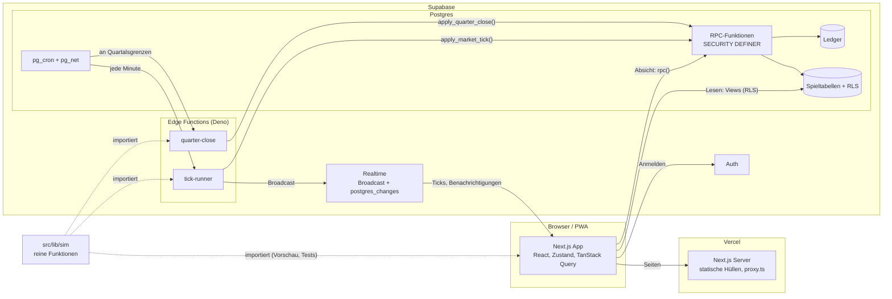
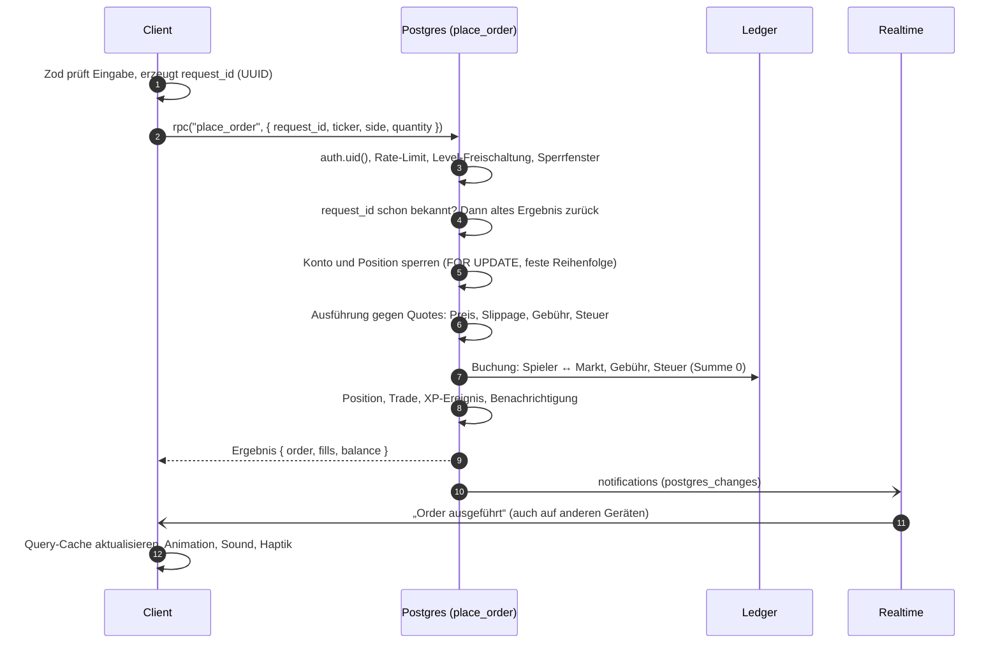
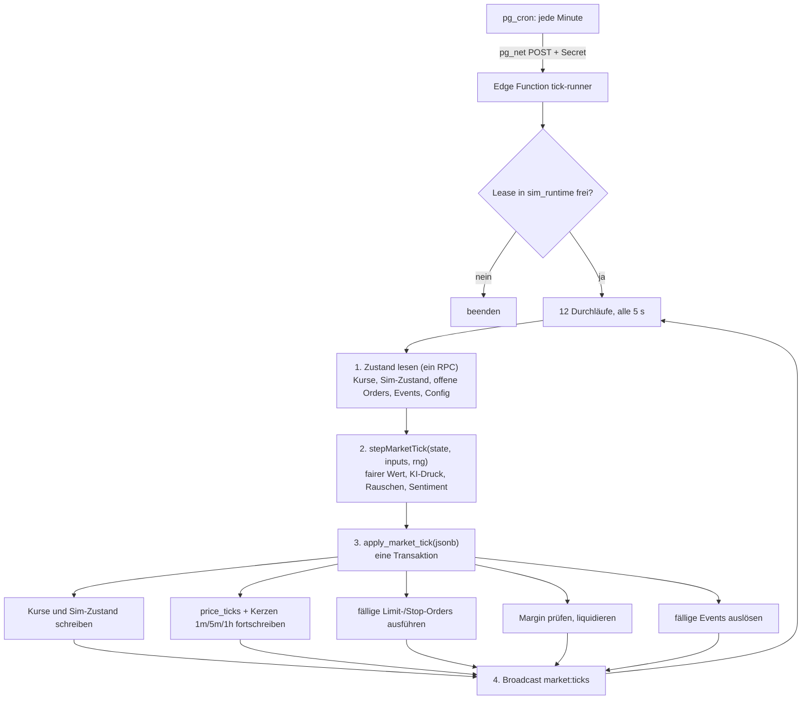
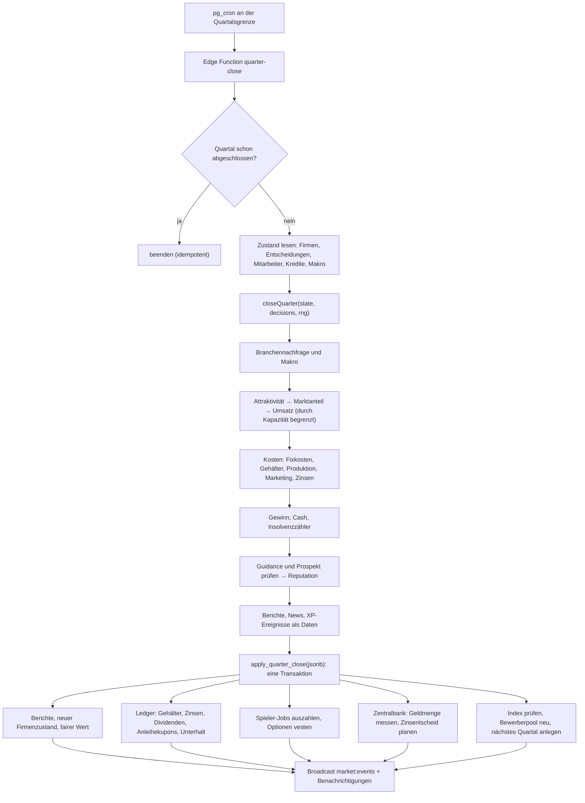

# Architektur

Wie NEXA aufgebaut ist, wie Daten fließen und wie Tick und Quartal ablaufen.
Begründungen stehen als ADRs in [`DECISIONS.md`](./DECISIONS.md), Tabellen in [`DATA_MODEL.md`](./DATA_MODEL.md),
Formeln in [`SIMULATION.md`](./SIMULATION.md).

## Inhalt

1. [Überblick](#1-überblick)
2. [Grundsätze](#2-grundsätze)
3. [Schichten und Ordner](#3-schichten-und-ordner)
4. [Datenfluss einer Spieleraktion](#4-datenfluss-einer-spieleraktion)
5. [Echtzeit](#5-echtzeit)
6. [Markt-Tick](#6-markt-tick)
7. [Quartalsabschluss](#7-quartalsabschluss)
8. [Zeit](#8-zeit)
9. [Anmeldung und Sitzung](#9-anmeldung-und-sitzung)
10. [Client-Architektur](#10-client-architektur)
11. [Sicherheit](#11-sicherheit)
12. [Betrieb und Skalierung](#12-betrieb-und-skalierung)
13. [Stand nach M0](#13-stand-nach-m0)

---

## 1. Überblick



Drei Orte, an denen Logik läuft:

| Ort                     | Was dort läuft                                                 | Warum dort                                                            |
| ----------------------- | -------------------------------------------------------------- | --------------------------------------------------------------------- |
| **Postgres-Funktionen** | Alles, was Geld, Bestände, XP oder Rechte ändert               | Transaktionen, Sperren, Constraints. Der einzige Ort, der buchen darf |
| **Edge Functions**      | Simulation: Kurse, KI-Investoren, Unternehmensquartale, Events | TypeScript aus `src/lib/sim`, testbar mit Vitest                      |
| **Client**              | Anzeige, Eingabe, Animation, optimistische Kleinigkeiten       | Hat nie das letzte Wort                                               |

## 2. Grundsätze

1. **Server-Autorität.** Der Client sendet Absichten („kaufe 10 VLT“), nie Ergebnisse („ich habe jetzt 10 VLT“).
2. **Geld ist ganzzahlig.** Cent als `bigint`, Kurse als `bigint` × 10 000 (ADR-003).
3. **Jede Geldbewegung steht im Ledger.** Doppelte Buchführung, unveränderlich (ADR-007).
4. **Simulation ist rein.** Gleiche Eingabe und gleicher Seed ergeben dasselbe Ergebnis (ADR-012).
5. **Balancing ist Konfiguration.** Kein Zahlenwert im Code außerhalb von `src/config/balance.ts` (ADR-009).
6. **Vier Spieler reichen.** Nichts setzt voraus, dass jemand online ist; die KI-Wirtschaft trägt den Markt.

## 3. Schichten und Ordner

```
src/
  app/                    Routen (App Router)
    (app)/                Spiel mit Navigation: Start, Portfolio, Märkte, Firma, Profil
    (auth)/               Anmelden, Registrieren
    dev/ui/               Komponenten-Showcase
  components/
    ui/                   Geteilte Bausteine (Button, Card, Sheet, …)
    pixel/                PixelIcon und Pixel-Art-Daten
    layout/               App-Hülle: Sidebar, TabBar, TopBar, Page
  features/               Fachlogik der Oberfläche, nach Feature
    market/ portfolio/ company/ career/ progression/ auth/ settings/
  lib/
    sim/                  Simulation: reine Funktionen, keine Abhängigkeiten
    supabase/             Clients (Browser, Server) und Umgebungsprüfung
    demo/                 Beispieldaten für den Demo-Modus (entfällt schrittweise ab M1)
    format.ts motion.ts sound.ts haptics.ts …
  config/                 balance.ts (Spielwerte), app.ts, navigation.ts
  stores/                 Zustand-Stores für UI-State
  styles/tokens.css       Design-Tokens
  proxy.ts                Sitzung erneuern, Seitenschutz
messages/de.json          Alle Texte
supabase/
  migrations/             Schema, RLS, Funktionen
  seed.sql                Stammdaten (Firmen, Erfolge, Jobs, …)
  functions/              Edge Functions (ab M1)
  tests/                  Lokale Schema-Prüfung
e2e/                      Playwright-Tests
docs/                     Diese Dokumente
```

Abhängigkeitsrichtung: `app` → `features` → `components` / `lib` → `config`. Features importieren sich nicht
gegenseitig tief; Gemeinsames wandert nach `components` oder `lib`. `lib/sim` importiert nur `config/balance.ts`.

## 4. Datenfluss einer Spieleraktion

Beispiel Market-Order (ab M1):



Wichtig:

- **Idempotenz:** Dieselbe `request_id` führt nie zweimal aus. Doppelklick und Netzwerk-Wiederholung sind harmlos.
- **Eine Transaktion:** Order, Buchung, Position und XP gelingen gemeinsam oder gar nicht.
- **Der Preis kommt vom Server.** Der Client zeigt eine Schätzung; verbindlich ist die Antwort.
- **Zod-Schemas** (z. B. `features/market/order-schema.ts`) geben schnelles Feedback. Die Datenbank prüft alles erneut.

Lesen läuft über Views und Tabellen mit RLS direkt aus dem Client (TanStack Query), ohne Umweg über den Next.js-Server.

> **Stand M1 (ADR-037):** Für die Alpha laufen Markt-Tick, Quartalsabschluss und Wartung als PL/pgSQL-Funktionen
> über `pg_cron` direkt in Postgres (`market_tick()` alle 5 Sekunden, `run_due_jobs()` jede Minute), weil sich alles
> per SQL Editor einspielen lassen muss. Der Client fragt `get_market_snapshot` im Tick-Takt ab statt Realtime zu
> abonnieren. Die Abschnitte 5 und 6 beschreiben die ursprünglich geplante Edge-Function-Variante; sie bleibt der Weg,
> wenn die Spielerzahl wächst. Funktionen, Fehlercodes und Jobs: `DATA_MODEL.md`, Abschnitt M1.

## 5. Echtzeit

| Kanal           | Technik                    | Inhalt                                                           | Empfänger                  |
| --------------- | -------------------------- | ---------------------------------------------------------------- | -------------------------- |
| `market:ticks`  | Broadcast                  | Pro Tick **eine** Nachricht: geänderte Kurse, Index, Tick-Nummer | Alle                       |
| `market:events` | Broadcast                  | Glocke, Zinsentscheid, Quartalszahlen, News-Schlagzeilen         | Alle                       |
| `notifications` | `postgres_changes` mit RLS | Order ausgeführt, XP, Margin Call, Jobangebot                    | Nur der betroffene Spieler |

Im Client:

1. Ein Abo pro Kanal, zentral in einem Provider.
2. Eingehende Ticks landen in einem Zustand-Store (kein React-State pro Zeile).
3. Komponenten abonnieren nur ihren Ticker (`useStore(s => s.quotes[ticker])`).
4. Zahlen laufen über `NumberTicker`, der direkt ins DOM schreibt. Höchstens ein Update pro Animation-Frame.
5. Nach Verbindungsabbruch: Snapshot per Query nachladen, dann weiter mit Ticks. Die Tick-Nummer zeigt Lücken.
6. Tab im Hintergrund: Abo bleibt, Animationen pausieren.

## 6. Markt-Tick

Entscheidung und Alternativen: ADR-004. Ablauf alle 5 Sekunden:



- **Lease:** Der Runner hält eine Zeile in `sim_runtime` mit Ablaufzeit. Ein zweiter Aufruf sieht die Lease und
  beendet sich. Stirbt der Runner, läuft die Lease ab, und der nächste Minutenaufruf übernimmt.
- **Determinismus:** Der Zufall je Tick und Aktie leitet sich aus (Seed, Tick-Nummer, Wertpapier) ab.
  Ein Tick lässt sich damit nachrechnen.
- **Nachholen:** Fällt der Runner aus, werden verpasste Ticks nicht einzeln nachgespielt. Der nächste Tick
  rechnet mit der tatsächlich vergangenen Zeit weiter (weniger Rauschen pro Sekunde, gleiche Drift).
- **Außerhalb der Börsenzeit** (22 bis 8 Uhr) läuft der Tick mit größerem Spread und dünnerer Liquidität weiter.
- **Kerzen:** `1m`, `5m`, `1h` schreibt der Tick fort. `1q` und `1y` entstehen beim Quartalsabschluss.
- **Kosten:** rund 43 000 Edge-Aufrufe pro Monat statt rund 520 000 bei einem Aufruf pro Tick.

## 7. Quartalsabschluss

An jeder Grenze aus `game_quarters` (08, 14, 20, 02 Uhr Berlin, ADR-006):



- **Idempotent:** Jedes Quartal hat einen Status. Ein zweiter Lauf für dasselbe Quartal ändert nichts.
- **Offline-Fortschritt:** Firmen, Gehälter und Zinsen brauchen niemanden online; der Abschluss läuft serverseitig.
  Das Grundeinkommen wird gar nicht periodisch gebucht, sondern beim Leeren aus der vergangenen Zeit berechnet
  (gedeckelt auf 8 Stunden).
- **Insider-Fenster:** Zwei Stunden vor der Grenze dürfen Mitarbeiter einer Firma deren Aktie nicht handeln.
  Das prüft `place_order` anhand von `insider_blackout_windows`.

## 8. Zeit

- Maßgeblich ist immer die Datenbankuhr (`now()`), nie die Uhr des Clients. Der Client zeigt Countdowns aus
  Server-Zeitpunkten.
- Spielzeit steht in `game_quarters` (explizite Zeilen), Börsenzeiten in der Konfiguration.
- Für Tests kann der Admin einen Zeitversatz setzen (`sim_runtime`), der in alle Zeitfunktionen einfließt.
- Tagesgrenzen (Limits, Streak, Missionen) wechseln um 00:00 Europe/Berlin.

## 9. Anmeldung und Sitzung

- Supabase Auth mit E-Mail und Passwort; Registrierung mit 18+-Bestätigung, ohne Einladungscode (ADR-114).
- Der Trigger `handle_new_user()` legt beim Anlegen des Auth-Nutzers Profil, Konto, Startkapital-Buchung und
  Standardeinstellungen an.
- `src/proxy.ts` erneuert das Sitzungs-Cookie und leitet nicht angemeldete Besucher auf `/login`. Das ist
  Komfort, nicht Schutz: Der Schutz ist RLS.
- **Demo-Modus** (ADR-015): Ohne Supabase-Variablen sind alle Seiten offen und zeigen Beispieldaten.
- Der `service_role`-Schlüssel wird in der Next.js-App nirgends verwendet. Er lebt nur in Edge Functions.

## 10. Client-Architektur

| Thema         | Lösung                                                                                                           |
| ------------- | ---------------------------------------------------------------------------------------------------------------- |
| Rendering     | Seiten sind statische Hüllen (`cacheComponents`), Daten kommen clientseitig. Dadurch sind Navigationen sofort da |
| Server-State  | TanStack Query (Lesen über Views, Schreiben über `rpc()`), Invalidierung nach Aktionen und über Realtime         |
| UI-State      | Zustand: Einstellungen (persistiert), Suche, Effekte, Live-Kurse                                                 |
| Optimistic UI | Nur für Unkritisches (Watchlist, Einstellungen) mit Rollback. Nie für Geld                                       |
| Übergänge     | React `<ViewTransition>`: Tab-Wechsel, Liste → Detail mit gleitendem Logo                                        |
| Charts        | TradingView Lightweight Charts (Apache 2.0), nachgeladen, Farben aus Tokens, Attributions-Logo sichtbar          |
| i18n          | `next-intl`, Texte in `messages/de.json`, Schlüssel typgeprüft                                                   |
| PWA           | Manifest, Icons, minimaler Service Worker (Offline-Seite). Web-Push in M8                                        |
| Fehler        | Toast mit verständlichem Text; RPC-Fehlercodes werden auf Textschlüssel abgebildet                               |

## 11. Sicherheit

| Risiko                | Maßnahme                                                                                         |
| --------------------- | ------------------------------------------------------------------------------------------------ |
| Manipulierter Client  | Keine Schreibrechte auf Spieltabellen; nur RPCs, die alles selbst prüfen                         |
| Fremde Daten lesen    | RLS auf allen Tabellen; öffentliche Sicht nur über Views mit unkritischen Spalten                |
| Kursanker auslesen    | Sim-Interna (`security_sim_state`, `ai_investor_holdings`, …) nur für `service_role`             |
| Doppelte Ausführung   | `request_id` je Aktion, eindeutiger Index                                                        |
| Race Conditions       | Zeilensperren in fester Reihenfolge, Geldlogik in einer Transaktion                              |
| Flooding              | Rate Limits je Spieler und Aktion (`rate_limits`)                                                |
| XP-Farming            | Tageslimits, Wash-Trading-Fenster, Mindestordergröße                                             |
| Multi-Accounts        | Einladungscodes, Login-Ereignisse, `suspicious_activity`, IPO-Limits für neue Konten             |
| Fremde Tick-Auslösung | Edge Functions prüfen ein Secret; `apply_*`-RPCs nur für `service_role`                          |
| Schlüssel im Client   | Nur der anon-Schlüssel hat das Präfix `NEXT_PUBLIC_`                                             |
| Echtgeld              | Es gibt keinen Zahlungsweg. Spätere Kosmetik hätte ein eigenes System ohne Verbindung zum Ledger |

## 12. Betrieb und Skalierung

| Stufe  | Spieler            | Änderungen                                                                                                                              |
| ------ | ------------------ | --------------------------------------------------------------------------------------------------------------------------------------- |
| Alpha  | 4 bis 20           | Wie beschrieben, Supabase Free/Pro, Vercel Hobby                                                                                        |
| Beta   | bis einige Hundert | Tick-Runner als dauerhafter Worker (gleicher Code, Node), `price_ticks` partitioniert mit Aufbewahrungsfrist, Lese-Views materialisiert |
| Danach | Tausende           | Broadcast nach Interesse aufteilen (Watchlist, offene Seite), Orderabgleich in eigenem Dienst, mehrere Märkte/Ligen als Mandanten       |

Beobachtung ab M1: Dauer und Verzug jedes Ticks (`sim_tick_log`), Fehler der Cron-Läufe (`job_runs`),
Geldmenge je Quartal (`money_supply_snapshots`), Ledger-Prüfsumme (Summe aller Einträge = 0).

## 13. Stand nach M0

| Bereich                                           | Stand                                                                                                                                                                                          |
| ------------------------------------------------- | ---------------------------------------------------------------------------------------------------------------------------------------------------------------------------------------------- |
| App-Gerüst, Tokens, Komponenten, 5 Tabs, Showcase | Umgesetzt, läuft im Demo-Modus mit Beispieldaten                                                                                                                                               |
| Anmeldung                                         | Oberfläche, Supabase-Clients und `proxy.ts` umgesetzt; gegen ein echtes Projekt noch nicht getestet                                                                                            |
| Datenbankschema, RLS, Seeds                       | Als Migrationen vorhanden, lokal gegen Postgres 16 geprüft; noch auf kein Supabase-Projekt angewendet                                                                                          |
| Simulation                                        | Typen, Formeln, Tick (`stepMarketTick`) und Quartal (`closeQuarter`) als reine Funktionen mit Tests; Parameter nur grob kalibriert, noch an keine Datenbank angebunden (siehe `SIMULATION.md`) |
| Edge Functions, Realtime, Cron                    | Entworfen (dieses Dokument), Umsetzung in M1                                                                                                                                                   |
