# Datenmodell

Vollständiges Postgres-Schema von NEXA für Supabase, ausgelegt bis einschließlich Meilenstein M8.
Quelle der Wahrheit sind die Migrationen in [`supabase/migrations`](../supabase/migrations) und die
Stammdaten in [`supabase/seed.sql`](../supabase/seed.sql). Die Abschnitte 3 und 4 dieses Dokuments werden
aus einer echten Datenbank erzeugt (`supabase/tools/gen_data_model.py`) und stimmen deshalb mit dem Schema überein.

<!-- BEGIN GENERATED:stats -->

Stand der Generierung: **132 Tabellen**, 18 Views, 81 Enums, 121 RLS-Policies, 437 Indizes, 35 Funktionen.

<!-- END GENERATED:stats -->

Inhalt:

1. [Konventionen](#1-konventionen)
2. [Zugriffsmodell und RLS](#2-zugriffsmodell-und-rls)
3. [Tabellen nach Domäne](#3-tabellen-nach-domäne)
4. [ER-Diagramme](#4-er-diagramme)
5. [Views](#5-views)
6. [Funktionen und RPCs](#6-funktionen-und-rpcs)
7. [Ledger im Detail](#7-ledger-im-detail)
8. [Spielzeit](#8-spielzeit)
9. [Stammdaten (Seed)](#9-stammdaten-seed)
10. [Migrationen, Cron und Aufbewahrung](#10-migrationen-cron-und-aufbewahrung)
11. [Offene Punkte](#11-offene-punkte)

---

## 1. Konventionen

### Einheiten (ADR-003)

| Größe                          | Typ                    | Suffix               | Beispiel                         |
| ------------------------------ | ---------------------- | -------------------- | -------------------------------- |
| Geld                           | `bigint`, Cent         | `_cents`             | `1000000` = 10.000,00 €          |
| Kurs                           | `bigint`, 1 € = 10 000 | `_e4`                | `840000` = 84,00 €               |
| Satz                           | `integer`, Basispunkte | `_bps`               | `300` = 3 %                      |
| Stückzahl                      | `bigint`, ganze Stücke | `quantity`, `shares` |                                  |
| Modellgröße ohne Geldcharakter | `double precision`     |                      | Qualität, Bekanntheit, Sentiment |

Es gibt in keiner Tabelle `numeric`, `real` oder `money`. Das prüft die lokale Verifikation.
Der Orderwert wird genau einmal gerundet: `gross_cents = round_half_even(quantity × price_e4 / 100)`.
Anleihekurse sind je 100 € Nennwert notiert (`1000000` = 100,0000 = pari).

### Namen, Schlüssel, Typen

- Alle Bezeichner und SQL-Kommentare sind englisch. Deutsch sind nur die Anzeigetexte in den Stammdaten.
- Tabellen im Plural und `snake_case`. Der Spieler heißt in Fremdschlüsseln immer `player_id` und zeigt auf `profiles.id`
  (das ist zugleich `auth.users.id`).
- Primärschlüssel: `uuid` (`gen_random_uuid()`) für Entitäten, `bigint identity` für Journale mit vielen Zeilen,
  sprechende `text`-Schlüssel für Kataloge (`sectors.key`, `achievements.key`, `unlocks.key`).
- **Enums** für geschlossene Wertemengen, die im Code verzweigen (`order_status`, `ledger_tx_kind`, `company_phase`).
  **Lookup-Tabellen** für Mengen, die Daten sind und Texte tragen (Branchen, Erfolge, Benachrichtigungsarten, Missionen).
- Zeitpunkte sind immer `timestamptz`. Jede Tabelle hat `created_at`; veränderliche Tabellen haben `updated_at`,
  gepflegt vom gemeinsamen Trigger `set_updated_at()`. Der Trigger wird in Migration 1400 automatisch an jede Tabelle
  mit dieser Spalte gehängt.
- Jeder Fremdschlüssel hat einen passenden Index. Auch das prüft die Verifikation.
- Kandidaten für kosmetische Käufe (später) liegen getrennt in `cosmetic_items`. Sie haben keinerlei Bezug zu Geld, Aktien oder XP.

### Idempotenz

Jede schreibende Spieleraktion trägt eine `request_id` (UUID vom Client):

- Tabellen, die eine Aktion direkt abbilden, haben `unique (player_id, request_id)`: `orders`, `vault_claims`,
  `player_lifestyle_items`, `capital_injections`, `player_jobs`, `work_tasks`, `salary_negotiations`,
  `shareholder_vote_ballots`, `ipo_subscriptions`, `loans` und weitere.
- Aktionen ohne eigene Tabelle nutzen das Journal `player_requests` über `request_begin()` und `request_complete()`.
- Buchungen im Ledger haben zusätzlich `ledger_transactions.idempotency_key`.

### Fehlercodes

RPCs melden fachliche Fehler mit eigenen SQLSTATEs. PostgREST reicht sie als `code` an den Client durch.

| SQLSTATE | Bedeutung                                                          |
| -------- | ------------------------------------------------------------------ |
| `NX001`  | Kontostand reicht nicht                                            |
| `NX002`  | Ledger-Transaktion nicht ausgeglichen oder weniger als zwei Zeilen |
| `NX003`  | Zeile ist unveränderlich                                           |
| `NX004`  | Rate Limit oder Zeilenlimit überschritten                          |
| `NX005`  | Einladungscode fehlt, ist ungültig oder verbraucht                 |
| `NX006`  | Nicht erlaubt (für kommende RPCs reserviert)                       |
| `NX007`  | Ungültiges Argument                                                |
| `NX008`  | Konto eingefroren                                                  |
| `NX009`  | Anfrage mit dieser `request_id` läuft noch                         |

---

## 2. Zugriffsmodell und RLS

### Grundsatz

RLS ist auf **jeder** Tabelle aktiv, auch auf den Partitionen von `price_ticks`. Die Rechte sind von Grund auf geschlossen:

- Migration 0100 nimmt `anon` und `authenticated` die Supabase-Standardrechte auf neue Objekte in `public` und entzieht
  `PUBLIC` das Standardrecht, neue Funktionen auszuführen.
- Migration 1400 entzieht noch einmal alles und vergibt dann gezielt. Jede Tabelle muss dort einer Kategorie zugeordnet sein,
  sonst bricht die Migration ab. Eine neue Tabelle kann also nicht versehentlich offen oder vergessen sein.
- `anon` hat **kein einziges Recht** in `public`: keine Tabelle, keine View, keine Funktion.
- `service_role` (Edge Functions, Tick-Runner, Next.js-Server) hat Vollzugriff und umgeht RLS.

### Gewählter Ansatz: spaltenreine Tabellen und `security_invoker`-Views

Jede Tabelle hat genau **eine** Sichtbarkeit. Spalten mit unterschiedlicher Sichtbarkeit stehen nie in derselben Tabelle.
Wo das Fachmodell beides enthält, ist es aufgeteilt:

| Öffentlich                                       | Privat oder intern                                                        |
| ------------------------------------------------ | ------------------------------------------------------------------------- |
| `profiles`                                       | `player_private`, `player_settings`                                       |
| `companies`                                      | `company_state`, `company_quarter_decisions`                              |
| `work_tasks` (Aufgabe)                           | `work_task_solutions` (Lösung)                                            |
| `league_entries` (Prozent, Platz)                | `league_entry_baselines` (Beträge)                                        |
| `scheduled_events`, `news_items`, `macro_events` | `scheduled_event_secrets`, `news_item_effects`, `macro_event_definitions` |
| `security_quotes`, `order_book_levels`           | `security_sim_state`, `ai_investor_holdings`                              |

Alle Views sind `security_invoker = true`. Sie erweitern den Zugriff nie, sondern liefern dem Client nur stabile,
fertig verknüpfte Formen. Die RLS-Policies der Basistabellen bleiben die einzige Stelle, an der Zugriff entschieden wird.

Warum nicht Definer-Views, die sichere Spalten aus gemischten Tabellen herausfiltern?

- Eine Definer-View umgeht RLS. Ein vergessener Filter oder eine später ergänzte Spalte legt sofort Daten offen.
  Der Supabase-Linter meldet solche Views deshalb als Sicherheitsproblem.
- Mit spaltenreinen Tabellen ist die Regel einfach zu prüfen: Eine sensible Spalte gehört nie in eine Tabelle der
  Kategorie `public_read`. Die Zuordnung steht an einer Stelle (Migration 1400).
- Realtime (`postgres_changes`) wertet RLS der Basistabelle aus. Das passt ohne Sonderfälle.

Daten, die Privatsphäre-Grenzen kreuzen (Portfolio eines Freundes, Orderbuch aus fremden Limit-Orders, Rangliste),
kommen nicht aus Views, sondern aus vom Server geschriebenen Tabellen ohne Personenbezug (`order_book_levels`,
`league_entries`) oder später aus `SECURITY DEFINER`-RPCs mit eigener Prüfung (`get_player_portfolio`).

### Kategorien

| Kategorie     | Lesen (`authenticated`)                                                  | Schreiben (`authenticated`)     |
| ------------- | ------------------------------------------------------------------------ | ------------------------------- |
| `public_read` | alle Zeilen, alle Spalten                                                | nein                            |
| `owner_read`  | nur `player_id = auth.uid()`                                             | nein, außer den Ausnahmen unten |
| `custom`      | eigene Policy je Tabelle (Beteiligte, Insider, Zeitpunkt, Freischaltung) | nein                            |
| `admin_read`  | nur wenn `is_admin()`                                                    | nein                            |
| `internal`    | kein Grant, keine Policy                                                 | nein                            |

**`public_read` (49):** `game_config_public_keys`, `game_quarters`, `market_status`, `levels`, `unlocks`, `achievements`,
`cosmetic_items`, `lifestyle_items`, `mission_templates`, `profiles`, `player_lifestyle_items`, `sectors`, `securities`,
`bonds`, `option_contracts`, `indices`, `index_memberships`, `security_quotes`, `price_ticks`, `candles`,
`order_book_levels`, `security_distributions`, `central_bank_state`, `central_bank_decisions`, `macro_indicators`,
`macro_indicator_history`, `companies`, `sector_quarter_stats`, `company_events`, `employee_traits`,
`cap_table_entries`, `share_issuances`, `share_lockups`, `insolvency_proceedings`, `ipos`,
`ipo_prospectus_forecasts`, `ipo_use_of_proceeds`, `guidance`, `shareholder_votes`, `corporate_actions`,
`reputation_events`, `insider_blackout_windows`, `job_definitions`, `work_task_definitions`, `league_seasons`,
`league_entries`, `notification_types`, `scheduled_events`, `macro_events`.

**`owner_read` (33):** `player_private`, `player_settings`, `player_unlocks`, `xp_events`, `xp_daily_counters`, `vaults`,
`vault_claims`, `login_streaks`, `daily_logins`, `player_missions`, `player_cosmetics`, `player_random_events`,
`player_bankruptcies`, `orders`, `positions`, `trades`, `position_lots`, `margin_events`, `financing_charges`,
`player_tax_years`, `distribution_payouts`, `watchlist_items`, `portfolio_snapshots`, `capital_injections`,
`ipo_subscriptions`, `shareholder_vote_ballots`, `player_jobs`, `salary_payouts`, `work_tasks`, `salary_negotiations`,
`notifications`, `notification_preferences`, `push_subscriptions`.

**`admin_read` (4):** `admin_actions`, `suspicious_activity`, `invite_codes`, `money_supply_snapshots`.

**`internal` (23):** `admin_users`, `internal_settings`, `sim_runtime`, `sim_rng_streams`, `sim_tick_log`, `job_runs`,
`invite_code_redemptions`, `random_event_definitions`, `sector_sim_state`, `security_sim_state`, `ai_investors`,
`ai_investor_holdings`, `insider_violations`, `work_task_solutions`, `league_entry_baselines`, `push_deliveries`,
`scheduled_event_secrets`, `macro_event_definitions`, `news_templates`, `news_item_effects`, `rate_limits`,
`player_requests`, `player_login_events`.

**`custom` (23):**

| Tabelle                                                    | Wer darf lesen                                                                                    |
| ---------------------------------------------------------- | ------------------------------------------------------------------------------------------------- |
| `game_config`                                              | Schlüssel aus `game_config_public_keys`; Admins alles                                             |
| `player_achievements`                                      | freigeschaltete Erfolge alle, Fortschritt nur der Besitzer                                        |
| `analyst_ratings`                                          | nur mit Freischaltung `analyst_reports` (Level 7) und erst ab `published_at`                      |
| `ledger_accounts`                                          | eigene Konten und Konten von Firmen, bei denen man Insider ist                                    |
| `ledger_entries`                                           | Zeilen auf diesen Konten (`owns_ledger_account`)                                                  |
| `ledger_transactions`                                      | Transaktionen, die eines dieser Konten berühren                                                   |
| `company_state`, `company_quarter_decisions`, `applicants` | Insider der Firma                                                                                 |
| `employees`                                                | Insider der Firma und der Spieler-Mitarbeiter selbst                                              |
| `poaching_offers`                                          | Insider der abwerbenden Firma                                                                     |
| `company_products`                                         | aktive Produkte alle, Entwicklung nur Insider                                                     |
| `company_quarter_reports`                                  | alle ab `published_at`, Insider schon vorher (Insider-Regel)                                      |
| `stock_option_grants`                                      | Inhaber und Insider der Firma                                                                     |
| `stock_option_vesting_events`                              | wer den zugehörigen Grant sieht                                                                   |
| `loans`                                                    | Kreditnehmer (Spieler) oder Insider der Firma                                                     |
| `loan_payments`                                            | wer den Kredit sieht                                                                              |
| `takeover_offers`                                          | Bieter und Insider von Ziel- oder Bieterfirma                                                     |
| `angel_offers`                                             | Ersteller, angesprochener Investor, Insider der Firma, dazu offene Angebote ohne festen Empfänger |
| `job_offers`                                               | Empfänger, Absender, Insider der Firma                                                            |
| `friendships`                                              | die beiden Beteiligten                                                                            |
| `feed_items`                                               | öffentliche Einträge, eigene Einträge, Einträge von Freunden                                      |
| `news_items`                                               | ab `published_at`                                                                                 |

„Insider“ einer Firma ist, wer Gründer, CEO oder aktiver Spieler-Mitarbeiter ist (`is_company_insider()`).
KI-Firmen haben keine Insider, ihr `company_state` ist damit für Spieler unsichtbar.

### Direkte Schreibrechte des Clients

Nur dort, wo ein Schreibzugriff keine Spielwirkung hat. Jeweils Spalten-Grant plus Policy `player_id = auth.uid()`:

| Tabelle                    | Erlaubt                | Spalten                                                                                                                                                             |
| -------------------------- | ---------------------- | ------------------------------------------------------------------------------------------------------------------------------------------------------------------- |
| `player_settings`          | UPDATE                 | `theme`, `chart_style`, `locale`, `sounds_enabled`, `animations_enabled`, `haptics_enabled`, `portfolio_visibility`, `show_playtime`, `hold_to_confirm`, `ui_state` |
| `watchlist_items`          | INSERT, UPDATE, DELETE | `player_id`, `security_id`, `sort_order` (höchstens 200 Zeilen je Spieler)                                                                                          |
| `notifications`            | UPDATE                 | nur `read_at` (einmal gelesen bleibt gelesen)                                                                                                                       |
| `notification_preferences` | INSERT, UPDATE         | `in_app_enabled`, `push_enabled`                                                                                                                                    |
| `push_subscriptions`       | INSERT, UPDATE, DELETE | `endpoint`, `p256dh`, `auth_key`, `user_agent`, `revoked_at` (höchstens 10 Zeilen je Spieler)                                                                       |
| `player_unlocks`           | UPDATE                 | nur `seen_at`                                                                                                                                                       |
| `player_achievements`      | UPDATE                 | nur `seen_at`                                                                                                                                                       |

Alles andere läuft über `SECURITY DEFINER`-Funktionen mit `set search_path = ''` und voll qualifizierten Namen.

### Admin

Admins stehen in `admin_users`. Die Tabelle ist `internal`, es gibt keinen Weg, sie vom Client aus zu schreiben, und kein
Flag in einer vom Spieler lesbaren oder änderbaren Tabelle. `is_admin()` prüft die Mitgliedschaft.
Auch Admins schreiben nie direkt, sondern über `admin_*`-RPCs, die jede Aktion in `admin_actions` protokollieren.
Der erste Admin wird einmalig per SQL eingetragen (siehe `supabase/README.md`).

---

## 3. Tabellen nach Domäne

Erzeugt aus dem Datenbankkatalog. „Pflicht“ bedeutet `NOT NULL`. Bei „Zugriff“ stehen die RLS-Policies für `authenticated`.

<!-- BEGIN GENERATED:tables -->

### 3.1 Konfiguration, Laufzeit und Spielzeit

9 Tabellen.

#### `game_config`

Balancing-Werte zur Laufzeit, ein JSON-Dokument je Bereich (ADR-009). Wird aus `src/config/balance.ts` erzeugt.

Zugriff für `authenticated`: SELECT „public keys or admin“

| Spalte        | Typ           | Pflicht | Hinweis         |
| ------------- | ------------- | ------- | --------------- |
| `key`         | `text`        | ja      | PK              |
| `value`       | `jsonb`       | ja      |                 |
| `description` | `text`        |         |                 |
| `updated_at`  | `timestamptz` | ja      | Default `now()` |
| `updated_by`  | `uuid`        |         | FK → `users.id` |

#### `game_config_public_keys`

Allowlist der `game_config`-Schlüssel, die Spieler lesen dürfen (Gebühren, Steuersatz, Tresorgröße).

Zugriff für `authenticated`: SELECT „public read“

| Spalte       | Typ           | Pflicht | Hinweis         |
| ------------ | ------------- | ------- | --------------- |
| `key`        | `text`        | ja      | PK              |
| `created_at` | `timestamptz` | ja      | Default `now()` |

#### `game_quarters`

Spielkalender (ADR-006): jedes Quartal als Zeile mit Beginn, Ende und Status.

Zugriff für `authenticated`: SELECT „public read“

| Spalte             | Typ              | Pflicht | Hinweis                |
| ------------------ | ---------------- | ------- | ---------------------- |
| `id`               | `bigint`         | ja      | PK, Default `identity` |
| `game_year`        | `integer`        | ja      |                        |
| `quarter`          | `smallint`       | ja      |                        |
| `starts_at`        | `timestamptz`    | ja      |                        |
| `ends_at`          | `timestamptz`    | ja      |                        |
| `status`           | `quarter_status` | ja      | Default `'scheduled'`  |
| `close_started_at` | `timestamptz`    |         |                        |
| `closed_at`        | `timestamptz`    |         |                        |
| `created_at`       | `timestamptz`    | ja      | Default `now()`        |
| `updated_at`       | `timestamptz`    | ja      | Default `now()`        |

#### `internal_settings`

Server-Einstellungen als Ersatz für Supabase Vault (URL und Secret der Edge Functions).

Zugriff für `authenticated`: `internal` (nur `service_role`)

| Spalte       | Typ           | Pflicht | Hinweis         |
| ------------ | ------------- | ------- | --------------- |
| `key`        | `text`        | ja      | PK              |
| `value`      | `text`        | ja      |                 |
| `updated_at` | `timestamptz` | ja      | Default `now()` |

#### `job_runs`

Genau-einmal-Schutz für Cron-Jobs wie den Quartalsabschluss (`job_name` + `run_key` eindeutig).

Zugriff für `authenticated`: `internal` (nur `service_role`)

| Spalte        | Typ              | Pflicht | Hinweis                |
| ------------- | ---------------- | ------- | ---------------------- |
| `id`          | `bigint`         | ja      | PK, Default `identity` |
| `job_name`    | `text`           | ja      |                        |
| `run_key`     | `text`           | ja      |                        |
| `status`      | `job_run_status` | ja      | Default `'running'`    |
| `started_at`  | `timestamptz`    | ja      | Default `now()`        |
| `finished_at` | `timestamptz`    |         |                        |
| `details`     | `jsonb`          | ja      | Default `'{}'`         |
| `error`       | `text`           |         |                        |

#### `market_status`

Singleton mit öffentlicher Börsenphase (vorbörslich, offen, nachbörslich) und letztem Tick.

Zugriff für `authenticated`: SELECT „public read“

| Spalte             | Typ            | Pflicht | Hinweis            |
| ------------------ | -------------- | ------- | ------------------ |
| `id`               | `boolean`      | ja      | PK, Default `true` |
| `phase`            | `market_phase` | ja      | Default `'closed'` |
| `phase_changed_at` | `timestamptz`  | ja      | Default `now()`    |
| `next_open_at`     | `timestamptz`  |         |                    |
| `next_close_at`    | `timestamptz`  |         |                    |
| `tick_seq`         | `bigint`       | ja      | Default `0`        |
| `last_tick_at`     | `timestamptz`  |         |                    |
| `is_halted`        | `boolean`      | ja      | Default `false`    |
| `halt_reason`      | `text`         |         |                    |
| `updated_at`       | `timestamptz`  | ja      | Default `now()`    |

#### `sim_rng_streams`

Gespeicherter Zustand der Zufallsgeneratoren je Strom, damit Ticks reproduzierbar sind (ADR-012).

Zugriff für `authenticated`: `internal` (nur `service_role`)

| Spalte       | Typ           | Pflicht | Hinweis         |
| ------------ | ------------- | ------- | --------------- |
| `stream_key` | `text`        | ja      | PK              |
| `seed`       | `bigint`      | ja      |                 |
| `state`      | `jsonb`       | ja      | Default `'{}'`  |
| `draws`      | `bigint`      | ja      | Default `0`     |
| `updated_at` | `timestamptz` | ja      | Default `now()` |

#### `sim_runtime`

Singleton: Lease des Tick-Runners, Tick-Zähler, Admin-Zeitversatz, Spiel-Epoche.

Zugriff für `authenticated`: `internal` (nur `service_role`)

| Spalte             | Typ           | Pflicht | Hinweis              |
| ------------------ | ------------- | ------- | -------------------- |
| `id`               | `boolean`     | ja      | PK, Default `true`   |
| `lease_holder`     | `uuid`        |         |                      |
| `lease_expires_at` | `timestamptz` |         |                      |
| `tick_seq`         | `bigint`      | ja      | Default `0`          |
| `last_tick_at`     | `timestamptz` |         |                      |
| `time_offset`      | `interval`    | ja      | Default `'00:00:00'` |
| `game_epoch_date`  | `date`        |         |                      |
| `is_paused`        | `boolean`     | ja      | Default `false`      |
| `state`            | `jsonb`       | ja      | Default `'{}'`       |
| `created_at`       | `timestamptz` | ja      | Default `now()`      |
| `updated_at`       | `timestamptz` | ja      | Default `now()`      |

#### `sim_tick_log`

Ein Eintrag pro Markt-Tick für Monitoring (Dauer, Fehler). Kurze Aufbewahrung.

Zugriff für `authenticated`: `internal` (nur `service_role`)

| Spalte               | Typ           | Pflicht | Hinweis         |
| -------------------- | ------------- | ------- | --------------- |
| `tick_seq`           | `bigint`      | ja      | PK              |
| `runner_id`          | `uuid`        |         |                 |
| `started_at`         | `timestamptz` | ja      | Default `now()` |
| `duration_ms`        | `integer`     |         |                 |
| `securities_updated` | `integer`     |         |                 |
| `orders_filled`      | `integer`     |         |                 |
| `error`              | `text`        |         |                 |

### 3.2 Ledger (doppelte Buchführung)

3 Tabellen.

#### `ledger_accounts`

Konten für Spieler, Firmen und System (Quellen und Senken). `balance_cents` ist ein per Trigger gepflegter Cache.

Zugriff für `authenticated`: SELECT „own accounts“

| Spalte             | Typ                   | Pflicht | Hinweis                         |
| ------------------ | --------------------- | ------- | ------------------------------- |
| `id`               | `uuid`                | ja      | PK, Default `gen_random_uuid()` |
| `kind`             | `ledger_account_kind` | ja      |                                 |
| `owner_player_id`  | `uuid`                |         | FK → `profiles.id`              |
| `owner_company_id` | `uuid`                |         | FK → `companies.id`             |
| `system_key`       | `text`                |         |                                 |
| `label`            | `text`                |         |                                 |
| `balance_cents`    | `bigint`              | ja      | Default `0`                     |
| `allow_negative`   | `boolean`             | ja      | Default `false`                 |
| `is_frozen`        | `boolean`             | ja      | Default `false`                 |
| `created_at`       | `timestamptz`         | ja      | Default `now()`                 |
| `updated_at`       | `timestamptz`         | ja      | Default `now()`                 |

#### `ledger_entries`

Buchungszeilen. Summe je Transaktion ist 0, kein UPDATE/DELETE.

Zugriff für `authenticated`: SELECT „entries of own accounts“

| Spalte                | Typ           | Pflicht | Hinweis                       |
| --------------------- | ------------- | ------- | ----------------------------- |
| `id`                  | `bigint`      | ja      | PK, Default `identity`        |
| `transaction_id`      | `uuid`        | ja      | FK → `ledger_transactions.id` |
| `account_id`          | `uuid`        | ja      | FK → `ledger_accounts.id`     |
| `amount_cents`        | `bigint`      | ja      |                               |
| `balance_after_cents` | `bigint`      | ja      |                               |
| `created_at`          | `timestamptz` | ja      | Default `now()`               |

#### `ledger_transactions`

Kopf einer Buchung mit Art, Bezug und Idempotenzschlüssel. Unveränderlich.

Zugriff für `authenticated`: SELECT „transactions of own accounts“

| Spalte            | Typ              | Pflicht | Hinweis                         |
| ----------------- | ---------------- | ------- | ------------------------------- |
| `id`              | `uuid`           | ja      | PK, Default `gen_random_uuid()` |
| `kind`            | `ledger_tx_kind` | ja      |                                 |
| `description`     | `text`           |         |                                 |
| `ref_type`        | `text`           |         |                                 |
| `ref_id`          | `uuid`           |         |                                 |
| `game_quarter_id` | `bigint`         |         | FK → `game_quarters.id`         |
| `initiated_by`    | `uuid`           |         | FK → `profiles.id`              |
| `idempotency_key` | `text`           |         |                                 |
| `metadata`        | `jsonb`          | ja      | Default `'{}'`                  |
| `db_txid`         | `bigint`         | ja      | Default `txid_current()`        |
| `created_at`      | `timestamptz`    | ja      | Default `now()`                 |

### 3.3 Spieler, Fortschritt und Belohnungen

25 Tabellen.

#### `achievements`

Katalog der Erfolge mit Pixel-Icon-Schlüssel und XP-Belohnung.

Zugriff für `authenticated`: SELECT „public read“

| Spalte        | Typ           | Pflicht | Hinweis         |
| ------------- | ------------- | ------- | --------------- |
| `key`         | `text`        | ja      | PK              |
| `title`       | `text`        | ja      |                 |
| `description` | `text`        | ja      |                 |
| `icon_key`    | `text`        | ja      |                 |
| `category`    | `text`        | ja      |                 |
| `metric`      | `text`        |         |                 |
| `threshold`   | `bigint`      |         |                 |
| `xp_reward`   | `integer`     | ja      |                 |
| `is_hidden`   | `boolean`     | ja      | Default `false` |
| `sort_order`  | `integer`     | ja      | Default `0`     |
| `created_at`  | `timestamptz` | ja      | Default `now()` |

#### `cosmetic_items`

Katalog kosmetischer Teile: Avatar-Teile, Profilrahmen, Titel. Nie käuflich.

Zugriff für `authenticated`: SELECT „public read“

| Spalte                   | Typ             | Pflicht | Hinweis                 |
| ------------------------ | --------------- | ------- | ----------------------- |
| `key`                    | `text`          | ja      | PK                      |
| `kind`                   | `cosmetic_kind` | ja      |                         |
| `slot`                   | `text`          |         |                         |
| `title`                  | `text`          | ja      |                         |
| `icon_key`               | `text`          | ja      |                         |
| `unlock_level`           | `integer`       |         | FK → `levels.level`     |
| `unlock_achievement_key` | `text`          |         | FK → `achievements.key` |
| `is_default`             | `boolean`       | ja      | Default `false`         |
| `sort_order`             | `integer`       | ja      | Default `0`             |
| `created_at`             | `timestamptz`   | ja      | Default `now()`         |

#### `daily_logins`

Ein Eintrag je Spieler und Kalendertag mit dem ausgezahlten Bonus.

Zugriff für `authenticated`: SELECT „owner read“

| Spalte        | Typ           | Pflicht | Hinweis                |
| ------------- | ------------- | ------- | ---------------------- |
| `player_id`   | `uuid`        | ja      | PK, FK → `profiles.id` |
| `login_day`   | `date`        | ja      | PK                     |
| `streak_day`  | `integer`     | ja      |                        |
| `xp_awarded`  | `integer`     | ja      | Default `0`            |
| `freeze_used` | `boolean`     | ja      | Default `false`        |
| `created_at`  | `timestamptz` | ja      | Default `now()`        |

#### `invite_code_redemptions`

Welcher Spieler welchen Einladungscode eingelöst hat.

Zugriff für `authenticated`: `internal` (nur `service_role`)

| Spalte        | Typ           | Pflicht | Hinweis                  |
| ------------- | ------------- | ------- | ------------------------ |
| `id`          | `bigint`      | ja      | PK, Default `identity`   |
| `code`        | `text`        | ja      | FK → `invite_codes.code` |
| `player_id`   | `uuid`        | ja      | FK → `profiles.id`       |
| `redeemed_at` | `timestamptz` | ja      | Default `now()`          |

#### `invite_codes`

Einladungscodes der geschlossenen Alpha (ADR-010).

Zugriff für `authenticated`: SELECT „admin read“

| Spalte       | Typ           | Pflicht | Hinweis         |
| ------------ | ------------- | ------- | --------------- |
| `code`       | `text`        | ja      | PK              |
| `max_uses`   | `integer`     | ja      | Default `1`     |
| `used_count` | `integer`     | ja      | Default `0`     |
| `is_active`  | `boolean`     | ja      | Default `true`  |
| `expires_at` | `timestamptz` |         |                 |
| `note`       | `text`        |         |                 |
| `created_by` | `uuid`        |         | FK → `users.id` |
| `created_at` | `timestamptz` | ja      | Default `now()` |
| `updated_at` | `timestamptz` | ja      | Default `now()` |

#### `levels`

XP-Kurve für Level 1 bis 50.

Zugriff für `authenticated`: SELECT „public read“

| Spalte          | Typ           | Pflicht | Hinweis         |
| --------------- | ------------- | ------- | --------------- |
| `level`         | `integer`     | ja      | PK              |
| `xp_to_next`    | `bigint`      |         |                 |
| `xp_cumulative` | `bigint`      | ja      |                 |
| `created_at`    | `timestamptz` | ja      | Default `now()` |

#### `lifestyle_items`

Kaufbare Statussymbole mit Unterhaltskosten (Geldsenke).

Zugriff für `authenticated`: SELECT „public read“

| Spalte                     | Typ           | Pflicht | Hinweis         |
| -------------------------- | ------------- | ------- | --------------- |
| `key`                      | `text`        | ja      | PK              |
| `title`                    | `text`        | ja      |                 |
| `description`              | `text`        | ja      |                 |
| `icon_key`                 | `text`        | ja      |                 |
| `price_cents`              | `bigint`      | ja      |                 |
| `upkeep_cents_per_quarter` | `bigint`      | ja      |                 |
| `resale_bps`               | `integer`     | ja      | Default `6000`  |
| `reputation_bonus`         | `smallint`    | ja      | Default `0`     |
| `min_level`                | `integer`     | ja      | Default `1`     |
| `sort_order`               | `integer`     | ja      | Default `0`     |
| `is_active`                | `boolean`     | ja      | Default `true`  |
| `created_at`               | `timestamptz` | ja      | Default `now()` |
| `updated_at`               | `timestamptz` | ja      | Default `now()` |

#### `login_streaks`

Login-Serie mit einem Streak-Schutz pro Woche.

Zugriff für `authenticated`: SELECT „owner read“

| Spalte                | Typ           | Pflicht | Hinweis                |
| --------------------- | ------------- | ------- | ---------------------- |
| `player_id`           | `uuid`        | ja      | PK, FK → `profiles.id` |
| `current_streak`      | `integer`     | ja      | Default `0`            |
| `longest_streak`      | `integer`     | ja      | Default `0`            |
| `last_login_day`      | `date`        |         |                        |
| `freeze_tokens`       | `smallint`    | ja      | Default `1`            |
| `freeze_granted_week` | `date`        |         |                        |
| `created_at`          | `timestamptz` | ja      | Default `now()`        |
| `updated_at`          | `timestamptz` | ja      | Default `now()`        |

#### `mission_templates`

Vorlagen für tägliche Missionen, Wochen-Challenges und Einstiegsmissionen.

Zugriff für `authenticated`: SELECT „public read“

| Spalte                | Typ            | Pflicht | Hinweis            |
| --------------------- | -------------- | ------- | ------------------ |
| `key`                 | `text`         | ja      | PK                 |
| `kind`                | `mission_kind` | ja      |                    |
| `title`               | `text`         | ja      |                    |
| `description`         | `text`         | ja      |                    |
| `icon_key`            | `text`         | ja      |                    |
| `metric`              | `text`         | ja      |                    |
| `target_min`          | `bigint`       | ja      |                    |
| `target_max`          | `bigint`       | ja      |                    |
| `xp_min`              | `integer`      | ja      |                    |
| `xp_max`              | `integer`      | ja      |                    |
| `reward_cents`        | `bigint`       | ja      | Default `0`        |
| `min_level`           | `integer`      | ja      | Default `1`        |
| `required_unlock_key` | `text`         |         | FK → `unlocks.key` |
| `weight`              | `integer`      | ja      | Default `100`      |
| `is_active`           | `boolean`      | ja      | Default `true`     |
| `created_at`          | `timestamptz`  | ja      | Default `now()`    |
| `updated_at`          | `timestamptz`  | ja      | Default `now()`    |

#### `player_achievements`

Fortschritt und Freischaltung der Erfolge je Spieler.

Zugriff für `authenticated`: SELECT „unlocked or own“; UPDATE „owner mark seen“

| Spalte            | Typ           | Pflicht | Hinweis                     |
| ----------------- | ------------- | ------- | --------------------------- |
| `player_id`       | `uuid`        | ja      | PK, FK → `profiles.id`      |
| `achievement_key` | `text`        | ja      | PK, FK → `achievements.key` |
| `progress`        | `bigint`      | ja      | Default `0`                 |
| `unlocked_at`     | `timestamptz` |         |                             |
| `seen_at`         | `timestamptz` |         |                             |
| `created_at`      | `timestamptz` | ja      | Default `now()`             |
| `updated_at`      | `timestamptz` | ja      | Default `now()`             |

#### `player_bankruptcies`

Historie der Spielerpleiten mit Neustartkapital und Malus.

Zugriff für `authenticated`: SELECT „owner read“

| Spalte                   | Typ           | Pflicht | Hinweis                         |
| ------------------------ | ------------- | ------- | ------------------------------- |
| `id`                     | `uuid`        | ja      | PK, Default `gen_random_uuid()` |
| `player_id`              | `uuid`        | ja      | FK → `profiles.id`              |
| `net_worth_before_cents` | `bigint`      | ja      |                                 |
| `restart_capital_cents`  | `bigint`      | ja      |                                 |
| `reputation_delta`       | `smallint`    | ja      | Default `0`                     |
| `malus_until`            | `timestamptz` |         |                                 |
| `ledger_transaction_id`  | `uuid`        |         | FK → `ledger_transactions.id`   |
| `created_at`             | `timestamptz` | ja      | Default `now()`                 |

#### `player_cosmetics`

Kosmetische Teile, die ein Spieler besitzt.

Zugriff für `authenticated`: SELECT „owner read“

| Spalte         | Typ           | Pflicht | Hinweis                       |
| -------------- | ------------- | ------- | ----------------------------- |
| `player_id`    | `uuid`        | ja      | PK, FK → `profiles.id`        |
| `cosmetic_key` | `text`        | ja      | PK, FK → `cosmetic_items.key` |
| `source`       | `text`        | ja      | Default `'level'`             |
| `granted_at`   | `timestamptz` | ja      | Default `now()`               |
| `expires_at`   | `timestamptz` |         |                               |

#### `player_lifestyle_items`

Statussymbole im Besitz eines Spielers. Im Profil öffentlich sichtbar.

Zugriff für `authenticated`: SELECT „public read“

| Spalte                   | Typ                | Pflicht | Hinweis                         |
| ------------------------ | ------------------ | ------- | ------------------------------- |
| `id`                     | `uuid`             | ja      | PK, Default `gen_random_uuid()` |
| `player_id`              | `uuid`             | ja      | FK → `profiles.id`              |
| `item_key`               | `text`             | ja      | FK → `lifestyle_items.key`      |
| `request_id`             | `uuid`             | ja      |                                 |
| `status`                 | `lifestyle_status` | ja      | Default `'owned'`               |
| `purchase_price_cents`   | `bigint`           | ja      |                                 |
| `purchased_at`           | `timestamptz`      | ja      | Default `now()`                 |
| `last_upkeep_quarter_id` | `bigint`           |         | FK → `game_quarters.id`         |
| `missed_upkeep_count`    | `smallint`         | ja      | Default `0`                     |
| `sold_at`                | `timestamptz`      |         |                                 |
| `sale_price_cents`       | `bigint`           |         |                                 |
| `created_at`             | `timestamptz`      | ja      | Default `now()`                 |
| `updated_at`             | `timestamptz`      | ja      | Default `now()`                 |

#### `player_missions`

Missionen eines Spielers je Zeitraum mit Fortschritt und Belohnung.

Zugriff für `authenticated`: SELECT „owner read“

| Spalte         | Typ              | Pflicht | Hinweis                         |
| -------------- | ---------------- | ------- | ------------------------------- |
| `id`           | `uuid`           | ja      | PK, Default `gen_random_uuid()` |
| `player_id`    | `uuid`           | ja      | FK → `profiles.id`              |
| `template_key` | `text`           | ja      | FK → `mission_templates.key`    |
| `kind`         | `mission_kind`   | ja      |                                 |
| `period_start` | `date`           | ja      |                                 |
| `target`       | `bigint`         | ja      |                                 |
| `progress`     | `bigint`         | ja      | Default `0`                     |
| `xp_reward`    | `integer`        | ja      | Default `0`                     |
| `reward_cents` | `bigint`         | ja      | Default `0`                     |
| `status`       | `mission_status` | ja      | Default `'active'`              |
| `expires_at`   | `timestamptz`    |         |                                 |
| `completed_at` | `timestamptz`    |         |                                 |
| `claimed_at`   | `timestamptz`    |         |                                 |
| `created_at`   | `timestamptz`    | ja      | Default `now()`                 |
| `updated_at`   | `timestamptz`    | ja      | Default `now()`                 |

#### `player_private`

Privater Spielerzustand: Altersbestätigung, Gründungssperre, Berufserfahrung, Spielzeit.

Zugriff für `authenticated`: SELECT „owner read“

| Spalte                       | Typ           | Pflicht | Hinweis                |
| ---------------------------- | ------------- | ------- | ---------------------- |
| `player_id`                  | `uuid`        | ja      | PK, FK → `profiles.id` |
| `age_confirmed_at`           | `timestamptz` |         |                        |
| `founding_ban_until`         | `timestamptz` |         |                        |
| `bankruptcy_count`           | `integer`     | ja      | Default `0`            |
| `career_experience_minutes`  | `bigint`      | ja      | Default `0`            |
| `playtime_seconds`           | `bigint`      | ja      | Default `0`            |
| `last_seen_at`               | `timestamptz` |         |                        |
| `ipo_investment_limit_cents` | `bigint`      |         |                        |
| `created_at`                 | `timestamptz` | ja      | Default `now()`        |
| `updated_at`                 | `timestamptz` | ja      | Default `now()`        |

#### `player_random_events`

Zufallsereignisse, die einem Spieler passiert sind.

Zugriff für `authenticated`: SELECT „owner read“

| Spalte                  | Typ                   | Pflicht | Hinweis                             |
| ----------------------- | --------------------- | ------- | ----------------------------------- |
| `id`                    | `uuid`                | ja      | PK, Default `gen_random_uuid()`     |
| `player_id`             | `uuid`                | ja      | FK → `profiles.id`                  |
| `definition_key`        | `text`                | ja      | FK → `random_event_definitions.key` |
| `title`                 | `text`                | ja      |                                     |
| `body`                  | `text`                | ja      |                                     |
| `payload`               | `jsonb`               | ja      | Default `'{}'`                      |
| `status`                | `random_event_status` | ja      | Default `'pending'`                 |
| `amount_cents`          | `bigint`              |         |                                     |
| `occurred_at`           | `timestamptz`         | ja      | Default `now()`                     |
| `expires_at`            | `timestamptz`         |         |                                     |
| `resolved_at`           | `timestamptz`         |         |                                     |
| `outcome`               | `jsonb`               |         |                                     |
| `ledger_transaction_id` | `uuid`                |         | FK → `ledger_transactions.id`       |
| `created_at`            | `timestamptz`         | ja      | Default `now()`                     |
| `updated_at`            | `timestamptz`         | ja      | Default `now()`                     |

#### `player_settings`

UI- und Privatsphäre-Einstellungen. Der Client darf sie direkt ändern.

Zugriff für `authenticated`: SELECT „owner read“; UPDATE „owner update“

| Spalte                 | Typ                    | Pflicht | Hinweis                |
| ---------------------- | ---------------------- | ------- | ---------------------- |
| `player_id`            | `uuid`                 | ja      | PK, FK → `profiles.id` |
| `theme`                | `ui_theme`             | ja      | Default `'dark'`       |
| `chart_style`          | `chart_style`          | ja      | Default `'candles'`    |
| `locale`               | `text`                 | ja      | Default `'de'`         |
| `sounds_enabled`       | `boolean`              | ja      | Default `true`         |
| `animations_enabled`   | `boolean`              | ja      | Default `true`         |
| `haptics_enabled`      | `boolean`              | ja      | Default `true`         |
| `portfolio_visibility` | `portfolio_visibility` | ja      | Default `'friends'`    |
| `show_playtime`        | `boolean`              | ja      | Default `false`        |
| `hold_to_confirm`      | `boolean`              | ja      | Default `true`         |
| `ui_state`             | `jsonb`                | ja      | Default `'{}'`         |
| `created_at`           | `timestamptz`          | ja      | Default `now()`        |
| `updated_at`           | `timestamptz`          | ja      | Default `now()`        |

#### `player_unlocks`

Freigeschaltete Features je Spieler, mit Merker, ob das Overlay schon gezeigt wurde.

Zugriff für `authenticated`: SELECT „owner read“; UPDATE „owner mark seen“

| Spalte        | Typ           | Pflicht | Hinweis                |
| ------------- | ------------- | ------- | ---------------------- |
| `player_id`   | `uuid`        | ja      | PK, FK → `profiles.id` |
| `unlock_key`  | `text`        | ja      | PK, FK → `unlocks.key` |
| `unlocked_at` | `timestamptz` | ja      | Default `now()`        |
| `seen_at`     | `timestamptz` |         |                        |

#### `profiles`

Öffentliche Spielerkarte: Nickname, Level, XP, Reputation, Avatar, Titel. Enthält bewusst keine privaten Daten.

Zugriff für `authenticated`: SELECT „public read“

| Spalte           | Typ           | Pflicht | Hinweis             |
| ---------------- | ------------- | ------- | ------------------- |
| `id`             | `uuid`        | ja      | PK, FK → `users.id` |
| `nickname`       | `text`        | ja      |                     |
| `level`          | `integer`     | ja      | Default `1`         |
| `xp_total`       | `bigint`      | ja      | Default `0`         |
| `reputation`     | `smallint`    | ja      | Default `50`        |
| `title_key`      | `text`        |         |                     |
| `frame_key`      | `text`        |         |                     |
| `avatar`         | `jsonb`       | ja      | Default `'{}'`      |
| `accent_color`   | `text`        |         |                     |
| `bankrupt_until` | `timestamptz` |         |                     |
| `is_deactivated` | `boolean`     | ja      | Default `false`     |
| `created_at`     | `timestamptz` | ja      | Default `now()`     |
| `updated_at`     | `timestamptz` | ja      | Default `now()`     |

#### `random_event_definitions`

Definitionen persönlicher Zufallsereignisse mit verdeckten Parametern.

Zugriff für `authenticated`: `internal` (nur `service_role`)

| Spalte            | Typ                   | Pflicht | Hinweis         |
| ----------------- | --------------------- | ------- | --------------- |
| `key`             | `text`                | ja      | PK              |
| `title`           | `text`                | ja      |                 |
| `description`     | `text`                | ja      |                 |
| `icon_key`        | `text`                | ja      |                 |
| `effect`          | `random_event_effect` | ja      |                 |
| `params`          | `jsonb`               | ja      | Default `'{}'`  |
| `weight`          | `integer`             | ja      | Default `100`   |
| `min_level`       | `integer`             | ja      | Default `1`     |
| `cooldown_hours`  | `integer`             | ja      | Default `24`    |
| `requires_choice` | `boolean`             | ja      | Default `false` |
| `is_active`       | `boolean`             | ja      | Default `true`  |
| `created_at`      | `timestamptz`         | ja      | Default `now()` |
| `updated_at`      | `timestamptz`         | ja      | Default `now()` |

#### `unlocks`

Freischaltungen je Level (Spec 9.3). Der Schlüssel wird serverseitig mit `has_unlock()` geprüft.

Zugriff für `authenticated`: SELECT „public read“

| Spalte              | Typ           | Pflicht | Hinweis                      |
| ------------------- | ------------- | ------- | ---------------------------- |
| `key`               | `text`        | ja      | PK                           |
| `level`             | `integer`     | ja      | FK → `levels.level`          |
| `title`             | `text`        | ja      |                              |
| `description`       | `text`        | ja      |                              |
| `icon_key`          | `text`        | ja      |                              |
| `intro_mission_key` | `text`        |         | FK → `mission_templates.key` |
| `sort_order`        | `integer`     | ja      | Default `0`                  |
| `created_at`        | `timestamptz` | ja      | Default `now()`              |

#### `vault_claims`

Historie der Tresorleerungen (idempotent über `request_id`).

Zugriff für `authenticated`: SELECT „owner read“

| Spalte                  | Typ           | Pflicht | Hinweis                         |
| ----------------------- | ------------- | ------- | ------------------------------- |
| `id`                    | `uuid`        | ja      | PK, Default `gen_random_uuid()` |
| `player_id`             | `uuid`        | ja      | FK → `profiles.id`              |
| `request_id`            | `uuid`        | ja      |                                 |
| `amount_cents`          | `bigint`      | ja      |                                 |
| `accrued_seconds`       | `integer`     | ja      |                                 |
| `forfeited_seconds`     | `integer`     | ja      | Default `0`                     |
| `ledger_transaction_id` | `uuid`        |         | FK → `ledger_transactions.id`   |
| `created_at`            | `timestamptz` | ja      | Default `now()`                 |

#### `vaults`

Grundeinkommens-Tresor. Der Inhalt ergibt sich aus der Zeit seit `accrual_started_at`.

Zugriff für `authenticated`: SELECT „owner read“

| Spalte                | Typ           | Pflicht | Hinweis                |
| --------------------- | ------------- | ------- | ---------------------- |
| `player_id`           | `uuid`        | ja      | PK, FK → `profiles.id` |
| `accrual_started_at`  | `timestamptz` | ja      | Default `now()`        |
| `last_claimed_at`     | `timestamptz` |         |                        |
| `total_claimed_cents` | `bigint`      | ja      | Default `0`            |
| `full_notified_at`    | `timestamptz` |         |                        |
| `created_at`          | `timestamptz` | ja      | Default `now()`        |
| `updated_at`          | `timestamptz` | ja      | Default `now()`        |

#### `xp_daily_counters`

Tageszähler je XP-Quelle für die Deckel (30 Trades, 12 Arbeitsstunden, 3 Missionen).

Zugriff für `authenticated`: SELECT „owner read“

| Spalte        | Typ           | Pflicht | Hinweis                |
| ------------- | ------------- | ------- | ---------------------- |
| `player_id`   | `uuid`        | ja      | PK, FK → `profiles.id` |
| `game_day`    | `date`        | ja      | PK                     |
| `source`      | `xp_source`   | ja      | PK                     |
| `event_count` | `integer`     | ja      | Default `0`            |
| `xp_sum`      | `bigint`      | ja      | Default `0`            |
| `units`       | `bigint`      | ja      | Default `0`            |
| `updated_at`  | `timestamptz` | ja      | Default `now()`        |

#### `xp_events`

XP-Journal (nur anhängen). `profiles.xp_total` und `level` sind daraus abgeleitet.

Zugriff für `authenticated`: SELECT „owner read“

| Spalte           | Typ           | Pflicht | Hinweis                |
| ---------------- | ------------- | ------- | ---------------------- |
| `id`             | `bigint`      | ja      | PK, Default `identity` |
| `player_id`      | `uuid`        | ja      | FK → `profiles.id`     |
| `source`         | `xp_source`   | ja      |                        |
| `amount`         | `integer`     | ja      |                        |
| `multiplier_bps` | `integer`     | ja      | Default `10000`        |
| `ref_type`       | `text`        |         |                        |
| `ref_id`         | `uuid`        |         |                        |
| `dedupe_key`     | `text`        |         |                        |
| `game_day`       | `date`        | ja      |                        |
| `level_after`    | `integer`     |         |                        |
| `created_at`     | `timestamptz` | ja      | Default `now()`        |

### 3.4 Wertpapiere, Marktdaten und Simulationsinterna

20 Tabellen.

#### `ai_investor_holdings`

Aggregierte Bestände je KI-Investortyp und Wertpapier.

Zugriff für `authenticated`: `internal` (nur `service_role`)

| Spalte              | Typ           | Pflicht | Hinweis                     |
| ------------------- | ------------- | ------- | --------------------------- |
| `investor_key`      | `text`        | ja      | PK, FK → `ai_investors.key` |
| `security_id`       | `uuid`        | ja      | PK, FK → `securities.id`    |
| `quantity`          | `bigint`      | ja      | Default `0`                 |
| `avg_price_e4`      | `bigint`      | ja      | Default `0`                 |
| `target_weight_bps` | `integer`     |         |                             |
| `updated_at`        | `timestamptz` | ja      | Default `now()`             |

#### `ai_investors`

Die sechs KI-Investortypen mit Strategieparametern und aggregiertem Cash (ADR-005).

Zugriff für `authenticated`: `internal` (nur `service_role`)

| Spalte        | Typ           | Pflicht | Hinweis         |
| ------------- | ------------- | ------- | --------------- |
| `key`         | `text`        | ja      | PK              |
| `name`        | `text`        | ja      |                 |
| `description` | `text`        | ja      |                 |
| `params`      | `jsonb`       | ja      | Default `'{}'`  |
| `cash_cents`  | `bigint`      | ja      | Default `0`     |
| `is_active`   | `boolean`     | ja      | Default `true`  |
| `state`       | `jsonb`       | ja      | Default `'{}'`  |
| `created_at`  | `timestamptz` | ja      | Default `now()` |
| `updated_at`  | `timestamptz` | ja      | Default `now()` |

#### `analyst_ratings`

Analystenkursziele (ab Level 7 lesbar, manchmal falsch).

Zugriff für `authenticated`: SELECT „unlocked feature“

| Spalte            | Typ                   | Pflicht | Hinweis                         |
| ----------------- | --------------------- | ------- | ------------------------------- |
| `id`              | `uuid`                | ja      | PK, Default `gen_random_uuid()` |
| `security_id`     | `uuid`                | ja      | FK → `securities.id`            |
| `analyst_name`    | `text`                | ja      |                                 |
| `rating`          | `analyst_rating_kind` | ja      |                                 |
| `target_price_e4` | `bigint`              | ja      |                                 |
| `summary`         | `text`                |         |                                 |
| `game_quarter_id` | `bigint`              |         | FK → `game_quarters.id`         |
| `published_at`    | `timestamptz`         | ja      | Default `now()`                 |
| `valid_until`     | `timestamptz`         |         |                                 |
| `created_at`      | `timestamptz`         | ja      | Default `now()`                 |

#### `bonds`

Anleihebedingungen: Laufzeit, Kupon, Nennwert, Fälligkeit.

Zugriff für `authenticated`: SELECT „public read“

| Spalte                  | Typ           | Pflicht | Hinweis                  |
| ----------------------- | ------------- | ------- | ------------------------ |
| `security_id`           | `uuid`        | ja      | PK, FK → `securities.id` |
| `issuer`                | `text`        | ja      | Default `'state'`        |
| `series`                | `text`        | ja      |                          |
| `term_game_years`       | `smallint`    | ja      |                          |
| `coupon_bps`            | `integer`     | ja      |                          |
| `face_value_cents`      | `bigint`      | ja      | Default `10000`          |
| `rating`                | `text`        | ja      | Default `'AAA'`          |
| `default_risk_bps`      | `integer`     | ja      | Default `0`              |
| `issued_at`             | `timestamptz` | ja      |                          |
| `matures_at`            | `timestamptz` | ja      |                          |
| `is_benchmark`          | `boolean`     | ja      | Default `true`           |
| `successor_security_id` | `uuid`        |         | FK → `securities.id`     |
| `created_at`            | `timestamptz` | ja      | Default `now()`          |
| `updated_at`            | `timestamptz` | ja      | Default `now()`          |

#### `candles`

Kerzen für 1 min, 5 min, 1 h, 1 Quartal und 1 Spieljahr, serverseitig aggregiert.

Zugriff für `authenticated`: SELECT „public read“

| Spalte           | Typ               | Pflicht | Hinweis                  |
| ---------------- | ----------------- | ------- | ------------------------ |
| `security_id`    | `uuid`            | ja      | PK, FK → `securities.id` |
| `interval`       | `candle_interval` | ja      | PK                       |
| `bucket_start`   | `timestamptz`     | ja      | PK                       |
| `open_e4`        | `bigint`          | ja      |                          |
| `high_e4`        | `bigint`          | ja      |                          |
| `low_e4`         | `bigint`          | ja      |                          |
| `close_e4`       | `bigint`          | ja      |                          |
| `volume`         | `bigint`          | ja      | Default `0`              |
| `turnover_cents` | `bigint`          | ja      | Default `0`              |
| `tick_count`     | `integer`         | ja      | Default `0`              |

#### `central_bank_decisions`

Historie der Zinsentscheide mit der Geldmenge, die sie ausgelöst hat.

Zugriff für `authenticated`: SELECT „public read“

| Spalte                      | Typ           | Pflicht | Hinweis                 |
| --------------------------- | ------------- | ------- | ----------------------- |
| `id`                        | `bigint`      | ja      | PK, Default `identity`  |
| `game_quarter_id`           | `bigint`      |         | FK → `game_quarters.id` |
| `previous_rate_bps`         | `integer`     | ja      |                         |
| `new_rate_bps`              | `integer`     | ja      |                         |
| `money_supply_cents`        | `bigint`      |         |                         |
| `money_supply_target_cents` | `bigint`      |         |                         |
| `statement`                 | `text`        |         |                         |
| `decided_at`                | `timestamptz` | ja      | Default `now()`         |

#### `central_bank_state`

Singleton mit dem aktuellen Leitzins.

Zugriff für `authenticated`: SELECT „public read“

| Spalte             | Typ           | Pflicht | Hinweis            |
| ------------------ | ------------- | ------- | ------------------ |
| `id`               | `boolean`     | ja      | PK, Default `true` |
| `policy_rate_bps`  | `integer`     | ja      |                    |
| `last_decision_at` | `timestamptz` |         |                    |
| `next_decision_at` | `timestamptz` |         |                    |
| `updated_at`       | `timestamptz` | ja      | Default `now()`    |

#### `index_memberships`

Aktuelle und frühere Indexmitglieder mit Gewicht.

Zugriff für `authenticated`: SELECT „public read“

| Spalte               | Typ           | Pflicht | Hinweis                         |
| -------------------- | ------------- | ------- | ------------------------------- |
| `id`                 | `uuid`        | ja      | PK, Default `gen_random_uuid()` |
| `index_security_id`  | `uuid`        | ja      | FK → `indices.security_id`      |
| `member_security_id` | `uuid`        | ja      | FK → `securities.id`            |
| `weight_bps`         | `integer`     | ja      | Default `0`                     |
| `joined_at`          | `timestamptz` | ja      | Default `now()`                 |
| `left_at`            | `timestamptz` |         |                                 |
| `created_at`         | `timestamptz` | ja      | Default `now()`                 |
| `updated_at`         | `timestamptz` | ja      | Default `now()`                 |

#### `indices`

Indexdefinitionen (NEXA 30) mit Divisor.

Zugriff für `authenticated`: SELECT „public read“

| Spalte               | Typ                | Pflicht | Hinweis                  |
| -------------------- | ------------------ | ------- | ------------------------ |
| `security_id`        | `uuid`             | ja      | PK, FK → `securities.id` |
| `key`                | `text`             | ja      |                          |
| `description`        | `text`             |         |                          |
| `base_value_e4`      | `bigint`           | ja      |                          |
| `divisor`            | `double precision` | ja      |                          |
| `max_members`        | `integer`          | ja      | Default `30`             |
| `last_rebalanced_at` | `timestamptz`      |         |                          |
| `created_at`         | `timestamptz`      | ja      | Default `now()`          |
| `updated_at`         | `timestamptz`      | ja      | Default `now()`          |

#### `macro_indicator_history`

Zeitreihe der Makrogrößen.

Zugriff für `authenticated`: SELECT „public read“

| Spalte          | Typ                | Pflicht | Hinweis                         |
| --------------- | ------------------ | ------- | ------------------------------- |
| `indicator_key` | `text`             | ja      | PK, FK → `macro_indicators.key` |
| `ts`            | `timestamptz`      | ja      | PK                              |
| `value`         | `double precision` | ja      |                                 |

#### `macro_indicators`

Öffentliche Makrogrößen wie Ölpreis und Konsumklima.

Zugriff für `authenticated`: SELECT „public read“

| Spalte        | Typ                | Pflicht | Hinweis         |
| ------------- | ------------------ | ------- | --------------- |
| `key`         | `text`             | ja      | PK              |
| `name`        | `text`             | ja      |                 |
| `unit`        | `text`             | ja      |                 |
| `value`       | `double precision` | ja      |                 |
| `prev_value`  | `double precision` |         |                 |
| `description` | `text`             |         |                 |
| `updated_at`  | `timestamptz`      | ja      | Default `now()` |

#### `money_supply_snapshots`

Geldmenge und Zu-/Abflüsse je Quartal aus dem Ledger.

Zugriff für `authenticated`: SELECT „admin read“

| Spalte              | Typ           | Pflicht | Hinweis                     |
| ------------------- | ------------- | ------- | --------------------------- |
| `game_quarter_id`   | `bigint`      | ja      | PK, FK → `game_quarters.id` |
| `player_cents`      | `bigint`      | ja      |                             |
| `company_cents`     | `bigint`      | ja      |                             |
| `minted_cents`      | `bigint`      | ja      | Default `0`                 |
| `burned_cents`      | `bigint`      | ja      | Default `0`                 |
| `by_system_account` | `jsonb`       | ja      | Default `'{}'`              |
| `created_at`        | `timestamptz` | ja      | Default `now()`             |

#### `option_contracts`

Platzhalter für Optionen ab Level 30 (Call/Put, Basispreis, Verfall).

Zugriff für `authenticated`: SELECT „public read“

| Spalte                   | Typ           | Pflicht | Hinweis                  |
| ------------------------ | ------------- | ------- | ------------------------ |
| `security_id`            | `uuid`        | ja      | PK, FK → `securities.id` |
| `underlying_security_id` | `uuid`        | ja      | FK → `securities.id`     |
| `option_type`            | `option_type` | ja      |                          |
| `strike_e4`              | `bigint`      | ja      |                          |
| `contract_size`          | `integer`     | ja      | Default `100`            |
| `expires_at`             | `timestamptz` | ja      |                          |
| `settled_at`             | `timestamptz` |         |                          |
| `settlement_price_e4`    | `bigint`      |         |                          |
| `created_at`             | `timestamptz` | ja      | Default `now()`          |

#### `order_book_levels`

Öffentliches Orderbuch: Marktmacher-Stufen plus aggregierte Spieler-Limits, ohne Spielerbezug.

Zugriff für `authenticated`: SELECT „public read“

| Spalte        | Typ           | Pflicht | Hinweis                  |
| ------------- | ------------- | ------- | ------------------------ |
| `security_id` | `uuid`        | ja      | PK, FK → `securities.id` |
| `side`        | `book_side`   | ja      | PK                       |
| `level`       | `smallint`    | ja      | PK                       |
| `price_e4`    | `bigint`      | ja      |                          |
| `quantity`    | `bigint`      | ja      |                          |
| `updated_at`  | `timestamptz` | ja      | Default `now()`          |

#### `price_ticks`

Rohe Kurs-Ticks alle 5 Sekunden. Nach Tagen partitioniert, 3 Tage Aufbewahrung.

Zugriff für `authenticated`: SELECT „public read“

| Spalte        | Typ           | Pflicht | Hinweis                  |
| ------------- | ------------- | ------- | ------------------------ |
| `security_id` | `uuid`        | ja      | PK, FK → `securities.id` |
| `ts`          | `timestamptz` | ja      | PK                       |
| `tick_seq`    | `bigint`      | ja      |                          |
| `price_e4`    | `bigint`      | ja      |                          |
| `volume`      | `bigint`      | ja      | Default `0`              |

#### `sector_sim_state`

Verdeckte Branchenschocks und Multiplikatoren der Simulation.

Zugriff für `authenticated`: `internal` (nur `service_role`)

| Spalte              | Typ                | Pflicht | Hinweis                |
| ------------------- | ------------------ | ------- | ---------------------- |
| `sector_key`        | `text`             | ja      | PK, FK → `sectors.key` |
| `demand_multiplier` | `double precision` | ja      | Default `1`            |
| `cost_multiplier`   | `double precision` | ja      | Default `1`            |
| `sentiment`         | `double precision` | ja      | Default `0`            |
| `state`             | `jsonb`            | ja      | Default `'{}'`         |
| `updated_at`        | `timestamptz`      | ja      | Default `now()`        |

#### `sectors`

Die fünf Branchen mit Branchen-KGV und gemeinsamer Quartalsnachfrage.

Zugriff für `authenticated`: SELECT „public read“

| Spalte              | Typ                | Pflicht | Hinweis         |
| ------------------- | ------------------ | ------- | --------------- |
| `key`               | `text`             | ja      | PK              |
| `name`              | `text`             | ja      |                 |
| `description`       | `text`             | ja      |                 |
| `icon_key`          | `text`             | ja      |                 |
| `typical_risk`      | `text`             |         |                 |
| `base_pe`           | `double precision` | ja      |                 |
| `base_demand_cents` | `bigint`           | ja      |                 |
| `demand_growth_bps` | `integer`          | ja      | Default `0`     |
| `sort_order`        | `integer`          | ja      | Default `0`     |
| `created_at`        | `timestamptz`      | ja      | Default `now()` |
| `updated_at`        | `timestamptz`      | ja      | Default `now()` |

#### `securities`

Alles mit Kurs: Aktien, Staatsanleihen, Indizes, später Optionen und Rohstoffe.

Zugriff für `authenticated`: SELECT „public read“

| Spalte         | Typ               | Pflicht | Hinweis                         |
| -------------- | ----------------- | ------- | ------------------------------- |
| `id`           | `uuid`            | ja      | PK, Default `gen_random_uuid()` |
| `kind`         | `security_kind`   | ja      |                                 |
| `ticker`       | `text`            | ja      |                                 |
| `name`         | `text`            | ja      |                                 |
| `company_id`   | `uuid`            |         | FK → `companies.id`             |
| `sector_key`   | `text`            |         | FK → `sectors.key`              |
| `status`       | `security_status` | ja      | Default `'pending'`             |
| `tick_size_e4` | `bigint`          | ja      | Default `100`                   |
| `is_tradable`  | `boolean`         | ja      | Default `true`                  |
| `is_shortable` | `boolean`         | ja      | Default `true`                  |
| `max_leverage` | `smallint`        | ja      | Default `10`                    |
| `listed_at`    | `timestamptz`     |         |                                 |
| `delisted_at`  | `timestamptz`     |         |                                 |
| `created_at`   | `timestamptz`     | ja      | Default `now()`                 |
| `updated_at`   | `timestamptz`     | ja      | Default `now()`                 |

#### `security_quotes`

Aktueller Kurs je Wertpapier (eine Zeile, wird bei jedem Tick überschrieben).

Zugriff für `authenticated`: SELECT „public read“

| Spalte               | Typ           | Pflicht | Hinweis                  |
| -------------------- | ------------- | ------- | ------------------------ |
| `security_id`        | `uuid`        | ja      | PK, FK → `securities.id` |
| `last_price_e4`      | `bigint`      | ja      |                          |
| `bid_e4`             | `bigint`      |         |                          |
| `ask_e4`             | `bigint`      |         |                          |
| `prev_close_e4`      | `bigint`      |         |                          |
| `day_open_e4`        | `bigint`      |         |                          |
| `day_high_e4`        | `bigint`      |         |                          |
| `day_low_e4`         | `bigint`      |         |                          |
| `day_volume`         | `bigint`      | ja      | Default `0`              |
| `day_turnover_cents` | `bigint`      | ja      | Default `0`              |
| `change_bps`         | `integer`     | ja      | Default `0`              |
| `market_cap_cents`   | `bigint`      |         |                          |
| `yield_bps`          | `integer`     |         |                          |
| `tick_seq`           | `bigint`      | ja      | Default `0`              |
| `updated_at`         | `timestamptz` | ja      | Default `now()`          |

#### `security_sim_state`

Verdeckter Kursanker: fairer Wert, Sentiment, Momentum, Liquidität.

Zugriff für `authenticated`: `internal` (nur `service_role`)

| Spalte                | Typ                | Pflicht | Hinweis                  |
| --------------------- | ------------------ | ------- | ------------------------ |
| `security_id`         | `uuid`             | ja      | PK, FK → `securities.id` |
| `fair_value_e4`       | `bigint`           | ja      |                          |
| `sentiment`           | `double precision` | ja      | Default `0`              |
| `momentum`            | `double precision` | ja      | Default `0`              |
| `volatility`          | `double precision` | ja      | Default `0.01`           |
| `liquidity_shares`    | `bigint`           | ja      | Default `100000`         |
| `spread_bps`          | `integer`          | ja      | Default `10`             |
| `pending_player_flow` | `bigint`           | ja      | Default `0`              |
| `state`               | `jsonb`            | ja      | Default `'{}'`           |
| `updated_at`          | `timestamptz`      | ja      | Default `now()`          |

### 3.5 Handel

11 Tabellen.

#### `distribution_payouts`

Auszahlung einer Ausschüttung an einen Spieler.

Zugriff für `authenticated`: SELECT „owner read“

| Spalte                  | Typ           | Pflicht | Hinweis                          |
| ----------------------- | ------------- | ------- | -------------------------------- |
| `id`                    | `bigint`      | ja      | PK, Default `identity`           |
| `distribution_id`       | `uuid`        | ja      | FK → `security_distributions.id` |
| `player_id`             | `uuid`        | ja      | FK → `profiles.id`               |
| `quantity`              | `bigint`      | ja      |                                  |
| `gross_cents`           | `bigint`      | ja      |                                  |
| `tax_cents`             | `bigint`      | ja      | Default `0`                      |
| `net_cents`             | `bigint`      | ja      |                                  |
| `ledger_transaction_id` | `uuid`        |         | FK → `ledger_transactions.id`    |
| `created_at`            | `timestamptz` | ja      | Default `now()`                  |

#### `financing_charges`

Finanzierungskosten über Nacht für Hebel und Leihgebühren für Shorts.

Zugriff für `authenticated`: SELECT „owner read“

| Spalte                  | Typ              | Pflicht | Hinweis                       |
| ----------------------- | ---------------- | ------- | ----------------------------- |
| `id`                    | `bigint`         | ja      | PK, Default `identity`        |
| `position_id`           | `uuid`           | ja      | FK → `positions.id`           |
| `player_id`             | `uuid`           | ja      | FK → `profiles.id`            |
| `kind`                  | `financing_kind` | ja      |                               |
| `charge_date`           | `date`           | ja      |                               |
| `base_cents`            | `bigint`         | ja      |                               |
| `rate_bps`              | `integer`        | ja      |                               |
| `amount_cents`          | `bigint`         | ja      |                               |
| `ledger_transaction_id` | `uuid`           |         | FK → `ledger_transactions.id` |
| `created_at`            | `timestamptz`    | ja      | Default `now()`               |

#### `margin_events`

Margin-Warnungen, Margin Calls und Zwangsliquidationen.

Zugriff für `authenticated`: SELECT „owner read“

| Spalte                 | Typ                  | Pflicht | Hinweis                         |
| ---------------------- | -------------------- | ------- | ------------------------------- |
| `id`                   | `uuid`               | ja      | PK, Default `gen_random_uuid()` |
| `player_id`            | `uuid`               | ja      | FK → `profiles.id`              |
| `position_id`          | `uuid`               | ja      | FK → `positions.id`             |
| `level`                | `margin_event_level` | ja      |                                 |
| `mark_price_e4`        | `bigint`             | ja      |                                 |
| `liquidation_price_e4` | `bigint`             |         |                                 |
| `equity_ratio_bps`     | `integer`            |         |                                 |
| `liquidation_order_id` | `uuid`               |         | FK → `orders.id`                |
| `loss_cents`           | `bigint`             |         |                                 |
| `created_at`           | `timestamptz`        | ja      | Default `now()`                 |
| `resolved_at`          | `timestamptz`        |         |                                 |

#### `orders`

Orders der Spieler (Market, Limit, Stop; Long/Short; Hebel). Idempotent über `request_id`.

Zugriff für `authenticated`: SELECT „owner read“

| Spalte              | Typ             | Pflicht | Hinweis                         |
| ------------------- | --------------- | ------- | ------------------------------- |
| `id`                | `uuid`          | ja      | PK, Default `gen_random_uuid()` |
| `player_id`         | `uuid`          | ja      | FK → `profiles.id`              |
| `security_id`       | `uuid`          | ja      | FK → `securities.id`            |
| `request_id`        | `uuid`          | ja      |                                 |
| `source`            | `order_source`  | ja      | Default `'player'`              |
| `side`              | `order_side`    | ja      |                                 |
| `position_side`     | `position_side` | ja      | Default `'long'`                |
| `type`              | `order_type`    | ja      |                                 |
| `time_in_force`     | `time_in_force` | ja      | Default `'gtc'`                 |
| `quantity`          | `bigint`        | ja      |                                 |
| `filled_quantity`   | `bigint`        | ja      | Default `0`                     |
| `limit_price_e4`    | `bigint`        |         |                                 |
| `stop_price_e4`     | `bigint`        |         |                                 |
| `leverage`          | `smallint`      | ja      | Default `1`                     |
| `status`            | `order_status`  | ja      | Default `'pending'`             |
| `reserved_cents`    | `bigint`        | ja      | Default `0`                     |
| `reserved_quantity` | `bigint`        | ja      | Default `0`                     |
| `avg_fill_price_e4` | `bigint`        |         |                                 |
| `fee_cents`         | `bigint`        | ja      | Default `0`                     |
| `reject_reason`     | `text`          |         |                                 |
| `triggered_at`      | `timestamptz`   |         |                                 |
| `expires_at`        | `timestamptz`   |         |                                 |
| `cancelled_at`      | `timestamptz`   |         |                                 |
| `filled_at`         | `timestamptz`   |         |                                 |
| `created_at`        | `timestamptz`   | ja      | Default `now()`                 |
| `updated_at`        | `timestamptz`   | ja      | Default `now()`                 |

#### `player_tax_years`

Steuertopf je Spieler und Spieljahr mit Verlustverrechnung.

Zugriff für `authenticated`: SELECT „owner read“

| Spalte                  | Typ           | Pflicht | Hinweis                |
| ----------------------- | ------------- | ------- | ---------------------- |
| `player_id`             | `uuid`        | ja      | PK, FK → `profiles.id` |
| `game_year`             | `integer`     | ja      | PK                     |
| `realized_gains_cents`  | `bigint`      | ja      | Default `0`            |
| `realized_losses_cents` | `bigint`      | ja      | Default `0`            |
| `loss_carry_in_cents`   | `bigint`      | ja      | Default `0`            |
| `tax_paid_cents`        | `bigint`      | ja      | Default `0`            |
| `updated_at`            | `timestamptz` | ja      | Default `now()`        |

#### `portfolio_snapshots`

Regelmäßige Vermögens-Schnappschüsse für den Wertverlauf.

Zugriff für `authenticated`: SELECT „owner read“

| Spalte                  | Typ                    | Pflicht | Hinweis                |
| ----------------------- | ---------------------- | ------- | ---------------------- |
| `player_id`             | `uuid`                 | ja      | PK, FK → `profiles.id` |
| `granularity`           | `snapshot_granularity` | ja      | PK                     |
| `taken_at`              | `timestamptz`          | ja      | PK                     |
| `net_worth_cents`       | `bigint`               | ja      |                        |
| `cash_cents`            | `bigint`               | ja      |                        |
| `stocks_cents`          | `bigint`               | ja      | Default `0`            |
| `bonds_cents`           | `bigint`               | ja      | Default `0`            |
| `short_liability_cents` | `bigint`               | ja      | Default `0`            |
| `margin_debt_cents`     | `bigint`               | ja      | Default `0`            |
| `company_equity_cents`  | `bigint`               | ja      | Default `0`            |

#### `position_lots`

Kauf-Tranchen (FIFO) für Steuer, Haltedauer und Wash-Trading-Prüfung.

Zugriff für `authenticated`: SELECT „owner read“

| Spalte             | Typ           | Pflicht | Hinweis                |
| ------------------ | ------------- | ------- | ---------------------- |
| `id`               | `bigint`      | ja      | PK, Default `identity` |
| `position_id`      | `uuid`        | ja      | FK → `positions.id`    |
| `player_id`        | `uuid`        | ja      | FK → `profiles.id`     |
| `security_id`      | `uuid`        | ja      | FK → `securities.id`   |
| `trade_id`         | `uuid`        |         | FK → `trades.id`       |
| `quantity_initial` | `bigint`      | ja      |                        |
| `quantity_open`    | `bigint`      | ja      |                        |
| `price_e4`         | `bigint`      | ja      |                        |
| `acquired_at`      | `timestamptz` | ja      | Default `now()`        |
| `closed_at`        | `timestamptz` |         |                        |

#### `positions`

Bestände je Spieler, Wertpapier, Richtung und Hebel, inklusive Liquidationspreis.

Zugriff für `authenticated`: SELECT „owner read“

| Spalte                    | Typ               | Pflicht | Hinweis                         |
| ------------------------- | ----------------- | ------- | ------------------------------- |
| `id`                      | `uuid`            | ja      | PK, Default `gen_random_uuid()` |
| `player_id`               | `uuid`            | ja      | FK → `profiles.id`              |
| `security_id`             | `uuid`            | ja      | FK → `securities.id`            |
| `side`                    | `position_side`   | ja      | Default `'long'`                |
| `leverage`                | `smallint`        | ja      | Default `1`                     |
| `status`                  | `position_status` | ja      | Default `'open'`                |
| `quantity`                | `bigint`          | ja      |                                 |
| `reserved_quantity`       | `bigint`          | ja      | Default `0`                     |
| `avg_entry_price_e4`      | `bigint`          | ja      |                                 |
| `cost_basis_cents`        | `bigint`          | ja      | Default `0`                     |
| `margin_cents`            | `bigint`          | ja      | Default `0`                     |
| `borrowed_cents`          | `bigint`          | ja      | Default `0`                     |
| `liquidation_price_e4`    | `bigint`          |         |                                 |
| `realized_pnl_cents`      | `bigint`          | ja      | Default `0`                     |
| `accrued_financing_cents` | `bigint`          | ja      | Default `0`                     |
| `last_financing_at`       | `timestamptz`     |         |                                 |
| `opened_at`               | `timestamptz`     | ja      | Default `now()`                 |
| `closed_at`               | `timestamptz`     |         |                                 |
| `created_at`              | `timestamptz`     | ja      | Default `now()`                 |
| `updated_at`              | `timestamptz`     | ja      | Default `now()`                 |

#### `security_distributions`

Dividenden (mit Ex-Tag), Kupons und Tilgungen je Wertpapier und Quartal.

Zugriff für `authenticated`: SELECT „public read“

| Spalte               | Typ                   | Pflicht | Hinweis                         |
| -------------------- | --------------------- | ------- | ------------------------------- |
| `id`                 | `uuid`                | ja      | PK, Default `gen_random_uuid()` |
| `security_id`        | `uuid`                | ja      | FK → `securities.id`            |
| `kind`               | `distribution_kind`   | ja      |                                 |
| `game_quarter_id`    | `bigint`              |         | FK → `game_quarters.id`         |
| `amount_per_unit_e4` | `bigint`              | ja      |                                 |
| `status`             | `distribution_status` | ja      | Default `'declared'`            |
| `declared_at`        | `timestamptz`         | ja      | Default `now()`                 |
| `ex_at`              | `timestamptz`         |         |                                 |
| `pay_at`             | `timestamptz`         |         |                                 |
| `paid_at`            | `timestamptz`         |         |                                 |
| `total_paid_cents`   | `bigint`              |         |                                 |
| `created_at`         | `timestamptz`         | ja      | Default `now()`                 |
| `updated_at`         | `timestamptz`         | ja      | Default `now()`                 |

#### `trades`

Ausführungen mit Kurs, Gebühr, Steuer und realisiertem Gewinn. Unveränderlich.

Zugriff für `authenticated`: SELECT „owner read“

| Spalte                  | Typ                  | Pflicht | Hinweis                         |
| ----------------------- | -------------------- | ------- | ------------------------------- |
| `id`                    | `uuid`               | ja      | PK, Default `gen_random_uuid()` |
| `order_id`              | `uuid`               | ja      | FK → `orders.id`                |
| `player_id`             | `uuid`               | ja      | FK → `profiles.id`              |
| `security_id`           | `uuid`               | ja      | FK → `securities.id`            |
| `position_id`           | `uuid`               |         | FK → `positions.id`             |
| `side`                  | `order_side`         | ja      |                                 |
| `position_side`         | `position_side`      | ja      | Default `'long'`                |
| `quantity`              | `bigint`             | ja      |                                 |
| `price_e4`              | `bigint`             | ja      |                                 |
| `gross_cents`           | `bigint`             | ja      |                                 |
| `fee_cents`             | `bigint`             | ja      | Default `0`                     |
| `tax_cents`             | `bigint`             | ja      | Default `0`                     |
| `realized_pnl_cents`    | `bigint`             |         |                                 |
| `counterparty`          | `trade_counterparty` | ja      | Default `'market_maker'`        |
| `counterparty_order_id` | `uuid`               |         | FK → `orders.id`                |
| `ledger_transaction_id` | `uuid`               |         | FK → `ledger_transactions.id`   |
| `tick_seq`              | `bigint`             |         |                                 |
| `is_wash_trade`         | `boolean`            | ja      | Default `false`                 |
| `xp_awarded`            | `integer`            | ja      | Default `0`                     |
| `executed_at`           | `timestamptz`        | ja      | Default `now()`                 |

#### `watchlist_items`

Persönliche Watchlist. Der Client darf direkt schreiben.

Zugriff für `authenticated`: INSERT „owner insert“; DELETE „owner delete“; SELECT „owner read“; UPDATE „owner update“

| Spalte        | Typ           | Pflicht | Hinweis                  |
| ------------- | ------------- | ------- | ------------------------ |
| `player_id`   | `uuid`        | ja      | PK, FK → `profiles.id`   |
| `security_id` | `uuid`        | ja      | PK, FK → `securities.id` |
| `sort_order`  | `integer`     | ja      | Default `0`              |
| `created_at`  | `timestamptz` | ja      | Default `now()`          |

### 3.6 Unternehmen und Mitarbeiter

21 Tabellen.

#### `applicants`

Bewerberpool, der jedes Quartal je Firma neu erzeugt wird.

Zugriff für `authenticated`: SELECT „insiders“

| Spalte                            | Typ                  | Pflicht | Hinweis                         |
| --------------------------------- | -------------------- | ------- | ------------------------------- |
| `id`                              | `uuid`               | ja      | PK, Default `gen_random_uuid()` |
| `company_id`                      | `uuid`               | ja      | FK → `companies.id`             |
| `game_quarter_id`                 | `bigint`             | ja      | FK → `game_quarters.id`         |
| `name`                            | `text`               | ja      |                                 |
| `specialty`                       | `employee_specialty` | ja      |                                 |
| `suggested_role`                  | `employee_role`      | ja      | Default `'staff'`               |
| `skill`                           | `smallint`           | ja      |                                 |
| `asking_salary_cents_per_quarter` | `bigint`             | ja      |                                 |
| `loyalty_pct`                     | `smallint`           | ja      | Default `70`                    |
| `trait_key`                       | `text`               |         | FK → `employee_traits.key`      |
| `status`                          | `applicant_status`   | ja      | Default `'available'`           |
| `hired_employee_id`               | `uuid`               |         | FK → `employees.id`             |
| `expires_at`                      | `timestamptz`        | ja      |                                 |
| `created_at`                      | `timestamptz`        | ja      | Default `now()`                 |

#### `cap_table_entries`

Aktionärsregister (Cap Table). Vor dem IPO maßgeblich, danach Gründer, Insider und Streubesitz.

Zugriff für `authenticated`: SELECT „public read“

| Spalte            | Typ               | Pflicht | Hinweis                         |
| ----------------- | ----------------- | ------- | ------------------------------- |
| `id`              | `uuid`            | ja      | PK, Default `gen_random_uuid()` |
| `company_id`      | `uuid`            | ja      | FK → `companies.id`             |
| `holder_kind`     | `cap_holder_kind` | ja      |                                 |
| `player_id`       | `uuid`            |         | FK → `profiles.id`              |
| `ai_investor_key` | `text`            |         | FK → `ai_investors.key`         |
| `label`           | `text`            |         |                                 |
| `shares`          | `bigint`          | ja      |                                 |
| `invested_cents`  | `bigint`          | ja      | Default `0`                     |
| `created_at`      | `timestamptz`     | ja      | Default `now()`                 |
| `updated_at`      | `timestamptz`     | ja      | Default `now()`                 |

#### `capital_injections`

Private Einlagen des Gründers (je Phase gedeckelt).

Zugriff für `authenticated`: SELECT „owner read“

| Spalte                  | Typ           | Pflicht | Hinweis                         |
| ----------------------- | ------------- | ------- | ------------------------------- |
| `id`                    | `uuid`        | ja      | PK, Default `gen_random_uuid()` |
| `company_id`            | `uuid`        | ja      | FK → `companies.id`             |
| `player_id`             | `uuid`        | ja      | FK → `profiles.id`              |
| `request_id`            | `uuid`        | ja      |                                 |
| `amount_cents`          | `bigint`      | ja      |                                 |
| `legal_form`            | `legal_form`  | ja      |                                 |
| `game_quarter_id`       | `bigint`      |         | FK → `game_quarters.id`         |
| `ledger_transaction_id` | `uuid`        |         | FK → `ledger_transactions.id`   |
| `created_at`            | `timestamptz` | ja      | Default `now()`                 |

#### `companies`

Öffentliches Firmenprofil für KI- und Spielerfirmen (dieselbe Simulation).

Zugriff für `authenticated`: SELECT „public read“

| Spalte                 | Typ               | Pflicht | Hinweis                         |
| ---------------------- | ----------------- | ------- | ------------------------------- |
| `id`                   | `uuid`            | ja      | PK, Default `gen_random_uuid()` |
| `name`                 | `text`            | ja      |                                 |
| `slug`                 | `text`            | ja      |                                 |
| `ticker`               | `text`            |         |                                 |
| `description`          | `text`            |         |                                 |
| `sector_key`           | `text`            | ja      | FK → `sectors.key`              |
| `is_ai`                | `boolean`         | ja      | Default `false`                 |
| `tier`                 | `company_tier`    |         |                                 |
| `legal_form`           | `legal_form`      | ja      |                                 |
| `phase`                | `company_phase`   | ja      | Default `'private'`             |
| `founder_id`           | `uuid`            |         | FK → `profiles.id`              |
| `ceo_id`               | `uuid`            |         | FK → `profiles.id`              |
| `logo_key`             | `text`            |         |                                 |
| `logo_pixels`          | `jsonb`           |         |                                 |
| `brand_color`          | `text`            |         |                                 |
| `security_id`          | `uuid`            |         | FK → `securities.id`            |
| `shares_outstanding`   | `bigint`          | ja      |                                 |
| `max_employees`        | `integer`         | ja      | Default `5`                     |
| `employee_count`       | `integer`         | ja      | Default `0`                     |
| `dividend_policy`      | `dividend_policy` | ja      | Default `'none'`                |
| `dividend_payout_bps`  | `integer`         | ja      | Default `0`                     |
| `ttm_revenue_cents`    | `bigint`          | ja      | Default `0`                     |
| `ttm_net_income_cents` | `bigint`          | ja      | Default `0`                     |
| `eps_ttm_e4`           | `bigint`          | ja      | Default `0`                     |
| `founded_quarter_id`   | `bigint`          |         | FK → `game_quarters.id`         |
| `founded_at`           | `timestamptz`     | ja      | Default `now()`                 |
| `listed_at`            | `timestamptz`     |         |                                 |
| `dissolved_at`         | `timestamptz`     |         |                                 |
| `created_at`           | `timestamptz`     | ja      | Default `now()`                 |
| `updated_at`           | `timestamptz`     | ja      | Default `now()`                 |

#### `company_events`

Öffentliche Firmenchronik: Gründung, Umwandlung, Meilensteine, IPO, Insolvenz.

Zugriff für `authenticated`: SELECT „public read“

| Spalte            | Typ           | Pflicht | Hinweis                 |
| ----------------- | ------------- | ------- | ----------------------- |
| `id`              | `bigint`      | ja      | PK, Default `identity`  |
| `company_id`      | `uuid`        | ja      | FK → `companies.id`     |
| `kind`            | `text`        | ja      |                         |
| `title`           | `text`        |         |                         |
| `payload`         | `jsonb`       | ja      | Default `'{}'`          |
| `game_quarter_id` | `bigint`      |         | FK → `game_quarters.id` |
| `created_at`      | `timestamptz` | ja      | Default `now()`         |

#### `company_products`

Produktlinien mit Entwicklungsfortschritt (Zeit-Gate).

Zugriff für `authenticated`: SELECT „active or insiders“

| Spalte                       | Typ                | Pflicht | Hinweis                         |
| ---------------------------- | ------------------ | ------- | ------------------------------- |
| `id`                         | `uuid`             | ja      | PK, Default `gen_random_uuid()` |
| `company_id`                 | `uuid`             | ja      | FK → `companies.id`             |
| `name`                       | `text`             | ja      |                                 |
| `status`                     | `product_status`   | ja      | Default `'in_development'`      |
| `quality`                    | `double precision` | ja      | Default `1`                     |
| `price_cents`                | `bigint`           |         |                                 |
| `unit_cost_cents`            | `bigint`           |         |                                 |
| `development_budget_cents`   | `bigint`           | ja      | Default `0`                     |
| `development_quarters_total` | `smallint`         | ja      | Default `0`                     |
| `development_quarters_done`  | `smallint`         | ja      | Default `0`                     |
| `started_quarter_id`         | `bigint`           |         | FK → `game_quarters.id`         |
| `launched_quarter_id`        | `bigint`           |         | FK → `game_quarters.id`         |
| `retired_at`                 | `timestamptz`      |         |                                 |
| `created_at`                 | `timestamptz`      | ja      | Default `now()`                 |
| `updated_at`                 | `timestamptz`      | ja      | Default `now()`                 |

#### `company_quarter_decisions`

Quartalsentscheidungen des Managements: Preis, Marketing, Entwicklung, Finanzen.

Zugriff für `authenticated`: SELECT „insiders“

| Spalte                      | Typ                | Pflicht | Hinweis                         |
| --------------------------- | ------------------ | ------- | ------------------------------- |
| `id`                        | `uuid`             | ja      | PK, Default `gen_random_uuid()` |
| `company_id`                | `uuid`             | ja      | FK → `companies.id`             |
| `game_quarter_id`           | `bigint`           | ja      | FK → `game_quarters.id`         |
| `status`                    | `decision_status`  | ja      | Default `'draft'`               |
| `price_index`               | `double precision` |         |                                 |
| `marketing_budget_cents`    | `bigint`           | ja      | Default `0`                     |
| `rnd_budget_cents`          | `bigint`           | ja      | Default `0`                     |
| `capacity_investment_cents` | `bigint`           | ja      | Default `0`                     |
| `reserve_target_cents`      | `bigint`           | ja      | Default `0`                     |
| `dividend_per_share_e4`     | `bigint`           | ja      | Default `0`                     |
| `buyback_budget_cents`      | `bigint`           | ja      | Default `0`                     |
| `details`                   | `jsonb`            | ja      | Default `'{}'`                  |
| `submitted_by`              | `uuid`             |         | FK → `profiles.id`              |
| `submitted_at`              | `timestamptz`      |         |                                 |
| `applied_at`                | `timestamptz`      |         |                                 |
| `created_at`                | `timestamptz`      | ja      | Default `now()`                 |
| `updated_at`                | `timestamptz`      | ja      | Default `now()`                 |

#### `company_quarter_reports`

Quartalszahlen. Öffentlich ab `published_at`, für Insider schon vorher.

Zugriff für `authenticated`: SELECT „published or insiders“

| Spalte                     | Typ                | Pflicht | Hinweis                         |
| -------------------------- | ------------------ | ------- | ------------------------------- |
| `id`                       | `uuid`             | ja      | PK, Default `gen_random_uuid()` |
| `company_id`               | `uuid`             | ja      | FK → `companies.id`             |
| `game_quarter_id`          | `bigint`           | ja      | FK → `game_quarters.id`         |
| `revenue_cents`            | `bigint`           | ja      |                                 |
| `cogs_cents`               | `bigint`           | ja      | Default `0`                     |
| `salaries_cents`           | `bigint`           | ja      | Default `0`                     |
| `marketing_cents`          | `bigint`           | ja      | Default `0`                     |
| `rnd_cents`                | `bigint`           | ja      | Default `0`                     |
| `fixed_costs_cents`        | `bigint`           | ja      | Default `0`                     |
| `interest_cents`           | `bigint`           | ja      | Default `0`                     |
| `tax_cents`                | `bigint`           | ja      | Default `0`                     |
| `net_income_cents`         | `bigint`           | ja      |                                 |
| `cash_end_cents`           | `bigint`           | ja      | Default `0`                     |
| `debt_end_cents`           | `bigint`           | ja      | Default `0`                     |
| `market_share_bps`         | `integer`          | ja      | Default `0`                     |
| `capacity_utilization_bps` | `integer`          |         |                                 |
| `employee_count`           | `integer`          | ja      | Default `0`                     |
| `shares_outstanding`       | `bigint`           | ja      |                                 |
| `eps_e4`                   | `bigint`           | ja      | Default `0`                     |
| `dividend_per_share_e4`    | `bigint`           | ja      | Default `0`                     |
| `quality`                  | `double precision` |         |                                 |
| `awareness`                | `double precision` |         |                                 |
| `price_index`              | `double precision` |         |                                 |
| `attractiveness`           | `double precision` |         |                                 |
| `computed_at`              | `timestamptz`      | ja      | Default `now()`                 |
| `published_at`             | `timestamptz`      |         |                                 |
| `created_at`               | `timestamptz`      | ja      | Default `now()`                 |

#### `company_state`

Betriebszustand für die Quartalssimulation: Qualität, Bekanntheit, Preisindex, Kapazität, Schulden.

Zugriff für `authenticated`: SELECT „insiders“

| Spalte                           | Typ                | Pflicht | Hinweis                 |
| -------------------------------- | ------------------ | ------- | ----------------------- |
| `company_id`                     | `uuid`             | ja      | PK, FK → `companies.id` |
| `quality`                        | `double precision` | ja      | Default `1`             |
| `awareness`                      | `double precision` | ja      | Default `1`             |
| `price_index`                    | `double precision` | ja      | Default `1`             |
| `capacity_cents`                 | `bigint`           | ja      | Default `0`             |
| `baseline_revenue_cents`         | `bigint`           | ja      | Default `0`             |
| `baseline_costs_cents`           | `bigint`           | ja      | Default `0`             |
| `fixed_costs_cents`              | `bigint`           | ja      | Default `0`             |
| `debt_cents`                     | `bigint`           | ja      | Default `0`             |
| `credit_limit_cents`             | `bigint`           | ja      | Default `0`             |
| `founder_capital_injected_cents` | `bigint`           | ja      | Default `0`             |
| `uncovered_quarters`             | `smallint`         | ja      | Default `0`             |
| `last_simulated_quarter_id`      | `bigint`           |         | FK → `game_quarters.id` |
| `state`                          | `jsonb`            | ja      | Default `'{}'`          |
| `created_at`                     | `timestamptz`      | ja      | Default `now()`         |
| `updated_at`                     | `timestamptz`      | ja      | Default `now()`         |

#### `employee_traits`

Eigenschaften von KI-Mitarbeitern mit ihren Effekten.

Zugriff für `authenticated`: SELECT „public read“

| Spalte        | Typ           | Pflicht | Hinweis         |
| ------------- | ------------- | ------- | --------------- |
| `key`         | `text`        | ja      | PK              |
| `name`        | `text`        | ja      |                 |
| `description` | `text`        | ja      |                 |
| `effects`     | `jsonb`       | ja      | Default `'{}'`  |
| `created_at`  | `timestamptz` | ja      | Default `now()` |

#### `employees`

KI-Mitarbeiter und Spieler-Mitarbeiter einer Firma.

Zugriff für `authenticated`: SELECT „insiders or self“

| Spalte                     | Typ                  | Pflicht | Hinweis                         |
| -------------------------- | -------------------- | ------- | ------------------------------- |
| `id`                       | `uuid`               | ja      | PK, Default `gen_random_uuid()` |
| `company_id`               | `uuid`               | ja      | FK → `companies.id`             |
| `player_id`                | `uuid`               |         | FK → `profiles.id`              |
| `name`                     | `text`               | ja      |                                 |
| `specialty`                | `employee_specialty` | ja      |                                 |
| `role`                     | `employee_role`      | ja      | Default `'staff'`               |
| `skill`                    | `smallint`           | ja      |                                 |
| `salary_cents_per_quarter` | `bigint`             | ja      |                                 |
| `loyalty_pct`              | `smallint`           | ja      | Default `70`                    |
| `trait_key`                | `text`               |         | FK → `employee_traits.key`      |
| `status`                   | `employee_status`    | ja      | Default `'active'`              |
| `onboarding_quarters_left` | `smallint`           | ja      | Default `1`                     |
| `productivity_multiplier`  | `double precision`   | ja      | Default `1`                     |
| `hired_quarter_id`         | `bigint`             |         | FK → `game_quarters.id`         |
| `hired_at`                 | `timestamptz`        | ja      | Default `now()`                 |
| `last_raise_quarter_id`    | `bigint`             |         | FK → `game_quarters.id`         |
| `left_at`                  | `timestamptz`        |         |                                 |
| `created_at`               | `timestamptz`        | ja      | Default `now()`                 |
| `updated_at`               | `timestamptz`        | ja      | Default `now()`                 |

#### `insolvency_proceedings`

Insolvenzverfahren mit Rettungsfenster und Gründungssperre.

Zugriff für `authenticated`: SELECT „public read“

| Spalte                         | Typ                 | Pflicht | Hinweis                         |
| ------------------------------ | ------------------- | ------- | ------------------------------- |
| `id`                           | `uuid`              | ja      | PK, Default `gen_random_uuid()` |
| `company_id`                   | `uuid`              | ja      | FK → `companies.id`             |
| `status`                       | `insolvency_status` | ja      | Default `'warning'`             |
| `opened_quarter_id`            | `bigint`            |         | FK → `game_quarters.id`         |
| `rescue_deadline`              | `timestamptz`       |         |                                 |
| `creditors_recovered_cents`    | `bigint`            |         |                                 |
| `shareholders_recovered_cents` | `bigint`            |         |                                 |
| `founder_ban_until`            | `timestamptz`       |         |                                 |
| `closed_at`                    | `timestamptz`       |         |                                 |
| `created_at`                   | `timestamptz`       | ja      | Default `now()`                 |
| `updated_at`                   | `timestamptz`       | ja      | Default `now()`                 |

#### `loan_payments`

Zins- und Tilgungszahlungen.

Zugriff für `authenticated`: SELECT „via loan“

| Spalte                  | Typ                 | Pflicht | Hinweis                       |
| ----------------------- | ------------------- | ------- | ----------------------------- |
| `id`                    | `bigint`            | ja      | PK, Default `identity`        |
| `loan_id`               | `uuid`              | ja      | FK → `loans.id`               |
| `game_quarter_id`       | `bigint`            |         | FK → `game_quarters.id`       |
| `kind`                  | `loan_payment_kind` | ja      |                               |
| `amount_cents`          | `bigint`            | ja      |                               |
| `ledger_transaction_id` | `uuid`              |         | FK → `ledger_transactions.id` |
| `created_at`            | `timestamptz`       | ja      | Default `now()`               |

#### `loans`

Kredite der KI-Bank an Firmen und der Kleinkredit für Spieler.

Zugriff für `authenticated`: SELECT „borrower“

| Spalte               | Typ           | Pflicht | Hinweis                         |
| -------------------- | ------------- | ------- | ------------------------------- |
| `id`                 | `uuid`        | ja      | PK, Default `gen_random_uuid()` |
| `company_id`         | `uuid`        |         | FK → `companies.id`             |
| `player_id`          | `uuid`        |         | FK → `profiles.id`              |
| `requested_by`       | `uuid`        |         | FK → `profiles.id`              |
| `request_id`         | `uuid`        | ja      |                                 |
| `principal_cents`    | `bigint`      | ja      |                                 |
| `outstanding_cents`  | `bigint`      | ja      |                                 |
| `policy_rate_bps`    | `integer`     | ja      |                                 |
| `risk_premium_bps`   | `integer`     | ja      |                                 |
| `interest_rate_bps`  | `integer`     | ja      |                                 |
| `term_quarters`      | `smallint`    | ja      |                                 |
| `started_quarter_id` | `bigint`      |         | FK → `game_quarters.id`         |
| `status`             | `loan_status` | ja      | Default `'active'`              |
| `missed_payments`    | `smallint`    | ja      | Default `0`                     |
| `closed_at`          | `timestamptz` |         |                                 |
| `created_at`         | `timestamptz` | ja      | Default `now()`                 |
| `updated_at`         | `timestamptz` | ja      | Default `now()`                 |

#### `poaching_offers`

Abwerbeversuche bei der Konkurrenz.

Zugriff für `authenticated`: SELECT „offering company“

| Spalte                             | Typ            | Pflicht | Hinweis                         |
| ---------------------------------- | -------------- | ------- | ------------------------------- |
| `id`                               | `uuid`         | ja      | PK, Default `gen_random_uuid()` |
| `employee_id`                      | `uuid`         | ja      | FK → `employees.id`             |
| `from_company_id`                  | `uuid`         | ja      | FK → `companies.id`             |
| `offered_by`                       | `uuid`         |         | FK → `profiles.id`              |
| `request_id`                       | `uuid`         | ja      |                                 |
| `offered_salary_cents_per_quarter` | `bigint`       | ja      |                                 |
| `status`                           | `offer_status` | ja      | Default `'open'`                |
| `success_chance_bps`               | `integer`      |         |                                 |
| `resolved_at`                      | `timestamptz`  |         |                                 |
| `created_at`                       | `timestamptz`  | ja      | Default `now()`                 |

#### `sector_quarter_stats`

Veröffentlichte Branchennachfrage und Summen je Quartal.

Zugriff für `authenticated`: SELECT „public read“

| Spalte            | Typ                | Pflicht | Hinweis                     |
| ----------------- | ------------------ | ------- | --------------------------- |
| `sector_key`      | `text`             | ja      | PK, FK → `sectors.key`      |
| `game_quarter_id` | `bigint`           | ja      | PK, FK → `game_quarters.id` |
| `demand_cents`    | `bigint`           | ja      |                             |
| `revenue_cents`   | `bigint`           | ja      |                             |
| `company_count`   | `integer`          | ja      |                             |
| `avg_price_index` | `double precision` |         |                             |
| `created_at`      | `timestamptz`      | ja      | Default `now()`             |

#### `share_issuances`

Historie der Aktienzahl: Gründung, Angel-Runden, IPO, Kapitalerhöhung, Rückkauf.

Zugriff für `authenticated`: SELECT „public read“

| Spalte                     | Typ                   | Pflicht | Hinweis                         |
| -------------------------- | --------------------- | ------- | ------------------------------- |
| `id`                       | `uuid`                | ja      | PK, Default `gen_random_uuid()` |
| `company_id`               | `uuid`                | ja      | FK → `companies.id`             |
| `kind`                     | `share_issuance_kind` | ja      |                                 |
| `shares`                   | `bigint`              | ja      |                                 |
| `price_e4`                 | `bigint`              | ja      |                                 |
| `proceeds_cents`           | `bigint`              | ja      | Default `0`                     |
| `shares_outstanding_after` | `bigint`              | ja      |                                 |
| `game_quarter_id`          | `bigint`              |         | FK → `game_quarters.id`         |
| `created_at`               | `timestamptz`         | ja      | Default `now()`                 |

#### `share_lockups`

Haltefristen, zum Beispiel der Gründer-Lock-up nach dem IPO.

Zugriff für `authenticated`: SELECT „public read“

| Spalte             | Typ             | Pflicht | Hinweis                         |
| ------------------ | --------------- | ------- | ------------------------------- |
| `id`               | `uuid`          | ja      | PK, Default `gen_random_uuid()` |
| `company_id`       | `uuid`          | ja      | FK → `companies.id`             |
| `player_id`        | `uuid`          | ja      | FK → `profiles.id`              |
| `reason`           | `lockup_reason` | ja      |                                 |
| `shares`           | `bigint`        | ja      |                                 |
| `locked_until`     | `timestamptz`   | ja      |                                 |
| `until_quarter_id` | `bigint`        |         | FK → `game_quarters.id`         |
| `released_at`      | `timestamptz`   |         |                                 |
| `created_at`       | `timestamptz`   | ja      | Default `now()`                 |

#### `stock_option_grants`

Aktienoptionen für Spieler-Mitarbeiter mit Vesting.

Zugriff für `authenticated`: SELECT „holder or insiders“

| Spalte               | Typ                   | Pflicht | Hinweis                         |
| -------------------- | --------------------- | ------- | ------------------------------- |
| `id`                 | `uuid`                | ja      | PK, Default `gen_random_uuid()` |
| `company_id`         | `uuid`                | ja      | FK → `companies.id`             |
| `player_id`          | `uuid`                | ja      | FK → `profiles.id`              |
| `employee_id`        | `uuid`                |         | FK → `employees.id`             |
| `shares_total`       | `bigint`              | ja      |                                 |
| `shares_vested`      | `bigint`              | ja      | Default `0`                     |
| `shares_exercised`   | `bigint`              | ja      | Default `0`                     |
| `strike_price_e4`    | `bigint`              | ja      |                                 |
| `vesting_quarters`   | `smallint`            | ja      | Default `4`                     |
| `cliff_quarters`     | `smallint`            | ja      | Default `0`                     |
| `granted_quarter_id` | `bigint`              |         | FK → `game_quarters.id`         |
| `status`             | `option_grant_status` | ja      | Default `'active'`              |
| `expires_at`         | `timestamptz`         |         |                                 |
| `created_at`         | `timestamptz`         | ja      | Default `now()`                 |
| `updated_at`         | `timestamptz`         | ja      | Default `now()`                 |

#### `stock_option_vesting_events`

Vesting-Schritte je Quartal.

Zugriff für `authenticated`: SELECT „via grant“

| Spalte            | Typ           | Pflicht | Hinweis                       |
| ----------------- | ------------- | ------- | ----------------------------- |
| `id`              | `bigint`      | ja      | PK, Default `identity`        |
| `grant_id`        | `uuid`        | ja      | FK → `stock_option_grants.id` |
| `game_quarter_id` | `bigint`      | ja      | FK → `game_quarters.id`       |
| `shares_vested`   | `bigint`      | ja      |                               |
| `created_at`      | `timestamptz` | ja      | Default `now()`               |

#### `takeover_offers`

Rettungsübernahmen und (später) freundliche oder feindliche Übernahmeangebote.

Zugriff für `authenticated`: SELECT „bidder or target insiders“

| Spalte               | Typ             | Pflicht | Hinweis                          |
| -------------------- | --------------- | ------- | -------------------------------- |
| `id`                 | `uuid`          | ja      | PK, Default `gen_random_uuid()`  |
| `target_company_id`  | `uuid`          | ja      | FK → `companies.id`              |
| `bidder_player_id`   | `uuid`          |         | FK → `profiles.id`               |
| `bidder_company_id`  | `uuid`          |         | FK → `companies.id`              |
| `kind`               | `takeover_kind` | ja      |                                  |
| `request_id`         | `uuid`          | ja      |                                  |
| `price_per_share_e4` | `bigint`        | ja      |                                  |
| `total_cents`        | `bigint`        | ja      |                                  |
| `status`             | `offer_status`  | ja      | Default `'open'`                 |
| `insolvency_id`      | `uuid`          |         | FK → `insolvency_proceedings.id` |
| `expires_at`         | `timestamptz`   | ja      |                                  |
| `resolved_at`        | `timestamptz`   |         |                                  |
| `created_at`         | `timestamptz`   | ja      | Default `now()`                  |
| `updated_at`         | `timestamptz`   | ja      | Default `now()`                  |

### 3.7 Börsengang und Governance

12 Tabellen.

#### `angel_offers`

Vorbörsliche Beteiligungsangebote zwischen Firma und Investor (Spieler oder KI).

Zugriff für `authenticated`: SELECT „participants or open offers“

| Spalte                  | Typ                     | Pflicht | Hinweis                         |
| ----------------------- | ----------------------- | ------- | ------------------------------- |
| `id`                    | `uuid`                  | ja      | PK, Default `gen_random_uuid()` |
| `company_id`            | `uuid`                  | ja      | FK → `companies.id`             |
| `direction`             | `angel_offer_direction` | ja      |                                 |
| `created_by`            | `uuid`                  |         | FK → `profiles.id`              |
| `investor_player_id`    | `uuid`                  |         | FK → `profiles.id`              |
| `ai_investor_key`       | `text`                  |         | FK → `ai_investors.key`         |
| `request_id`            | `uuid`                  | ja      |                                 |
| `shares`                | `bigint`                | ja      |                                 |
| `price_per_share_e4`    | `bigint`                | ja      |                                 |
| `total_cents`           | `bigint`                | ja      |                                 |
| `message`               | `text`                  |         |                                 |
| `status`                | `offer_status`          | ja      | Default `'open'`                |
| `expires_at`            | `timestamptz`           | ja      |                                 |
| `resolved_at`           | `timestamptz`           |         |                                 |
| `ledger_transaction_id` | `uuid`                  |         | FK → `ledger_transactions.id`   |
| `created_at`            | `timestamptz`           | ja      | Default `now()`                 |
| `updated_at`            | `timestamptz`           | ja      | Default `now()`                 |

#### `corporate_actions`

Kapitalmaßnahmen: Dividende, Rückkauf, Kapitalerhöhung.

Zugriff für `authenticated`: SELECT „public read“

| Spalte                | Typ                       | Pflicht | Hinweis                          |
| --------------------- | ------------------------- | ------- | -------------------------------- |
| `id`                  | `uuid`                    | ja      | PK, Default `gen_random_uuid()`  |
| `company_id`          | `uuid`                    | ja      | FK → `companies.id`              |
| `kind`                | `corporate_action_kind`   | ja      |                                  |
| `status`              | `corporate_action_status` | ja      | Default `'announced'`            |
| `request_id`          | `uuid`                    | ja      |                                  |
| `requested_by`        | `uuid`                    |         | FK → `profiles.id`               |
| `shares`              | `bigint`                  |         |                                  |
| `price_e4`            | `bigint`                  |         |                                  |
| `budget_cents`        | `bigint`                  |         |                                  |
| `amount_per_share_e4` | `bigint`                  |         |                                  |
| `vote_id`             | `uuid`                    |         | FK → `shareholder_votes.id`      |
| `distribution_id`     | `uuid`                    |         | FK → `security_distributions.id` |
| `game_quarter_id`     | `bigint`                  |         | FK → `game_quarters.id`          |
| `announced_at`        | `timestamptz`             | ja      | Default `now()`                  |
| `executed_at`         | `timestamptz`             |         |                                  |
| `created_at`          | `timestamptz`             | ja      | Default `now()`                  |
| `updated_at`          | `timestamptz`             | ja      | Default `now()`                  |

#### `guidance`

Prognose des Gründers für das nächste Quartal und ihr Ergebnis.

Zugriff für `authenticated`: SELECT „public read“

| Spalte                 | Typ                | Pflicht | Hinweis                         |
| ---------------------- | ------------------ | ------- | ------------------------------- |
| `id`                   | `uuid`             | ja      | PK, Default `gen_random_uuid()` |
| `company_id`           | `uuid`             | ja      | FK → `companies.id`             |
| `target_quarter_id`    | `bigint`           | ja      | FK → `game_quarters.id`         |
| `issued_quarter_id`    | `bigint`           |         | FK → `game_quarters.id`         |
| `issued_by`            | `uuid`             |         | FK → `profiles.id`              |
| `request_id`           | `uuid`             | ja      | Default `gen_random_uuid()`     |
| `revenue_low_cents`    | `bigint`           | ja      |                                 |
| `revenue_high_cents`   | `bigint`           | ja      |                                 |
| `actual_revenue_cents` | `bigint`           |         |                                 |
| `deviation_bps`        | `integer`          |         |                                 |
| `outcome`              | `guidance_outcome` | ja      | Default `'pending'`             |
| `evaluated_at`         | `timestamptz`      |         |                                 |
| `created_at`           | `timestamptz`      | ja      | Default `now()`                 |

#### `insider_blackout_windows`

Sperrfenster vor Quartalszahlen, in denen Insider nicht handeln dürfen.

Zugriff für `authenticated`: SELECT „public read“

| Spalte            | Typ           | Pflicht | Hinweis                         |
| ----------------- | ------------- | ------- | ------------------------------- |
| `id`              | `uuid`        | ja      | PK, Default `gen_random_uuid()` |
| `company_id`      | `uuid`        | ja      | FK → `companies.id`             |
| `security_id`     | `uuid`        | ja      | FK → `securities.id`            |
| `game_quarter_id` | `bigint`      |         | FK → `game_quarters.id`         |
| `starts_at`       | `timestamptz` | ja      |                                 |
| `ends_at`         | `timestamptz` | ja      |                                 |
| `reason`          | `text`        | ja      | Default `'earnings'`            |
| `created_at`      | `timestamptz` | ja      | Default `now()`                 |

#### `insider_violations`

Insider-Trades im Sperrfenster, auch unentdeckte (KI-Finanzaufsicht).

Zugriff für `authenticated`: `internal` (nur `service_role`)

| Spalte                  | Typ                        | Pflicht | Hinweis                            |
| ----------------------- | -------------------------- | ------- | ---------------------------------- |
| `id`                    | `uuid`                     | ja      | PK, Default `gen_random_uuid()`    |
| `player_id`             | `uuid`                     | ja      | FK → `profiles.id`                 |
| `company_id`            | `uuid`                     | ja      | FK → `companies.id`                |
| `security_id`           | `uuid`                     | ja      | FK → `securities.id`               |
| `window_id`             | `uuid`                     |         | FK → `insider_blackout_windows.id` |
| `order_id`              | `uuid`                     |         | FK → `orders.id`                   |
| `trade_id`              | `uuid`                     |         | FK → `trades.id`                   |
| `status`                | `insider_violation_status` | ja      | Default `'undetected'`             |
| `detection_chance_bps`  | `integer`                  | ja      |                                    |
| `detection_roll_bps`    | `integer`                  |         |                                    |
| `fine_cents`            | `bigint`                   |         |                                    |
| `reputation_delta`      | `smallint`                 |         |                                    |
| `ledger_transaction_id` | `uuid`                     |         | FK → `ledger_transactions.id`      |
| `detected_at`           | `timestamptz`              |         |                                    |
| `created_at`            | `timestamptz`              | ja      | Default `now()`                    |
| `updated_at`            | `timestamptz`              | ja      | Default `now()`                    |

#### `ipo_prospectus_forecasts`

Prospekt: verbindliche Umsatzprognose für vier Quartale samt automatischer Prüfung.

Zugriff für `authenticated`: SELECT „public read“

| Spalte                   | Typ           | Pflicht | Hinweis                 |
| ------------------------ | ------------- | ------- | ----------------------- |
| `ipo_id`                 | `uuid`        | ja      | PK, FK → `ipos.id`      |
| `quarter_offset`         | `smallint`    | ja      | PK                      |
| `game_quarter_id`        | `bigint`      |         | FK → `game_quarters.id` |
| `revenue_forecast_cents` | `bigint`      | ja      |                         |
| `actual_revenue_cents`   | `bigint`      |         |                         |
| `deviation_bps`          | `integer`     |         |                         |
| `is_met`                 | `boolean`     |         |                         |
| `checked_at`             | `timestamptz` |         |                         |

#### `ipo_subscriptions`

Zeichnungen von Spielern und KI-Fonds im Bookbuilding.

Zugriff für `authenticated`: SELECT „owner read“

| Spalte                   | Typ                   | Pflicht | Hinweis                         |
| ------------------------ | --------------------- | ------- | ------------------------------- |
| `id`                     | `uuid`                | ja      | PK, Default `gen_random_uuid()` |
| `ipo_id`                 | `uuid`                | ja      | FK → `ipos.id`                  |
| `player_id`              | `uuid`                |         | FK → `profiles.id`              |
| `ai_investor_key`        | `text`                |         | FK → `ai_investors.key`         |
| `request_id`             | `uuid`                | ja      | Default `gen_random_uuid()`     |
| `shares_requested`       | `bigint`              | ja      |                                 |
| `limit_price_e4`         | `bigint`              | ja      |                                 |
| `reserved_cents`         | `bigint`              | ja      | Default `0`                     |
| `shares_allocated`       | `bigint`              | ja      | Default `0`                     |
| `status`                 | `subscription_status` | ja      | Default `'pending'`             |
| `reserve_transaction_id` | `uuid`                |         | FK → `ledger_transactions.id`   |
| `settle_transaction_id`  | `uuid`                |         | FK → `ledger_transactions.id`   |
| `created_at`             | `timestamptz`         | ja      | Default `now()`                 |
| `updated_at`             | `timestamptz`         | ja      | Default `now()`                 |

#### `ipo_use_of_proceeds`

Prospekt: geplante und tatsächliche Mittelverwendung in Prozent.

Zugriff für `authenticated`: SELECT „public read“

| Spalte        | Typ                 | Pflicht | Hinweis            |
| ------------- | ------------------- | ------- | ------------------ |
| `ipo_id`      | `uuid`              | ja      | PK, FK → `ipos.id` |
| `category`    | `proceeds_category` | ja      | PK                 |
| `planned_bps` | `integer`           | ja      |                    |
| `actual_bps`  | `integer`           |         |                    |
| `checked_at`  | `timestamptz`       |         |                    |

#### `ipos`

Börsengang mit Prospektkopf, Preisspanne, Zeichnungsfrist und Ergebnis.

Zugriff für `authenticated`: SELECT „public read“

| Spalte                    | Typ           | Pflicht | Hinweis                         |
| ------------------------- | ------------- | ------- | ------------------------------- |
| `id`                      | `uuid`        | ja      | PK, Default `gen_random_uuid()` |
| `company_id`              | `uuid`        | ja      | FK → `companies.id`             |
| `status`                  | `ipo_status`  | ja      | Default `'draft'`               |
| `request_id`              | `uuid`        | ja      |                                 |
| `filed_by`                | `uuid`        |         | FK → `profiles.id`              |
| `ticker`                  | `text`        | ja      |                                 |
| `shares_offered`          | `bigint`      | ja      |                                 |
| `shares_offered_bps`      | `integer`     | ja      |                                 |
| `price_range_low_e4`      | `bigint`      |         |                                 |
| `price_range_high_e4`     | `bigint`      |         |                                 |
| `final_price_e4`          | `bigint`      |         |                                 |
| `founder_lockup_quarters` | `smallint`    | ja      | Default `4`                     |
| `filed_quarter_id`        | `bigint`      |         | FK → `game_quarters.id`         |
| `subscription_opens_at`   | `timestamptz` |         |                                 |
| `subscription_closes_at`  | `timestamptz` |         |                                 |
| `total_demand_shares`     | `bigint`      | ja      | Default `0`                     |
| `proceeds_cents`          | `bigint`      |         |                                 |
| `underwriter_fee_cents`   | `bigint`      |         |                                 |
| `failure_reason`          | `text`        |         |                                 |
| `security_id`             | `uuid`        |         | FK → `securities.id`            |
| `listed_at`               | `timestamptz` |         |                                 |
| `created_at`              | `timestamptz` | ja      | Default `now()`                 |
| `updated_at`              | `timestamptz` | ja      | Default `now()`                 |

#### `reputation_events`

Journal der Reputationsänderungen eines Gründers.

Zugriff für `authenticated`: SELECT „public read“

| Spalte             | Typ                     | Pflicht | Hinweis                 |
| ------------------ | ----------------------- | ------- | ----------------------- |
| `id`               | `bigint`                | ja      | PK, Default `identity`  |
| `player_id`        | `uuid`                  | ja      | FK → `profiles.id`      |
| `kind`             | `reputation_event_kind` | ja      |                         |
| `delta`            | `smallint`              | ja      |                         |
| `reputation_after` | `smallint`              | ja      |                         |
| `company_id`       | `uuid`                  |         | FK → `companies.id`     |
| `ref_type`         | `text`                  |         |                         |
| `ref_id`           | `uuid`                  |         |                         |
| `reason`           | `text`                  |         |                         |
| `game_quarter_id`  | `bigint`                |         | FK → `game_quarters.id` |
| `created_at`       | `timestamptz`           | ja      | Default `now()`         |

#### `shareholder_vote_ballots`

Abgegebene Stimmen mit Aktiengewicht (geheim).

Zugriff für `authenticated`: SELECT „owner read“

| Spalte       | Typ           | Pflicht | Hinweis                         |
| ------------ | ------------- | ------- | ------------------------------- |
| `vote_id`    | `uuid`        | ja      | PK, FK → `shareholder_votes.id` |
| `player_id`  | `uuid`        | ja      | PK, FK → `profiles.id`          |
| `choice`     | `vote_choice` | ja      |                                 |
| `shares`     | `bigint`      | ja      |                                 |
| `request_id` | `uuid`        | ja      |                                 |
| `cast_at`    | `timestamptz` | ja      | Default `now()`                 |

#### `shareholder_votes`

Abstimmungen der Hauptversammlung (Dividende, Abberufung des CEO).

Zugriff für `authenticated`: SELECT „public read“

| Spalte              | Typ           | Pflicht | Hinweis                         |
| ------------------- | ------------- | ------- | ------------------------------- |
| `id`                | `uuid`        | ja      | PK, Default `gen_random_uuid()` |
| `company_id`        | `uuid`        | ja      | FK → `companies.id`             |
| `kind`              | `vote_kind`   | ja      |                                 |
| `title`             | `text`        | ja      |                                 |
| `description`       | `text`        |         |                                 |
| `proposal`          | `jsonb`       | ja      | Default `'{}'`                  |
| `proposed_by`       | `uuid`        |         | FK → `profiles.id`              |
| `request_id`        | `uuid`        | ja      | Default `gen_random_uuid()`     |
| `status`            | `vote_status` | ja      | Default `'scheduled'`           |
| `opens_at`          | `timestamptz` | ja      |                                 |
| `closes_at`         | `timestamptz` | ja      |                                 |
| `record_at`         | `timestamptz` |         |                                 |
| `threshold_bps`     | `integer`     | ja      | Default `5000`                  |
| `quorum_bps`        | `integer`     | ja      | Default `0`                     |
| `yes_shares`        | `bigint`      | ja      | Default `0`                     |
| `no_shares`         | `bigint`      | ja      | Default `0`                     |
| `abstain_shares`    | `bigint`      | ja      | Default `0`                     |
| `result_applied_at` | `timestamptz` |         |                                 |
| `created_at`        | `timestamptz` | ja      | Default `now()`                 |
| `updated_at`        | `timestamptz` | ja      | Default `now()`                 |

### 3.8 Karriere

8 Tabellen.

#### `job_definitions`

Jobbörse der KI-Firmen vom Praktikanten bis zum C-Level.

Zugriff für `authenticated`: SELECT „public read“

| Spalte                  | Typ                  | Pflicht | Hinweis                         |
| ----------------------- | -------------------- | ------- | ------------------------------- |
| `id`                    | `uuid`               | ja      | PK, Default `gen_random_uuid()` |
| `key`                   | `text`               | ja      |                                 |
| `company_id`            | `uuid`               | ja      | FK → `companies.id`             |
| `tier`                  | `job_tier`           | ja      |                                 |
| `title`                 | `text`               | ja      |                                 |
| `description`           | `text`               | ja      |                                 |
| `specialty`             | `employee_specialty` | ja      |                                 |
| `task_kind`             | `work_task_kind`     | ja      | Default `'generic'`             |
| `min_level`             | `integer`            | ja      |                                 |
| `salary_cents_per_hour` | `bigint`             | ja      |                                 |
| `grants_options`        | `boolean`            | ja      | Default `false`                 |
| `has_decisions`         | `boolean`            | ja      | Default `false`                 |
| `is_active`             | `boolean`            | ja      | Default `true`                  |
| `created_at`            | `timestamptz`        | ja      | Default `now()`                 |
| `updated_at`            | `timestamptz`        | ja      | Default `now()`                 |

#### `job_offers`

Jobangebote von Spielerfirmen (Gehalt plus Optionen) und Headhuntern.

Zugriff für `authenticated`: SELECT „participants“

| Spalte                  | Typ                  | Pflicht | Hinweis                         |
| ----------------------- | -------------------- | ------- | ------------------------------- |
| `id`                    | `uuid`               | ja      | PK, Default `gen_random_uuid()` |
| `company_id`            | `uuid`               | ja      | FK → `companies.id`             |
| `to_player_id`          | `uuid`               | ja      | FK → `profiles.id`              |
| `offered_by`            | `uuid`               |         | FK → `profiles.id`              |
| `request_id`            | `uuid`               | ja      |                                 |
| `role`                  | `employee_role`      | ja      | Default `'staff'`               |
| `specialty`             | `employee_specialty` | ja      |                                 |
| `tier`                  | `job_tier`           | ja      |                                 |
| `title`                 | `text`               | ja      |                                 |
| `message`               | `text`               |         |                                 |
| `salary_cents_per_hour` | `bigint`             | ja      |                                 |
| `option_shares`         | `bigint`             | ja      | Default `0`                     |
| `option_strike_e4`      | `bigint`             |         |                                 |
| `vesting_quarters`      | `smallint`           | ja      | Default `4`                     |
| `status`                | `offer_status`       | ja      | Default `'open'`                |
| `expires_at`            | `timestamptz`        | ja      |                                 |
| `resolved_at`           | `timestamptz`        |         |                                 |
| `created_at`            | `timestamptz`        | ja      | Default `now()`                 |
| `updated_at`            | `timestamptz`        | ja      | Default `now()`                 |

#### `player_jobs`

Anstellung eines Spielers mit Gehalt, Erfahrung und Beförderungsstufe.

Zugriff für `authenticated`: SELECT „owner read“

| Spalte                  | Typ                 | Pflicht | Hinweis                         |
| ----------------------- | ------------------- | ------- | ------------------------------- |
| `id`                    | `uuid`              | ja      | PK, Default `gen_random_uuid()` |
| `player_id`             | `uuid`              | ja      | FK → `profiles.id`              |
| `company_id`            | `uuid`              | ja      | FK → `companies.id`             |
| `job_definition_id`     | `uuid`              |         | FK → `job_definitions.id`       |
| `employee_id`           | `uuid`              |         | FK → `employees.id`             |
| `request_id`            | `uuid`              | ja      |                                 |
| `tier`                  | `job_tier`          | ja      |                                 |
| `title`                 | `text`              | ja      |                                 |
| `status`                | `player_job_status` | ja      | Default `'active'`              |
| `salary_cents_per_hour` | `bigint`            | ja      |                                 |
| `promotion_step`        | `smallint`          | ja      | Default `0`                     |
| `experience_minutes`    | `bigint`            | ja      | Default `0`                     |
| `performance_score`     | `smallint`          | ja      | Default `50`                    |
| `last_paid_at`          | `timestamptz`       | ja      | Default `now()`                 |
| `next_task_at`          | `timestamptz`       |         |                                 |
| `started_at`            | `timestamptz`       | ja      | Default `now()`                 |
| `ended_at`              | `timestamptz`       |         |                                 |
| `end_reason`            | `job_end_reason`    |         |                                 |
| `created_at`            | `timestamptz`       | ja      | Default `now()`                 |
| `updated_at`            | `timestamptz`       | ja      | Default `now()`                 |

#### `salary_negotiations`

Gehaltsverhandlungen (eine pro Woche).

Zugriff für `authenticated`: SELECT „owner read“

| Spalte                      | Typ                   | Pflicht | Hinweis                         |
| --------------------------- | --------------------- | ------- | ------------------------------- |
| `id`                        | `uuid`                | ja      | PK, Default `gen_random_uuid()` |
| `player_id`                 | `uuid`                | ja      | FK → `profiles.id`              |
| `player_job_id`             | `uuid`                | ja      | FK → `player_jobs.id`           |
| `request_id`                | `uuid`                | ja      |                                 |
| `week_start`                | `date`                | ja      |                                 |
| `requested_raise_bps`       | `integer`             | ja      |                                 |
| `success_chance_bps`        | `integer`             | ja      |                                 |
| `outcome`                   | `negotiation_outcome` | ja      |                                 |
| `old_salary_cents_per_hour` | `bigint`              | ja      |                                 |
| `new_salary_cents_per_hour` | `bigint`              | ja      |                                 |
| `created_at`                | `timestamptz`         | ja      | Default `now()`                 |

#### `salary_payouts`

Passive Gehaltszahlungen (höchstens 12 bezahlte Stunden pro Tag).

Zugriff für `authenticated`: SELECT „owner read“

| Spalte                  | Typ           | Pflicht | Hinweis                       |
| ----------------------- | ------------- | ------- | ----------------------------- |
| `id`                    | `bigint`      | ja      | PK, Default `identity`        |
| `player_job_id`         | `uuid`        | ja      | FK → `player_jobs.id`         |
| `player_id`             | `uuid`        | ja      | FK → `profiles.id`            |
| `pay_day`               | `date`        | ja      |                               |
| `period_start`          | `timestamptz` | ja      |                               |
| `period_end`            | `timestamptz` | ja      |                               |
| `minutes_paid`          | `integer`     | ja      |                               |
| `amount_cents`          | `bigint`      | ja      |                               |
| `bonus_cents`           | `bigint`      | ja      | Default `0`                   |
| `xp_awarded`            | `integer`     | ja      | Default `0`                   |
| `ledger_transaction_id` | `uuid`        |         | FK → `ledger_transactions.id` |
| `created_at`            | `timestamptz` | ja      | Default `now()`               |

#### `work_task_definitions`

Arten von Arbeitsaufgaben (20 bis 60 Sekunden).

Zugriff für `authenticated`: SELECT „public read“

| Spalte                | Typ              | Pflicht | Hinweis            |
| --------------------- | ---------------- | ------- | ------------------ |
| `key`                 | `text`           | ja      | PK                 |
| `task_kind`           | `work_task_kind` | ja      |                    |
| `title`               | `text`           | ja      |                    |
| `description`         | `text`           | ja      |                    |
| `icon_key`            | `text`           | ja      |                    |
| `min_tier`            | `job_tier`       | ja      | Default `'intern'` |
| `duration_seconds`    | `integer`        | ja      |                    |
| `xp_min`              | `integer`        | ja      | Default `50`       |
| `xp_max`              | `integer`        | ja      | Default `150`      |
| `bonus_bps_of_hourly` | `integer`        | ja      | Default `5000`     |
| `config`              | `jsonb`          | ja      | Default `'{}'`     |
| `is_active`           | `boolean`        | ja      | Default `true`     |
| `created_at`          | `timestamptz`    | ja      | Default `now()`    |
| `updated_at`          | `timestamptz`    | ja      | Default `now()`    |

#### `work_task_solutions`

Lösungen der Arbeitsaufgaben. Getrennt gespeichert, damit sie nie zum Client gelangen.

Zugriff für `authenticated`: `internal` (nur `service_role`)

| Spalte       | Typ           | Pflicht | Hinweis                  |
| ------------ | ------------- | ------- | ------------------------ |
| `task_id`    | `uuid`        | ja      | PK, FK → `work_tasks.id` |
| `solution`   | `jsonb`       | ja      |                          |
| `created_at` | `timestamptz` | ja      | Default `now()`          |

#### `work_tasks`

Aufgaben eines Spielers mit Aufgabenstellung, Antwort und Bewertung.

Zugriff für `authenticated`: SELECT „owner read“

| Spalte                  | Typ                | Pflicht | Hinweis                          |
| ----------------------- | ------------------ | ------- | -------------------------------- |
| `id`                    | `uuid`             | ja      | PK, Default `gen_random_uuid()`  |
| `player_id`             | `uuid`             | ja      | FK → `profiles.id`               |
| `player_job_id`         | `uuid`             | ja      | FK → `player_jobs.id`            |
| `definition_key`        | `text`             | ja      | FK → `work_task_definitions.key` |
| `status`                | `work_task_status` | ja      | Default `'available'`            |
| `prompt`                | `jsonb`            | ja      | Default `'{}'`                   |
| `answer`                | `jsonb`            |         |                                  |
| `quality_score`         | `smallint`         |         |                                  |
| `xp_awarded`            | `integer`          | ja      | Default `0`                      |
| `bonus_cents`           | `bigint`           | ja      | Default `0`                      |
| `request_id`            | `uuid`             |         |                                  |
| `available_at`          | `timestamptz`      | ja      | Default `now()`                  |
| `expires_at`            | `timestamptz`      | ja      |                                  |
| `started_at`            | `timestamptz`      |         |                                  |
| `submitted_at`          | `timestamptz`      |         |                                  |
| `ledger_transaction_id` | `uuid`             |         | FK → `ledger_transactions.id`    |
| `created_at`            | `timestamptz`      | ja      | Default `now()`                  |
| `updated_at`            | `timestamptz`      | ja      | Default `now()`                  |

### 3.9 Soziales und Benachrichtigungen

10 Tabellen.

#### `feed_items`

Einträge im Freundes-Feed, vom Server erzeugt.

Zugriff für `authenticated`: SELECT „public, own or friends“

| Spalte        | Typ               | Pflicht | Hinweis                |
| ------------- | ----------------- | ------- | ---------------------- |
| `id`          | `bigint`          | ja      | PK, Default `identity` |
| `actor_id`    | `uuid`            | ja      | FK → `profiles.id`     |
| `kind`        | `text`            | ja      |                        |
| `visibility`  | `feed_visibility` | ja      | Default `'friends'`    |
| `company_id`  | `uuid`            |         | FK → `companies.id`    |
| `security_id` | `uuid`            |         | FK → `securities.id`   |
| `payload`     | `jsonb`           | ja      | Default `'{}'`         |
| `created_at`  | `timestamptz`     | ja      | Default `now()`        |

#### `friendships`

Freundschaftsanfragen und Freundschaften (eine Zeile je Paar).

Zugriff für `authenticated`: SELECT „participants“

| Spalte         | Typ                 | Pflicht | Hinweis                         |
| -------------- | ------------------- | ------- | ------------------------------- |
| `id`           | `uuid`              | ja      | PK, Default `gen_random_uuid()` |
| `requester_id` | `uuid`              | ja      | FK → `profiles.id`              |
| `addressee_id` | `uuid`              | ja      | FK → `profiles.id`              |
| `status`       | `friendship_status` | ja      | Default `'pending'`             |
| `request_id`   | `uuid`              | ja      | Default `gen_random_uuid()`     |
| `responded_at` | `timestamptz`       |         |                                 |
| `created_at`   | `timestamptz`       | ja      | Default `now()`                 |
| `updated_at`   | `timestamptz`       | ja      | Default `now()`                 |

#### `league_entries`

Öffentliche Rangliste: Wachstum in Prozent und Platz, nie absolute Beträge.

Zugriff für `authenticated`: SELECT „public read“

| Spalte       | Typ           | Pflicht | Hinweis                      |
| ------------ | ------------- | ------- | ---------------------------- |
| `season_id`  | `uuid`        | ja      | PK, FK → `league_seasons.id` |
| `player_id`  | `uuid`        | ja      | PK, FK → `profiles.id`       |
| `growth_bps` | `integer`     | ja      | Default `0`                  |
| `rank`       | `integer`     |         |                              |
| `updated_at` | `timestamptz` | ja      | Default `now()`              |

#### `league_entry_baselines`

Vermögens-Basiswerte hinter den Prozentwerten der Liga.

Zugriff für `authenticated`: `internal` (nur `service_role`)

| Spalte                    | Typ           | Pflicht | Hinweis                             |
| ------------------------- | ------------- | ------- | ----------------------------------- |
| `season_id`               | `uuid`        | ja      | PK, FK → `league_entries.season_id` |
| `player_id`               | `uuid`        | ja      | PK, FK → `league_entries.player_id` |
| `start_net_worth_cents`   | `bigint`      | ja      |                                     |
| `net_inflow_cents`        | `bigint`      | ja      | Default `0`                         |
| `current_net_worth_cents` | `bigint`      | ja      |                                     |
| `updated_at`              | `timestamptz` | ja      | Default `now()`                     |

#### `league_seasons`

Liga-Saison je Kalenderwoche.

Zugriff für `authenticated`: SELECT „public read“

| Spalte       | Typ                    | Pflicht | Hinweis                         |
| ------------ | ---------------------- | ------- | ------------------------------- |
| `id`         | `uuid`                 | ja      | PK, Default `gen_random_uuid()` |
| `week_start` | `date`                 | ja      |                                 |
| `starts_at`  | `timestamptz`          | ja      |                                 |
| `ends_at`    | `timestamptz`          | ja      |                                 |
| `status`     | `league_season_status` | ja      | Default `'scheduled'`           |
| `winner_id`  | `uuid`                 |         | FK → `profiles.id`              |
| `created_at` | `timestamptz`          | ja      | Default `now()`                 |
| `updated_at` | `timestamptz`          | ja      | Default `now()`                 |

#### `notification_preferences`

Schalter je Spieler und Benachrichtigungsart für In-App und Push.

Zugriff für `authenticated`: INSERT „owner insert“; SELECT „owner read“; UPDATE „owner update“

| Spalte           | Typ           | Pflicht | Hinweis                           |
| ---------------- | ------------- | ------- | --------------------------------- |
| `player_id`      | `uuid`        | ja      | PK, FK → `profiles.id`            |
| `type_key`       | `text`        | ja      | PK, FK → `notification_types.key` |
| `in_app_enabled` | `boolean`     | ja      | Default `true`                    |
| `push_enabled`   | `boolean`     | ja      | Default `false`                   |
| `created_at`     | `timestamptz` | ja      | Default `now()`                   |
| `updated_at`     | `timestamptz` | ja      | Default `now()`                   |

#### `notification_types`

Katalog der Benachrichtigungsarten mit Standardwerten.

Zugriff für `authenticated`: SELECT „public read“

| Spalte           | Typ           | Pflicht | Hinweis         |
| ---------------- | ------------- | ------- | --------------- |
| `key`            | `text`        | ja      | PK              |
| `category`       | `text`        | ja      |                 |
| `title`          | `text`        | ja      |                 |
| `description`    | `text`        | ja      |                 |
| `icon_key`       | `text`        | ja      |                 |
| `default_in_app` | `boolean`     | ja      | Default `true`  |
| `default_push`   | `boolean`     | ja      | Default `false` |
| `is_mandatory`   | `boolean`     | ja      | Default `false` |
| `sort_order`     | `integer`     | ja      | Default `0`     |
| `created_at`     | `timestamptz` | ja      | Default `now()` |

#### `notifications`

In-App-Benachrichtigungen, live über Realtime (ADR-013).

Zugriff für `authenticated`: SELECT „owner read“; UPDATE „owner mark read“

| Spalte       | Typ           | Pflicht | Hinweis                         |
| ------------ | ------------- | ------- | ------------------------------- |
| `id`         | `uuid`        | ja      | PK, Default `gen_random_uuid()` |
| `player_id`  | `uuid`        | ja      | FK → `profiles.id`              |
| `type_key`   | `text`        | ja      | FK → `notification_types.key`   |
| `title`      | `text`        | ja      |                                 |
| `body`       | `text`        |         |                                 |
| `payload`    | `jsonb`       | ja      | Default `'{}'`                  |
| `link`       | `text`        |         |                                 |
| `dedupe_key` | `text`        |         |                                 |
| `read_at`    | `timestamptz` |         |                                 |
| `expires_at` | `timestamptz` |         |                                 |
| `created_at` | `timestamptz` | ja      | Default `now()`                 |

#### `push_deliveries`

Push-Ausgang und Zustellprotokoll (Tagesdeckel).

Zugriff für `authenticated`: `internal` (nur `service_role`)

| Spalte            | Typ                    | Pflicht | Hinweis                      |
| ----------------- | ---------------------- | ------- | ---------------------------- |
| `id`              | `bigint`               | ja      | PK, Default `identity`       |
| `notification_id` | `uuid`                 | ja      | FK → `notifications.id`      |
| `subscription_id` | `uuid`                 | ja      | FK → `push_subscriptions.id` |
| `status`          | `push_delivery_status` | ja      | Default `'queued'`           |
| `error`           | `text`                 |         |                              |
| `attempted_at`    | `timestamptz`          |         |                              |
| `created_at`      | `timestamptz`          | ja      | Default `now()`              |

#### `push_subscriptions`

Web-Push-Abos der PWA.

Zugriff für `authenticated`: INSERT „owner insert“; DELETE „owner delete“; SELECT „owner read“; UPDATE „owner update“

| Spalte         | Typ           | Pflicht | Hinweis                         |
| -------------- | ------------- | ------- | ------------------------------- |
| `id`           | `uuid`        | ja      | PK, Default `gen_random_uuid()` |
| `player_id`    | `uuid`        | ja      | FK → `profiles.id`              |
| `endpoint`     | `text`        | ja      |                                 |
| `p256dh`       | `text`        | ja      |                                 |
| `auth_key`     | `text`        | ja      |                                 |
| `user_agent`   | `text`        |         |                                 |
| `last_used_at` | `timestamptz` |         |                                 |
| `revoked_at`   | `timestamptz` |         |                                 |
| `created_at`   | `timestamptz` | ja      | Default `now()`                 |
| `updated_at`   | `timestamptz` | ja      | Default `now()`                 |

### 3.10 Events und Nachrichten

7 Tabellen.

#### `macro_event_definitions`

Definitionen zufälliger Makro-Events mit verdeckter Wirkung.

Zugriff für `authenticated`: `internal` (nur `service_role`)

| Spalte              | Typ                | Pflicht | Hinweis         |
| ------------------- | ------------------ | ------- | --------------- |
| `key`               | `text`             | ja      | PK              |
| `kind`              | `macro_event_kind` | ja      |                 |
| `title`             | `text`             | ja      |                 |
| `description`       | `text`             | ja      |                 |
| `icon_key`          | `text`             | ja      |                 |
| `effects`           | `jsonb`            | ja      | Default `'{}'`  |
| `weight`            | `integer`          | ja      | Default `100`   |
| `duration_quarters` | `smallint`         | ja      | Default `1`     |
| `is_active`         | `boolean`          | ja      | Default `true`  |
| `created_at`        | `timestamptz`      | ja      | Default `now()` |
| `updated_at`        | `timestamptz`      | ja      | Default `now()` |

#### `macro_events`

Aktive und vergangene Makro-Events (öffentliche Schlagzeile).

Zugriff für `authenticated`: SELECT „public read“

| Spalte               | Typ                  | Pflicht | Hinweis                            |
| -------------------- | -------------------- | ------- | ---------------------------------- |
| `id`                 | `uuid`               | ja      | PK, Default `gen_random_uuid()`    |
| `definition_key`     | `text`               | ja      | FK → `macro_event_definitions.key` |
| `kind`               | `macro_event_kind`   | ja      |                                    |
| `status`             | `macro_event_status` | ja      | Default `'active'`                 |
| `title`              | `text`               | ja      |                                    |
| `description`        | `text`               |         |                                    |
| `sector_key`         | `text`               |         | FK → `sectors.key`                 |
| `started_quarter_id` | `bigint`             |         | FK → `game_quarters.id`            |
| `started_at`         | `timestamptz`        | ja      | Default `now()`                    |
| `ends_at`            | `timestamptz`        |         |                                    |
| `created_at`         | `timestamptz`        | ja      | Default `now()`                    |
| `updated_at`         | `timestamptz`        | ja      | Default `now()`                    |

#### `news_item_effects`

Verdeckter Sentiment-Impuls je Nachricht.

Zugriff für `authenticated`: `internal` (nur `service_role`)

| Spalte         | Typ                | Pflicht | Hinweis                  |
| -------------- | ------------------ | ------- | ------------------------ |
| `news_item_id` | `bigint`           | ja      | PK, FK → `news_items.id` |
| `sentiment`    | `double precision` | ja      | Default `0`              |
| `decay_ticks`  | `integer`          | ja      | Default `120`            |
| `applied_at`   | `timestamptz`      |         |                          |
| `created_at`   | `timestamptz`      | ja      | Default `now()`          |

#### `news_items`

Veröffentlichte Nachrichten für Ticker und Aktien-Detailseite.

Zugriff für `authenticated`: SELECT „published“

| Spalte            | Typ             | Pflicht | Hinweis                    |
| ----------------- | --------------- | ------- | -------------------------- |
| `id`              | `bigint`        | ja      | PK, Default `identity`     |
| `category`        | `news_category` | ja      |                            |
| `headline`        | `text`          | ja      |                            |
| `body`            | `text`          |         |                            |
| `importance`      | `smallint`      | ja      | Default `1`                |
| `company_id`      | `uuid`          |         | FK → `companies.id`        |
| `security_id`     | `uuid`          |         | FK → `securities.id`       |
| `sector_key`      | `text`          |         | FK → `sectors.key`         |
| `event_id`        | `uuid`          |         | FK → `scheduled_events.id` |
| `macro_event_id`  | `uuid`          |         | FK → `macro_events.id`     |
| `actor_player_id` | `uuid`          |         | FK → `profiles.id`         |
| `template_key`    | `text`          |         | FK → `news_templates.key`  |
| `game_quarter_id` | `bigint`        |         | FK → `game_quarters.id`    |
| `published_at`    | `timestamptz`   | ja      | Default `now()`            |
| `created_at`      | `timestamptz`   | ja      | Default `now()`            |

#### `news_templates`

Textvorlagen mit Variablen für Nachrichten.

Zugriff für `authenticated`: `internal` (nur `service_role`)

| Spalte              | Typ                | Pflicht | Hinweis         |
| ------------------- | ------------------ | ------- | --------------- |
| `key`               | `text`             | ja      | PK              |
| `category`          | `news_category`    | ja      |                 |
| `headline_template` | `text`             | ja      |                 |
| `body_template`     | `text`             |         |                 |
| `sentiment`         | `double precision` | ja      | Default `0`     |
| `importance`        | `smallint`         | ja      | Default `1`     |
| `locale`            | `text`             | ja      | Default `'de'`  |
| `weight`            | `integer`          | ja      | Default `100`   |
| `is_active`         | `boolean`          | ja      | Default `true`  |
| `created_at`        | `timestamptz`      | ja      | Default `now()` |
| `updated_at`        | `timestamptz`      | ja      | Default `now()` |

#### `scheduled_event_secrets`

Verdeckte Parameter geplanter Events (zum Beispiel Erfolgswahrscheinlichkeit einer Studie).

Zugriff für `authenticated`: `internal` (nur `service_role`)

| Spalte       | Typ           | Pflicht | Hinweis                        |
| ------------ | ------------- | ------- | ------------------------------ |
| `event_id`   | `uuid`        | ja      | PK, FK → `scheduled_events.id` |
| `params`     | `jsonb`       | ja      |                                |
| `created_at` | `timestamptz` | ja      | Default `now()`                |

#### `scheduled_events`

Angekündigte Events mit Countdown: Zinsentscheid, Quartalszahlen, Studien, Glocken.

Zugriff für `authenticated`: SELECT „public read“

| Spalte            | Typ                      | Pflicht | Hinweis                         |
| ----------------- | ------------------------ | ------- | ------------------------------- |
| `id`              | `uuid`                   | ja      | PK, Default `gen_random_uuid()` |
| `kind`            | `scheduled_event_kind`   | ja      |                                 |
| `status`          | `scheduled_event_status` | ja      | Default `'scheduled'`           |
| `title`           | `text`                   | ja      |                                 |
| `description`     | `text`                   |         |                                 |
| `importance`      | `smallint`               | ja      | Default `1`                     |
| `company_id`      | `uuid`                   |         | FK → `companies.id`             |
| `security_id`     | `uuid`                   |         | FK → `securities.id`            |
| `sector_key`      | `text`                   |         | FK → `sectors.key`              |
| `game_quarter_id` | `bigint`                 |         | FK → `game_quarters.id`         |
| `dedupe_key`      | `text`                   |         |                                 |
| `announced_at`    | `timestamptz`            | ja      | Default `now()`                 |
| `scheduled_at`    | `timestamptz`            | ja      |                                 |
| `resolved_at`     | `timestamptz`            |         |                                 |
| `outcome`         | `jsonb`                  |         |                                 |
| `created_at`      | `timestamptz`            | ja      | Default `now()`                 |
| `updated_at`      | `timestamptz`            | ja      | Default `now()`                 |

### 3.11 Admin, Missbrauchsschutz und Audit

6 Tabellen.

#### `admin_actions`

Audit-Log der Admin-Aktionen (nur anhängen).

Zugriff für `authenticated`: SELECT „admin read“

| Spalte        | Typ           | Pflicht | Hinweis                |
| ------------- | ------------- | ------- | ---------------------- |
| `id`          | `bigint`      | ja      | PK, Default `identity` |
| `admin_id`    | `uuid`        |         | FK → `users.id`        |
| `action`      | `text`        | ja      |                        |
| `target_type` | `text`        |         |                        |
| `target_id`   | `text`        |         |                        |
| `payload`     | `jsonb`       | ja      | Default `'{}'`         |
| `created_at`  | `timestamptz` | ja      | Default `now()`        |

#### `admin_users`

Admins des Spiels. Nur per SQL oder Service-Rolle pflegbar.

Zugriff für `authenticated`: `internal` (nur `service_role`)

| Spalte       | Typ           | Pflicht | Hinweis             |
| ------------ | ------------- | ------- | ------------------- |
| `user_id`    | `uuid`        | ja      | PK, FK → `users.id` |
| `note`       | `text`        |         |                     |
| `granted_by` | `uuid`        |         | FK → `users.id`     |
| `created_at` | `timestamptz` | ja      | Default `now()`     |

#### `player_login_events`

Gehashte Login-Merkmale für spätere Mehrfachkonten-Erkennung.

Zugriff für `authenticated`: `internal` (nur `service_role`)

| Spalte            | Typ           | Pflicht | Hinweis                |
| ----------------- | ------------- | ------- | ---------------------- |
| `id`              | `bigint`      | ja      | PK, Default `identity` |
| `player_id`       | `uuid`        | ja      | FK → `profiles.id`     |
| `ip_hash`         | `text`        |         |                        |
| `user_agent_hash` | `text`        |         |                        |
| `device_hash`     | `text`        |         |                        |
| `created_at`      | `timestamptz` | ja      | Default `now()`        |

#### `player_requests`

Idempotenz-Journal für Spieleraktionen ohne eigene Tabelle.

Zugriff für `authenticated`: `internal` (nur `service_role`)

| Spalte         | Typ           | Pflicht | Hinweis                |
| -------------- | ------------- | ------- | ---------------------- |
| `player_id`    | `uuid`        | ja      | PK, FK → `profiles.id` |
| `request_id`   | `uuid`        | ja      | PK                     |
| `action`       | `text`        | ja      |                        |
| `result`       | `jsonb`       |         |                        |
| `completed_at` | `timestamptz` |         |                        |
| `created_at`   | `timestamptz` | ja      | Default `now()`        |

#### `rate_limits`

Zähler für Rate Limits je Spieler und Aktion.

Zugriff für `authenticated`: `internal` (nur `service_role`)

| Spalte         | Typ           | Pflicht | Hinweis                |
| -------------- | ------------- | ------- | ---------------------- |
| `player_id`    | `uuid`        | ja      | PK, FK → `profiles.id` |
| `action`       | `text`        | ja      | PK                     |
| `window_start` | `timestamptz` | ja      | PK                     |
| `hits`         | `integer`     | ja      | Default `1`            |

#### `suspicious_activity`

Protokoll verdächtiger Muster: Wash-Trading, Mehrfachkonten, Limit-Verstöße.

Zugriff für `authenticated`: SELECT „admin read“

| Spalte              | Typ               | Pflicht | Hinweis                |
| ------------------- | ----------------- | ------- | ---------------------- |
| `id`                | `bigint`          | ja      | PK, Default `identity` |
| `player_id`         | `uuid`            |         | FK → `profiles.id`     |
| `related_player_id` | `uuid`            |         | FK → `profiles.id`     |
| `kind`              | `suspicious_kind` | ja      |                        |
| `severity`          | `smallint`        | ja      | Default `1`            |
| `details`           | `jsonb`           | ja      | Default `'{}'`         |
| `ref_type`          | `text`            |         |                        |
| `ref_id`            | `uuid`            |         |                        |
| `reviewed_by`       | `uuid`            |         | FK → `users.id`        |
| `reviewed_at`       | `timestamptz`     |         |                        |
| `created_at`        | `timestamptz`     | ja      | Default `now()`        |

<!-- END GENERATED:tables -->

---

## 4. ER-Diagramme

### 4.0 Überblick

Vereinfachte Sicht auf die Kernbeziehungen. Die Diagramme je Domäne darunter sind aus den Fremdschlüsseln erzeugt.

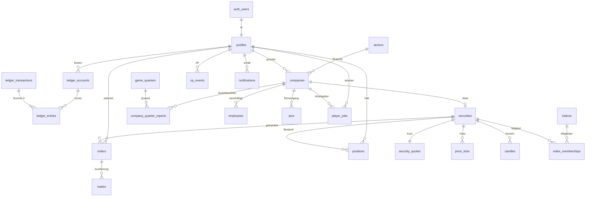

In den folgenden Diagrammen fehlen die Kanten zu `game_quarters` und `ledger_transactions`, weil fast jede Tabelle
darauf verweist und die Diagramme sonst unlesbar wären. Die Spalten dazu heißen überall `game_quarter_id` bzw.
`ledger_transaction_id` und stehen in Abschnitt 3.

<!-- BEGIN GENERATED:er -->

### 4.1 Ledger (doppelte Buchführung)

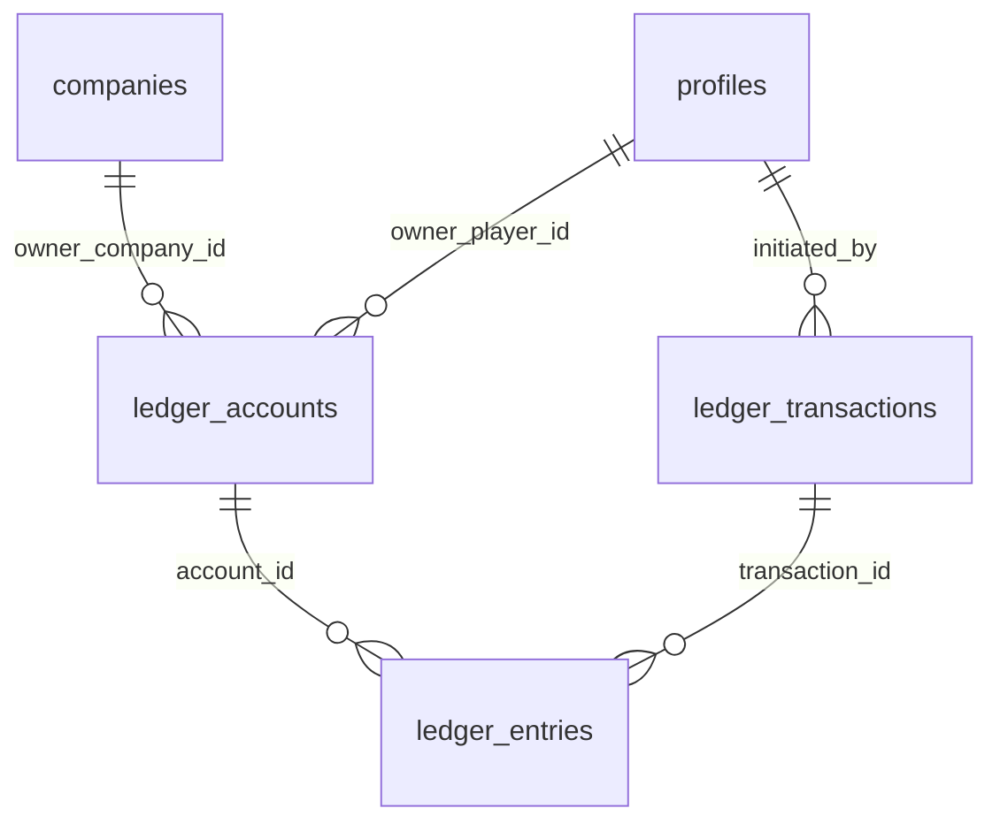

### 4.2 Spieler, Fortschritt und Belohnungen

```mermaid
erDiagram
  achievements ||--o{ cosmetic_items : "unlock_achievement_key"
  achievements ||--o{ player_achievements : "achievement_key"
  cosmetic_items ||--o{ player_cosmetics : "cosmetic_key"
  invite_codes ||--o{ invite_code_redemptions : "code"
  levels ||--o{ cosmetic_items : "unlock_level"
  levels ||--o{ unlocks : "level"
  lifestyle_items ||--o{ player_lifestyle_items : "item_key"
  mission_templates ||--o{ player_missions : "template_key"
  mission_templates ||--o{ unlocks : "intro_mission_key"
  profiles ||--o{ daily_logins : "player_id"
  profiles ||--o{ invite_code_redemptions : "player_id"
  profiles ||--o{ login_streaks : "player_id"
  profiles ||--o{ player_achievements : "player_id"
  profiles ||--o{ player_bankruptcies : "player_id"
  profiles ||--o{ player_cosmetics : "player_id"
  profiles ||--o{ player_lifestyle_items : "player_id"
  profiles ||--o{ player_missions : "player_id"
  profiles ||--o{ player_private : "player_id"
  profiles ||--o{ player_random_events : "player_id"
  profiles ||--o{ player_settings : "player_id"
  profiles ||--o{ player_unlocks : "player_id"
  profiles ||--o{ vault_claims : "player_id"
  profiles ||--o{ vaults : "player_id"
  profiles ||--o{ xp_daily_counters : "player_id"
  profiles ||--o{ xp_events : "player_id"
  random_event_definitions ||--o{ player_random_events : "definition_key"
  unlocks ||--o{ mission_templates : "required_unlock_key"
  unlocks ||--o{ player_unlocks : "unlock_key"
```

### 4.3 Wertpapiere, Marktdaten und Simulationsinterna

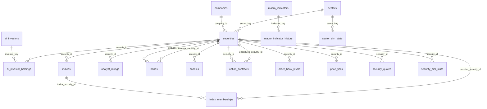

### 4.4 Handel

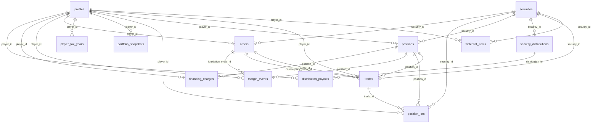

### 4.5 Unternehmen und Mitarbeiter

```mermaid
erDiagram
  ai_investors ||--o{ cap_table_entries : "ai_investor_key"
  companies ||--o{ applicants : "company_id"
  companies ||--o{ cap_table_entries : "company_id"
  companies ||--o{ capital_injections : "company_id"
  companies ||--o{ company_events : "company_id"
  companies ||--o{ company_products : "company_id"
  companies ||--o{ company_quarter_decisions : "company_id"
  companies ||--o{ company_quarter_reports : "company_id"
  companies ||--o{ company_state : "company_id"
  companies ||--o{ employees : "company_id"
  companies ||--o{ insolvency_proceedings : "company_id"
  companies ||--o{ loans : "company_id"
  companies ||--o{ poaching_offers : "from_company_id"
  companies ||--o{ share_issuances : "company_id"
  companies ||--o{ share_lockups : "company_id"
  companies ||--o{ stock_option_grants : "company_id"
  companies ||--o{ takeover_offers : "bidder_company_id"
  companies ||--o{ takeover_offers : "target_company_id"
  employee_traits ||--o{ applicants : "trait_key"
  employee_traits ||--o{ employees : "trait_key"
  employees ||--o{ applicants : "hired_employee_id"
  employees ||--o{ poaching_offers : "employee_id"
  employees ||--o{ stock_option_grants : "employee_id"
  insolvency_proceedings ||--o{ takeover_offers : "insolvency_id"
  loans ||--o{ loan_payments : "loan_id"
  profiles ||--o{ cap_table_entries : "player_id"
  profiles ||--o{ capital_injections : "player_id"
  profiles ||--o{ companies : "ceo_id"
  profiles ||--o{ companies : "founder_id"
  profiles ||--o{ company_quarter_decisions : "submitted_by"
  profiles ||--o{ employees : "player_id"
  profiles ||--o{ loans : "player_id"
  profiles ||--o{ loans : "requested_by"
  profiles ||--o{ poaching_offers : "offered_by"
  profiles ||--o{ share_lockups : "player_id"
  profiles ||--o{ stock_option_grants : "player_id"
  profiles ||--o{ takeover_offers : "bidder_player_id"
  sectors ||--o{ companies : "sector_key"
  sectors ||--o{ sector_quarter_stats : "sector_key"
  securities ||--o{ companies : "security_id"
  stock_option_grants ||--o{ stock_option_vesting_events : "grant_id"
```

### 4.6 Börsengang und Governance

```mermaid
erDiagram
  ai_investors ||--o{ angel_offers : "ai_investor_key"
  ai_investors ||--o{ ipo_subscriptions : "ai_investor_key"
  companies ||--o{ angel_offers : "company_id"
  companies ||--o{ corporate_actions : "company_id"
  companies ||--o{ guidance : "company_id"
  companies ||--o{ insider_blackout_windows : "company_id"
  companies ||--o{ insider_violations : "company_id"
  companies ||--o{ ipos : "company_id"
  companies ||--o{ reputation_events : "company_id"
  companies ||--o{ shareholder_votes : "company_id"
  insider_blackout_windows ||--o{ insider_violations : "window_id"
  ipos ||--o{ ipo_prospectus_forecasts : "ipo_id"
  ipos ||--o{ ipo_subscriptions : "ipo_id"
  ipos ||--o{ ipo_use_of_proceeds : "ipo_id"
  orders ||--o{ insider_violations : "order_id"
  profiles ||--o{ angel_offers : "created_by"
  profiles ||--o{ angel_offers : "investor_player_id"
  profiles ||--o{ corporate_actions : "requested_by"
  profiles ||--o{ guidance : "issued_by"
  profiles ||--o{ insider_violations : "player_id"
  profiles ||--o{ ipo_subscriptions : "player_id"
  profiles ||--o{ ipos : "filed_by"
  profiles ||--o{ reputation_events : "player_id"
  profiles ||--o{ shareholder_vote_ballots : "player_id"
  profiles ||--o{ shareholder_votes : "proposed_by"
  securities ||--o{ insider_blackout_windows : "security_id"
  securities ||--o{ insider_violations : "security_id"
  securities ||--o{ ipos : "security_id"
  security_distributions ||--o{ corporate_actions : "distribution_id"
  shareholder_votes ||--o{ corporate_actions : "vote_id"
  shareholder_votes ||--o{ shareholder_vote_ballots : "vote_id"
  trades ||--o{ insider_violations : "trade_id"
```

### 4.7 Karriere

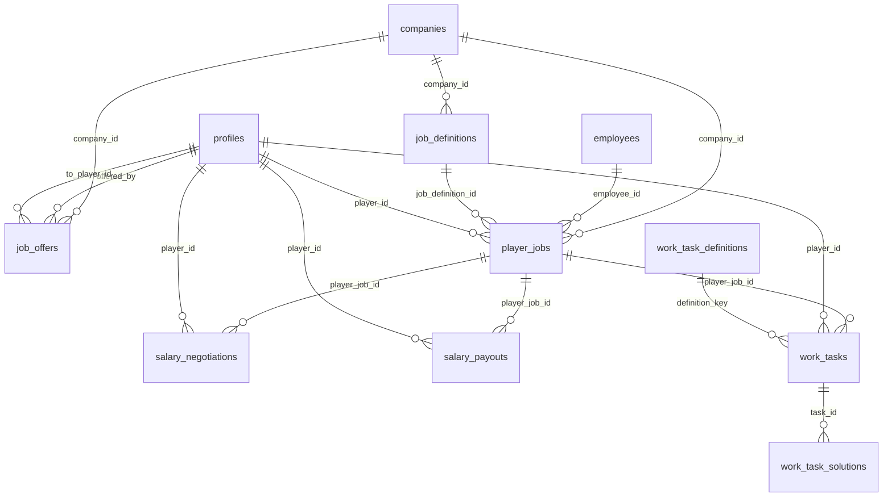

### 4.8 Soziales und Benachrichtigungen

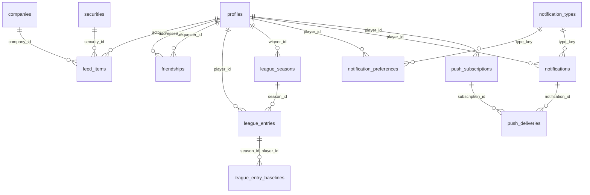

### 4.9 Events und Nachrichten

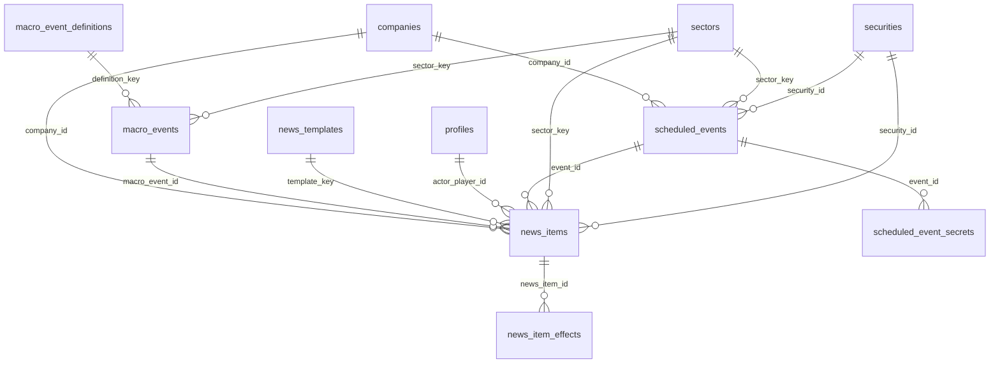

### 4.10 Admin, Missbrauchsschutz und Audit

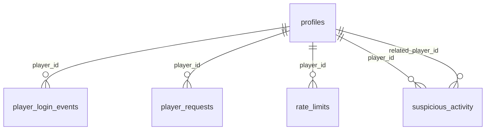

<!-- END GENERATED:er -->

---

## 5. Views

Alle Views sind `security_invoker = true` und nur für `authenticated` freigegeben. Angelegt in Migration 1500.

| View                   | Inhalt                                                                                      | Basis                                                    |
| ---------------------- | ------------------------------------------------------------------------------------------- | -------------------------------------------------------- |
| `v_securities`         | Marktliste: Stammdaten, Logo und Farbe des Emittenten, aktueller Kurs                       | `securities`, `security_quotes`, `companies`             |
| `v_stock_fundamentals` | Kennzahlen je Aktie: KGV, Nettomarge, Dividendenrendite, Marktkapitalisierung               | `companies`, `security_quotes`, `security_distributions` |
| `v_bonds`              | Staatsanleihen mit Bedingungen, Kurs und Rendite                                            | `bonds`, `securities`, `security_quotes`                 |
| `v_index_members`      | Aktuelle Indexmitglieder mit Gewicht und Kurs                                               | `indices`, `index_memberships`                           |
| `v_company_profiles`   | Firmenkopf: Profil, Gründer mit Reputation, Kurs, letzte **veröffentlichte** Quartalszahlen | `companies`, `profiles`, `company_quarter_reports`       |
| `v_cap_table`          | Aktionärsregister mit Anteil in Basispunkten                                                | `cap_table_entries`                                      |
| `v_ipo_calendar`       | Laufende und vergangene Börsengänge mit Überzeichnung (ohne Entwürfe)                       | `ipos`, `companies`                                      |
| `v_job_board`          | Offene Jobs der KI-Firmen                                                                   | `job_definitions`, `companies`                           |
| `v_player_profiles`    | Öffentliche Spielerkarte mit Anzahl Erfolge, Statussymbolen und gegründeten Firmen          | `profiles` und weitere                                   |
| `v_league_standings`   | Wochenliga nach Wachstum in Prozent; `is_friend_or_me` filtert die Freundes-Liga            | `league_entries`, `league_seasons`                       |
| `v_friends`            | Freunde und offene Anfragen aus Sicht des Aufrufers                                         | `friendships`, `profiles`                                |
| `v_feed`               | Sichtbare Feed-Einträge mit Namen                                                           | `feed_items`                                             |
| `v_event_calendar`     | Kommende Events für die Countdown-Leiste und Ergebnisse der letzten 24 Stunden              | `scheduled_events`                                       |
| `v_news`               | Newsticker mit Firmen- und Tickernamen                                                      | `news_items`                                             |
| `v_my_accounts`        | Eigene Kontostände (Cash, Reserve)                                                          | `ledger_accounts`                                        |
| `v_my_ledger`          | Eigener Kontoauszug                                                                         | `ledger_entries`, `ledger_transactions`                  |
| `v_my_positions`       | Offene Positionen mit Marktwert und unrealisiertem Ergebnis (nur Anzeige)                   | `positions`, `security_quotes`                           |
| `v_my_vault`           | Tresorzustand mit aufgelaufenen Sekunden                                                    | `vaults`                                                 |

Die `v_my_*`-Views filtern zusätzlich zur RLS ausdrücklich auf `auth.uid()`. Sonst würden Firmenkonten, die ein Insider
lesen darf, in „meinen“ Listen auftauchen.

---

## 6. Funktionen und RPCs

### 6.1 Jetzt umgesetzt (M0)

| Funktion                                                                             | Aufrufbar von            | Zweck                                                                                                                                                                    |
| ------------------------------------------------------------------------------------ | ------------------------ | ------------------------------------------------------------------------------------------------------------------------------------------------------------------------ |
| `handle_new_user()`                                                                  | Trigger auf `auth.users` | Prüft Einladungscode und Altersbestätigung, legt Profil, Einstellungen, Tresor, Login-Serie, Ledger-Konten und Benachrichtigungs-Standards an und bucht das Startkapital |
| `is_admin()`                                                                         | `authenticated`          | Aufrufer steht in `admin_users`                                                                                                                                          |
| `is_company_insider(company_id)`                                                     | `authenticated`          | RLS-Helfer: Gründer, CEO oder aktiver Spieler-Mitarbeiter                                                                                                                |
| `are_friends(a, b)`                                                                  | `authenticated`          | RLS-Helfer; ein Client darf nur Paare abfragen, in denen er selbst vorkommt                                                                                              |
| `has_unlock(key)`                                                                    | `authenticated`          | Aufrufer hat das Feature freigeschaltet                                                                                                                                  |
| `owns_ledger_account(account_id)`, `can_read_ledger_transaction(id)`                 | `authenticated`          | RLS-Helfer für das Ledger                                                                                                                                                |
| `game_now()`, `game_day(ts)`, `current_game_quarter()`                               | `authenticated`          | Spielzeit inklusive Admin-Versatz, Spieltag, laufendes Quartal                                                                                                           |
| `ensure_game_quarters(days_ahead)`                                                   | Server                   | Legt kommende Quartale an (Europe/Berlin, 08/14/20/02 Uhr), idempotent                                                                                                   |
| `ledger_post(kind, entries, …)`                                                      | Server                   | Bucht eine ausgeglichene Transaktion, sperrt Konten in fester Reihenfolge, idempotent über Schlüssel                                                                     |
| `ledger_transfer(from, to, amount, kind, …)`                                         | Server                   | Kurzform für zwei Buchungszeilen                                                                                                                                         |
| `ledger_system_account(key)`, `ledger_player_account(player, kind)`                  | Server                   | Konten nachschlagen                                                                                                                                                      |
| `ledger_audit()`, `money_supply_cents()`                                             | Server                   | Abgleich Cache gegen Journal; Geldmenge für die Zentralbank                                                                                                              |
| `rate_limit_hit(…)`, `rate_limit_enforce(…)`                                         | Server                   | Zähler im festen Zeitfenster; `enforce` wirft `NX004`                                                                                                                    |
| `request_begin(…)`, `request_complete(…)`                                            | Server                   | Idempotenz-Journal für Aktionen ohne eigene Tabelle                                                                                                                      |
| `config_jsonb/bigint/boolean(key, path, fallback)`                                   | Server                   | Typisierter Zugriff auf `game_config`                                                                                                                                    |
| `maintain_price_tick_partitions(…)`                                                  | Server, Cron             | Tagespartitionen für `price_ticks` anlegen und alte löschen                                                                                                              |
| `run_maintenance()`                                                                  | Cron                     | Kalender, Partitionen, Aufbewahrungsfristen                                                                                                                              |
| `invoke_edge_function(name, body)`                                                   | Cron                     | Ruft eine Edge Function über `pg_net`; URL und Secret aus Supabase Vault                                                                                                 |
| `set_updated_at()`, `prevent_mutation()`, `enforce_row_cap()` und die Ledger-Trigger | Trigger                  | Gemeinsame Triggerfunktionen                                                                                                                                             |

„Server“ bedeutet: nur `service_role` hat `EXECUTE`, dazu andere `SECURITY DEFINER`-Funktionen. `anon` darf keine Funktion ausführen.

**Metadaten bei der Registrierung** (`supabase.auth.signUp({ options: { data } })`):

| Feld            | Pflicht                                                                  | Bedeutung                                                                                                                         |
| --------------- | ------------------------------------------------------------------------ | --------------------------------------------------------------------------------------------------------------------------------- |
| `invite_code`   | ja, solange `game_config.auth.inviteRequired` nicht `false` ist          | Groß-/Kleinschreibung und Leerzeichen am Rand egal                                                                                |
| `age_confirmed` | ja, solange `game_config.auth.ageConfirmationRequired` nicht `false` ist | `true`                                                                                                                            |
| `nickname`      | nein                                                                     | 3 bis 20 Zeichen aus `[A-Za-z0-9_]`; ist er vergeben, hängt der Server fünf Ziffern an; fehlt er, heißt der Spieler `TraderNNNNN` |

Startkapital: `game_config`, Schlüssel `economy`, Pfad `startingCapitalCents`, sonst 1 000 000 Cent (ADR-011).

### 6.2 Geplant je Meilenstein

Signaturskizzen. Jede Spieler-RPC ist `SECURITY DEFINER`, prüft `auth.uid()`, Level und Freischaltung, Rate Limit und
Eingaben erneut und nimmt eine `p_request_id uuid`. Rückgabe ist die betroffene Zeile oder ein `jsonb`-Ergebnis.
„intern“ heißt: nur `service_role`.

**M1 Markt**

```sql
acquire_tick_lease(p_runner_id uuid, p_ttl_seconds int) returns boolean                    -- intern
get_tick_state() returns jsonb                                                               -- intern, ein Roundtrip
apply_market_tick(p_payload jsonb) returns jsonb                                             -- intern: Kurse, Ticks, Kerzen, Orderbuch,
                                                                                             --   fällige Limit-/Stop-Orders, KI-Bestände
place_order(p_request_id uuid, p_security_id uuid, p_side order_side, p_type order_type,
            p_quantity bigint, p_limit_price_e4 bigint default null,
            p_stop_price_e4 bigint default null, p_position_side position_side default 'long',
            p_leverage smallint default 1, p_time_in_force time_in_force default 'gtc') returns orders
cancel_order(p_request_id uuid, p_order_id uuid) returns orders
execute_order_fill(p_order_id uuid, p_quantity bigint, p_price_e4 bigint,
                   p_counterparty trade_counterparty) returns trades                         -- intern: Trade, Position, Lots,
                                                                                             --   Gebühr, Steuer, Ledger
```

**M2 Spieler-Kern**

```sql
claim_vault(p_request_id uuid) returns jsonb               -- { amount_cents, accrued_seconds, forfeited_seconds }
claim_daily_login(p_request_id uuid) returns jsonb         -- Streak, Bonus-XP, Streak-Schutz
award_xp(p_player_id uuid, p_source xp_source, p_amount int, p_ref_type text, p_ref_id uuid,
         p_dedupe_key text) returns jsonb                  -- intern: Tagesdeckel, Level-up, Freischaltungen
assign_daily_missions(p_player_id uuid) returns setof player_missions                        -- intern
track_mission_progress(p_player_id uuid, p_metric text, p_delta bigint) returns void         -- intern
claim_mission(p_request_id uuid, p_mission_id uuid) returns player_missions
unlock_achievement(p_player_id uuid, p_key text) returns void                                -- intern
update_profile(p_nickname text, p_avatar jsonb, p_title_key text, p_frame_key text,
               p_accent_color text) returns profiles
send_friend_request(p_request_id uuid, p_nickname text) returns friendships
respond_friend_request(p_friendship_id uuid, p_accept boolean) returns friendships
remove_friend(p_friendship_id uuid) returns void
get_player_portfolio(p_player_id uuid) returns jsonb       -- beachtet portfolio_visibility, nur Gewichte in Prozent
notify(p_player_id uuid, p_type_key text, p_title text, p_body text, p_payload jsonb,
       p_dedupe_key text) returns uuid                     -- intern, beachtet notification_preferences
snapshot_portfolios(p_granularity snapshot_granularity) returns int                          -- intern
close_league_season(p_season_id uuid) returns void                                           -- intern
```

**M3 Karriere**

```sql
take_job(p_request_id uuid, p_job_definition_id uuid) returns player_jobs
quit_job(p_request_id uuid) returns player_jobs
accrue_salaries() returns int                              -- intern: höchstens 12 bezahlte Stunden pro Tag, XP
start_work_task(p_task_id uuid) returns work_tasks
submit_work_task(p_request_id uuid, p_task_id uuid, p_answer jsonb) returns work_tasks
negotiate_salary(p_request_id uuid, p_raise_bps int) returns salary_negotiations
```

**M4 Unternehmen**

```sql
found_company(p_request_id uuid, p_name text, p_sector_key text, p_legal_form legal_form,
              p_logo_pixels jsonb, p_brand_color text, p_capital_cents bigint) returns companies
convert_company(p_request_id uuid, p_company_id uuid, p_legal_form legal_form) returns companies
inject_capital(p_request_id uuid, p_company_id uuid, p_amount_cents bigint) returns capital_injections
submit_quarter_decisions(p_request_id uuid, p_company_id uuid, p_decisions jsonb) returns company_quarter_decisions
start_product_development(p_request_id uuid, p_company_id uuid, p_name text, p_budget_cents bigint) returns company_products
hire_applicant(p_request_id uuid, p_applicant_id uuid, p_role employee_role) returns employees
dismiss_employee(p_request_id uuid, p_employee_id uuid) returns employees
set_employee_salary(p_request_id uuid, p_employee_id uuid, p_salary_cents_per_quarter bigint) returns employees
request_loan(p_request_id uuid, p_company_id uuid, p_amount_cents bigint, p_term_quarters int) returns loans
repay_loan(p_request_id uuid, p_loan_id uuid, p_amount_cents bigint) returns loans
close_quarter(p_quarter_id bigint, p_results jsonb) returns jsonb   -- intern: wendet die in TypeScript berechnete
                                                                    --   Simulation an (Berichte, Gehälter, Zinsen, Dividenden,
                                                                    --   Kupons, Vesting, Insolvenz), idempotent über job_runs
```

**M5 Sozial**

```sql
create_job_offer(p_request_id uuid, p_company_id uuid, p_to_player_id uuid, p_terms jsonb) returns job_offers
respond_job_offer(p_request_id uuid, p_offer_id uuid, p_accept boolean) returns job_offers
create_angel_offer(p_request_id uuid, p_company_id uuid, p_shares bigint, p_price_per_share_e4 bigint,
                   p_investor_player_id uuid default null) returns angel_offers
respond_angel_offer(p_request_id uuid, p_offer_id uuid, p_accept boolean) returns angel_offers
poach_employee(p_request_id uuid, p_employee_id uuid, p_company_id uuid, p_salary_cents_per_quarter bigint) returns poaching_offers
record_insider_trade(p_trade_id uuid) returns void         -- intern, aus execute_order_fill
resolve_insider_violations() returns int                   -- intern: Aufdeckung würfeln, Strafe, Reputation
```

**M6 Börsengang**

```sql
file_ipo(p_request_id uuid, p_company_id uuid, p_prospectus jsonb) returns ipos   -- Prognose, Mittelverwendung (Summe 100 %), Lock-up
subscribe_ipo(p_request_id uuid, p_ipo_id uuid, p_shares bigint, p_limit_price_e4 bigint) returns ipo_subscriptions
cancel_ipo_subscription(p_request_id uuid, p_subscription_id uuid) returns ipo_subscriptions
price_ipo(p_ipo_id uuid, p_ai_demand jsonb) returns ipos   -- intern: Zuteilung, Listing oder Abbruch mit Rückzahlung
issue_guidance(p_request_id uuid, p_company_id uuid, p_revenue_low_cents bigint, p_revenue_high_cents bigint) returns guidance
announce_corporate_action(p_request_id uuid, p_company_id uuid, p_kind corporate_action_kind, p_terms jsonb) returns corporate_actions
propose_vote(p_request_id uuid, p_company_id uuid, p_kind vote_kind, p_proposal jsonb) returns shareholder_votes
cast_vote(p_request_id uuid, p_vote_id uuid, p_choice vote_choice) returns shareholder_vote_ballots
adjust_reputation(p_player_id uuid, p_kind reputation_event_kind, p_delta int, p_ref jsonb) returns int   -- intern
```

**M7 Risiko**

```sql
-- place_order wird um Short und Hebel erweitert (gleiche Signatur)
charge_financing(p_charge_date date) returns int           -- intern: Hebelzinsen, Leihgebühren
check_margin(p_security_ids uuid[]) returns int            -- intern, im Tick: Warnung, Margin Call
liquidate_position(p_position_id uuid) returns orders      -- intern
declare_bankruptcy(p_request_id uuid) returns player_bankruptcies
resolve_scheduled_event(p_event_id uuid, p_outcome jsonb) returns scheduled_events   -- intern
start_macro_event(p_definition_key text, p_sector_key text default null) returns macro_events   -- intern
```

**M8 Feinschliff**

```sql
buy_lifestyle_item(p_request_id uuid, p_item_key text) returns player_lifestyle_items
sell_lifestyle_item(p_request_id uuid, p_item_id uuid) returns player_lifestyle_items
charge_lifestyle_upkeep(p_quarter_id bigint) returns int   -- intern
roll_random_events() returns int                           -- intern
respond_random_event(p_request_id uuid, p_event_id uuid, p_accept boolean) returns player_random_events
equip_cosmetics(p_request_id uuid, p_avatar jsonb, p_title_key text, p_frame_key text) returns profiles
queue_push(p_notification_id uuid) returns int             -- intern: Tagesdeckel, push_deliveries
```

**Admin** (prüfen `is_admin()`, schreiben `admin_actions`)

```sql
admin_set_config(p_key text, p_value jsonb) returns game_config
admin_set_time_offset(p_offset interval) returns timestamptz
admin_trigger_event(p_kind scheduled_event_kind, p_params jsonb) returns scheduled_events
admin_reset_player(p_player_id uuid) returns void
admin_create_invite_code(p_code text, p_max_uses int, p_expires_at timestamptz) returns invite_codes
admin_adjust_balance(p_player_id uuid, p_amount_cents bigint, p_reason text) returns uuid
```

---

## 7. Ledger im Detail

Umsetzung von ADR-007 in Migration 0300.

### Aufbau

- `ledger_accounts`: Kontoarten `player_cash`, `player_reserve`, `company_cash`, `company_reserve`, `system`.
  Jeder Spieler bekommt bei der Registrierung ein Cash- und ein Reservekonto. Auf das Reservekonto wandert Geld,
  das durch offene Limit-Kauforders, IPO-Zeichnungen oder Margin gebunden ist. So ist „verfügbar“ immer der
  Stand des Cash-Kontos, ohne zweite Rechnung.
- `ledger_transactions`: Kopf mit `kind`, Bezug (`ref_type`, `ref_id`), Quartal und optionalem `idempotency_key`.
- `ledger_entries`: Zeilen mit `amount_cents` und `balance_after_cents`.

Vorzeichen: `amount_cents > 0` erhöht den Kontostand, `< 0` senkt ihn. Die Zeilen einer Transaktion ergeben zusammen 0.

### Garantien

| Regel                                                    | Durchgesetzt von                                                                                                              |
| -------------------------------------------------------- | ----------------------------------------------------------------------------------------------------------------------------- |
| Summe je Transaktion = 0, mindestens zwei Zeilen         | Constraint-Trigger `ledger_check_balanced`, `DEFERRABLE INITIALLY DEFERRED`, auf `ledger_entries` und `ledger_transactions`   |
| Kein UPDATE, DELETE, TRUNCATE auf Zeilen und Köpfen      | Trigger `prevent_mutation`                                                                                                    |
| Keine Zeilen an eine abgeschlossene Transaktion anhängen | `ledger_transactions.db_txid` muss der laufenden Datenbanktransaktion entsprechen                                             |
| Kontostand nur über Buchungen                            | Trigger `ledger_accounts_guard` lässt Änderungen an `balance_cents` nur aus dem Buchungstrigger zu; neue Konten starten bei 0 |
| Spieler- und Firmenkonten nie negativ                    | Prüfung im Buchungstrigger (`NX001`) und Check-Constraint; nur Konten mit `allow_negative` dürfen ins Minus                   |
| Keine Deadlocks                                          | `ledger_post()` sperrt alle betroffenen Konten in Reihenfolge der `id`                                                        |
| Kein doppeltes Buchen                                    | `idempotency_key` eindeutig; `ledger_post()` gibt bei Wiederholung die vorhandene Transaktion zurück                          |

`ledger_audit()` vergleicht jeden Cache mit der Summe der Zeilen und muss leer sein.

### Systemkonten

Quellen und Senken dürfen negativ werden. Ihr Stand zeigt, wie viel Geld über diesen Weg ins Spiel kam (negativ)
oder das Spiel verlassen hat (positiv).

| `system_key` | Rolle                                                                               |
| ------------ | ----------------------------------------------------------------------------------- |
| `mint`       | Geldschöpfung: Startkapital, Grundeinkommen, Boni, Eröffnungsbilanzen der KI-Firmen |
| `payroll`    | Gehälter, die KI-Firmen an Spieler zahlen                                           |
| `fees`       | Ordergebühren und andere Gebühren (Senke)                                           |
| `taxes`      | Steuern auf Gewinne (Senke)                                                         |
| `market`     | Gegenpartei der KI (Marktmacher, Fonds) und Rundungsdifferenzen                     |
| `upkeep`     | Unterhalt für Statussymbole (Senke)                                                 |
| `interest`   | Finanzierungskosten, Kreditzinsen, Kupons                                           |
| `bank`       | Kreditsummen der KI-Bank                                                            |
| `fines`      | Strafen der Finanzaufsicht (Senke)                                                  |
| `economy`    | Kunden und Lieferanten der Firmen (Umsatz und Kosten)                               |

### Beispiel: Registrierung

| Konto                            | `amount_cents` |
| -------------------------------- | -------------- |
| `mint`                           | −1 000 000     |
| `player_cash` des neuen Spielers | +1 000 000     |

### Beispiel: Kauf von 10 Aktien zu 84,00 € mit 1 € Gebühr (geplant in M1)

| Konto         | `amount_cents` |
| ------------- | -------------- |
| `player_cash` | −84 100        |
| `market`      | +84 000        |
| `fees`        | +100           |

---

## 8. Spielzeit

Umsetzung von ADR-006 in Migration 0200.

- `game_quarters` enthält jedes Quartal als Zeile. Q1 beginnt um 08:00, Q2 um 14:00, Q3 um 20:00, Q4 um 02:00 (Europe/Berlin).
  Ein **Spieltag** läuft von 08:00 bis 08:00 und entspricht einem Spieljahr. `game_year` zählt ab der Epoche in
  `sim_runtime.game_epoch_date`, die beim ersten Aufruf von `ensure_game_quarters()` gesetzt wird.
- Beginn und Ende werden beide aus der lokalen Uhrzeit berechnet. An den Tagen der Zeitumstellung ist dadurch genau ein
  Quartal 5 bzw. 7 Stunden lang, ohne Sonderfall im Code. Ein Exclusion-Constraint verhindert überlappende Quartale.
- `game_now()` ist die Uhrzeit plus `sim_runtime.time_offset`. Damit spult der Admin für Tests vor.
  `current_game_quarter()` liest das Quartal, in dem `game_now()` liegt. Spielzeit wird nie aus der Uhr ausgerechnet.
- Der Status (`scheduled`, `active`, `closing`, `closed`) gehört dem Quartalsabschluss. `ensure_game_quarters()` setzt nur `active`.
- `market_status` hält die Börsenphase für den Client (08 bis 22 Uhr offen, danach nachbörslich), geschrieben vom Tick-Runner.

---

## 9. Stammdaten (Seed)

`supabase/seed.sql` ist idempotent und kann mehrfach laufen. Nicht enthalten ist `game_config`
(wird mit `pnpm db:config` aus `src/config/balance.ts` erzeugt).

| Inhalt                                                | Anzahl | Hinweis                                                       |
| ----------------------------------------------------- | ------ | ------------------------------------------------------------- |
| Branchen                                              | 5      | mit Branchen-KGV und Quartalsnachfrage (Summe der KI-Umsätze) |
| KI-Unternehmen                                        | 15     | ADR-014; je Branche Bluechip, Mittelständler, Pennystock      |
| Aktien mit Startkurs, Geld/Brief und verdecktem Anker | 15     | Startkurse 0,31 € bis 112,50 €                                |
| Firmenkonten mit Eröffnungsbilanz                     | 15     | eine Quartalsrate Kosten, gebucht aus `mint`                  |
| Staatsanleihen                                        | 4      | 1, 2, 5, 10 Spieljahre; Kupon 2,5 % bis 3,8 %                 |
| Index NEXA 30                                         | 1      | Basis 1000 Punkte, 15 Mitglieder nach Marktkapitalisierung    |
| KI-Investortypen                                      | 6      | Spec 5.3, mit Strategieparametern                             |
| Leitzins                                              | 300 bp | `central_bank_state`                                          |
| Makrogrößen                                           | 4      | Ölpreis, Konsumklima, Lohnindex, Konjunkturindex              |
| Level                                                 | 50     | `round(100 × n^1.5)`                                          |
| Freischaltungen                                       | 28     | Spec 9.3                                                      |
| Missionsvorlagen                                      | 23     | 11 täglich, 3 wöchentlich, 9 Einstieg                         |
| Erfolge                                               | 56     | inklusive der 8 aus Spec 11.2, jeder mit eigenem `icon_key`   |
| Kosmetik                                              | 15     | Titel, Rahmen, Avatar-Teile                                   |
| Statussymbole                                         | 5      | Spec 11.3 mit Unterhalt je Quartal                            |
| Zufallsereignisse                                     | 7      | Spec 11.4 plus drei kleine                                    |
| Makro-Events                                          | 5      | Spec 5.5                                                      |
| Nachrichtenvorlagen                                   | 18     |                                                               |
| Benachrichtigungsarten                                | 30     |                                                               |
| Mitarbeiter-Eigenschaften                             | 8      |                                                               |
| Arbeitsaufgaben-Arten                                 | 6      |                                                               |
| Jobs bei KI-Firmen                                    | 19     | 5 Stufen, Level 2, 5, 12, 20, 25                              |
| Einladungscodes                                       | 2      | vor einem echten Start ersetzen                               |
| Zufallsströme                                         | 5      | `sim_rng_streams`                                             |

Die KI-Unternehmen haben feste IDs (`md5('nexa:company:' || ticker)::uuid`, Aktien entsprechend mit `nexa:security:`),
damit Demo-Daten und Tests in jeder Umgebung dieselben Schlüssel verwenden.

Startwerte der 15 KI-Unternehmen (Umsatz und Kosten je Quartal):

| Ticker | Unternehmen           | Branche  | Größe    | Aktien   | Startkurs | Umsatz       | Kosten         | Ausschüttung |
| ------ | --------------------- | -------- | -------- | -------- | --------- | ------------ | -------------- | ------------ |
| KLS    | KlarSoft AG           | Tech     | Bluechip | 50 Mio.  | 84,00 €   | 420 Mio. €   | 382,5 Mio. €   | 20 %         |
| PXW    | Pixelwerk Studios     | Tech     | Mittel   | 20 Mio.  | 23,50 €   | 60 Mio. €    | 55,5 Mio. €    | keine        |
| QSL    | QuantenSprung Labs    | Tech     | Penny    | 40 Mio.  | 0,42 €    | 2,4 Mio. €   | 2,9 Mio. €     | keine        |
| BRZ    | Brotzeit Handel AG    | Handel   | Bluechip | 80 Mio.  | 41,20 €   | 1 960 Mio. € | 1 901,2 Mio. € | 50 %         |
| KFR    | Kaufrausch Märkte     | Handel   | Mittel   | 25 Mio.  | 15,80 €   | 280 Mio. €   | 273 Mio. €     | 35 %         |
| FGD    | Fundgrube Discount    | Handel   | Penny    | 60 Mio.  | 0,65 €    | 45 Mio. €    | 44,4 Mio. €    | keine        |
| VLT    | Volta Energie AG      | Energie  | Bluechip | 100 Mio. | 56,40 €   | 1 300 Mio. € | 1 182,5 Mio. € | 65 %         |
| RKW    | Rheinkraft Werke      | Energie  | Mittel   | 30 Mio.  | 18,90 €   | 150 Mio. €   | 138,2 Mio. €   | 45 %         |
| SFX    | SolarFuchs            | Energie  | Penny    | 50 Mio.  | 0,88 €    | 6 Mio. €     | 6,5 Mio. €     | keine        |
| NPH    | NeuroPharm AG         | Pharma   | Bluechip | 60 Mio.  | 112,50 €  | 480 Mio. €   | 403,3 Mio. €   | 40 %         |
| ALM    | Alpenmed              | Pharma   | Mittel   | 15 Mio.  | 34,60 €   | 52 Mio. €    | 46,1 Mio. €    | 20 %         |
| GNV    | GenoVita Biotech      | Pharma   | Penny    | 80 Mio.  | 0,31 €    | 0,4 Mio. €   | 2,1 Mio. €     | keine        |
| NDL    | Nordlicht Logistik AG | Logistik | Bluechip | 70 Mio.  | 47,80 €   | 870 Mio. €   | 817,7 Mio. €   | 45 %         |
| EBX    | Eilbote Express       | Logistik | Mittel   | 20 Mio.  | 12,40 €   | 78 Mio. €    | 74,1 Mio. €    | 30 %         |
| FPT    | Frachtpilot           | Logistik | Penny    | 45 Mio.  | 0,54 €    | 9 Mio. €     | 8,7 Mio. €     | keine        |

Die Startkurse sind so gewählt, dass Jahresgewinn je Aktie mal Branchen-KGV ungefähr den Kurs ergibt
(Tech 28, Handel 14, Energie 12, Pharma 22, Logistik 16). Drei Pennystocks schreiben Verlust und werden nach Fantasie bewertet.

---

## 10. Migrationen, Cron und Aufbewahrung

| Datei                                         | Inhalt                                                                                                  |
| --------------------------------------------- | ------------------------------------------------------------------------------------------------------- |
| `20261110000100_extensions_enums_helpers.sql` | Standardrechte schließen, alle Enums, `set_updated_at`, `prevent_mutation`, `admin_users`, `is_admin()` |
| `20261110000200_config_game_time.sql`         | `game_config`, Laufzeit-Singletons, Spielkalender und Zeitfunktionen                                    |
| `20261110000300_ledger.sql`                   | Ledger mit Triggern, `ledger_post()`, Systemkonten                                                      |
| `20261110000400_players_progression.sql`      | Profile, Einladungscodes, Level, XP, Tresor, Missionen, Erfolge, Lebensstil, Zufallsereignisse          |
| `20261110000500_securities_market_data.sql`   | Branchen, Wertpapiere, Kurse, Ticks (partitioniert), Kerzen, Index, Zentralbank, Simulationsinterna     |
| `20261110000600_trading.sql`                  | Orders, Trades, Positionen, Margin, Steuern, Ausschüttungen, Watchlist                                  |
| `20261110000700_companies_employees.sql`      | Firmen, Produkte, Quartale, Mitarbeiter, Optionen, Kredite, Cap Table, Insolvenz                        |
| `20261110000800_ipo_governance.sql`           | Business Angels, IPO, Guidance, Kapitalmaßnahmen, Abstimmungen, Reputation, Insider-Regel               |
| `20261110000900_careers.sql`                  | Jobs, Gehalt, Arbeitsaufgaben, Verhandlung, Jobangebote                                                 |
| `20261110001000_social_notifications.sql`     | Freunde, Feed, Liga, Benachrichtigungen, Push                                                           |
| `20261110001100_events_news.sql`              | Geplante Events, Makro-Events, Nachrichten                                                              |
| `20261110001200_admin_audit.sql`              | Admin-Log, Rate Limits, Idempotenz-Journal, Missbrauchsprotokoll                                        |
| `20261110001300_auth_signup.sql`              | `handle_new_user()` und Trigger auf `auth.users`                                                        |
| `20261110001400_triggers_rls_policies.sql`    | `updated_at`-Trigger, RLS-Helfer, Rechte, alle Policies, Realtime-Publikation                           |
| `20261110001500_public_views.sql`             | Views                                                                                                   |
| `20261110001600_cron.sql`                     | `invoke_edge_function()`, `run_maintenance()`, Zeitpläne mit `pg_cron`                                  |

Die Reihenfolge weicht an einer Stelle von der Domänenliste ab: Das Ledger kommt vor den Spielern, weil Spielertabellen
auf Buchungen verweisen. Die Fremdschlüssel vom Ledger auf `profiles` und `companies` werden in den späteren Migrationen ergänzt.

### Zeitpläne (`pg_cron`)

Migration 1600 legt die Jobs nur an, wenn `pg_cron` verfügbar ist. Fehlt die Erweiterung (lokale Prüfung), wird der
Block übersprungen. URL und Secret der Edge Functions stehen in Supabase Vault (`nexa_functions_base_url`,
`nexa_cron_secret`), ersatzweise in `internal_settings`. Solange nichts hinterlegt ist, tut `invoke_edge_function()` nichts.

| Job                    | Zeitplan (UTC)      | Aufruf                                                                     |
| ---------------------- | ------------------- | -------------------------------------------------------------------------- |
| `nexa-tick-runner`     | jede Minute         | `invoke_edge_function('tick-runner')` (ADR-004)                            |
| `nexa-quarter-runner`  | zur vollen Stunde   | `invoke_edge_function('quarter-runner')`; prüft, ob ein Quartal fällig ist |
| `nexa-ensure-quarters` | stündlich, Minute 5 | `ensure_game_quarters(3)`                                                  |
| `nexa-maintenance`     | täglich 03:17       | `run_maintenance()`                                                        |

### Aufbewahrung

| Tabelle                           | Frist                                           | Mechanismus                                                               |
| --------------------------------- | ----------------------------------------------- | ------------------------------------------------------------------------- |
| `price_ticks`                     | 3 Tage                                          | Tagespartitionen, alte werden gelöscht (`maintain_price_tick_partitions`) |
| `candles`                         | 1 min: 7 Tage, 5 min: 30 Tage, sonst unbegrenzt | `run_maintenance()`                                                       |
| `portfolio_snapshots`             | 5 min: 2 Tage, 1 h: 30 Tage, 1 Tag: unbegrenzt  | `run_maintenance()`                                                       |
| `rate_limits`                     | 1 Tag                                           | `run_maintenance()`                                                       |
| `player_requests`, `sim_tick_log` | 7 Tage                                          | `run_maintenance()`                                                       |
| `notifications`                   | abgelaufene sofort, gelesene nach 30 Tagen      | `run_maintenance()`                                                       |
| `player_login_events`             | 90 Tage                                         | `run_maintenance()`                                                       |

Größenordnung für `price_ticks`: 20 Wertpapiere mal 17 280 Ticks am Tag sind rund 350 000 Zeilen täglich. Mit drei Tagen
Aufbewahrung bleibt die Tabelle bei etwa einer Million Zeilen und passt in das kostenlose Supabase-Kontingent.

### Indizes für die heißen Pfade

| Abfrage                                 | Index                                                                                |
| --------------------------------------- | ------------------------------------------------------------------------------------ |
| Ticks und Kerzen je Wertpapier und Zeit | Primärschlüssel `(security_id, ts)` bzw. `(security_id, interval, bucket_start)`     |
| Orders eines Spielers nach Status       | `orders (player_id, status, created_at desc)`                                        |
| Offene Limit-Orders für das Matching    | `orders (security_id, side, limit_price_e4, created_at)` nur für offene Limit-Orders |
| Fällige Stop-Orders                     | `orders (security_id, side, stop_price_e4)` nur für offene Stops                     |
| Liquidationsprüfung im Tick             | `positions (security_id, liquidation_price_e4)` nur für offene Hebelpositionen       |
| Benachrichtigungen                      | `notifications (player_id, created_at desc)` und ein Teilindex für ungelesene        |
| Wash-Trading-Prüfung                    | `trades (player_id, security_id, executed_at desc)`                                  |
| Kontoauszug                             | `ledger_entries (account_id, id desc)`                                               |

---

## 11. Offene Punkte

1. **Schlüssel in `game_config`.** `handle_new_user()` liest `economy.startingCapitalCents`, `auth.inviteRequired` und
   `auth.ageConfirmationRequired`. Der Generator `pnpm db:config` muss diese Namen treffen oder die Funktion wird angepasst.
2. **`game_config_public_keys` ist leer.** Welche Konfigurationsbereiche der Client lesen darf (Gebühren, Steuersatz,
   Tresor, XP-Regeln), muss der Config-Seed mit eintragen. Ohne Eintrag sieht der Client nichts.
3. **Fehlermeldung bei der Registrierung.** Schlägt der Trigger fehl (falscher Code), meldet Supabase Auth nur einen
   allgemeinen Datenbankfehler. Für eine saubere Meldung sollte der Next.js-Server den Code vorab mit der Service-Rolle prüfen.
4. **Cap Table nach dem IPO.** Vorgesehen ist, nach dem Börsengang nur Gründer, Insider, Angels und den Streubesitz zu
   führen. Ob große Spielerpositionen (zum Beispiel ab 3 %) öffentlich gemeldet werden, ist eine Designfrage für M6.
5. **Freundes-Liga.** Es gibt eine Saison je Woche für alle; die Freundes-Liga ist ein Filter darauf. Getrennte Ligen
   mit eigenem Platz 1 je Freundeskreis bräuchten eine Gruppentabelle.
6. **Anleihen rollen.** Die vier Start-Anleihen laufen aus. `bonds.successor_security_id` ist vorbereitet, die
   Neuemission gehört in `close_quarter` (M1).
7. **Einladungscodes im Seed** sind Platzhalter und stehen im Repository. Vor dem Freundestest neu vergeben.

## Nachtrag: Migration 1700 (Marktsegmente und Schonfrist)

Nach der Ausarbeitung der Unternehmenssimulation (ADR-032) ergänzt
`20261110001700_company_market_segments.sql`:

| Objekt                                         | Änderung                                                                     |
| ---------------------------------------------- | ---------------------------------------------------------------------------- |
| Enum `market_segment`                          | `local`, `regional`, `national`, `international`                             |
| `company_quarter_reports.market_segment`       | Markt, in dem die Firma im Quartal verkauft hat                              |
| `company_quarter_reports.segment_demand_cents` | Gesamtausgaben der Kunden in diesem Markt (100 % des Marktanteils-Diagramms) |
| `company_quarter_reports.uncovered_quarters`   | Aufeinanderfolgende Abschlüsse mit negativer Kasse                           |
| `company_quarter_reports.grace_quarters_left`  | Verbleibende Abschlüsse bis zur Insolvenz, `null` bei positiver Kasse        |

Die laufenden Entscheidungen einer Firma (Preis, Marketing-Budget, Guidance) liegen in `company_state.state`.
Die generierten Abschnitte 3 und 4 dieses Dokuments enthalten diese Spalten noch nicht; sie werden beim nächsten
Lauf von `supabase/tools/gen_data_model.py` aktualisiert.

**Für M4 vorgemerkt:** eine Tabelle je Branche, Markt und Quartal (Nachfrage, Umsatz der etablierten Anbieter,
unbediente Nachfrage) für das Marktanteils-Diagramm, sowie Startwerte der KI-Firmen passend zur neuen
Kalkulation (Qualität, Bekanntheit, Entwickleranteil).

## Nachtrag: M1 (Markt komplett in Postgres)

**Entscheidung für die Alpha** (ersetzt ADR-004 und ADR-013 vorerst, ADR muss noch in `docs/DECISIONS.md` nachgetragen
werden): Der Besitzer kann nur SQL in den Supabase SQL Editor einfügen. Deshalb läuft das ganze M1-Backend als
PL/pgSQL in der Datenbank. Es gibt keine Edge Functions, keine Secrets und kein Realtime. Den Markt-Tick startet
`pg_cron` alle 5 Sekunden, alles andere `run_due_jobs()` jede Minute. Clients fragen die Lese-RPCs regelmäßig ab
(Polling). Zufall kommt aus `random()` (Box-Muller in `gauss_random()`). Die deterministische Referenz bleibt
die TypeScript-Simulation in `src/lib/sim`.

### Migrationen

Jede Datei ist selbst idempotent geschrieben. Die Kopie in `supabase/updates/` ist inhaltsgleich.

| Datei                                 | Inhalt                                                                                                                                                           |
| ------------------------------------- | ---------------------------------------------------------------------------------------------------------------------------------------------------------------- |
| `20261111000100_m1_foundation.sql`    | Neue Spalten, Rundung (`div_round_half_even`, `order_value_cents`, `apply_bps`), Config-Leser, Fehler, Level und XP, `handle_new_user()` mit vorgefülltem Tresor |
| `20261111000200_m1_trading.sql`       | `execute_fill()`, `place_order`, `cancel_order`, `claim_vault`, `complete_tutorial`                                                                              |
| `20261111000300_m1_market_tick.sql`   | `market_tick()`, `market_tick_at(ts)`, Anleihepreis, Ausführung ruhender Limits                                                                                  |
| `20261111000400_m1_jobs.sql`          | Quartalsabschluss, Anleihen (Kupon, Rückzahlung, Neuemission), Kurshistorie, `market_bootstrap()`, `run_due_jobs()`, Admin-RPCs                                  |
| `20261111000500_m1_read_api_cron.sql` | Lese-RPCs, Rechte, `pg_cron`-Jobs                                                                                                                                |

Neue Spalten: `security_sim_state.ema_fast`, `ema_slow` (Momentum), `maker_inventory` (Bestand des Marktmachers aus
Spielerorders), `price_deviation` (Anleihen); `player_private.tutorial_completed_at`, `player_private.tax_loss_pot_cents`
(Verlusttopf, eigener Spieler darf lesen). Neuer Enum-Wert `xp_source.tutorial`. Neue Nachrichtenvorlagen
`earnings_profit_up` … `earnings_loss_larger`, `bond_new_series`, `bond_matured`. Keine neuen Tabellen.

### RPCs für den Client

Alle in `public`, Rückgabe `jsonb`, `EXECUTE` nur für `authenticated` (nicht `anon`). Lesefunktionen sind
`STABLE SECURITY DEFINER` und liefern nur öffentliche Marktdaten und die eigenen Daten (`auth.uid()`). Zahlen sind
einfache JSON-Zahlen (Cent, e4, bps), Zeitpunkte ISO-Strings, Schlüssel `snake_case`. Felder, die über den
vereinbarten Vertrag hinausgehen, sind mit _(zusätzlich)_ markiert.

| RPC                                                                                        | Ergebnis (Kurzform)                                                                                                                                                                                                                                                                                                                                                                                                                                                                                                                              |
| ------------------------------------------------------------------------------------------ | ------------------------------------------------------------------------------------------------------------------------------------------------------------------------------------------------------------------------------------------------------------------------------------------------------------------------------------------------------------------------------------------------------------------------------------------------------------------------------------------------------------------------------------------------ |
| `get_market_snapshot()`                                                                    | `server_time, tick_seq, session ('regular'/'after_hours'), paused, policy_rate_bps, index {ticker 'NEXA30', name, value_e4, prev_close_e4, change_bps}, securities[]` mit `id, ticker, name, kind, sector_key, size_class, last/bid/ask/prev_close_e4, change_bps, day_high/low_e4, day_volume, market_cap_cents` und bei Anleihen `term_game_years, coupon_bps, yield_bps, matures_at, face_value_cents` (sonst `null`). _(zusätzlich: `last_tick_at`, `day_start`, Index `day_high_e4/day_low_e4`, je Wertpapier `company_id`, `brand_color`)_ |
| `get_candles(p_ticker, p_interval, p_limit = 300)`                                         | Array aufsteigend nach Zeit: `{t (Epoch-Sekunden), o, h, l, c (e4), v}`. Intervalle `1m, 5m, 1h, 1q, 1y`; `p_limit` 1 bis 1000. Funktioniert für Aktien, Anleihen und `NEXA30` (auch `NX30`). Die neueste Kerze ist die laufende.                                                                                                                                                                                                                                                                                                                |
| `get_order_book(p_ticker, p_levels = 8)`                                                   | `{bids: [{price_e4, quantity, players}], asks: […]}`, beste Preise zuerst, höchstens 20 Stufen. Marktmacher-Stufen plus offene Spieler-Limits zum gleichen Preis zusammengefasst; `players` = Anzahl Spieler-Orders der Stufe, keine Identitäten. Für den Index leere Listen.                                                                                                                                                                                                                                                                    |
| `get_security_details(p_ticker)`                                                           | `ticker, name, kind, description, sector_key, size_class, color, market_cap_cents, shares_outstanding, pe_x100, dividend_yield_bps, revenue_cents, net_income_cents, margin_bps, news[{published_at, headline, body}]` (letzte 10). _(zusätzlich: `status`, `eps_ttm_e4`, `term_game_years`, `coupon_bps`, `matures_at`, `face_value_cents`)_                                                                                                                                                                                                    |
| `get_my_portfolio()`                                                                       | `cash_cents, reserved_cents, positions_value_cents, total_cents, loss_pot_cents, vault {accrued_cents, cap_cents, rate_cents_per_hour, last_claimed_at, full_at, server_time}, positions[], open_orders[], recent_trades[]` (50), `level, xp_total, xp_into_level, xp_for_next, tutorial_completed`. _(zusätzlich: `server_time`; Positionen `realized_pnl_cents, change_bps, opened_at`; Orders `reserved_cents`; Trades `xp_awarded`)_                                                                                                         |
| `place_order(p_request_id, p_ticker, p_side, p_type, p_quantity, p_limit_price_e4 = null)` | `order_id, status ('filled'/'open'/'partially_filled'), filled_quantity, avg_price_e4, gross_cents, fee_cents, tax_cents, realized_pnl_cents, cash_cents, xp_awarded, level, xp_total`. _(zusätzlich: `reserved_cents, ticker, side, type, quantity, limit_price_e4`)_                                                                                                                                                                                                                                                                           |
| `cancel_order(p_request_id, p_order_id)`                                                   | `{order_id, status: 'cancelled'}`                                                                                                                                                                                                                                                                                                                                                                                                                                                                                                                |
| `claim_vault(p_request_id)`                                                                | `{claimed_cents, cash_cents, full_at}`                                                                                                                                                                                                                                                                                                                                                                                                                                                                                                           |
| `complete_tutorial(p_request_id)`                                                          | `{xp_awarded, level, xp_total, already_completed}`                                                                                                                                                                                                                                                                                                                                                                                                                                                                                               |
| `admin_set_paused(p_paused)`, `admin_run_tick()`, `admin_close_quarter()`                  | Nur mit Eintrag in `admin_users`, sonst `forbidden`. Ergebnis: `{paused}`, das Tick-Ergebnis bzw. Quartalsdaten mit `closed_quarter_id, next_quarter_id, game_time, time_offset`. Jede Admin-Aktion landet in `admin_actions`.                                                                                                                                                                                                                                                                                                                   |

Schreibende RPCs sind über `request_id` idempotent (`player_requests`; dieselbe `request_id` liefert das erste Ergebnis).

### Fehler

`raise exception using errcode = '<Code>', message = '<Schlüssel>'`. Der Client zeigt den Text zum Schlüssel
(`error.message`).

| Schlüssel               | Code    | Wann                                                                       |
| ----------------------- | ------- | -------------------------------------------------------------------------- |
| `insufficient_funds`    | `NX001` | Bargeld reicht nicht für Orderwert, Reservierung, Gebühr oder Steuer       |
| `rate_limited`          | `NX004` | Order- oder Aktionslimit (`abuse.rateLimits`) überschritten                |
| `forbidden`             | `NX006` | Admin-RPC ohne Admin                                                       |
| `invalid_quantity`      | `NX007` | Stückzahl nicht 1 bis 100 000                                              |
| `invalid_price`         | `NX007` | Limit fehlt oder ist ≤ 0                                                   |
| `invalid_argument`      | `NX007` | unbekannte Seite/Ordertyp, fehlende `request_id` _(zusätzlich)_            |
| `invalid_interval`      | `NX007` | unbekanntes Kerzenintervall _(zusätzlich)_                                 |
| `not_authenticated`     | `NX010` | kein angemeldeter Spieler                                                  |
| `unknown_security`      | `NX011` | Ticker unbekannt                                                           |
| `not_tradable`          | `NX012` | Index, fällige oder nicht gelistete Wertpapiere                            |
| `insufficient_position` | `NX013` | Verkauf über den freien (nicht reservierten) Bestand                       |
| `order_not_found`       | `NX014` | Order existiert nicht oder gehört einem anderen Spieler                    |
| `order_not_open`        | `NX015` | Order ist schon ausgeführt oder storniert                                  |
| `market_paused`         | `NX016` | Simulation pausiert                                                        |
| `nothing_to_claim`      | `NX017` | Tresor enthält weniger als 1 €                                             |
| `locked`                | `NX018` | Funktion noch nicht freigeschaltet (Limit-Order ab Level 3, Anleihen ab 5) |

Die bisherigen Codes `NX001` bis `NX009` behalten ihre Bedeutung.

### Orderausführung

- **Gegenpartei** ist immer der Marktmacher (Spieler gegen Spieler gibt es in M1 nicht). Eine Market-Order läuft vom
  Briefkurs (Kauf) bzw. Geldkurs (Verkauf) durch das synthetische Buch. Bei linearem Impact ist der Durchschnittspreis
  `touch × (1 ± a × (pending + q/2))` mit `a = impactBpsPerDepth / 10 000 / Tiefe`; `pending` ist der gleichgerichtete
  Spielerfluss seit dem letzten Tick, damit Stückeln innerhalb eines Ticks nichts bringt. Tiefe = Aktien
  `shares_outstanding × depthFreeFloatFraction`, Anleihen `security_sim_state.liquidity_shares`, nachbörslich × 0,25.
- **Market-Orders werden immer voll ausgeführt** (höchstens 100 000 Stück, `trading.maxOrderQuantity`, Rückfallwert).
  Die Kappung `maxImpactBpsPerOrder` aus `price-impact.ts` wird deshalb nicht angewendet.
- **Limit-Kauf** am oder über dem Briefkurs wird sofort ausgeführt, aber nie über dem Limit (der Teil, der das Limit
  überschreiten würde, bleibt als Rest im Buch: `partially_filled`). Ruhende Kauf-Limits reservieren
  `Rest × Limit + Gebühr` vom Bargeld auf das Reservekonto (`order_reserve`), Verkaufs-Limits reservieren Stücke
  (`positions.reserved_quantity`). Der Tick führt ruhende Limits zum Limitpreis aus, wenn der aktuelle Brief ≤ Kauflimit
  bzw. Geld ≥ Verkaufslimit ist, und gibt die Reservierung dabei frei.
- **Gebühr** `trading.orderFeeCents` einmal je Order (beim ersten Fill).
- **Steuer** `trading.capitalGainsTaxBps` auf den realisierten Gewinn nach Gebühren. Anschaffungskosten nach FIFO aus
  `position_lots` (Kaufkurs × Stück, ohne Kaufgebühr). Verluste füllen `player_private.tax_loss_pot_cents`, spätere
  Gewinne werden erst oberhalb des Topfs besteuert, nichts wird erstattet. `player_tax_years` führt Gewinne,
  Verluste und gezahlte Steuer je Spieljahr.
- **Ledger** je Fill eine Transaktion: Kauf `cash −(Wert+Gebühr)`, `market +Wert`, `fees +Gebühr`; Verkauf
  `cash +(Wert−Gebühr−Steuer)`, `market −Wert`, `fees`, `taxes`. Ruhende Kauf-Limits buchen vom Reservekonto.
- **Kurswirkung:** Der Nettofluss steht in `security_sim_state.pending_player_flow`. Der nächste Tick bewegt den Kurs um
  `immediateShare` (50 %) des Impacts; der Rest landet im Bestand des Marktmachers (`maker_inventory`), den er mit
  0,5 % je Tick (nachbörslich 0,125 %) zur Hälfte am Markt glattstellt. Danach zieht der Value-Fonds zum fairen Wert zurück.
- **Sperren** (verklemmungsfrei): Konten des Spielers in id-Reihenfolge → Position, Order, Spielerzeilen →
  Systemkonten (`ledger_post`) → Kurs- und Simulationszeilen. Tick, Quartalsabschluss und Fälligkeiten sperren alle
  betroffenen Spielerkonten vorab in id-Reihenfolge.
- **XP:** `grant_xp()` wendet `progression.xpMultiplier` genau einmal an. Trade-XP (`xpSources.trade.xp`) einmal je
  Order, nur für die ersten `maxTradesPerDay` je Berliner Kalendertag, nicht unter 100 € Orderwert
  (`xpSources.trade.minOrderValueCents`, Rückfallwert) und nicht für einen Verkauf, wenn dieselbe Aktie innerhalb von
  `trading.washTradeWindowSeconds` gekauft wurde (`trades.is_wash_trade`). Level nach `xpBase × n^xpExponent`, beim
  Aufstieg werden die passenden Zeilen in `player_unlocks` angelegt.
- **Freischaltungen:** Limit-Orders ab dem Level von `limit_orders`, Anleihen ab dem Level von `bonds`
  (`game_config.progression.unlocks`, sonst Tabelle `unlocks`).
- **Rate Limit:** `abuse.rateLimits.ordersPerMinute` und `ordersPerDay` für Orders, `actionsPerMinute` für Storno und Tresor.

### Markt-Tick (`market_tick()`)

Alle 5 Sekunden, Advisory Lock `7311001` (Tick, `run_due_jobs()` und Admin-Abschluss laufen nie gleichzeitig; ein
Tick überspringt, wenn der Lock belegt ist). Während `sim_runtime.is_paused` passiert nichts. Reihenfolge:

1. ruhende Limit-Orders gegen den Kurs ausführen, den die Spieler gerade sehen
2. je Aktie: Sentiment-Zerfall, Spielerfluss → Marktmacher, Druck von Value-Fonds (Anker fairer Wert, tote Zone 1 %),
   Momentum-Tradern und Kleinanlegern, Glattstellung des Marktmachers, linearer Impact, Rauschen
   `tickNoiseBps[Größenklasse] × sectors.volatilityMultiplier × tickNoiseScale` (nachbörslich × 0,5), Begrenzung auf
   `maxTickReturnBps`, stochastisch gerundet. Renten- und Indexfonds starten im Gleichgewicht und haben bei festem
   Leitzins keinen Druck; sie fehlen in M1.
3. je Anleihe: Rendite = Leitzins + Laufzeitaufschlag (`bonds.maturities`, linear interpoliert auf die Restlaufzeit,
   begrenzt auf `minYieldBps`…`maxYieldBps`); Preis = Barwert der restlichen Kupons und der Rückzahlung minus
   Stückzinsen („clean“), mal `exp(Abweichung)`. Die Abweichung ist ein kleiner AR(1)-Prozess
   (`security_sim_state.volatility`) plus Spielerfluss. `yield_bps` im Kurs ist die Rendite inklusive Abweichung.
   Preis je Anleihe in e4: 1 000 000 = 100 € = Nennwert.
4. NEXA 30 = Σ (Aktien × Kurs) / Divisor
5. `security_quotes` (Geld/Brief aus dem halben Spread `halfSpreadBps[Größenklasse]` + Sentiment, nachbörslich × 3;
   Anleihen `spread_bps / 2`), `price_ticks`, Kerzen `1m/5m/1h/1q/1y`, `market_status`, `sim_tick_log`.

Gemessen lokal (15 Aktien, 4 Anleihen, Index): im Mittel 3,3 ms je Tick, p99 5 ms, Maximum 25 ms.

### Zeitgrenzen

- **Handelszeit:** regulär 08:00 bis 22:00 Uhr Europe/Berlin (`time.marketOpenHour/CloseHour`), sonst nachbörslich.
  Handel ist rund um die Uhr möglich.
- **Handelstag:** beginnt mit der Schlussglocke um 22:00 Uhr Berlin. Der Schlusskurs um 22:00 ist `prev_close_e4`,
  `change_bps` bezieht sich darauf; Tageshoch, -tief und -volumen beginnen um 22:00 neu. Der nachbörsliche Handel
  ab 22:00 zählt also schon zum nächsten Tag.
- **Kerzen:** `1m`, `5m`, `1h` an der Uhr (UTC) ausgerichtet; `1q` = Spielquartal (02/08/14/20 Uhr Berlin, wie
  `game_quarters`); `1y` = Spieljahr = Spieltag ab 08:00 Uhr Berlin. Der Zeitstempel einer Kerze ist ihr Beginn.
- Alle Zeitpunkte der Simulation sind `game_now()` (Uhr plus Admin-Versatz).

### Quartalsabschluss (`close_game_quarter`, idempotent über `job_runs`)

1. KI-Firmen: Umsatz = Basisumsatz × `exp(N(0, sectors.demandNoise))`, Kosten = Fixkosten + variabler Anteil × Umsatz
   (Operating Leverage), Gewinn = Umsatz − Kosten. Der Basisumsatz wächst mit `demandGrowthBpsPerGameYear` und übernimmt
   30 % der Überraschung (`company.aiPolicy.revenueNoisePersistence`, Rückfallwert). Bericht in
   `company_quarter_reports` (sofort veröffentlicht), TTM-Werte und EPS in `companies`.
2. Fairer Wert nach `fair-value.ts`: EPS × `sectors.peRatio` × Wachstums- × Makrofaktor. Verlustfirmen behalten ihren
   Anker, skaliert mit der Umsatzentwicklung (Exponent `valuation.lossMakerRevenueElasticity`, Rückfallwert 0,5),
   mindestens 50 % des Kassenbestands je Aktie.
3. Überraschung gegen die Erwartung → Sentiment-Schock (`events.earnings`), Nachricht aus den Vorlagen, z. B.
   „Volta Energie AG steigert Gewinn um 12 %“.
4. Kupons aller laufenden Anleihen: `Nennwert × Kupon / couponsPerGameYear` je Anleihe, anteilig nach Haltedauer der
   offenen Lots im Quartal (kein Stückzins im Kurs, daher kein Kupon für Kauf kurz vor dem Abschluss), Steuer
   `incomeTaxOnCouponsAndDividendsBps`. Ledger `coupon`: `interest −brutto`, `cash +netto`, `taxes +Steuer`.
   `security_distributions` + `distribution_payouts`.
5. Fällige Anleihen: offene Orders storniert, Bestände zum Nennwert an den Emittenten verkauft (ohne Gebühr,
   Steuer auf einen Gewinn mit Verlusttopf), Status `matured`. Für jede Laufzeit aus `bonds.maturities` wird bei Bedarf
   eine neue Serie ausgegeben (Ticker `NXB01002` usw., Kupon = aktuelle Rendite, Kurs pari, `successor_security_id`).

`run_due_jobs()` schließt jede Minute alle abgelaufenen Quartale (höchstens 8 je Lauf). Beim allerersten Lauf auf einer
Datenbank werden ältere offene Quartale ohne Simulation geschlossen und nur das zuletzt abgelaufene simuliert.
`admin_close_quarter()` schließt das laufende Quartal sofort, indem es den Admin-Zeitversatz bis zum Quartalsende
vorstellt (ADR-006); die Spielzeit bleibt danach vorgerückt.

### Start und Kurshistorie (`market_bootstrap()`)

Idempotent; läuft am Ende von `setup-all.sql` und `update-to-latest.sql` und notfalls in `run_due_jobs()`:
Kalender, EMAs, faire Werte aus den Fundamentaldaten (einmal), fällige Anleihen und neue Serien. Nur wenn es noch
keine Kerzen gibt: Anleihen auf ihren Renditepreis, gewinnstarke Aktien ohne Trades auf ihren fairen Wert (die
Seed-Kurse beruhten auf etwas anderen KGVs), NEXA-30-Divisor neu auf 1000 Punkte, dann die Kurshistorie:
beschränkter Zufallspfad (`Band × tanh(Summe / Band)`), der genau im aktuellen Kurs endet; feinste Schritte 1 min
(6 h), 5 min (30 Tage), 1 Spieltag (365 Tage), gröbere Kerzen daraus aggregiert, Index aus den Mitgliedern.
Umfang: 364 × 1m, 577 × 5m, 727 × 1h, 121 × 1q, 365 × 1y je Wertpapier, zusammen rund 43 000 Zeilen für 20 Wertpapiere.
Danach Vortagesschluss, Tageshoch/-tief und Volumen seit 22:00 aus der Historie.

### Zeitpläne (ersetzen die Jobs aus Migration 1600)

| Job                | Zeitplan        | Aufruf                         |
| ------------------ | --------------- | ------------------------------ |
| `nexa-market-tick` | alle 5 Sekunden | `select public.market_tick()`  |
| `nexa-due-jobs`    | jede Minute     | `select public.run_due_jobs()` |

`nexa-tick-runner`, `nexa-quarter-runner`, `nexa-ensure-quarters` und `nexa-maintenance` werden entfernt.
`run_due_jobs()` erledigt Kalender, Quartalsabschlüsse, Fälligkeiten und einmal je UTC-Tag `run_maintenance()`,
behält `price_ticks` nur noch rund einen Tag (Kerzen tragen die Historie) und löscht `cron.job_run_details` älter als
einen Tag. Ohne `pg_cron` (lokale Prüfung) werden keine Jobs angelegt.

### Konfiguration

Gelesen werden die Abschnitte `time`, `economy`, `trading`, `bonds`, `sectors`, `valuation`, `aiInvestors`, `events`,
`progression`, `abuse`, `centralBank`. Diese Schlüssel fehlen noch in `src/config/balance.ts` und wirken bis dahin mit
ihrem Rückfallwert:

| Schlüssel                                        | Rückfallwert | Bedeutung                                                                                                          |
| ------------------------------------------------ | ------------ | ------------------------------------------------------------------------------------------------------------------ |
| `aiInvestors.tickNoiseScale`                     | 0,2          | Faktor auf `tickNoiseBps` für Aktien. Mit 1 (TS-Werte) lagen die Tagesspannen bei 10 % (Bluechip) bis 90 % (Penny) |
| `trading.maxOrderQuantity`                       | 100 000      | höchste Stückzahl je Order                                                                                         |
| `progression.xpSources.trade.minOrderValueCents` | 10 000       | Mindestorderwert für Trade-XP                                                                                      |
| `economy.vaultMinClaimCents`                     | 100          | Mindestbetrag zum Leeren des Tresors                                                                               |
| `company.aiPolicy.revenueNoisePersistence`       | 0,3          | Anteil der Umsatzüberraschung, der im Basisumsatz bleibt                                                           |
| `company.aiPolicy.costNoiseShare`                | 0,25         | Kostenrauschen relativ zum Umsatzrauschen                                                                          |
| `valuation.lossMakerRevenueElasticity`           | 0,5          | Anpassung des Ankers von Verlustfirmen an die Umsatzentwicklung                                                    |

Gemessene Tagesspannen (ein simulierter Tag, 17 280 Ticks, Test `51_m1_day.sql`): Bluechips im Mittel 2,6 bis 2,9 %,
Mittelständler 6 %, Pennystocks 16 % (einzelne Werte 10 bis 25 %), Anleihen 0,2 bis 1,2 %, NEXA 30 rund 1 %.

### Bestehendes Projekt aktualisieren

`supabase/update-to-latest.sql` komplett in den Supabase SQL Editor einfügen und ausführen. Die Datei darf beliebig
oft laufen: Sie legt Spalten und Funktionen idempotent an, überschreibt `game_config` mit den Werten aus
`balance.ts`, plant die `pg_cron`-Jobs neu und ruft `market_bootstrap()` auf (Kurshistorie nur beim ersten Mal).
Danach laufen Tick und Quartale von selbst. Neue Projekte nehmen weiterhin `setup-all.sql`.

### Bekannte Grenzen

- Kein Handel Spieler gegen Spieler; Spieler-Limits erscheinen nur im Orderbuch.
- `order_book_levels` wird nicht mehr beschrieben: `get_order_book()` berechnet die Stufen aus dem Kurs (spart 400
  Zeilenänderungen je Tick).
- Live-Kurse liegen nicht auf dem `tick_size_e4`-Raster (wie die TS-Simulation: stochastisch auf 0,0001 € gerundet).
- Firmenumsätze werden in M1 nicht im Ledger gebucht (nur Berichte und fairer Wert).
- Die Abschnitte 3 und 4 dieses Dokuments enthalten die neuen Spalten erst nach dem nächsten Lauf von
  `supabase/tools/gen_data_model.py`.

## Nachtrag: M2a (Bruchstücke, Geldkreislauf, Namen, Reichenliste, Missionen)

Entscheidungen des Auftraggebers (ADR-039 bis ADR-045, `docs/ECONOMY.md`): Bruchstücke von Aktien, endlose Level,
geschlossener Geldkreislauf, Live-Reichenliste, Spielername mit Filter und Änderung alle 60 Tage, Missionen ab der
ersten Minute. Alles kommt wie M1 über `update-to-latest.sql` in bestehende Projekte (idempotent, zweimal getestet,
in drei Ausgangslagen: leere Datenbank, Stand vor M1, Stand M1 mit echten Daten).

### Migrationen

| Datei                               | Inhalt                                                                                                                |
| ----------------------------------- | --------------------------------------------------------------------------------------------------------------------- |
| `20261112000100_m2_schema.sql`      | Spalten auf `*_e6`, Views, Levelgrenze, Systemkonten und Buchungssperren, Namensfilter, Reichenliste, Missionsspalten |
| `20261112000200_m2_money_names.sql` | Genesis, Staatsauszahlungen, Grundeinkommensfaktor, Namensprüfung, `check_nickname`, `change_nickname`, Registrierung |
| `20261112000300_m2_trading.sql`     | Handel in Millionstel, Order per Betrag, Tick/Kerzen/Historie in Millionstel, Lese-RPCs                               |
| `20261112000400_m2_rich_list.sql`   | KI-Tycoons, Vermögensrangliste, Schnappschüsse, Ranglisten-Nachrichten, `get_rich_list(_news)`                        |
| `20261112000500_m2_missions.sql`    | 70 Missionsvorlagen, Fortschritt, Zuteilung, `get_my_missions`, `claim_mission`, `daily_check_in`, `track_event`      |
| `20261112000600_m2_jobs.sql`        | `market_bootstrap()` und `run_due_jobs()` mit Genesis, Tycoons und Reichenliste                                       |

### A. Bruchstücke (Millionstel)

Alle Stückzahlen von Spielern und KI-Flüssen sind `bigint` in Millionstel (`*_e6`, 1 Aktie = 1 000 000):
`orders.quantity_e6/filled_quantity_e6/reserved_quantity_e6`, `positions.quantity_e6/reserved_quantity_e6`,
`position_lots.quantity_initial_e6/quantity_open_e6`, `trades.quantity_e6`, `distribution_payouts.quantity_e6`,
`security_quotes.day_volume_e6`, `candles.volume_e6`, `price_ticks.volume_e6`, `security_sim_state.pending_player_flow_e6`,
`ai_investor_holdings.quantity_e6`, neu `rich_tycoon_holdings.quantity_e6`. Firmenanteile (`shares_outstanding`, Cap Table)
bleiben ganze Aktien. **Bestehende Daten:** Je Spalte in einem geschützten Schritt umbenannt und mit 1 000 000
multipliziert, genau einmal (gibt es die neue Spalte schon, passiert nichts). `trades` ist unveränderlich; der Trigger
wird dafür kurz ausgesetzt. `v_my_positions` und `v_securities` wurden mit den neuen Spaltennamen neu angelegt.
Geld aus Stückzahl: `value_cents = round_half_even(quantity_e6 × price_e4 / 100 000 000)` (`public.value_cents`).

`place_order(p_request_id, p_ticker, p_side, p_type, p_quantity_e6 = null, p_limit_price_e4 = null, p_amount_cents = null)`
(die alte Signatur ist entfernt). Genau eines von Stückzahl und Betrag, sonst `invalid_argument`.

- **Kauf per Betrag:** Der Spieler zahlt höchstens den Betrag inklusive Gebühr. Market: Stückzahl =
  `floor((Betrag − Gebühr) × 1e8 / Preis)`; der Preis ist der Ausführungspreis für die Stückzahl zum Briefkurs
  (konservativ, also nie mehr als der Betrag). Limit: zum Limitpreis. Abweichung höchstens 1 Cent nach unten.
- **Verkauf per Betrag:** Betrag = Bruttoerlös vor Gebühr und Steuer; Stückzahl = `ceil(Betrag × 1e8 / Preis)`, nie mehr
  als der freie Bestand (`insufficient_position`). Sind es 99,9 % oder mehr des freien Bestands, wird der ganze Bestand
  verkauft (kein Rest-Staub). Gilt auch für Verkäufe per Stückzahl.
- **Mindestorderwert** `trading.minOrderValueCents` (1 €) zum Ausführungs- bzw. Limitpreis → `order_too_small`
  (Ausnahme: Verkauf des ganzen Bestands). Höchstens `trading.maxOrderQuantity` ganze Aktien.
- Ergebnis: `filled_quantity`/`quantity` heißen jetzt `filled_quantity_e6`/`quantity_e6`; zusätzlich `amount_cents`.
- JSON-Umbenennungen: Snapshot `day_volume_e6`; Orderbuch `quantity_e6`; Portfolio-Positionen `quantity_e6`,
  `reserved_quantity_e6`; offene Orders `quantity_e6`, `filled_quantity_e6`; Trades `quantity_e6`; Kerzen behalten `v`,
  der Wert ist jetzt in Millionstel.

### B. Endlose Level

Die Prüfung `profiles.level between 1 and 50` ist ersetzt durch `level >= 1`. `level_progress()` rechnet bis
`progression.maxLevel` (10 000, technische Decke); Freischaltungen bleiben in der Tabelle `levels`/`unlocks` (bis 50).

### C. Geschlossener Geldkreislauf

- **Genesis** (`money_genesis()`, einmal, aus `market_bootstrap()`): Konto `world_genesis` bucht `money.totalSupplyCents`
  (10 Mrd. €) in einer einzigen Transaktion auf `treasury` (5 %), `market` = Finanzmarkt (60 %), `tycoons` (5 %),
  `households` (30 %). Danach nimmt `world_genesis` keine Buchung mehr an, die `mint` ist geschlossen (Trigger
  `ledger_entries_aa_money_guard`, `NX003`), und kein Systemkonto außer `world_genesis` darf negativ werden.
- **Bestehende Daten (Re-Sourcing, im selben Schritt):** Was die alte `mint` schon geschaffen hat, wird umgebucht, so
  dass sie bei 0 endet: Startguthaben der 15 KI-Firmen (Seed, 5,34 Mrd. €) aus dem Finanzmarkt (eingezahltes Kapital der
  Investoren; Ersatz Haushalte), alles andere (Startkapital, Grundeinkommen) aus der Staatskasse (Ersatz Haushalte, dann
  Finanzmarkt). Andere negative Systemkonten (`interest` aus Kupons usw.) werden aus der Staatskasse ausgeglichen,
  positive Senken (`fees`, `taxes`, …) in die Staatskasse überführt. Ergebnis nach dem Seed: Finanzmarkt 661,3 Mio. €,
  Staatskasse knapp 500 Mio. €, Tycoons 500 Mio. €, Haushalte 3 Mrd. €.
- **Flüsse ab jetzt:** Startkapital, Grundeinkommen, Kupons und Rückzahlungen zahlt die Staatskasse
  (`state_payout`; ist sie leer, zahlen die Haushalte, protokolliert in `admin_actions`). Gebühren und Steuern
  gehen in die Staatskasse. Aktien handeln gegen den Finanzmarkt (`market`), Anleihen gegen die Staatskasse (der Staat
  gibt aus und kauft zurück). Kann der Finanzmarkt (oder bei Anleihen die Staatskasse) einen Verkauf nicht zahlen:
  `market_illiquid` (praktisch unerreichbar).
- **Grundeinkommensfaktor** = clamp(Staatskasse / `money.basicIncome.treasuryTargetCents`, `minFactor`, 1), angewendet
  beim Abholen. `claim_vault` liefert `factor_bps`; im Portfolio enthält `vault` `factor_bps`, und
  `rate_cents_per_hour` ist die wirksame Rate.
- `get_market_snapshot` liefert `economy: { money_supply_cents, treasury_cents, basic_income_factor_bps, total_supply_cents }`.
- **Invariante** (Tests `51`, `56`): Summe aller Konten außer `world_genesis` = 10 Mrd. € exakt, `mint` = 0 und ohne
  Buchung nach der Genesis, kein Systemkonto negativ, Ledger-Summe 0, `ledger_audit()` leer – nach Anmeldungen, einem
  simulierten Tag, Trades, Tresor, Kupons, Rückzahlung und Quartalsabschlüssen.

### D. Namen

- `blocked_name_terms` (intern): 200 Begriffe (Schimpfwörter de/en, sexuelle Begriffe, Beleidigungen,
  extremistische Begriffe und Codes, reservierte Namen). Dazu dynamisch reserviert: alle KI-Tycoons, alle KI-Firmen
  (mit und ohne Rechtsform), alle Ticker, Indexschlüssel.
- **Normalisierung:** Kleinbuchstaben, ä→ae ö→oe ü→ue ß→ss, Akzente weg, Leetspeak (0→o 1→i 3→e 4→a 5→s 7→t 8→b @→a
  $→s !→i), Nicht-Buchstaben weg, Buchstabenwiederholungen zusammengezogen.
- **Treffer:** Begriffe ab 5 Buchstaben als Teilwort, kürzere nur als ganzes Wort oder ganzer Name; Codes (88, 1488,
  14, HH, SS, KKK, ACAB, 69, XXX) nur als eigenes Zifferns- bzw. Buchstabenstück. Ausnahmen pro Begriff:
  `fuck`, `fick`, `nazi` auch als Teilwort; `arsch`, `mongo`, `fuehrer`, `pussy`, `anal`, `dick`, `cock`, `cunt` … nur als Wort.
- **Bewusst erlaubt:** Klassenbester, Matthias, Analyst, Hans_Peter, Bastian, Dickmann, Schwanstein, Pussycat,
  Scunthorpe, Grapefruit, Barsch, Mongolei, Lokfuehrer, Max1988, Therapeut, Arsenal. **Bewusst blockiert** (in Kauf
  genommen): Nazim/Ignazio (enthält „nazi“), Lisa88 (Code 88), Finn_Mueller (Maskottchen Finn), Nigeria
  (enthält normalisiert „niger“).
- `name_violation(name, kind = 'player')` (intern) → `null` oder `name_too_short`, `name_too_long`, `name_invalid_chars`,
  `name_profanity`, `name_reserved`, `name_taken`. Spieler: `names.minLength`–`maxLength`, `[A-Za-z0-9_]`. Firmen:
  3–30 Zeichen, Buchstaben mit Umlauten, Ziffern, Leerzeichen, `- & . '`.
- `check_nickname(p_nickname)` → `{ allowed, reason }`, auch für `anon` (Registrierungsformular). Schreibt nichts und
  verrät nur, ob ein Name vergeben ist; eine Ratenbegrenzung pro IP ist in der Datenbank nicht möglich.
- Registrierung: verbotene Namen werden mit dem Schlüssel als Meldung abgelehnt (`NX019`); vergebene Namen bekommen wie
  bisher eine Ziffernfolge.
- `change_nickname(p_request_id, p_nickname)` → `{ nickname, changed_at, next_change_at }`; die erste Änderung ist jederzeit
  erlaubt, danach alle `names.nicknameChangeDays` (60) Tage (`name_change_too_soon`). Neue Spalte `profiles.nickname_changed_at`.
- `get_my_portfolio` liefert `nickname` und `nickname_change_available_at` (`null` = jetzt möglich).

### E. Reichenliste

- `rich_tycoons` (120), `rich_tycoon_holdings`, `rich_list_snapshots` (alle intern). Vermögen der Tycoons:
  `log W(r) = log 400 Mio. − (log 400 Mio. − log 15 000) × ((r − 1) / 119)^0,5`. Bargeld = W × 500 Mio. / ΣW
  (genau die Tycoon-Geldmenge), der Rest in Aktien zum Geldkurs. Die 15 Reichsten haben je eine KI-Firma gegründet
  (größtes Vermögen ↔ größte Marktkapitalisierung, höchstens 40 % der eigenen Firma); alle zusammen halten höchstens
  60 % einer Firma (betrifft die Pennystocks). Bestände sind vorerst fest; das Vermögen bewegt sich mit den Kursen.
  Verteilung beim Start: Platz 1 400 Mio. €, Platz 2 157 Mio. €, Platz 3 113 Mio. €, Platz 10 24 Mio. €; Perzentile
  p10 25 Tsd. €, p25 57 Tsd. €, Median 288 Tsd. €, p75 2,4 Mio. €, p90 15,7 Mio. €. Neue Spieler (10 000 €) starten etwa auf Platz 121.
- **Vermögen:** Spieler = Bargeld + Reserve + Positionen zum Geldkurs (Aktien und Anleihen; Platzhalter für
  Firmenanteile ab M4 in `player_net_worth_cents`), Tycoon = Bargeld + Bestände zum Geldkurs.
- `get_rich_list(p_limit = 100, p_offset = 0, p_scope = 'all' | 'players')` → `{ server_time, total, entries: [{ rank, kind,
id, name, description, net_worth_cents, change_24h_bps, rank_change_24h, is_me }], me: { rank, net_worth_cents,
next: { rank, name, gap_cents } | null } | null }`. Ränge innerhalb der Ansicht; 24-h-Werte gegen den letzten
  Schnappschuss, der mindestens 24 h alt ist (sonst `null`).
- Schnappschuss alle `richList.snapshotMinutes` aus `run_due_jobs()`, 8 Tage aufbewahrt. Nachrichten (`news_items`,
  Kategorie `player`, Vorlagen `rich_*`): Einstieg in einen Rang aus `richList.newsRanks`, neue Nummer eins insgesamt,
  neue Nummer eins unter Spielern, Überholen eines anderen Spielers (einmal pro Paar und Tag), Aufsteiger des Tages
  (einmal täglich ab 22:00 Uhr Berlin).
- `get_rich_list_news(p_limit = 20)` → `[{ published_at, headline, body, kind, player_id }]`, `kind` ∈ `rank_entry`,
  `number_one`, `players_one`, `overtake`, `top_gainer`.

### F. Missionen

- Vorlagen in `mission_templates` (Spalten neu: `mode`, `params`, `chain_order`, `scale_with_level`; `kind` ist jetzt
  Text): 20 schnelle, 15 tägliche, 9 wöchentliche, 26 Meilensteine. Alte Vorlagen ohne `mode` werden nie vergeben.
  XP in den Vorlagen sind Basis-XP; `grant_xp` wendet den Multiplikator einmal an, das JSON-Feld `xp` zeigt den
  ausgezahlten Wert.
- **Arten:** schnell (immer `quickMission.active` = 3 offen, nach dem Abholen sofort Ersatz, dieselbe Vorlage nicht
  zweimal in 24 h), täglich (`dailyMission.perDay` je Berliner Kalendertag, verfallen um Mitternacht), wöchentlich
  (`weeklyMission.perWeek`, Montag 00:00 bis Montag), Meilensteine (Kette nach `chain_order`, `milestoneMission.visible`
  sichtbar, verfallen nie; abgeholte Meilensteine verschwinden aus der Liste).
- **Gesperrte Funktionen** werden nie angeboten (`params.unlock`: Limit-Order ab Level 3, Anleihen ab Level 5).
- **Zielwerte** in Euro wachsen mit dem Level: × min(5, 1 + 0,2 × (Level − 1)) (`progression.missionTargetScalePerLevel`,
  `missionTargetScaleMax`, Rückfallwerte).
- **Fortschritt** serverseitig: Fills (`trade`, `buy`, `sell`, `trade_value`, `buy_value`, `distinct_security`,
  `buy_sector`, `sectors_bought`, `bond_bought`, `realized_profit`, `trading_day`), `limit_order`, `vault_claim`,
  `tutorial`, `check_in`; Zustände (`net_worth`, `level`, `sectors_held`, `rich_rank`, `rich_rank_improve`) beim Lesen
  der Missionen und im Reichenlisten-Schnappschuss.
- `get_my_missions()` → `{ server_time, groups: [{ kind, resets_at, missions: [{ id, key, title, description, progress,
target, xp, status, expires_at }] }] }` (Reihenfolge quick, daily, weekly, milestone; teilt fehlende Missionen
  zu, idempotent und pro Spieler serialisiert).
- `claim_mission(p_request_id, p_mission_id)` → `{ xp_awarded, level, xp_total }`; Fehler `mission_not_found`
  (auch verfallen), `mission_not_completed`, `mission_already_claimed`.
- `daily_check_in(p_request_id)` → `{ xp_awarded, streak_days, already_checked_in, level, xp_total }` _(zusätzlich
  `freeze_used`)_: einmal pro Berliner Tag `dailyLogin.xp` + min(`streakBonusCap`, (Serie − 1) × `streakBonusPerDay`).
  Ein verpasster Tag wird mit dem wöchentlichen Streak-Schutz überbrückt (montags aufgefüllt).
- `track_event(p_kind, p_ref)` → `{ ok: true }`: nur `view_security` (Ticker, verschiedene zählen), `open_rich_list`,
  `open_rules`; pro Tag 50/20/20 Ereignisse. Davon hängen nur schnelle Missionen mit 20 Basis-XP ab.
- `get_my_portfolio` liefert `missions_claimable` und `streak_days`.

### Neue Fehlerschlüssel

| Schlüssel                                                                                                | Code    |
| -------------------------------------------------------------------------------------------------------- | ------- |
| `name_too_short`, `name_too_long`, `name_invalid_chars`, `name_profanity`, `name_reserved`, `name_taken` | `NX019` |
| `name_change_too_soon`                                                                                   | `NX020` |
| `order_too_small`                                                                                        | `NX021` |
| `market_illiquid`                                                                                        | `NX022` |
| `mission_not_found`                                                                                      | `NX023` |
| `mission_not_completed`                                                                                  | `NX024` |
| `mission_already_claimed`                                                                                | `NX025` |

### Neue RPCs und Rechte

`authenticated`: `change_nickname`, `check_nickname`, `get_rich_list`, `get_rich_list_news`, `get_my_missions`,
`claim_mission`, `daily_check_in`, `track_event`. `anon`: nur `check_nickname`. Alles andere (`money_genesis`,
`state_payout`, `name_violation`, `seed_rich_tycoons`, `rich_list_snapshot`, `mission_event`, …) ist intern.

### Bekannte Grenzen

- Prestige-Titel ab Level 50 sind konfiguriert, aber noch nicht als Titel vergeben.
- Tycoon-Bestände handeln nicht; Firmenumsätze laufen noch nicht über die Haushalte (M4).
- Die Missionsvorlagen werden bei jedem Update auf den Stand der Migration gesetzt (`on conflict do update`).

## Nachtrag: M2b (Avatare, tägliche Belohnung, Fähigkeiten, Jobs, Spielerkarte)

Entwurf in `docs/JOBS_AND_SKILLS.md` (ADR-050 bis ADR-054). Werte aus `game_config` (`skills`, `jobs`, `dailyRewards`,
`avatars`, `careers`), der Fähigkeitenbaum aus `skills.tree`. Wie M1/M2a idempotent über `update-to-latest.sql` und in
vier Ausgangslagen getestet (leer, Stand vor M1, Stand M1, Stand M2a).

### Migrationen

| Datei                                   | Inhalt                                                                                                           |
| --------------------------------------- | ---------------------------------------------------------------------------------------------------------------- |
| `20261113000100_m2b_schema.sql`         | `profiles.avatar_key`, Fähigkeiten, Punkte, Belohnungskalender, Stellenanzeigen, Bewerbungen, Vertragsspalten    |
| `20261113000200_m2b_profile_skills.sql` | Fehlerschlüssel, Fähigkeiten, `grant_xp` mit Punkten, Avatare, tägliche Belohnung, `claim_mission`, Spielerkarte |
| `20261113000300_m2b_jobs.sql`           | KI-Stellen, Jobbörse, Bewerbungen, Vertrag, Lohnabrechnung, Gehaltserhöhung, Kündigung, Arbeitgeber-RPCs         |
| `20261113000400_m2b_wiring.sql`         | `get_my_portfolio`, `get_rich_list` (Avatar), `run_due_jobs` (KI-Stellen und Löhne)                              |

### Tabellen

- `profiles.avatar_key text not null default 'rookie'`: geprüft nur in `set_avatar` gegen `avatars.portraits`.
- `player_skills (player_id, skill_key, learned_at)`, PK beide Spalten. Unumkehrbar; es gibt kein RPC zum Verlernen.
- `player_skill_points (player_id PK, free_points, branch_points jsonb, branch_work_minutes jsonb)`. Bestehende Spieler
  bekommen einmalig (Level − 1) × `skills.freePointsPerLevel` freie Punkte (beim Anlegen der Zeile). Fehlt die Zeile,
  gilt sie als leer.
- `daily_reward_claims (player_id, claim_day)` PK: ein Abholen pro Berliner Kalendertag mit `cycle_day`, `xp_awarded`,
  `cash_cents`, `skill_points` und `freeze_used`. `login_streaks` hat zwei neue Spalten: `reward_cycle_day` (0 = noch
  nie) und `reward_last_day`.
- `job_postings`: `tier` (`job_tier`), `title_key` (KI, der Client übersetzt `jobs.titles.<key>`) oder `title`
  (Spielerfirma), `required` `[{ branch, min_score }]` (1–8), `salary_cents_per_hour`, `slots` (`null` = unbegrenzt,
  KI), `is_ai`, `ai_slot`, `status` `open`/`closed`, `game_quarter_id`, `posted_at`, `expires_at`. KI-Stellen sind
  eindeutig je Firma, Quartal und `ai_slot`.
- `job_applications`: Wunschlohn, Satz (≤ `jobs.applicationMessageMaxLength`, Namensfilter), Status `pending`,
  `offered`, `rejected`, `declined`, `withdrawn`, `expired`, `signed` oder `closed`. Dazu Angebot, Ablauf und Unterschrift
  (SVG-Pfad, ≤ 8000 Zeichen). Ein Angebot nach `offer_expires_at` wird als `expired` gelesen.
- `player_jobs` neu: `posting_id`, `application_id`, `title_key`, `required`, `ceiling_cents_per_hour` (KI),
  `raise_base_score` (Treffer-Score bei Einstellung bzw. letzter Erhöhung), `last_raise_at`, `raise_requested_at`,
  `pending_raise_bps/_at`, `pay_factor_bps`, `earned_total_cents`, `paid_day`, `paid_minutes_today`, `signature`.
- `mission_templates.reward_skill_points`: 1 für wöchentliche Missionen und Meilensteine, sonst 0.
- RLS: Fähigkeiten, Punkte, Belohnungen und Bewerbungen liest nur der Besitzer, Stellenanzeigen alle Angemeldeten.
  Schreiben geht nur über RPCs.

### Formeln

- **Branchen-Score** = Σ `skills.scoreByTier[tier − 1]` der gelernten Fähigkeiten der Branche (Hybride zählen für beide).
- **Treffer-Score** einer Stelle = Σ über die geforderten Branchen min(Score, 2 × max(min_score, 1)).
- **KI-Lohndecke** = Grundlohn × min(`aiSalaryCapMultiplier`, 1 + `aiSalaryPerScoreBps` / 10 000 × Treffer-Score).
- **Produktivität** (bps) = 10 000 × min(`maxProductivity`, `playerBaseProductivity` + `productivityPerSkillScore` × Treffer-Score).
- **Gehaltserhöhung**: höchstens `raiseRequest.maxRaiseBpsPerScore` × (Treffer-Score jetzt − `raise_base_score`); bei
  KI-Firmen zusätzlich bis zur Lohndecke. Danach `raiseRequest.cooldownDays` Wartezeit.
- **Ein Gehalt** (Kündigung, Abfindung) = `jobs.salaryUnitHours` × Vertragslohn.

### KI-Stellen (`refresh_ai_job_postings()`, idempotent je Quartal)

`c` ist der Index der börsennotierten KI-Firma nach Ticker, `i` läuft von 0 bis `aiPostingsPerCompany` − 1, und
`q` = (Spieljahr − 1) × 4 + (Quartal − 1).

- Branche = `jobs.sectorBranches[sector][(c + i) % len]`.
- Stufe = `careers.tiers[(2c + i + q) % 5]`.
- `title_key` = `<branche>_<stufe>`.
- `min_score` kommt aus `jobs.tierMinScore`. Teamleitung und C-Level verlangen zusätzlich `management` mit
  ⌊min_score / 2⌋, außer die Branche ist selbst `management`.
- Lohn = Grundlohn der Stufe. Die Stelle läuft bis zum Quartalsende; danach werden die alten KI-Stellen geschlossen.

Die Stellen werden beim Lesen der Jobbörse und in `run_due_jobs()` erzeugt.

### RPCs

| RPC                                                                                  | Antwort (Abweichungen vom Vertrag kursiv)                                                                                                         |
| ------------------------------------------------------------------------------------ | ------------------------------------------------------------------------------------------------------------------------------------------------- |
| `set_avatar(p_request_id, p_avatar_key)`                                             | `{ avatar_key }`; `avatar_unknown`, `avatar_locked` (Level < Porträt-Level)                                                                       |
| `get_daily_reward()`                                                                 | `{ day, claimable, streak_days, freezes_left, next_reset_at, cycle: [{ day, xp, cash_cents, skill_points, _xp_awarded_ }] }`                      |
| `claim_daily_reward(p_request_id)`                                                   | `{ day, xp, cash_cents, skill_points, streak_days, level, xp_total, leveled_up, _freeze_used_ }`                                                  |
| `get_my_skills()`                                                                    | `{ free_points, branch_points, branch_progress, branch_scores, learned: [{ key, learned_at }] }` (alle 8 Branchen)                                |
| `learn_skill(p_request_id, p_skill_key)`                                             | wie `get_my_skills` plus `learned_key`                                                                                                            |
| `get_job_board()`                                                                    | `{ postings: [...], next_refresh_at }`; _`slots_open` bei KI-Stellen = `jobs.aiSlotsOpen` (Rückfall 99)_                                          |
| `apply_for_job(p_request_id, p_posting_id, p_salary_wish_cents_per_hour, p_message)` | Bewerbung (`{ id, status, posting, salary_wish_cents_per_hour, offer_salary_cents_per_hour, offer_expires_at, message, created_at, updated_at }`) |
| `get_my_applications()`                                                              | `{ applications }`, neueste zuerst, letzte 30 Tage                                                                                                |
| `counter_offer(p_request_id, p_application_id, p_salary_wish_cents_per_hour)`        | Bewerbung (KI: sofort neues Angebot, gedeckelt; Spielerfirma: wieder `pending`)                                                                   |
| `withdraw_application(p_request_id, p_application_id)`                               | Bewerbung (`offered` → `declined`, `pending` → `withdrawn`)                                                                                       |
| `sign_contract(p_request_id, p_application_id, p_signature)`                         | wie `get_my_job`; schließt alle anderen offenen Bewerbungen (`closed`)                                                                            |
| `get_my_job()`                                                                       | `{ job: null \| {...} }`; _`raise_available_at` ist `null`, wenn eine Erhöhung jetzt möglich ist_                                                 |
| `quit_job(p_request_id)`                                                             | `{ paid_cents, cash_cents }`: ein Gehalt vom Spieler an die Firma (`insufficient_funds`)                                                          |
| `request_raise(p_request_id, p_raise_bps)`                                           | `{ status: accepted \| pending, salary_cents_per_hour }`                                                                                          |
| `get_player_card(p_nickname)`                                                        | Vertragsform; Groß-/Kleinschreibung egal, `company` vorerst `null`                                                                                |

**Arbeitgeber** (Gründer oder CEO einer Spielerfirma, sonst `employer_only`; Oberfläche in M4):

| RPC                                                                                                             | Antwort                                                                                                                             |
| --------------------------------------------------------------------------------------------------------------- | ----------------------------------------------------------------------------------------------------------------------------------- |
| `create_job_posting(p_request_id, p_company_id, p_tier, p_title, p_required, p_salary_cents_per_hour, p_slots)` | Stelle wie in der Jobbörse (ohne persönliche Felder) plus `salary_cents_per_hour`, `slots`, `status`                                |
| `close_job_posting(p_request_id, p_posting_id)`                                                                 | `{ id, status: 'closed' }`; offene Bewerbungen werden `closed`                                                                      |
| `get_company_applications(p_company_id)`                                                                        | `{ applications: [Bewerbung + applicant { nickname, avatar_key, level, branch_scores, match_score }] }`                             |
| `respond_application(p_request_id, p_application_id, p_action, p_salary_cents_per_hour)`                        | Bewerbung; `accept` = Angebot zum Wunschlohn, `counter` = Angebot zum genannten Lohn                                                |
| `get_company_team(p_company_id)`                                                                                | `{ members: [{ player_job_id, nickname, avatar_key, title, salary_cents_per_hour, productivity_bps, started_at, pending_raise }] }` |
| `fire_employee(p_request_id, p_player_job_id)`                                                                  | `{ player_job_id, status: 'fired', severance_cents }`: ein Gehalt Abfindung aus der Firmenkasse                                     |
| `respond_raise(p_request_id, p_player_job_id, p_accept)`                                                        | `{ status: accepted \| rejected, salary_cents_per_hour }`; ohne offene Anfrage `invalid_argument`                                   |

Einen Lohn senken kann der Arbeitgeber nicht; dafür gibt es kein RPC.

### Abläufe

- **Tägliche Belohnung**: Ein Abholen pro Berliner Tag erledigt auch den täglichen Check-in (Serie, Missionsereignis
  `check_in`; `daily_check_in` bleibt nutzbar und zählt denselben Tag).
  - Gestern abgeholt: der Kalender läuft weiter, nach Tag 7 kommt wieder Tag 1.
  - Ein Tag verpasst und der wöchentliche Schutz (`dailyRewards.freezesPerWeek`) ist noch frei: der Kalender läuft
    weiter und der Schutz ist verbraucht.
  - Sonst beginnt der Kalender wieder bei Tag 1.
  - XP über `grant_xp` (Quelle `daily_login`, Multiplikator einmal).
  - Geld kommt aus der Staatskasse. Fehlt dort Geld, wird gezahlt, was da ist (`state_pay_partial`).
  - Fähigkeitspunkte werden als freie Punkte gutgeschrieben.
- **Fähigkeiten**: Kosten `skills.costByTier[tier − 1]`. Zuerst werden die Branchenpunkte der Fähigkeit ausgegeben
  (bei Hybriden zuerst die Branche mit mehr Punkten), dann freie Punkte. Alle `requires` müssen gelernt sein. Jeder
  Levelaufstieg in `grant_xp` gibt `skills.freePointsPerLevel` freie Punkte; abgeholte wöchentliche Missionen und
  Meilensteine geben `reward_skill_points` (`claim_mission` liefert zusätzlich `skill_points`).
- **Bewerbung**:
  - Voraussetzungen: Level ≥ `minLevel` der Stufe (`job_level_too_low`) und alle `min_score` erfüllt (`job_skills_missing`).
  - Höchstens `jobs.maxOpenApplications` offene Bewerbungen (`application_limit`), je Stelle eine (`application_exists`).
  - Bewerben ist auch mit Job erlaubt.
  - KI-Firmen bieten sofort min(Wunsch, Lohndecke) für `jobs.offerValidHours` an. Spielerfirmen entscheiden selbst.
  - Unterschreiben braucht ein gültiges Angebot (`application_not_offered`, `offer_expired`) und keinen aktiven Job
    (`job_active_exists`).
  - Freie Plätze bei Spielerfirmen: eine volle Stelle meldet `job_not_found`.
- **Lohn** (`accrue_salaries()` in `run_due_jobs()`, auch vor Kündigung, Entlassung):
  - Minutengenau seit `last_paid_at`, höchstens `careers.paidHoursPerDayCap` bezahlte Stunden pro Berliner Tag.
  - Gezahlt wird aus der Firmenkasse (`company_cash` → `player_cash`, Art `salary`). Eine Spielerfirma mit zu wenig
    Geld zahlt, was sie hat; `pay_factor_bps` hält den Anteil fest. Das Privatkonto des Inhabers wird nie belastet.
  - Pro voller Stunde XP `xpSources.workHour` (bei Spielerfirmen × `playerCompanyMultiplier`).
  - Arbeitsminuten werden gleichmäßig auf die geforderten Branchen verteilt. Alle `skills.workHoursPerBranchPoint`
    Stunden gibt es +1 Branchenpunkt.
  - Jede Abrechnung landet in `salary_payouts`.

### Neue Fehlerschlüssel

| Schlüssel                   | Code    | Schlüssel                 | Code    |
| --------------------------- | ------- | ------------------------- | ------- |
| `avatar_unknown`            | `NX026` | `application_not_found`   | `NX038` |
| `avatar_locked`             | `NX027` | `application_not_offered` | `NX039` |
| `daily_reward_claimed`      | `NX028` | `offer_expired`           | `NX040` |
| `skill_unknown`             | `NX029` | `job_active_exists`       | `NX041` |
| `skill_learned`             | `NX030` | `no_active_job`           | `NX042` |
| `skill_locked`              | `NX031` | `raise_too_soon`          | `NX043` |
| `skill_points_insufficient` | `NX032` | `raise_too_high`          | `NX044` |
| `job_not_found`             | `NX033` | `player_not_found`        | `NX045` |
| `job_level_too_low`         | `NX034` | `employer_only`           | `NX046` |
| `job_skills_missing`        | `NX035` |                           |         |
| `application_limit`         | `NX036` |                           |         |
| `application_exists`        | `NX037` |                           |         |

### Portfolio und Reichenliste

- `get_my_portfolio` liefert zusätzlich `avatar_key` (alte Spieler: `rookie`), `skill_points_free` (ohne Zeile 0) und
  `daily_reward_claimable`.
- `get_rich_list`: jeder Eintrag hat `avatar_key`. Bei Tycoons wird es aus der Id per Hash unter den Porträts bis
  Level 25 gewählt (`tycoon_avatar_key`).

### Rechte

`authenticated` darf die 22 RPCs aus den Tabellen oben ausführen. Intern bleiben `skill_*`, `player_branch_scores`,
`daily_reward_next`, `state_pay_partial`, `refresh_ai_job_postings`, `accrue_job_salary`, `accrue_salaries`,
`job_state`, `require_company_owner` und die übrigen Hilfsfunktionen.

### Bekannte Grenzen

- `companies.employee_count` wird noch nicht mitgezählt; das kommt mit den Firmen in M4.
- Fixtures der Arbeitgeber-RPCs liegen in `__fixtures__/employer/`. Sie gehören noch nicht zum Vertragstest.
- Verfällt eine KI-Stelle zum Quartalsende, bleiben die offenen Angebote bis zu ihrem eigenen Ablauf unterschreibbar.

## Nachtrag: M3c (langsamere Level, spielergetriebene Kurse, Spielerfirmen)

Entscheidungen ADR-055 bis ADR-057, Formeln in `src/lib/sim/progression.ts`, `player-influence.ts`, `tick.ts`,
`startup.ts` und `skills.ts`, Konzept in `docs/PLAYER_COMPANIES.md`. Wie zuvor kommt alles idempotent über
`update-to-latest.sql` und ist in fünf Ausgangslagen getestet (leer, Stand vor M1, M1, M2a, M2b).

### Migrationen

| Datei                                     | Inhalt                                                                                 |
| ----------------------------------------- | -------------------------------------------------------------------------------------- |
| `20261114000100_m3c_levels.sql`           | Neue XP-Kurve, `xp_for_next_level`, `xp_total_for_level`, Bestandsschutz, `grant_xp`   |
| `20261114000200_m3c_markets.sql`          | Spieleraktivität und -volumen je Wertpapier, `execute_fill`, `market_tick_at`          |
| `20261114000300_m3c_companies_schema.sql` | Fehlerschlüssel, `player_companies`, `player_company_reports`, RLS                     |
| `20261114000400_m3c_companies.sql`        | Firmenlogik, Quartalsabschluss, RPCs, Vertrag, Visitenkarte, Portfolio, Vermögen, Jobs |

### A. Level (ADR-055)

- Level 1 → 2 kostet `progression.firstLevelXp` (100), danach `round(xpBase × Level^xpExponent)` mit `xpBase` 250.
  Beispiele: Level 3 ab 807 XP, Level 6 ab 6 901 XP, Level 10 ab 27 612 XP.
- `xp_for_next_level(level)` und `xp_total_for_level(level)` sind interne Helfer; `level_progress` und `level_for_xp`
  rechnen mit der neuen Kurve.
- **Bestandsschutz:** `keep_levels_after_curve_change()` hebt `xp_total` jedes Spielers auf mindestens die neue
  Schwelle seines Levels (idempotent, in der Migration aufgerufen). Level und freie Fähigkeitspunkte ändern sich nicht.
  `grant_xp` senkt ein Level nie.
- Eine ältere `game_config` ohne `firstLevelXp` bekommt in der Migration einmal `firstLevelXp` 100 und `xpBase` 250,
  weil `update-to-latest.sql` die Konfiguration erst nach den Schemaschritten überschreibt.
- Die Referenztabelle `levels` folgt der neuen Kurve (`seed.sql` und Migration).

### B. Spielergetriebene Kurse (ADR-056, `SIMULATION.md` §6a)

Neu in `security_sim_state`:

- `player_activity` (`double precision`, Einheit Cent) ist der Spielerumsatz mit Halbwertszeit
  `aiInvestors.playerWeight.activityHalfLifeHours`. Die Spalte heißt bewusst nicht `*_cents`: Geld steht nie in Floats,
  und es ist eine Kennzahl, kein Geld.
- `pending_player_volume_e6` ist das Bruttovolumen der Spieler seit dem letzten Tick. `execute_fill` füllt es neben
  `pending_player_flow_e6`.

`market_tick_at` je Aktie:

1. Aktivität `A ← A × 0,5^(tickSeconds / (Halbwertszeit × 3600)) + Bruttovolumen × letzter Kurs`.
2. KI-Gewicht `w = max(minAiWeight, R / (R + A))`, `R = referenceActivityCents[Klasse]`.
3. Wertfonds-Anker: `fairer Wert × (1 + maxHoldingsPremium × tanh(Spielerbestand in Cent / (premiumScaleDepths × depthCentsPer100Bps[Klasse])))`.
   Der Spielerbestand ist die Summe der offenen Long-Positionen, je Tick aggregiert.
4. Trendfolger, Herde und Rauschen werden mit `w` gewichtet.
5. Spielerrendite `0,01 × Nettokauf in Cent / depthCentsPer100Bps[Klasse] / Liquidität`. Sie wirkt sofort und
   ersetzt den alten Anteil `immediateShare × impact(Spielerfluss)`. Der Marktmacher-Bestand zieht den Spielerfluss
   weiter ab.
6. Die Kappung `maxTickReturnBps` gilt wie bisher für die Summe.

Anleihen: Das Rauschen der Kursabweichung wird mit `bonds.volatilityMultiplier` multipliziert. Spielerkäufe wirken mit
`0,01 × Nettokauf / bondDepthCentsPer100Bps / Liquidität`. Index, Kerzen und Spreads bleiben unverändert.

Gemessen in Test 61 (Rauschen aus):

- 10.000 € Kauf einer Pennystock: +2,00 % im nächsten Tick.
- Halten gegen Kontrolle ohne Halteprämie: +2,1 % gegen +0,7 % nach 200 Ticks.
- Volatilität pro Tick: 2,5 bps bei viel Spielerumsatz, 17 bps ohne.

### C. Spielerfirmen (ADR-057)

**Tabellen**

- `companies` bekommt eine Zeile mit `is_ai = false`, `legal_form 'small_business'`, `phase 'private'`, Gründer und CEO
  = Spieler, `brand_color`, `description` = Idee und `shares_outstanding` 1. Dazu ein Konto `company_cash`.
- `player_companies (company_id PK, founder_id unique, …)`:
  - `idea`, `tier` (`garage` | `small_business`)
  - `potential_annual_cents`: verborgen, Pareto-Zug bei der Gründung
  - `awareness`, `quality` (0..1), `quarters_active`
  - `marketing_cents_per_quarter`, `ai_workers`
  - `unpaid_cents`, `distress`, `last_closed_quarter_id`
- RLS: Der Gründer liest seine Zeile über Spaltenrechte **ohne** `potential_annual_cents`. Diese Spalte liest niemand.
- `player_company_reports (company_id, game_quarter_id)`:
  - `label` im Format `J<Spieljahr> Q<Quartal>`
  - Nachfrage, Kapazität, Umsatz, Wareneinsatz, Fixkosten, KI-Kräfte, Marketing
  - Löhne des Quartals aus `salary_payouts`, Betriebsergebnis, Auslastung
  - bezahlte und offene Kosten, Bekanntheit, Qualität, Team-Leistung, Team-Score
  - Der Gründer liest seine Berichte.

**Regeln**

- Eine Firma pro Spieler (`company_exists`). Gründen geht nicht mit aktivem Job (`job_active_exists`).
- Mindestlevel:
  - Garage: max(`startups.garage.minLevel`, Level von `found_garage`)
  - Kleinunternehmen: max(`company.tiers` small_business `minLevel`, Level von `found_small_business`)
  - Sonst `company_level_too_low`.
- Name: Namensfilter für Firmen (`name_*`, eindeutig unter Firmen). Idee: 1–120 Zeichen mit Schimpfwortfilter
  (`name_profanity`). Farbe `#rrggbb`. Die Branche muss in `startups.capacityCentsPerProductivity` stehen.
- Gründungskosten fließen aus der Privatkasse in die Firmenkasse (`company_founding`).
- Gründer können keinen Job unterschreiben (`owns_company`).
- Spieler mit aktivem Job in der Firma plus KI-Kräfte ≤ `max_employees` der Stufe. Geprüft in `sign_contract` und
  `set_ai_workers` (`employee_limit`).

**Team und Kapazität** (`player_company_team`)

- Gründerleistung: `productivityBps(matchScore([{Branche₀, 0}, {Branche₁, 0}], Gründer-Scores))`. Die Branchen kommen
  aus `jobs.sectorBranches[Sektor]`.
- Spieler-Mitarbeiter zählen mit ihrer Job-Leistung, KI-Kräfte mit 10 000 bps.
- Kapazität = Leistung / 10 000 × `capacityCentsPerProductivity[Sektor]`.
- Team-Score = Summe der Branchen-Scores von Gründer und Mitarbeitern in allen Branchen des Sektors.

**Quartalsabschluss** (`player_company_close_quarter(company, quarter)`, idempotent je Quartal)

- Rechnet `closeStartupQuarter` mit `gauss_random()` als Rauschen.
- Der Umsatz kommt von den Haushalten (`company_revenue`).
- Wareneinsatz, Fixkosten, KI-Kräfte und Marketing gehen an die Haushalte zurück (`company_costs`), soweit die Kasse
  reicht. Der Rest wird zu `unpaid_cents`; dann gilt `distress`, und die KI-Kräfte werden auf 0 gesetzt.
- Ohne neue offene Rechnungen werden alte aus der Kasse beglichen.
- Bei positivem Betriebsergebnis bekommt der Gründer `xpSources.profitableCompanyQuarter.xp` (einmal je Quartal).
- `run_due_jobs()` ruft danach `player_companies_close_due()` auf. Das schließt jedes geschlossene Spielquartal seit
  der Gründung, das noch keinen Bericht hat, höchstens 8 je Firma und Lauf.
- Löhne laufen weiter stündlich (M2b) und stehen nur im Bericht.

**Wert** (`company_value_cents`) = max(0, Kasse − offene Rechnungen + round(4 × max(0, letztes Betriebsergebnis) ×
KGV des Sektors × `valuationPeDiscount`)).

- Er zählt zu `player_net_worth_cents` und `rich_list_entries` (Reichenliste, Visitenkarte).
- `get_my_portfolio` liefert ihn getrennt als `company_value_cents`. `total_cents` und `net_worth_cents` bleiben
  ohne Firma.

**Schätzung der Marktgröße** (`potentialEstimate`)

- Spanne `initialSpread × decayPerQuarter^quarters_active`.
- `u1`, `u2` werden je Firma und Quartal aus einem Hash von Firmen-Id und `quarters_active` abgeleitet
  (`uniform_from_text`). Die Spanne bleibt also im Quartal stabil und enthält die Wahrheit immer.

### RPCs

`COMPANY` = `{ id, name, idea, sector, color, tier, founded_at, cash_cents, value_cents, unpaid_cents, distress,
awareness_bps, quality_bps, quarters_active, estimate_low_cents, estimate_high_cents, marketing_cents_per_quarter,
ai_workers, ai_worker_cost_cents, max_employees, employees, open_postings, pending_applications,
founder_productivity_bps, team_productivity_bps, capacity_cents, next_quarter_at, can_upgrade, upgrade_cost_cents,
last_quarter, history }`.

- `employees` zählt die aktiven Spieler-Mitarbeiter.
- `capacity_cents` ist die Kapazität des aktuellen Teams.
- `next_quarter_at` ist das Ende des laufenden Spielquartals.
- `last_quarter` ist `null` oder `{ label, demand_cents, capacity_cents, revenue_cents, cogs_cents, fixed_cents,
ai_worker_cents, marketing_cents, wages_cents, operating_profit_cents, utilization_bps }`.
- `history` enthält `[{ label, revenue_cents, profit_cents }]`, die ältesten zuerst, höchstens 12.

| RPC                                                                      | Antwort                                                                                                                                       |
| ------------------------------------------------------------------------ | --------------------------------------------------------------------------------------------------------------------------------------------- |
| `check_company_name(p_name)`                                             | `{ allowed, reason }`                                                                                                                         |
| `found_company(p_request_id, p_name, p_idea, p_sector, p_color, p_tier)` | `{ company: COMPANY }`                                                                                                                        |
| `get_my_company()`                                                       | `{ company: null \| COMPANY }`                                                                                                                |
| `set_company_marketing(p_request_id, p_marketing_cents)`                 | `{ company }`; 0 bis 10 Mio. €                                                                                                                |
| `set_ai_workers(p_request_id, p_count)`                                  | `{ company }`; `employee_limit`                                                                                                               |
| `company_deposit(p_request_id, p_amount_cents)`                          | `{ company }`; begleicht zuerst offene Rechnungen                                                                                             |
| `company_withdraw(p_request_id, p_amount_cents)`                         | `{ company }`; höchstens Kasse − offene Rechnungen (`insufficient_funds`)                                                                     |
| `upgrade_company(p_request_id)`                                          | `{ company }`; Kosten in die Firmenkasse                                                                                                      |
| `get_company_postings()`                                                 | `{ postings: [{ id, tier, title, title_key, required, salary_cents_per_hour, slots, slots_open, status, applications_pending, posted_at }] }` |

- `upgrade_company`: Die Kosten sind Gründung Kleinunternehmen − Gründung Garage × `upgradeCreditShare`, also
  12.500 €. Danach gelten 5 Plätze. Fehler: `company_upgrade_unavailable` (keine Garage), `company_level_too_low`.
- `get_company_postings` gilt für die eigene Firma. Geschlossene Stellen bleiben 7 Tage in der Liste.
- Alle Firmen-RPCs außer `check_company_name` und `found_company` melden ohne eigene Firma `company_not_found`.
- Die Arbeitgeber-RPCs aus M2b behalten ihre Formen. `respond_application` akzeptiert
  `p_salary_cents_per_hour = null` bei `accept` und `reject`.
- `get_player_card.company` ist für Gründer `{ name, ticker: null }`.
- `get_my_portfolio` liefert zusätzlich `company_value_cents`.

### Neue Fehlerschlüssel

| Schlüssel                     | Code    |
| ----------------------------- | ------- |
| `company_exists`              | `NX047` |
| `company_not_found`           | `NX048` |
| `company_level_too_low`       | `NX049` |
| `owns_company`                | `NX050` |
| `employee_limit`              | `NX051` |
| `company_upgrade_unavailable` | `NX052` |

### Bekannte Grenzen

- Die Insolvenz mit Privathaftung fehlt noch. Eine Firma in Schieflage bleibt bestehen, bis der Gründer einzahlt.
- Das Bruttovolumen für die Spieleraktivität kommt nur aus Spieler-Fills (`execute_fill` ohne `p_system`).
- Eine Firma, die mitten im Quartal gegründet wird, wird am Ende dieses Quartals voll abgerechnet.

## Nachtrag: M3d (gewinnabhängiger Lohn, Insolvenz, Firmenchat, Arbeitsaufgaben)

Entscheidungen ADR-052 und ADR-058 bis ADR-060, Formeln in `src/lib/sim/payroll.ts`, `insolvency.ts` und
`work-tasks.ts`, Konzept in `docs/PLAYER_COMPANIES.md` §3 und `docs/JOBS_AND_SKILLS.md` §6a. Getestet in sechs
Ausgangslagen (leer, vor M1, M1, M2a, M2b, M3c).

### Migrationen

| Datei                                   | Inhalt                                                                                                         |
| --------------------------------------- | -------------------------------------------------------------------------------------------------------------- |
| `20261115000100_m3d_schema.sql`         | Fehlerschlüssel, Spalten, `company_dissolutions`, `player_loans`, `company_messages`, `player_work_tasks`, RLS |
| `20261115000200_m3d_pay_insolvency.sql` | Lohnfaktor, Bonus, Einbehalt, Auflösung, `close_company`, Anpassungen bestehender RPCs                         |
| `20261115000300_m3d_chat.sql`           | `get_company_chat`, `post_company_message`                                                                     |
| `20261115000400_m3d_work_tasks.sql`     | Ziehen, Lösen und Bewerten der Arbeitsaufgaben, `get_work_task`, `submit_work_task`                            |

### A. Gewinnabhängiger Lohn (ADR-058)

Neue Felder:

- `player_companies.pay_factor_bps`, Vorgabe 10 000.
- `salary_payouts.base_amount_cents`: der Lohn zum Vertragslohn, vor Faktor und Kassenmangel.
- `player_company_reports.base_wages_cents`, `bonus_cents`, `pay_factor_bps`.

Lohn und Quartalsabschluss:

- Die Lohnabrechnung einer Spielerfirma zahlt Vertragslohn × `pay_factor_bps` / 10 000. Fehlt Geld in der Kasse,
  zahlt sie, was da ist (wie in M2b).
- `get_my_job.pay_factor_bps` = Faktor der Firma × Anteil, den die Firma zuletzt zahlen konnte. Daraus folgt
  `effective_salary_cents_per_hour`.
- Beim Quartalsabschluss gilt Grundlöhne = Summe `base_amount_cents` der Auszahlungen im Quartal und Ergebnis vor
  Löhnen = Betriebsergebnis des Berichts.
- Der neue Faktor ist `payFactorBps`: 10 000, wenn das Ergebnis die Löhne deckt, sonst Ergebnis / Löhne, mindestens
  `jobs.profitLinkedPay.minFactor`.
- Bonus (`distributeBonus`):
  - Der Topf ist `bonusShareOfProfit` × Überschuss.
  - Er wird nach Lohngewicht auf die aktiven Mitarbeiter verteilt, je höchstens `maxBonusFactor` × eigene Grundlöhne.
  - Gezahlt wird nur aus vorhandenem Geld; reicht die Kasse nicht, werden alle Boni anteilig gekürzt.
  - Jeder Bonus ist eine Ledger-Buchung `work_bonus` und eine Zeile in `salary_payouts` (`bonus_cents`,
    `minutes_paid` 0, Zeitraum = Quartal).
- `get_my_job` liefert zusätzlich `last_bonus_cents` (Bonus des letzten abgeschlossenen Quartals der Firma).
- COMPANY liefert zusätzlich `pay_factor_bps`, und `last_quarter` hat `bonus_cents`. `wages_cents` bleiben die
  gezahlten Löhne.

### B. Insolvenz, Privathaftung, Zwangskredit, freiwillige Schließung (ADR-052)

**Zähler:** `player_companies.distress_quarters` steigt bei jedem Abschluss mit offenen Rechnungen um 1, sonst wird er 0.
Erreicht er `startups.insolvency.graceQuarters`, wird die Firma mit Grund `insolvent` aufgelöst (`isInsolvent`).

**`company_dissolve(company, reason)`** folgt `dissolve()`:

1. Löhne bis jetzt werden abgerechnet.
2. Je aktivem Mitarbeiter fällt eine Abfindung von einem Gehalt an (`salaryUnitHours` × Vertragslohn). Die Schulden
   sind offene Rechnungen plus Abfindungen.
3. Die Firmenkasse zahlt, dann die Privatkasse des Gründers.
4. Der Rest kommt als **Zwangskredit** aus dem Finanzmarkt-Topf (`market`). Der Gründer bekommt eine Zeile in
   `player_loans` (`kind 'forced'`, ohne Zinsen).
5. Gläubiger:
   - Die Haushalte erhalten die offenen Rechnungen.
   - Die Mitarbeiter erhalten ihre Abfindungen; ihr eigener Kredit wird davon einbehalten.
   - Was in der Firmenkasse übrig bleibt, geht an den Gründer und wird für dessen Kredit einbehalten.
6. Jobs enden mit `end_reason` `company_insolvent`, bei freiwilliger Schließung mit `fired`.
7. Stellen und offene Bewerbungen werden geschlossen. `player_companies.status = 'dissolved'` (die Historie bleibt),
   `companies.phase = 'dissolved'`, und eine Zeile kommt in `company_dissolutions`.
8. Nur bei Insolvenz gilt `profiles.founding_locked_until` = jetzt + `startups.insolvency.foundingLockoutDays`.
   `found_company` meldet dann `founding_locked`.

**Weitere Regeln:**

- Eine aktive Firma pro Gründer: Der eindeutige Index gilt nur für `status = 'active'`. Nach einer Schließung darf
  man neu gründen.
- **Einbehalt** (`loan_withhold`, `withholdIncome`): Von jeder privaten Einnahme geht
  `startups.insolvency.loanWithholdingBps` an offene Zwangskredite (älteste zuerst, zurück in den Topf `market`).
  Das gilt für Lohn, Bonus, Aufgabenbonus, Tresor, Nettoerlös aus Verkäufen, Tagesbelohnung, Entnahme aus der
  Firma, Restguthaben und Abfindungen. Bei 0 wird der Kredit `repaid`.
- `get_my_portfolio` liefert zusätzlich `debt_cents`, `debt_withholding_bps` und `founding_locked_until`.
- Vermögen (Reichenliste, Visitenkarte, `player_net_worth_cents`) ist abzüglich `debt_cents`.
- `get_my_company` → `{ company: COMPANY | null, last_dissolution: null | { company_name, reason, at,
total_debt_cents, from_founder_cents, loan_cents } }`. `last_dissolution` ist die letzte Auflösung des Aufrufers
  innerhalb von 7 Tagen.
- COMPANY liefert zusätzlich `distress_quarters` und `grace_quarters`.
- `close_company(p_request_id)` → `{ from_company_cents, from_founder_cents, loan_cents, to_founder_cents,
total_debt_cents }`: dieselbe Auflösung mit Grund `closed`, ohne Sperre.

### C. Firmenchat (ADR-060)

- `company_messages (id bigint, company_id, author_id, kind 'player' | 'system', body, created_at)`.
- RLS: lesen dürfen der Gründer der aktiven Firma und Spieler mit aktivem Job dort. Geschrieben wird nur über RPCs.
- Die Chat-Firma ist die eigene aktive Firma, sonst der Arbeitgeber, wenn es eine aktive Spielerfirma ist.
- `get_company_chat(p_before_id = null)` → `{ company: null | { id, name, color }, members, messages: [{ id, kind,
author, avatar_key, is_me, is_founder, body, created_at }] }`. Die neueste Nachricht steht zuletzt; höchstens
  `startups.chat.historyLimit`, mit `p_before_id` nur ältere.
- `post_company_message(p_request_id, p_body)` → Nachricht. Fehler:
  - `not_in_company`
  - `invalid_argument` (leer oder länger als `maxMessageLength`)
  - `name_profanity`
  - `rate_limited` (mehr als `maxMessagesPerMinute`)
- Systemzeilen:
  - Eintritt: „… ist jetzt im Team.“, Kündigung: „… hat gekündigt.“, Entlassung: „… wurde entlassen.“
  - Quartal: „Quartal J14 Q2: Umsatz 1.234 €, Gewinn -56 €.“
  - Bonus, geänderter Lohnfaktor
  - Warnung „Achtung: offene Rechnungen. Noch N Quartale bis zur Insolvenz.“
  - Auflösung

### D. Arbeitsaufgaben (ADR-059)

`player_work_tasks` ist eine neue Tabelle; die ungenutzte Entwurfstabelle `work_tasks` bleibt unverändert. Ihre
Spalte `correct_index` hat keine Spaltenfreigabe und ist für Spieler unlesbar.

- `get_work_task()` → `{ task: null | { id, kind, params, created_at, expires_at, started_at }, next_task_at }`.
  - Mit aktivem Job entsteht eine Aufgabe, wenn keine offen ist und die letzte mindestens
    `careers.workTask.intervalHours` alt ist. Die erste kommt sofort nach der Unterschrift.
  - Die Art folgt der ersten geforderten Branche (`workTaskKind`, Funktion `work_task_kind_for`).
  - Die Zahlen werden wie `draw()` gezogen und neu gezogen, bis `isClear` gilt (höchstens 21 Mal).
  - Beim ersten Anzeigen wird die Aufgabe `started`. Sie verfällt nach `expiresHours`.
  - `next_task_at` = letzte Aufgabe + Intervall. Ohne Job sind beide Felder `null`.
- `params`:
  - `finance_choice`: `{ amount_cents, years, offers: [{ rate_bps, fee_cents } × 2] }`
  - `sales_pick`: `{ customers: [{ units, price_cents, unit_cost_cents, service_cents } × 3] }`
  - `analyst_estimate`: `{ revenue_cents, cogs_bps, fixed_cents, marketing_cents, options: [4 Zahlen] }`
- `submit_work_task(p_request_id, p_task_id, p_choice)` → `{ correct, correct_index, xp, bonus_cents, level, xp_total }`.
  - Bewertet nach `gradeWorkTask` mit Sekunden = jetzt − `started_at`.
  - XP über `grant_xp` (Quelle `work_task`, Multiplikator einmal).
  - Bonus = `bonusSalaryHours` × wirksamer Stundenlohn aus der Kasse des Arbeitgebers, höchstens was da ist, mit
    Einbehalt für Kredite.
  - Fehler: `work_task_not_found`, `work_task_expired`, `work_task_done`, `no_active_job`, `invalid_argument`
    (Wahl außerhalb der Optionen).
- `get_my_job` liefert zusätzlich `next_work_task_at` und `work_task_open`.

### Neue Fehlerschlüssel

| Schlüssel             | Code    |
| --------------------- | ------- |
| `founding_locked`     | `NX053` |
| `not_in_company`      | `NX054` |
| `work_task_not_found` | `NX055` |
| `work_task_expired`   | `NX056` |
| `work_task_done`      | `NX057` |

### Bekannte Grenzen

- Ein Ruf-Ereignis bei Insolvenz gibt es noch nicht (es gibt kein Rufsystem).
- Coupons, Rückzahlungen von Anleihen und Grundeinkommen außerhalb des Tresors sind vom Einbehalt nicht erfasst; die
  Liste folgt dem Vertrag.
- Boni gehen nur an Mitarbeiter, die beim Abschluss noch aktiv sind; das Lohngewicht zählt nur ihre Grundlöhne.

## Nachtrag: M3e (Skill-Karte, Kündigungsfrist, automatische Arbeit, Produkte und Stufen)

Entscheidungen ADR-061 bis ADR-064. Formeln in `src/lib/sim/skills.ts` (`isReachable`) und `src/lib/sim/startup.ts`
(`companyStage`, `trainingFor`, `closeStartupQuarter` mit Stufe). Getestet in sieben Ausgangslagen (leer, vor M1, M1,
M2a, M2b, M3c, M3d).

### Migrationen

| Datei                           | Inhalt                                                                                                                    |
| ------------------------------- | ------------------------------------------------------------------------------------------------------------------------- |
| `20261116000100_m3e_schema.sql` | `player_jobs.notice_ends_at`, `job_postings.required_skills`, `player_companies.product_key`                              |
| `20261116000200_m3e_logic.sql`  | Skill-Karte, Kündigung, automatische Arbeit, KI-Angebote, Skills in Stellen, Produkte, Stufen, Schulungen, `get_employer` |

### A. Skill-Karte (ADR-061)

`learn_skill` prüft statt `requires` die Hex-Karte (`skill_reachable`). Ein Feld ist offen, wenn es ein
Einstiegsfeld (`entry`) ist oder ein gelernter Skill auf einem Nachbarfeld liegt: (q±1, r), (q, r±1), (q+1, r−1),
(q−1, r+1). Sonst kommt `skill_locked`. Kosten, Punkte und Scores bleiben, gelernte Skills bleiben gültig.

### B. Kündigung mit Frist (ADR-063)

- `quit_job(p_request_id)` → `{ notice_ends_at }`. Es wird nichts bezahlt; die Frist ist `jobs.quitNoticeHours`.
  Ein zweiter Aufruf liefert die bestehende Frist.
- `cancel_quit(p_request_id)` → Form von `get_my_job`. Ohne Job kommt `no_active_job`, ohne Kündigung
  `invalid_argument`.
- `process_quit_notices()` läuft in `run_due_jobs()` vor der Lohnabrechnung. Der Lohn wird bis zum Fristende
  abgerechnet, dann endet der Job (`end_reason 'quit'`, `ended_at` = Fristende) mit Chatzeile „… hat gekündigt.“.
- Während der Frist darf man sich bewerben, `sign_contract` meldet weiter `job_active_exists`.
- `get_my_job` liefert `notice_ends_at`, und `quit_cost_cents` ist immer 0. `get_company_team` zeigt je Mitglied
  `notice_ends_at` und `skills`.

### C. Automatische Arbeit (ADR-064)

`get_work_task()` liefert immer `{ task: null, next_task_at: null }`, es entstehen keine Aufgaben mehr.
`submit_work_task` beantwortet alte offene Aufgaben weiter. In `get_my_job` ist `work_task_open` false und
`next_work_task_at` null.

### D. KI-Angebote

Bei KI-Stellen darf `p_salary_wish_cents_per_hour` null sein und wird ignoriert. Angebot und gespeicherter Wunsch sind
die persönliche Lohndecke. `counter_offer` bei KI-Stellen meldet `invalid_argument`. Bei Spielerfirmen bleibt der
Wunsch Pflicht.

### E. Stellen mit konkreten Skills (ADR-062)

- `job_postings.required_skills text[]` (Vorgabe leer).
- `create_job_posting(…, p_slots, p_required_skills text[] = '{}')`: höchstens 4 bekannte Schlüssel, sonst
  `invalid_argument`. Die alte Signatur ohne den Parameter ist entfernt.
- Bewerben verlangt alle Skills (`job_skills_missing`), und `eligible` berücksichtigt sie.
- `required_skills` steht in der Jobbörse, in `application.posting` und in `get_company_postings`.
- `get_company_applications.applicant.skills` sind die gelernten Skills des Bewerbers, die die Stelle verlangt oder
  eine Stufe des Firmenprodukts braucht.

### F. Produkte, Wachstumsstufen, Schulungen (ADR-062)

- `player_companies.product_key`; bestehende Firmen bekommen das erste Produkt ihrer Branche. Fehlt der Schlüssel
  (älteres Config), rechnet `company_product` mit dem ersten Produkt.
- `found_company(…, p_tier, p_product = null)`: null heißt erstes Produkt, ein unbekanntes Produkt `invalid_argument`.
  Die alte Signatur ist entfernt.
- **Stufe** (`company_stage`) ist die höchste Stufe, deren Skills (und die aller früheren) Gründer oder aktive
  Mitarbeiter gelernt haben.
- Quartalsabschluss mit Stufe s:
  - Qualitätsziel + `qualityBonusPerStage` × s
  - Bekanntheit höchstens `awarenessCaps[s]`
  - Kapazität × (1 + `capacityBonusPerStage` × s)
- COMPANY liefert zusätzlich `product_key`, `stage` und `stages: [{ stage, reached, skills: [{ key, covered_by }] }]`.
  `covered_by` ist der Spielername, der Gründer zuerst. `capacity_cents` enthält den Stufenbonus.
- `train_employee(p_request_id, p_player_job_id, p_skill_key)` → `{ skill_key, cost_cents, salary_cents_per_hour }`:
  - nur für den Arbeitgeber (`employer_only`)
  - Kosten `trainingFor(tier)` aus der Firmenkasse an die Haushalte (`insufficient_funds`)
  - Der Skill ist sofort gelernt (ohne Punkte und Karte; `skill_learned`, `skill_unknown`).
  - Der Vertragslohn steigt um `wageRaiseBps`. Chatzeile „… hat eine Schulung abgeschlossen.“

### G. Arbeitgeber aus Sicht des Mitarbeiters

`get_employer()` → `{ employer: null | { company, kind 'ai' | 'player', product_key, stage, tier, founder, team_size,
last_quarter: null | { label, revenue_cents, profit_cents }, pay_factor_bps } }`.

- Bei KI-Firmen: `product_key`, `stage`, `tier` und `founder` sind null. `team_size` = Spieler mit Job dort, und
  `last_quarter` kommt aus `company_quarter_reports` (Gewinn = Jahresüberschuss).
- Bei Spielerfirmen zählt `team_size` den Gründer mit.

### Neue Fehlerschlüssel

Keine.

## Nachtrag: M3f (Logos, sofort kündigen, Gründer mit Job, GmbH, Börsengang)

Entscheidungen ADR-065 bis ADR-067. Formeln in `src/lib/sim/logo.ts` (`isValidLogo`) und `src/lib/sim/startup.ts`
(`founderFactor`, `needsFullTimeFounder`, `issuePriceCents`, `aiTakeShare`, `capitalIncreasePriceCents`). Getestet in
acht Ausgangslagen (leer bis M3e).

### Migrationen

| Datei                               | Inhalt                                                                                                               |
| ----------------------------------- | -------------------------------------------------------------------------------------------------------------------- |
| `20261117000100_m3f_schema.sql`     | Fehlerschlüssel, Logo-Spalten, `company_logo_reports`, Stufen GmbH/AG, `company_share_offers`, `offer_subscriptions` |
| `20261117000200_m3f_logos_jobs.sql` | Logos und Meldungen, sofortige Kündigung, Gründer mit Job, Vollzeitpflicht                                           |
| `20261117000300_m3f_ipo.sql`        | GmbH, Börsengang mit Zeichnung, Kapitalerhöhung, Angebote, Fair Value börsennotierter Spielerfirmen                  |

### A. Logos (ADR-065)

- `player_companies.logo` (`{ palette, grid }`), `logo_version` und `logo_hidden`.
- `set_company_logo(p_request_id, p_logo)` → `{ company }`. Die Prüfung `logo_valid` entspricht `isValidLogo`:
  - 1 bis `startups.logo.maxColors` Farben, jede als `#rrggbb` in Kleinbuchstaben
  - `size` Zeilen zu je `size` Zeichen aus `.` und den Palettenindizes
  - mindestens 8 Pixel
  - sonst `invalid_argument`
- Ein neues Logo erhöht die Version und hebt das Ausblenden auf; Meldungen gelten je Version.
- `report_company_logo(p_request_id, p_company_id)` → `{ reported: true }`:
  - eine Meldung je Spieler und Logo-Version
  - ab 3 Meldungen ist das Logo ausgeblendet (Rückfallwert; Schlüssel `startups.logo.reportsToHide`, noch nicht in
    `balance.ts`)
  - die eigene Firma und Firmen ohne Logo melden `invalid_argument`, unbekannte Firmen `company_not_found`
- `logo` (null, wenn ausgeblendet oder KI-Firma) steht in jedem Firmenobjekt für den Client (`company_json`:
  Jobbörse, Bewerbungen, Job, Arbeitgeber), in COMPANY (dazu `logo_hidden`) und in den Wertpapieren von
  `get_market_snapshot` (dazu `company_kind` `ai` | `player`; Anleihen zählen als `ai`).

### B. Sofort kündigen (ADR-066)

- `quit_job(p_request_id, p_immediate = false)`. Die alte Signatur ist entfernt.
- `p_immediate`: Zuerst wird der Lohn abgerechnet. Dann zahlt der Spieler `jobs.quitNowCostHours` × Vertragslohn an
  die Kasse des Arbeitgebers (`insufficient_funds`), und der Job endet sofort, auch während einer Frist.
  Antwort `{ ended: true, paid_cents }`, sonst `{ notice_ends_at }`.
- `get_my_job` liefert zusätzlich `quit_now_cost_cents`.

### C. Gründer mit Job (ADR-066)

- `found_company` verlangt keinen jobfreien Gründer mehr.
- Kopfzahl = aktive Spieler-Mitarbeiter + KI-Kräfte. `sign_contract` meldet `owns_company` nur bei Kopfzahl ≥
  `startups.fullTimeFromEmployees` oder bei einer Stelle der eigenen Firma.
- `company_full_time_check` läuft nach `sign_contract`, `set_ai_workers` und `upgrade_company`. Erreicht die Kopfzahl
  die Schwelle und hat der Gründer einen Job ohne Frist, bekommt er die Frist `quitNoticeHours` und die Chatzeile
  „Ab 5 Mitarbeitern arbeitet … Vollzeit in der Firma.“
- Arbeitet der Gründer anderswo, zählt seine Leistung mal `sideJobFounderFactor`.
- COMPANY liefert zusätzlich `founder_has_job`, `full_time_from` und `headcount`.

### D. GmbH und AG (ADR-067)

- `player_companies.tier` kennt jetzt `garage`, `small_business`, `gmbh` und `ag`; Werte stehen in
  `company_tier_cfg`.
- `upgrade_company` geht garage → small_business → gmbh. Die GmbH verlangt Level ≥ `startups.gmbh.minLevel` und
  kostet die Differenz der Gründungskosten (`legal_form gmbh`). Weiter geht es nur über den Börsengang, sonst
  `company_upgrade_unavailable`.
- COMPANY: `can_upgrade` und `upgrade_cost_cents` beziehen sich auf den nächsten selbst bezahlten Schritt (null für
  GmbH und AG).

### E. Börsengang und Kapitalerhöhung (ADR-067)

**Tabellen:**

- `company_share_offers (id, company_id, kind 'ipo' | 'capital_increase', price_cents, shares_total_e6,
shares_offered_e6, shares_subscribed_e6, shares_ai_e6, status, security_id, ends_at, …)`: alle Angemeldeten lesen.
- `offer_subscriptions (offer_id, player_id, shares_e6, amount_cents)`: der Besitzer liest.

**`go_public(p_request_id, p_share_percent)` → `{ company }`:**

- Voraussetzungen: Level ≥ `ipo.minLevel` (`company_level_too_low`), Stufe in `ipo.fromTiers`
  (`company_upgrade_unavailable`), Prozent zwischen `minSharePercent` und `maxSharePercent` (`invalid_argument`),
  noch nicht an der Börse und keine laufende Zeichnung (`already_listed`).
- Angeboten werden `sharesTotal` × p % zu `issuePriceCents(Firmenwert)`, Zeichnung bis jetzt +
  `subscriptionHours`. `companies.phase` wird `ipo`.

**`capital_increase(p_request_id, p_share_percent)` → `{ company }`:**

- Nur börsennotiert und ohne laufendes Angebot; 1 bis `capitalIncreaseMaxPercent` % der ausgegebenen Aktien.
- Preis = `capitalIncreasePriceCents(letzter Kurs)`.

**`subscribe_offer(p_request_id, p_offer_id, p_amount_cents)` → `{ shares_e6, amount_cents, offer }`:**

- Aktien in Millionsteln = ⌊Betrag × 10⁶ / Preis⌋, höchstens der Rest. Bezahlt wird ⌈Aktien × Preis / 10⁶⌉ an die
  Firmenkasse.
- Fehler: `offer_closed`, `offer_sold_out`, `insufficient_funds`, `invalid_argument` (auch für den Gründer).

**Ende der Zeichnung** (`close_due_offers()` in `run_due_jobs()`):

- KI-Investoren übernehmen `aiTakeShare(Qualität)` des Rests aus dem Finanzmarkt-Topf; der Rest wird nicht
  ausgegeben.
- Beim Börsengang:
  - Neues Wertpapier (Aktie, Ticker aus 3–4 Großbuchstaben des Namens, eindeutig, Branche der Firma, gelistet).
  - Kurs = Ausgabepreis; Fair Value = Firmenwert / ausgegebene Aktien, bei jedem Quartalsabschluss neu.
  - Die Firma wird `penny`, `phase 'listed'`, `legal_form ag`, `player_companies.tier 'ag'` (100 Plätze).
  - Der Gründer erhält alle nicht angebotenen Aktien (Einstand 0), die Zeichner ihre zum Ausgabepreis.
  - `player_company_value_cents` ist danach 0, weil die Aktien im Depot zählen.
- Bei der Kapitalerhöhung wachsen die ausgegebenen Aktien, und die Zeichner bekommen ihre Aktien.
- Systemzeilen im Chat bei Beginn und Ende.
- Börsennotierte Spieleraktien handeln und ticken wie die KI-Aktien.

**Lesen:**

- `get_offers()` → `{ offers: [OFFER] }`: laufende Angebote und solche, die in den letzten 24 h geendet haben.
- OFFER = `{ id, kind, company: { id, name, color, logo, sector, product_key, stage }, ticker, price_cents,
shares_offered_e6, shares_subscribed_e6, ends_at, status, my_shares_e6, value_cents, last_quarter }`.
- COMPANY liefert zusätzlich:
  - `listing`: null oder `{ status 'subscription' | 'listed', ticker, shares_total_e6, founder_shares_e6,
offer, last_price_e4 }`
  - `can_go_public` und `can_capital_increase`

### Neue Fehlerschlüssel

| Schlüssel        | Code    |
| ---------------- | ------- |
| `offer_closed`   | `NX058` |
| `offer_sold_out` | `NX059` |
| `already_listed` | `NX060` |

### Bekannte Grenzen

- Die Auflösung einer börsennotierten Firma nimmt die Aktie nicht vom Markt.
- Ausgegebene Aktien werden in `companies.shares_outstanding` auf ganze Stück abgerundet; die Depots halten Millionstel.

## Nachtrag: M3g (Konto zurücksetzen und löschen)

### Migrationen

| Datei                                  | Inhalt                                                                                     |
| -------------------------------------- | ------------------------------------------------------------------------------------------ |
| `20261118000200_m3g_account_reset.sql` | `reset_account`, `delete_account`, gemeinsame Aufräumfunktion, Fremdschlüssel der Historie |

### RPCs

- `reset_account(p_request_id, p_confirm)` → `{ ok: true, reset_at }` (Spielzeit). Idempotent über `request_id`.
- `delete_account(p_confirm)` → `{ ok: true }`. Löscht `auth.users`; das Profil folgt per Kaskade, der Spitzname ist
  wieder frei.
- `p_confirm` muss der eigene Spitzname sein (Groß- und Kleinschreibung egal, Leerzeichen am Rand egal), sonst
  `confirm_mismatch`.
- Beide rufen die interne Funktion `account_wipe(p_player, p_key)` auf (nicht für Clients freigegeben).

### Was bleibt, was geht

- Bleibt: Auth-Nutzer, Spitzname, Avatar, Akzentfarbe, `player_settings`, `notification_preferences`, Freundschaften,
  Push-Abos, Einladungscode, `player_requests`, `rate_limits`, `player_login_events`, `suspicious_activity`,
  `age_confirmed_at` und Spielzeit.
- Eigene Firma: offene Zeichnungen werden zuerst regulär abgeschlossen (`close_share_offer`), dann wird die Firma wie
  bei `close_company` aufgelöst (`company_dissolve(…, 'closed')`): Abfindungen, Gründerhaftung, Mitarbeiter verlieren
  den Job. Aufgelöste Firmen bleiben als Historie stehen.
- Job: Lohn bis jetzt, dann Ende ohne Kündigungsfrist und ohne Gebühr (`end_reason = 'quit'`), Systemnachricht im
  Firmenchat.
- Offene Orders werden storniert (Reservierung zurück), Bestände verfallen (`positions` geschlossen, Menge 0). Spieler
  handeln gegen den Market Maker, Stückzahlen müssen nicht erhalten bleiben.
- Zeichnungen bei offenen Angeboten anderer Firmen verfallen; das Geld bleibt bei der Firma.
- Gelöscht: XP, Missionen, Erfolge, Skills, Skillpunkte, Bewerbungen, Jobs, Arbeitsaufgaben, Zwangskredite,
  Tagesbelohnungen, Benachrichtigungen, Watchlist, Feed, Ligen, Ranglisten-Schnappschüsse und alles weitere mit
  `player_id`.
- Zurückgesetzt: Level 1, XP 0, Reputation 50, Titel, Rahmen, Gründungssperre, Tutorial, Verlusttopf, Tresor, Serie.
- Geld: Bargeld und Reservekonto gehen per Buchung an den Staat (`treasury`, vor der Genesis `mint`). Danach zahlt
  `state_payout` das Startkapital neu aus (`restart_capital`). Alle Buchungen haben die Summe 0.
- Handelshistorie: `trades` sind unveränderlich und bleiben. `player_private.account_reset_at` blendet ältere Trades in
  `get_my_portfolio.recent_trades` aus.

### Löschen und Historie

- `ledger_accounts.owner_player_id`, `ledger_transactions.initiated_by`, `trades.player_id`, `orders.player_id` und
  `positions.player_id` haben keinen Fremdschlüssel mehr. Ledger und Trades sind unveränderlich und dürfen weder
  kaskadiert gelöscht noch auf NULL gesetzt werden; Orders und Positionen werden von Trades referenziert.
- Nach dem Löschen behalten diese Zeilen die UUID als anonyme Referenz. Die Ledger-Konten des Spielers bleiben mit
  Saldo 0 und `is_frozen = true` stehen.

### Neue Fehlerschlüssel

| Schlüssel          | Code    |
| ------------------ | ------- |
| `confirm_mismatch` | `NX061` |

### Bekannte Grenzen

- Ein Admin kann sein Konto nicht löschen: `admin_actions.admin_id` setzt beim Löschen auf NULL, die Tabelle ist aber
  unveränderlich.
- Texte mit dem Spitznamen (Firmenchat, Ranglisten-News) bleiben nach dem Löschen stehen.

## Nachtrag: M3h (KI-Kräfte für Stufen-Skills, Schulungen ab Teamgröße)

### Migrationen

| Datei                                       | Inhalt                                                                                          |
| ------------------------------------------- | ----------------------------------------------------------------------------------------------- |
| `20261119000100_m3h_ai_skills_training.sql` | `player_companies.ai_worker_skills`, `hire_ai_workers`, `dismiss_ai_worker`, Stufen, Schulungen |

### Schema

- `player_companies.ai_worker_skills text[] not null default '{}'`: je ein Skill-Schlüssel pro KI-Kraft, die für einen
  Stufen-Skill eingestellt wurde (in Einstellungsreihenfolge). KI-Kräfte über die Länge des Arrays hinaus sind
  allgemeine KI-Kräfte. Für Clients lesbar wie `ai_workers`.
- Invariante: `cardinality(ai_worker_skills) <= ai_workers` (Check-Constraint), keine Duplikate. Der Trigger
  `ai_worker_skills_guard` entfernt Duplikate und kürzt das Array, sobald `ai_workers` sinkt. Dadurch halten alle
  Wege, die KI-Kräfte entfernen (`set_ai_workers`, Quartalsabschluss mit offenen Rechnungen, Auflösung,
  Konto-Reset), die Invariante: zuerst gehen allgemeine KI-Kräfte, dann spezialisierte vom Ende des Arrays.

### RPCs

- `hire_ai_workers(p_request_id, p_count, p_skill default null)` → `{ company }` (wie `set_ai_workers`). Nur
  Gründer, idempotent über `request_id`, gleiche Platzgrenze (`maxEmployees` der Stufe, Spieler zählen mit).
  Ohne `p_skill`: `p_count` allgemeine KI-Kräfte (1 bis 1000). Mit `p_skill`: `p_count` muss 1 sein, der Skill muss
  zu einer Stufe des Produkts gehören (sonst `invalid_argument`) und darf noch nicht von einer KI-Kraft abgedeckt sein
  (`skill_already_covered`).
- `dismiss_ai_worker(p_request_id, p_skill default null)` → `{ company }`. Mit `p_skill`: entlässt die KI-Kraft für
  diesen Skill (keine da: `invalid_argument`). Ohne: eine allgemeine KI-Kraft, gibt es keine, die zuletzt eingestellte
  spezialisierte; ohne KI-Kräfte `invalid_argument`.
- `set_ai_workers` bleibt unverändert; beim Senken greift der Trigger.
- `train_employee` wirft `training_locked`, solange `company_headcount(firma)` (aktive Mitarbeiter plus KI-Kräfte)
  unter `startups.training.fromEmployees` (Standard 5) liegt.

### Stufen und COMPANY

- `company_stage()` zählt Skills von KI-Kräften wie gelernte Skills des Teams. Alles, was die Stufe liest
  (Quartalsabschluss, Arbeitgeberansicht, Jobs), folgt automatisch.
- Stufen-Skills in `stages[].skills[]`: `{ key, covered_by, covered_by_ai }`. `covered_by` ist der Spitzname des
  ersten Teammitglieds mit dem Skill (sonst `null`); `covered_by_ai` ist `true`, wenn nur eine KI-Kraft ihn abdeckt.
- Neu im COMPANY-JSON: `ai_worker_skills: string[]` und `training_from: number`.

### Neue Fehlerschlüssel

| Schlüssel               | Code    |
| ----------------------- | ------- |
| `skill_already_covered` | `NX062` |
| `training_locked`       | `NX063` |

## Nachtrag: M3i (Stündlicher Betrieb, Top-Unternehmen, Logo einmalig)

### Migrationen

| Datei                                   | Inhalt                                                                                                    |
| --------------------------------------- | --------------------------------------------------------------------------------------------------------- |
| `20261120000100_m3i_hourly_ranking.sql` | Betriebsstunden (ADR-072), Quartalsabschluss aus Stunden, `get_company_ranking` (ADR-074), Logo (ADR-076) |

### Schema

- `player_companies.last_hour_at timestamptz not null` (Standard: volle Stunde von `game_now()`, bestehende Firmen
  bekommen die laufende Stunde): Ende der zuletzt abgerechneten Betriebsstunde = Beginn der nächsten. Für Clients
  lesbar. `player_companies.pay_factor_bps` ist jetzt der Lohnfaktor der letzten Betriebsstunde.
- `player_company_hours` (PK `company_id, hour_start`): `game_quarter_id` (Quartal, in dem die Stunde beginnt),
  `demand_cents`, `capacity_cents`, `revenue_cents`, `cogs_cents`, `fixed_cents`, `marketing_cents`,
  `player_wages_due_cents`, `player_wages_paid_cents`, `ai_wages_due_cents`, `ai_wages_paid_cents`, `pay_factor_bps`,
  `paid_costs_cents` (bezahlte Fix- und Marketingkosten), `unpaid_added_cents`, `profit_cents`
  (Umsatz − Wareneinsatz − Spielerlöhne − KI-Löhne − Fixkosten − Marketing). RLS: Gründer und aktive Mitarbeiter
  lesen die Stunden ihrer Firma, keine Schreibrechte für Clients. Gehalten werden etwa 7 Tage.

### Betriebsstunde (`player_company_close_hour(firma, stunde)`)

Spiegelt `closeStartupHour` (src/lib/sim/startup.ts), intern, idempotent pro (Firma, Stunde):

```
Nachfrage/h  = Potenzial / 4 / quarterHours × Bekanntheit × (0,5 + 0,5 × Qualität) × exp(demandNoise × gauss)
Kapazität/h  = Teamleistung × Kapazität je Leistung × (1 + capacityBonusPerStage × Stufe) / quarterHours
Umsatz/h     = min(Nachfrage, Kapazität)   (höchstens, was die Haushalte haben)
Lohnsumme    = KI-Kräfte × aiWorkerWageCentsPerHour + Σ Stundenlöhne der Spieler (Minuten wie accrue_job_salary)
Lohnfaktor   = Lohnsumme ≤ 0 ? 10 000 : clamp(floor(max(0, Rohertrag) × 10 000 / Lohnsumme), 0, 10 000)
```

- Buchungen: Umsatz Haushalte → Firmenkasse; Wareneinsatz und KI-Löhne (`floor(KI-Lohnsumme × Faktor)`) Firmenkasse →
  Haushalte; jeder Spieler bekommt seine Stunde über `accrue_job_salary(job, Stundenende)` mit dem Faktor der Stunde
  (Lohnbuchung `salary`, Kreditabzug, XP je Arbeitsstunde, Bereichsminuten, `salary_payouts`, Tageskappe). Bei
  Kündigungsfrist endet die Stunde am Fristende. Der Gründer bekommt keinen Lohn.
- Fixkosten (`fixedCostCentsPerQuarter / quarterHours`) und Marketing (`marketing_cents_per_quarter / quarterHours`)
  zahlt die Kasse; was fehlt, kommt zu `unpaid_cents` (Schieflage). Ohne neue offene Rechnung zahlt die Stunde alte ab.
- `pay_factor_bps` der Firma = Faktor der Stunde; `last_hour_at` rückt vor.

### Löhne

- `accrue_salaries` zahlt nur noch Jobs bei KI-Firmen, und zwar in ganzen Stunden (ab 60 Minuten, Rest bleibt stehen).
- Jobs bei Spielerfirmen werden nur in der Betriebsstunde bezahlt. Wege, die einen Job mitten in der Stunde abrechnen
  (Kündigung, Entlassung, sofortige Kündigung, Fristende, Auflösung, Konto-Reset, Schulung), rufen weiter
  `accrue_job_salary` auf: die angebrochene Stunde zum aktuellen Lohnfaktor der Firma, höchstens aus der Kasse.
- Neu: `job_payable_minutes(job, bis)` (intern) liefert die Minuten, die `accrue_job_salary` zahlen würde.

### Quartalsabschluss

`player_company_close_quarter` bucht keinen Umsatz und keine Kosten mehr. Er summiert die Stunden des Quartals in
`player_company_reports` (gleiche Spalten: `ai_worker_cents` = gezahlte KI-Löhne, `wages_cents` = gezahlte
Spielerlöhne, `operating_profit_cents` = Summe der Stundengewinne, also nach allen Löhnen; `paid_costs_cents` =
Wareneinsatz + KI-Löhne + bezahlte Fix-/Marketingkosten; `pay_factor_bps` = gezahlte ÷ fällige Löhne des Quartals;
`base_wages_cents` = Vertragslöhne aus `salary_payouts` wie bisher). Danach wie bisher: Bekanntheit und Qualität,
Gewinnbonus (ADR-058) als `bonusShareOfProfit` des Quartalsgewinns nach Lohngewicht (höchstens `maxBonusFactor` ×
Vertragslöhne), XP für ein Gewinnquartal, Schieflage-Zähler, KI-Kräfte gehen bei neuen offenen Rechnungen, Chat.
Der Quartals-Lohnfaktor mit `minFactor` entfällt; der Chat meldet „Lohnfaktor im Quartal: X %“, wenn er sich ändert.
Die Antwort enthält zusätzlich `hours`.

### Ablauf in `run_due_jobs`

- Neu `player_companies_run_due()` → `{ hours, quarters }` (Schlüssel `player_companies` im Ergebnis von
  `run_due_jobs`): je Firma, älteste zuerst, höchstens 48 Stunden pro Lauf bis zur letzten vollen Stunde. Endet
  dazwischen ein noch nicht abgeschlossenes Quartal, wird erst dieses abgeschlossen (sobald `game_quarters.status`
  `closed` ist und `last_hour_at ≥ ends_at`), damit Bekanntheit und Qualität des neuen Quartals gelten.
- `player_companies_close_due()` bleibt (Rückgabe: Zahl der Quartale) und ruft `player_companies_run_due()`.

### COMPANY-JSON

Neu: `ai_wage_cents_per_hour`, `live` und `hours`.

```
live:  { last_hour_at, revenue_per_hour_cents, profit_per_hour_cents, pay_factor_bps,
         today_revenue_cents, today_profit_cents, quarter_revenue_cents, quarter_profit_cents }
hours: [{ hour_start, revenue_cents, profit_cents }]   -- die letzten 24 Stunden, älteste zuerst
```

Pro Stunde = letzte abgerechnete Stunde; heute = Berliner Kalendertag; Quartal = laufendes Quartal.

### RPC `get_company_ranking(p_scope default 'players', p_limit default 100)`

`{ server_time, total, entries: [{ rank, company_id, kind, name, color, logo, ticker, sector, tier, founder,
value_cents, revenue_cents, team_size, is_mine }], mine: { rank, value_cents } | null }`

- `players`: aktive Spielerfirmen; Wert `company_value_cents`, börsennotierte zum Börsenwert (Aktien × letzter Kurs,
  wie die Aktien des Gründers in der Rangliste zählen). `all`: zusätzlich börsennotierte KI-Firmen zum Börsenwert.
- Sortierung: Wert absteigend, dann Name. `p_limit` 1 bis 500. `revenue_cents` = Umsatz des letzten Quartalsberichts
  (KI: `null`), `team_size` = Gründer + aktive Mitarbeiter + KI-Kräfte (KI: `null`), `tier` und `founder` nur bei
  Spielerfirmen. `mine` = eigene aktive Firma, auch jenseits des Limits. Unbekannter Scope: `invalid_argument`.

### Logo (ADR-076)

- `set_company_logo` lehnt ein zweites Logo ab, solange das erste sichtbar ist (`logo_locked`); ein nach Meldungen
  ausgeblendetes Logo darf ersetzt werden.
- `logo_has_forbidden_symbol(grid)` (IMMUTABLE, intern) portiert `hasForbiddenSymbol`: drei Vorlagen, alle Drehungen
  und Spiegelungen, Skalierung 1 bis 3, in der ganzen Zeichnung und in jeder Farbe, ein Fehlfeld Toleranz.
  Treffer: `logo_forbidden`.

### Neue Fehlerschlüssel

| Schlüssel        | Code    |
| ---------------- | ------- |
| `logo_locked`    | `NX064` |
| `logo_forbidden` | `NX065` |

### Bekannte Grenzen

- Beim Umstieg zählt erst die laufende Stunde; frühere Stunden des laufenden Quartals bringen keinen Umsatz.
- Die angebrochene Stunde beim Auflösen bringt keinen Umsatz mehr; Löhne werden zum letzten Faktor abgerechnet.
- Der Firmenwert nutzt den Quartalsgewinn jetzt nach Spielerlöhnen (vorher davor).

## Nachtrag: M3j (Firmenbanner)

### Migrationen

| Datei                           | Inhalt                                                                           |
| ------------------------------- | -------------------------------------------------------------------------------- |
| `20261121000100_m3j_banner.sql` | `player_companies.banner`, `set_company_banner`, Symbolprüfung für Breite × Höhe |

### Schema

- `player_companies.banner jsonb` (nullable, unter 8 KB): Pixel-Banner über der Firmenseite (ADR-078), gleiche Form
  wie `logo`: `{ palette: ["#rrggbb", …], grid: [Zeilen] }`. Für Clients lesbar wie `logo` (Spaltenrecht, RLS des
  Gründers).

### RPC `set_company_banner(p_request_id, p_banner)` → `{ company }`

- Nur der Gründer der aktiven Firma (sonst `company_not_found`), idempotent über `request_id`.
- `banner_valid` (intern) entspricht `isValidBanner` (src/lib/sim/logo.ts): 1 bis `startups.banner.maxColors` Farben
  als `#rrggbb` in Kleinbuchstaben, genau `startups.banner.height` Zeilen mit genau `startups.banner.width` Zeichen aus
  `.` und den Farbindizes (Rückfallwerte 48 × 12, 6 Farben). Kein Mindestmaß an Pixeln. Sonst `invalid_argument`.
- Verbotene Symbole: `logo_forbidden` (wie beim Logo).
- Keine Sperre und keine Meldungen: Das Banner darf jederzeit neu gezeichnet werden. `null` (SQL oder JSON) entfernt es.
- COMPANY (`company_state`, `get_my_company` und alle Antworten mit `{ company }`) enthält `banner` (`{ palette, grid }`
  oder `null`). Die Rangliste und `company_json` tragen kein Banner.

### Symbolprüfung

- `logo_has_forbidden_symbol(grid)` arbeitet jetzt auf Breite × Höhe (Breite = Länge der ersten Zeile, Höhe =
  Zeilenzahl) wie `hasForbiddenSymbol`: Skalierung 1 bis 3, solange die Vorlage in beide Richtungen passt. Logos
  (16 × 16) werden unverändert geprüft.

## Nachtrag: M4a (Kunstwerke, Auktionen, mehr Missionen)

### Migrationen

| Datei                             | Inhalt                                                                                         |
| --------------------------------- | ---------------------------------------------------------------------------------------------- |
| `20261122000100_m4a_artworks.sql` | Kunstwerke, Auktionen, Gebote, Likes, Verkäufe, `art_escrow`, zehn RPCs, Galerie-Job (ADR-080) |
| `20261122000200_m4a_missions.sql` | 47 neue Missionen, neue Messgrößen, `params.requires`, `view_profile`                          |
| `seeds/artworks.sql` (generiert)  | 36 Werke der NEXA-Galerie (`pnpm artworks`), `on conflict (gallery_key) do nothing`            |

`seeds/artworks.sql` läuft nach `seed.sql` (`verify_local.sh`) und steht in `setup-all.sql`, `setup-seeds.sql`,
`update-to-latest.sql` und im letzten Teil von `sql-editor/setup-*` und `sql-editor/update-*`.

### Schema

Alle fünf Tabellen haben RLS ohne Policy und ohne Rechte für Clients; gelesen wird nur über die RPCs.

- `artworks`: `id`, `serial bigint unique` (Anzeige `ART-0042`, vergeben ohne Lücken per Trigger
  `artworks_assign_serial`, daher bleibt die Galerie bei `ART-0001` bis `ART-0036`), `gallery_key text unique` (nur
  Galerie), `title`, `origin` (`game` | `player`), `rarity` (`common` | `rare` | `legendary` | `null`), `creator_id`
  und `owner_id` (→ `profiles`, `on delete set null`; `owner_id null` = NEXA-Galerie), `pixels jsonb`
  (`{ palette, grid }`), `value_cents` (letzter Verkaufspreis, `null` = nie verkauft), `created_at`.
- `artwork_auctions`: `artwork_id`, `seller_id` (`null` bei der Galerie), `by_gallery`, `start_cents`, `ends_at`,
  `status` (`open` | `sold` | `unsold` | `cancelled`), `leader_id`, `current_cents` (Höchstgebot, liegt in
  `art_escrow`), `bids`, `created_at`, `closed_at`. Höchstens eine offene Auktion je Werk (eindeutiger Teilindex).
- `artwork_bids`: `auction_id`, `bidder_id`, `amount_cents`, `at` (Verlauf aller Gebote).
- `artwork_likes`: PK `(artwork_id, player_id)`.
- `artwork_sales`: `artwork_id`, `auction_id` (eindeutig), `seller_id` (`null` = Galerie), `buyer_id`, `price_cents`,
  `fee_cents` (was an die Haushalte ging), `at`. Verkäufer und Käufer ohne Fremdschlüssel: Der Verlauf überdauert
  gelöschte Spieler (Anzeige „Ehemaliger Spieler“).

### Geld

- Neues Systemkonto `art_escrow` (darf nicht negativ werden): hält die Höchstgebote der offenen Auktionen. Es zählt
  wie jedes Konto zur Geldmengen-Invariante (Summe aller Konten außer `world_genesis` = Gesamtgeldmenge).
- Neue Buchungsarten `artwork_creation` (Spieler → Staatskasse), `artwork_bid` (eine Buchung je Gebot: altes
  Höchstgebot `art_escrow` → bisheriger Führender, neues Gebot Bieter → `art_escrow`), `artwork_refund` (Rückgabe
  beim Zurücksetzen des Kontos), `artwork_sale` (`art_escrow` → Verkäufer `Preis − ⌊Preis × feeBps / 10 000⌋`,
  Gebühr → Haushalte; Galerie: alles an die Haushalte). Auf den Erlös des Verkäufers wirkt der Kreditabzug
  (`loan_withhold`) wie bei anderen Einkünften.
- Vermögen: `player_art_value_cents(spieler)` = Summe `value_cents` der eigenen Werke (nie verkauft = 0) zählt zu
  `player_net_worth_cents` und `rich_list_entries` (Reichenliste, Visitenkarte, Vermögensmissionen).
  `get_my_portfolio` bleibt unverändert.

### Regeln (wie `src/lib/sim/artworks.ts`)

- `artwork_valid(pixels)`: `artworks.size` Zeilen mit `artworks.size` Zeichen aus `.` und den Indizes `0-9a-f`
  unterhalb der Palettenlänge, 1 bis `maxColors` Farben `#rrggbb` (klein), mindestens 16 gemalte Pixel.
- Verbotene Symbole: `logo_has_forbidden_symbol` (arbeitet mit beliebigen Zeichen je Farbe, also auch `a-f`).
- Titel: getrimmt, Leerräume zusammengefasst, 3 bis `titleMaxLength` Zeichen, Buchstaben (mit Umlauten), Ziffern,
  Leerzeichen und einfache Satzzeichen, mindestens ein Buchstabe, jedes Wort durch den Namensfilter
  (`text_has_profanity`). Fehler wie beim Namensfilter: `name_too_short`, `name_too_long`, `name_invalid_chars`,
  `name_profanity` (`NX019`).
- Kosten: `createBaseCostCents × createCostFactor ^ (bisher gemalte Werke)`; gezählt werden alle Werke mit
  `creator_id` = Spieler.
- Mindestgebot: Startpreis, danach `⌈aktuell × (10 000 + minIncrementBps) / 10 000 / 100⌉ × 100`.
- Anti-Sniping: Liegt das Gebot weniger als `antiSnipeMinutes` vor dem Ende, endet die Auktion `antiSnipeMinutes`
  nach dem Gebot.
- Beliebtheit: `(Likes × likeWeight + Gebote der laufenden Auktion × bidWeight + 1) / (Alter in h + 2) ^ gravity`.
- Schreib-RPCs verlangen Level ≥ `unlock_level('artworks')` (8), sonst `artworks_locked`. Lesen darf jeder Spieler.
  Alle Schreib-RPCs sind über `request_id` idempotent. Zeiten der Auktionen sind Spielzeit (`game_now()`).

### Job (`run_due_jobs` → `artworks_run_due()`)

- Fällige Auktionen (`ends_at ≤ game_now()`) werden abgerechnet: mit Gebot verkauft (Besitzerwechsel,
  `value_cents` = Preis, Zeile in `artwork_sales`), ohne Gebot `unsold` (das Werk bleibt beim Besitzer).
- Galerie (`artworks_gallery_schedule`): Der Berliner Tag hat `auctionsPerDay` Zeitfenster zu je 24 h /
  `auctionsPerDay` (bei 4: 00, 06, 12, 18 Uhr). Für jedes begonnene Fenster startet eine Galerie-Auktion
  (`auctionHours` lang, Startpreis nach Seltenheit; Werke ohne Seltenheit wie `common`); kommt der Job spät, holt er
  die Fenster des Tages auf einmal nach. Kandidaten: Werke ohne Besitzer und ohne offene Auktion, die heute noch nicht
  angeboten wurden; nie verkaufte zuerst, dann die seltener angebotenen, dann eine tägliche Mischung. Idempotent.

### Konto zurücksetzen und löschen

`account_wipe` ruft zuerst `artworks_wipe_player`: Auktionen des Spielers werden abgebrochen (der Führende bekommt sein
Gebot zurück), Gebote, mit denen er führt, gehen auf sein Bargeld zurück (danach wie alles Bargeld an den Staat) und
die Auktion hat wieder keinen Führenden, seine Werke gehen an die Galerie, seine Likes verschwinden. Der Urheber bleibt.

### RPCs

ARTWORK und alle Antworten wie in `docs/ARTWORKS.md` Abschnitt 8. Ergänzungen:

- `current_cents` ist `null`, solange niemand geboten hat; `min_bid_cents` ist dann der Startpreis.
  `seller` ist `null` bei Galerie-Auktionen. `hot` ist auf 6 Nachkommastellen gerundet.
- `get_artworks(p_sort, p_origin, p_on_auction, p_limit, p_offset)`: `p_limit` 1 bis 100 (Standard 24). Sortierung
  `hot` (Beliebtheit), `price` (aktuelles Gebot, sonst Wert, sonst Startpreis; ohne Preis zuletzt), `new`
  (`created_at`), `ending` (laufende Auktionen nach Ende, danach der Rest nach Beliebtheit). Unbekannte Werte:
  `invalid_argument`.
- `get_artwork(p_artwork_id)`: `sales` neueste zuerst; `bids` = bis zu 50 Gebote der laufenden, sonst der letzten
  Auktion, neueste zuerst.
- `get_art_rankings(p_limit)`: `p_limit` 1 bis 100 (Standard 10). `collections`: Spieler mit mindestens einem Werk,
  nach Wert, dann Anzahl; `artworks`: nur verkaufte Werke nach Wert.
- `get_collection(p_nickname)`: Spitzname ohne Groß-/Kleinschreibung, `null` = eigene Sammlung; unbekannt:
  `player_not_found`. Werke nach Wert, dann neueste.
- `create_artwork`: Prüfreihenfolge Level, Pixel (`invalid_argument`), Titel, verbotenes Symbol (`logo_forbidden`),
  Geld (`insufficient_funds`).
- `like_artwork`: Weder Besitzer noch Urheber dürfen liken (`own_artwork`). Ein zweiter Like ändert nichts.
- `start_auction`: nur der Besitzer (`forbidden`), Startpreis ≥ `minStartCents`, Dauer aus `durationsHours`
  (sonst `invalid_argument`), schon in einer Auktion: `already_on_auction`.
- `cancel_auction`: nur der Verkäufer (`forbidden`, Galerie-Auktionen nie), nicht mehr offen: `auction_ended`, mit
  Höchstgebot: `auction_has_bids`.
- `bid_artwork`: Verkäufer oder Besitzer: `own_artwork`; abgelaufen: `auction_ended`; unter dem Mindestgebot:
  `bid_too_low`; zu wenig Bargeld: `insufficient_funds` (bei eigenem Höchstgebot zählt es mit).

### Neue Fehlerschlüssel

| Schlüssel            | Code    |
| -------------------- | ------- |
| `artworks_locked`    | `NX066` |
| `artwork_not_found`  | `NX067` |
| `auction_not_found`  | `NX068` |
| `auction_ended`      | `NX069` |
| `bid_too_low`        | `NX070` |
| `own_artwork`        | `NX071` |
| `already_on_auction` | `NX072` |
| `auction_has_bids`   | `NX073` |

Dazu wie bisher `insufficient_funds` (`NX001`), `forbidden` (`NX006`), `invalid_argument` (`NX007`), Namensfilter
(`NX019`), `player_not_found` (`NX045`), `logo_forbidden` (`NX065`). `api_error` kennt jetzt auch `NX061` bis
`NX065`.

### Freischaltung

Zeile `artworks` (Level 8, „Artworks“, Symbol `unlock_art`) in `unlocks` (in `seed.sql` und, sobald die Level-Tabelle
gefüllt ist, in der Migration); Spieler ab Level 8 bekommen sie beim Update in `player_unlocks`.

### Missionen

Neue Messgrößen (`mission_event`):

| Messgröße             | Quelle                                                                        |
| --------------------- | ----------------------------------------------------------------------------- |
| `work_hours`          | Trigger: `player_jobs.experience_minutes` überschreitet volle Stunden (Summe) |
| `raise`               | Trigger: `salary_cents_per_hour` eines aktiven Jobs steigt                    |
| `skill_learned`       | Trigger: neue Zeile in `player_skills`                                        |
| `ai_worker_hired`     | Trigger: `player_companies.ai_workers` steigt (Gründer, Summe)                |
| `job_posted`          | Trigger: Stellenanzeige einer Spielerfirma (Ausschreibender, sonst Gründer)   |
| `profitable_hour`     | Trigger: Betriebsstunde mit `profit_cents > 0` (Gründer)                      |
| `company_deposit`     | `company_deposit`                                                             |
| `view_profile`        | `track_event('view_profile', spitzname)`: fremdes Profil, verschiedene Namen  |
| `art_like`            | `like_artwork` (nur neue Likes, verschiedene Werke)                           |
| `art_bid`             | `bid_artwork`                                                                 |
| `art_won`, `art_sold` | Abrechnung einer verkauften Auktion (Käufer, Verkäufer)                       |
| `art_painted`         | `create_artwork`                                                              |
| `art_auction_started` | `start_auction`                                                               |

Neue Zustände (`mission_state_value`): `login_streak` (aktuelle Serie), `skills_total` (gelernte Fähigkeiten),
`art_collection_value` (Wert der eigenen Werke, in Euro angezeigt), `art_owned`.

`params.requires` (`job`, `company`, `skill_point`, `artwork`): `missions_assign` bietet die Mission nur an, solange
der Spieler einen aktiven Job, eine aktive eigene Firma, einen freien Fähigkeitspunkt oder ein eigenes Werk ohne
offene Auktion hat. Freischaltungen weiter über `params.unlock` (`first_job`, `found_garage`, `artworks`).

Neue Vorlagen (Basis-XP; Wochen- und Meilensteinmissionen mit 1 Fähigkeitspunkt):

- Schnell: `q_trades_3`, `q_sectors_2`, `q_view_profile`, `q_learn_skill`, `q_deposit`, `q_ai_worker`, `q_art_like`,
  `q_art_bid`.
- Täglich: `d_trades_10`, `d_buys`, `d_buy_pharma`, `d_buy_retail`, `d_buy_logistics`, `d_rich_list`,
  `d_view_profiles`, `d_work_hours`, `d_profit_hours`, `d_art_likes`, `d_art_bids`.
- Wöchentlich: `w_sells`, `w_buy_value`, `w_profiles`, `w_streak`, `w_work_hours`, `w_raise`, `w_skills`,
  `w_profit_hours`, `w_ai_workers`, `w_job_posting`, `w_art_bids`, `w_art_win`, `w_art_auction`.
- Meilensteine (in die Kette eingereiht, `chain_order`): `m_first_skill` (5), `m_first_hours` (7), `m_streak_7` (9),
  `m_first_raise` (10), `m_first_ai_worker` (11), `m_skills_5` (12), `m_first_posting` (13), `m_art_first_like` (14),
  `m_art_first_bid` (15), `m_art_first_win` (16), `m_art_paint` (17), `m_work_100` (18), `m_profit_100` (19),
  `m_art_collection` (22), `m_streak_30` (24).

Arbeitsaufgaben gibt es seit ADR-064 nicht mehr; dafür gibt es keine neue Mission.

### Bekannte Grenzen

- Keine Benachrichtigungen beim Überbieten oder Verkauf (die Tabelle `notifications` wird noch nirgends befüllt).
- Gelöschte Spieler verlieren ihre Gebote im Verlauf (`artwork_bids` mit `on delete cascade`).

## Nachtrag: M4b (Grundstück: Bleibe, Möbel, Böden, Garage)

### Migrationen

| Datei                             | Inhalt                                                                                 |
| --------------------------------- | -------------------------------------------------------------------------------------- |
| `20261123000100_m4b_property.sql` | Katalog- und Spielertabellen, sieben RPCs, Vermögen, Zurücksetzen, Missionen (ADR-082) |
| `seeds/furniture.sql` (generiert) | 65 Möbel und 14 Autos (`scripts/gen-furniture.ts`), `on conflict (key) do update`      |

`seeds/furniture.sql` läuft nach `seeds/artworks.sql` (`verify_local.sh`, nur wenn `furniture_catalog` existiert) und
steht in `setup-all.sql`, `setup-seeds.sql`, `update-to-latest.sql` und im letzten Teil von `sql-editor/setup-*` und
`sql-editor/update-*`. Preise, Namen und Größen werden bei jedem Lauf aktualisiert.

### Schema

Alle fünf Tabellen haben RLS ohne Policy und ohne Rechte für Clients; gelesen wird nur über die RPCs.

- `furniture_catalog`: `key` (PK), `name`, `category` (`seating`, `tables`, `beds`, `kitchen`, `bath`, `plants`,
  `decor`, `tech`, `rugs`, `fun`), `tier` (`budget` bis `ultra`), `price_cents`, `width`, `height` (Felder),
  `layer` (`floor` = Teppich, liegt unter Möbeln; `object`).
- `car_catalog`: `key` (PK), `name`, `brand`, `tier`, `price_cents`.
- `player_homes`: `player_id` (PK, → `profiles`, `on delete cascade`), `tier` (Schlüssel aus `property.tiers`,
  `null` = noch keine Bleibe), `wall_color` (`#rrggbb`), `floor` (verwendeter Boden, Standard `laminate`),
  `floors_owned text[]` (gekaufte Böden, Standard `{laminate}`), `updated_at` (Trigger `set_updated_at`). Die Zeile
  entsteht beim ersten Kauf einer Bleibe oder eines Bodens.
- `player_furniture`: `id`, `player_id`, `item_key` (→ `furniture_catalog`), `price_paid_cents`, `placed`, `x`, `y`
  (linkes oberes Feld, nur wenn aufgestellt), `rot` (0 | 90), `bought_at`. Nicht aufgestellt = Inventar.
- `player_cars`: `id`, `player_id`, `car_key` (→ `car_catalog`), `slot` (eindeutig je Spieler), `price_paid_cents`,
  `bought_at`.

### Geld

- Alle Käufe gehen als Buchung `lifestyle_purchase` vom Bargeld an die Haushalte (`households`), Rückverkäufe als
  `lifestyle_sale` von den Haushalten ans Bargeld (danach `loan_withhold` wie bei anderen Einkünften). Beide Arten gab
  es schon im Enum; neue Buchungsarten sind nicht nötig.
- Idempotenzschlüssel: `property:home:<spieler>:<request>`, `property:furniture:<spieler>:<request>`,
  `property:floor:<spieler>:<material>` (jeder Boden höchstens einmal), `property:car:<auto>`, `property:sell:<id>`.
- Vermögen: `player_property_value_cents(spieler)` = `⌊Preis der Stufe × tradeInBps / 10 000⌋` +
  `⌊bezahlter Preis × resaleBps / 10 000⌋` je Möbelstück und Auto + `⌊Preis × resaleBps / 10 000⌋` je gekauftem Boden
  (Preis aus `property.floors`, Laminat zählt 0). Zählt zu `player_net_worth_cents` und `rich_list_entries`.

### Regeln (wie `src/lib/sim/property.ts`)

- `property_config()` liest `game_config.property` (Rückfall: Werte aus `balance.ts`); `property_tier`,
  `property_trade_in_cents`, `property_upgrade_cost_cents` (`upgradeCostCents`), `property_resale_cents`
  (`resaleCents`), `property_floor_price_cents`, `property_floor_owned` (gekauft oder Preis 0).
- Alle Schreib-RPCs verlangen Level ≥ `unlock_level('property')` (4), sonst `property_locked`, und sind über
  `request_id` idempotent. Lesen darf jeder Spieler.
- Aufstellung (`invalidPlacements`): Jedes Teil liegt ganz im Grundriss der Stufe (`rot` 90 tauscht Breite und Höhe),
  auf einem Feld liegt höchstens ein Teil je Ebene (`floor`, `object`): Teppich unter Sofa ist erlaubt, zwei Teppiche
  oder zwei Möbel übereinander nicht.

### RPCs

PROPERTY und INVENTORY wie in `docs/PROPERTY.md` Abschnitt 2. Ergänzungen:

- `floors_owned` enthält gekaufte und kostenlose Böden, sortiert nach Preis. `placed` und das Inventar nach Kaufzeit,
  `garage` nach Platz. `inventory.cars` ist immer leer (Autos stehen in der Garage).
- `get_property(p_nickname)`: Spitzname ohne Groß-/Kleinschreibung, `null` = eigene Bleibe; unbekannt:
  `player_not_found`. Fremde Bleiben sind öffentlich, `inventory` ist dann `null`. Ohne Bleibe: `tier` `null`,
  `width`/`height`/`garage_slots` 0, erste Wandfarbe, Laminat.
- `buy_home(p_request_id, p_tier)`: unbekannte Stufe `invalid_argument`; Level unter `minLevel` der Stufe
  `property_locked`; gleiche oder niedrigere Stufe `invalid_tier`; Stufen dürfen übersprungen werden.
  `cost_cents` = Preis − Anrechnung der alten Bleibe. Beim Umzug kommen alle Möbel ins Inventar, Autos, Böden und
  Wandfarbe bleiben.
- `buy_furniture(p_request_id, p_item_key, p_count)`: `p_count` 1 bis 20 (sonst `invalid_argument`), unbekanntes
  Stück `item_not_found`. Eine Bleibe ist nicht nötig.
- `buy_floor(p_request_id, p_material)`: unbekannter Boden `invalid_argument`; ein schon gekaufter oder kostenloser
  Boden kostet nichts (Antwort wie gewohnt). Eine Bleibe ist nicht nötig.
- `save_layout(p_request_id, p_wall_color, p_floor, p_placed)`: Prüfreihenfolge `p_placed` kein Array oder Wandfarbe
  nicht in `property.wallColors` (Groß-/Kleinschreibung egal, gespeichert klein): `invalid_argument`; keine Bleibe:
  `no_home`; Boden nicht im Besitz: `floor_not_owned`; Eintrag ohne `id`/`x`/`y`/`rot`, `x`/`y` keine ganze Zahl ≥ 0,
  `rot` nicht 0 oder 90, eine `id` doppelt oder nicht im Besitz, außerhalb oder überlappend: `layout_invalid`.
  Die Aufstellung ersetzt die alte vollständig.
- `buy_car(p_request_id, p_car_key)`: ohne Bleibe `no_home`, unbekanntes Auto `item_not_found`, kein freier Platz
  (Wohnung und Apartment haben 0) `garage_full`. Das Auto kommt auf den ersten freien Platz.
- `sell_item(p_request_id, p_kind, p_id)`: `p_kind` `furniture` oder `car` (sonst `invalid_argument`); aufgestellte,
  fremde oder unbekannte Stücke `item_not_found`. `refund_cents` = `⌊bezahlter Preis × resaleBps / 10 000⌋`.

### Neue Fehlerschlüssel

| Schlüssel         | Code    |
| ----------------- | ------- |
| `property_locked` | `NX074` |
| `no_home`         | `NX075` |
| `invalid_tier`    | `NX076` |
| `item_not_found`  | `NX077` |
| `layout_invalid`  | `NX078` |
| `floor_not_owned` | `NX079` |
| `garage_full`     | `NX080` |

Dazu wie bisher `insufficient_funds` (`NX001`), `invalid_argument` (`NX007`), `player_not_found` (`NX045`).

### Konto zurücksetzen und löschen

`account_wipe` löscht `player_homes`, `player_furniture` und `player_cars` des Spielers ohne Erstattung: Das Geld ist
beim Kauf an die Haushalte gegangen und bleibt dort (Geldmengen-Invariante unverändert). Beim Löschen des Kontos
greift zusätzlich `on delete cascade`.

### Freischaltung

Zeile `property` (Level 4, „Grundstück“, Symbol `unlock_home`) in `unlocks` (in `seed.sql` und, sobald die
Level-Tabelle gefüllt ist, in der Migration); Spieler ab Level 4 bekommen sie beim Update in `player_unlocks`.

### Missionen

Neue Messgrößen (`mission_event`): `home_bought` (`buy_home`), `home_upgraded` (`buy_home` mit vorhandener Bleibe),
`furniture_bought` (`buy_furniture`, Summe der Stücke), `furniture_placed` (`save_layout`, Zahl der aufgestellten
Stücke; Modus `max`), `car_bought` (`buy_car`). Alle Vorlagen mit `params.unlock = 'property'`:

- Schnell: `q_home_furniture` (ein Möbelstück kaufen).
- Meilensteine: `m_home_first` (20), `m_home_furnish` (5 Stücke aufstellen, 21), `m_home_upgrade` (ab Level 8, 23),
  `m_home_car` (ab Level 14, 25).

### Bekannte Grenzen

- Die Böden zählen zum Vermögen mit dem aktuellen Preis aus `property.floors`, nicht mit dem damals bezahlten.
- Missionen mit Ereignissen zählen erst ab ihrer Vergabe: Wer schon eine Bleibe hat, erfüllt `m_home_first` erst mit
  dem nächsten Umzug.

## Nachtrag: M4c (Gewinnhebel, Ausbaustufen, Freunde)

Migrationen `20261124000100_m4c_company_levers.sql` (ADR-083) und `20261124000200_m4c_friends.sql` (ADR-084), je mit
idempotenter Kopie in `supabase/updates/`. Die Formeln spiegeln `src/lib/sim/startup.ts`, alle Werte kommen aus
`game_config.startups` (`marketFactorByTier`, `foundingAwareness`, `expansion`, `pricing`, `contractWork`, `ipo`).

### Neue Spalten

| Tabelle                | Spalte                   | Typ / Vorgabe        | Bedeutung                                     |
| ---------------------- | ------------------------ | -------------------- | --------------------------------------------- |
| `player_companies`     | `price_level`            | `text`, `'normal'`   | `budget`, `normal` oder `premium` (Check)     |
| `player_companies`     | `contract_work`          | `boolean`, `true`    | Freie Kapazität als Auftragsarbeit verkaufen  |
| `player_companies`     | `expansion_level`        | `integer`, `0` (≥ 0) | Gekaufte Ausbaustufen, ohne Obergrenze        |
| `player_company_hours` | `contract_revenue_cents` | `bigint`, `0` (≥ 0)  | Anteil von `revenue_cents` aus Auftragsarbeit |

Die drei Firmenspalten sind für `authenticated` lesbar (Spalten-Grant), wie die übrigen sichtbaren Spalten.
Bestehende Firmen behalten ihre gespeicherte Marktgröße; sie starten mit `normal`, Auftragsarbeit an und Stufe 0.

### Stündlicher Abschluss (`player_company_close_hour`)

- Wirksamer Markt = Nische × `marketFactorByTier[tier]` × (1 + `expansion.marketBonusPerLevel` × Stufe)
  (`company_market_factor`).
- Nachfrage/h × `pricing[price_level].demand`; Premium unter `pricing.premiumMinQuality` zusätzlich
  × `pricing.premiumLowQualityDemand` (`company_price_effect`).
- Kapazität/h × (1 + `expansion.capacityBonusPerLevel` × Stufe) (`company_capacity_factor`).
- Verkauft = min(Nachfrage, Kapazität); eigener Umsatz = verkauft × `pricing[price_level].price`.
- Auftragsarbeit (nur mit `contract_work`) = (Kapazität − verkauft) × `contractWork.shareOfFreeCapacity`, zum
  Normalpreis.
- Wareneinsatz = verkauft × (1 − Bruttomarge der Branche) + Auftrag × (1 − `contractWork.grossMargin`).
- Der Umsatz (eigener und Auftrag) ist eine Buchung `company_revenue` von den Haushalten an die Firmenkasse; die
  Haushalte zahlen höchstens ihren Bestand (zuerst den eigenen Umsatz).
- Fixkosten = Grundkosten der Rechtsform × (1 + `expansion.fixedCostPerLevel` × Stufe) (`company_fixed_cost_cents`).

Quartalsabschluss: Der Marketing-Zuwachs rechnet mit dem wirksamen Markt, die Mundpropaganda wird mit
`pricing[price_level].awareness` multipliziert.

Plätze für Spieler und KI-Kräfte = `maxEmployees` der Rechtsform + `expansion.employeesPerLevel` × Stufe
(`company_max_employees`), geprüft in `sign_contract`, `set_ai_workers` und `hire_ai_workers`.

### Gründung und Börsengang

- `found_company` nimmt zusätzlich `p_tier = 'gmbh'` an: ab `startups.gmbh.minLevel`, Kosten
  `startups.gmbh.foundingCostCents`, Rechtsform `gmbh`.
- Startbekanntheit aus `startups.foundingAwareness[tier]` (Garage, Kleinunternehmen, GmbH).
- `go_public` und `can_go_public` folgen nur `startups.ipo.fromTiers` (jetzt mit Garage) und `startups.ipo.minLevel`
  (6). Die Rückfallwerte im SQL sind dieselben.

### RPC `set_company_strategy(p_request_id uuid, p_price_level text, p_contract_work boolean)`

Nur der Gründer. Speichert Preisstrategie und Auftragsarbeit. Antwort `{company: COMPANY}` wie `set_company_marketing`,
idempotent über `request_id`. Fehler: `invalid_argument` (unbekannte Stufe, fehlende Werte).

### RPC `expand_company(p_request_id uuid)`

Nur der Gründer. Erlaubt, wenn die Rechtsform in `expansion.fromTiers` steht (sonst `company_upgrade_unavailable`).
Preis = round(`expansion.baseCostCents` × `expansion.costGrowth`^Stufe) aus der **Firmenkasse** (freie Kasse = Bestand −
offene Rechnungen; zu wenig: `insufficient_funds`), gebucht als `company_costs` an die Haushalte. Danach Stufe + 1,
`companies.max_employees` nachgezogen, Chatzeile in der Firma. Antwort `{company: COMPANY}`, idempotent.

### COMPANY: neue Felder

| Feld                   | Typ             | Bedeutung                                                              |
| ---------------------- | --------------- | ---------------------------------------------------------------------- |
| `price_level`          | `string`        | `budget` / `normal` / `premium`                                        |
| `contract_work`        | `boolean`       | Auftragsarbeit an                                                      |
| `expansion_level`      | `number`        | Gekaufte Stufen                                                        |
| `can_expand`           | `boolean`       | Rechtsform darf ausbauen                                               |
| `expansion_cost_cents` | `number / null` | Preis der nächsten Stufe; `null`, wenn nicht erlaubt                   |
| `market_factor`        | `number`        | `marketFactorByTier[tier]` × (1 + `marketBonusPerLevel` × Stufe), 4 NK |

Geändert: `max_employees` und `capacity_cents` enthalten die Ausbaustufen; `estimate_low_cents` und
`estimate_high_cents` beschreiben den wirksamen Markt (× `market_factor`).

`live` bekommt die Werte der letzten abgeschlossenen Stunde (ohne Stunde je 0): `contract_revenue_per_hour_cents`,
`demand_per_hour_cents`, `capacity_per_hour_cents`, `fixed_per_hour_cents`, `ai_wages_per_hour_cents` (gezahlte
KI-Löhne), `marketing_per_hour_cents`. Jeder Eintrag in `hours` hat zusätzlich `contract_revenue_cents`.

### Freunde (ADR-084)

Auf der bestehenden Tabelle `friendships` (eine Zeile je Paar). Alle RPCs nur für `authenticated`, `SECURITY DEFINER`,
`search_path = ''`. Spieler werden über den Nickname gesucht (ohne Groß-/Kleinschreibung, deaktivierte nicht).

FRIENDS:

```json
{
  "friends": [{ "nickname": "…", "level": 7, "since": "timestamptz" }],
  "incoming": [{ "nickname": "…", "level": 3, "at": "timestamptz" }],
  "outgoing": [{ "nickname": "…", "level": 5, "at": "timestamptz" }]
}
```

Freunde nach Nickname sortiert, Anfragen neueste zuerst.

| RPC                                                          | Wirkung                                                                                                                                                                |
| ------------------------------------------------------------ | ---------------------------------------------------------------------------------------------------------------------------------------------------------------------- |
| `get_friends()`                                              | FRIENDS des Aufrufers                                                                                                                                                  |
| `send_friend_request(p_request_id, p_nickname)`              | Neue Anfrage; liegt schon eine Anfrage des anderen vor, wird sie angenommen; befreundet oder eigene offene Anfrage: nichts; abgelehnte Zeile wird neue Anfrage von mir |
| `respond_friend_request(p_request_id, p_nickname, p_accept)` | Nur der Adressat einer offenen Anfrage; Annehmen setzt `accepted`, Ablehnen **löscht** die Zeile                                                                       |
| `remove_friend(p_request_id, p_nickname)`                    | Löscht eine Freundschaft oder die eigene offene Anfrage; sonst nichts                                                                                                  |

Alle schreibenden RPCs sind über `request_id` idempotent und antworten mit FRIENDS. Fehler: `player_not_found`
(unbekannter Nickname), `invalid_argument` (man selbst, keine offene Anfrage, fehlende Werte), `rate_limited`
(`send_friend_request`).

Benachrichtigungen: `friend_request` an den Adressat einer neuen Anfrage, neuer Typ `friend_accepted` (Kategorie
`social`, in der Migration angelegt) an den Anfragenden bei Annahme. Link `/players/<nickname>`, abschaltbar über
`notification_preferences`.

Interne Helfer (nur `service_role`): `friends_json`, `friend_target`, `friend_notify`, sowie für Firmen
`company_market_factor`, `company_capacity_factor`, `company_fixed_cost_cents`, `company_max_employees`,
`company_can_expand`, `company_expansion_cost_cents`, `company_price_effect`.

Keine neuen Fehlerschlüssel.

## Nachtrag: M4d (Spieler-Tag, Namen ohne Doppelgänger, Spielersuche)

Migration `20261125000100_m4d_player_tags.sql` (ADR-085), idempotente Kopie in `supabase/updates/`.

### Spieler-Tag

`profiles.tag text not null`, eindeutig (`profiles_tag_uq`), Check `^[A-HJ-NP-Z2-9]{4}$`: vier Zeichen aus
`ABCDEFGHJKLMNPQRSTUVWXYZ23456789` (ohne 0/O/1/I), angezeigt als `#K7Q2`. Vergeben über den Spalten-Default
`public.new_player_tag()` (Zufall, bis zu 100 Versuche gegen vorhandene Tags) bei jedem Insert, also auch bei der
Registrierung; bestehende Spieler bekommen ihn beim Einspielen der Migration. Der Tag ändert sich nie: nicht beim
Namenswechsel, nicht bei `reset_account`; erst `delete_account` gibt ihn mit dem Profil frei.

### Namen ohne Doppelgänger

Namensschlüssel `public.name_key(nick)` = `replace(name_normalize(nick, true), '_', '')`: klein, Umlaute und Akzente
gefaltet, Leet-Ziffern zu Buchstaben (`0 1 3 4 5 7 8` → `o i e a s t b`), Unterstriche entfernt. Wiederholte
Buchstaben werden **nicht** zusammengezogen („Matthias“ und „Mathias“ bleiben verschieden, „Mira2“ ist erlaubt, weil
`2` nicht abgebildet wird).

- `name_violation(…, 'player', …)` meldet `name_taken` auch, wenn ein anderes Profil denselben Schlüssel hat
  (`M1ra`, `Mi_ra`, `MIRA` neben `Mira`). Gilt für `check_nickname`, `change_nickname` und die Registrierung.
- Die Registrierung hängt wie bisher eine fünfstellige Zahl an, solange Name **oder** Schlüssel vergeben sind.
- Bestehende Doppelgänger bleiben; es gibt nur einen nicht eindeutigen Index `profiles_name_key_idx` auf
  `name_key(nickname)`. Wer `name_normalize` oder `name_key` ändert, muss diesen Index neu aufbauen.

### Suche nach Nickname oder Tag

Interner Helfer `player_by_handle(text)`: aktiver Spieler per Nickname (ohne Groß-/Kleinschreibung), sonst per Tag
(`#K7Q2` oder `k7q2`). Den nutzen:

- `get_player_card(p_nickname)`: nimmt auch einen Tag (`/players/%23K7Q2`). Neues Feld `tag`.
- `send_friend_request`, `respond_friend_request`, `remove_friend`: `p_nickname` darf auch ein Tag sein.

### Neue Felder

| RPC                        | Feld  | Typ             | Bedeutung                               |
| -------------------------- | ----- | --------------- | --------------------------------------- |
| `get_player_card`          | `tag` | `string`        | Tag ohne `#`                            |
| `get_my_portfolio`         | `tag` | `string`        | eigener Tag                             |
| FRIENDS (alle drei Listen) | `tag` | `string`        | Tag des anderen Spielers                |
| `get_rich_list` `entries`  | `tag` | `string / null` | Tag bei Spielern, `null` bei KI-Tycoons |

### `search_players(p_query)`

Nur `authenticated`, `STABLE`, `SECURITY DEFINER`, `search_path = ''`. Antwort:

```json
{ "players": [{ "nickname": "Mira", "tag": "K7Q2", "level": 12, "avatar_key": "rookie" }] }
```

- Anfrage getrimmt, ein führendes `#` entfällt; weniger als 2 oder mehr als 64 Zeichen: leere Liste.
- Reihenfolge: zuerst der Spieler mit genau diesem Tag, dann Nickname exakt, dann Präfix, dann „enthält“ (jeweils ohne
  Groß-/Kleinschreibung), innerhalb jeder Gruppe nach Level absteigend, dann Nickname. Höchstens 8 Einträge.
- `%`, `_` und `\` aus der Eingabe gelten wörtlich (escaped), nicht als Platzhalter.
- Deaktivierte Spieler fehlen (wie bei `get_friends`), gelöschte gibt es nicht mehr. Keine Ratenbegrenzung (Lese-RPC).

Interne Helfer (nur `service_role`): `new_player_tag`, `name_key`, `player_by_handle`. Keine neuen Fehlerschlüssel.

## Nachtrag: M4e (Automatische Auszahlung an den CEO)

Migration `20261126000100_m4e_founder_payout.sql` (ADR-086), idempotente Kopie in `supabase/updates/`. Die Regel
spiegelt `src/lib/sim/startup.ts` (`isValidFounderPayout`, `founderPayoutCents`); Werte aus
`game_config.startups.founderPayout` (`stepBps` 500, `maxBps` 10 000; dieselben Rückfallwerte im SQL).

### Neue Spalten

| Tabelle                | Spalte                 | Typ / Vorgabe                 | Bedeutung                                        |
| ---------------------- | ---------------------- | ----------------------------- | ------------------------------------------------ |
| `player_companies`     | `founder_payout_bps`   | `integer`, `0` (0 bis 10 000) | Anteil jedes Stundengewinns, der an den CEO geht |
| `player_company_hours` | `founder_payout_cents` | `bigint`, `0` (≥ 0)           | Ausgezahlter Betrag der Stunde (nicht im Gewinn) |

`founder_payout_bps` ist für `authenticated` lesbar (Spalten-Grant). Bestehende Firmen starten mit 0 %.

### Stündlicher Abschluss (`player_company_close_hour`)

Nach allen eigenen Buchungen der Stunde (Umsatz, Wareneinsatz und KI-Löhne, Spielerlöhne, Fixkosten und Marketing,
offene Rechnungen):

- Auszahlung = min(⌊Gewinn × `founder_payout_bps` / 10 000⌋, freie Kasse), nur bei **positivem** Stundengewinn und
  Anteil > 0. Freie Kasse = Bestand der Firmenkasse − offene Rechnungen nach dieser Stunde (dieselbe Regel wie
  `company_withdraw` und `expand_company`). Verlust, 0 % oder keine freie Kasse: nichts.
- Gebucht genau wie `company_withdraw`: eine ausgeglichene Buchung `transfer` von der Firmenkasse an `player_cash`
  des Gründers (Beschreibung „CEO-Auszahlung HH Uhr“, `ref_type = 'company'`, Schlüssel `pch:<firma>:<stunde>:payout`),
  danach `loan_withhold` auf das Einkommen (offene Zwangskredite). Keine Steuer, wie bei der Entnahme.
- Der Betrag steht in `player_company_hours.founder_payout_cents`. `profit_cents` bleibt unverändert: Die Auszahlung
  ist eine Überweisung an den Eigentümer, keine Kosten. Die Firmenkasse sinkt um den Betrag.
- Idempotent je (Firma, Stunde) wie der Rest der Stunde: Eine schon abgeschlossene Stunde wird übersprungen, die
  Buchung hat dazu einen eindeutigen Schlüssel.

Doppelt gezählt wird nichts: Firmenwert (`company_value_cents`, Kasse − offene Rechnungen + Ertragswert) sinkt um die
Auszahlung, das Bargeld des Gründers steigt um sie; Tages-, Stunden- und Quartalsgewinn der Firma bleiben gleich.

### RPC `set_founder_payout(p_request_id uuid, p_bps integer)`

Nur der Gründer einer aktiven Firma (sonst `company_not_found`). Ganze Schritte von `stepBps` zwischen 0 und `maxBps`,
sonst `invalid_argument` (auch ohne Wert). Antwort `{company: COMPANY}` wie `set_company_strategy`, idempotent über
`request_id`. Gilt ab der nächsten abgeschlossenen Stunde.

### COMPANY: neue Felder

| Feld                                 | Typ      | Bedeutung                                                        |
| ------------------------------------ | -------- | ---------------------------------------------------------------- |
| `founder_payout_bps`                 | `number` | Gewählter Anteil in Basispunkten                                 |
| `live.founder_payout_per_hour_cents` | `number` | Auszahlung der letzten abgeschlossenen Stunde (ohne Stunde 0)    |
| `live.today_founder_payout_cents`    | `number` | Summe der Stunden des Berliner Tages (wie `today_revenue_cents`) |
| `hours[].founder_payout_cents`       | `number` | Auszahlung der jeweiligen Stunde                                 |

Die Antwort von `player_company_close_hour` hat zusätzlich `founder_payout_cents`. Keine neuen Fehlerschlüssel.

## Nachtrag: M4f (Freundes-Feed, Benachrichtigungen, Wochen-Liga)

Migrationen `20261127000100_m4f_social.sql` (ADR-088) und `20261127000200_m4f_league.sql` (ADR-089), je mit
idempotenter Kopie in `supabase/updates/`. Werte aus `game_config.social` (`feed.pageSize` 30,
`feed.bigTradeMinProfitCents` 100 000, `feed.bigTradeMinBps` 1 500, `feed.levelEvery` 5, `feed.artMinPriceCents`
1 000 000, `feed.carMinPriceCents` 10 000 000, `feed.streakMilestones` [7, 30, 100, 365], `feed.keepDays` 30,
`league.updateEveryMinutes` 10, `league.podium` 3, `league.minBaselineCents` 1 000 000; dieselben Rückfallwerte im SQL).

### Schema

| Tabelle          | Änderung                                                                                                        |
| ---------------- | --------------------------------------------------------------------------------------------------------------- |
| `feed_items`     | neue Spalte `dedupe_key text` (eindeutig, `null` erlaubt): dasselbe Ereignis erzeugt nie zwei Einträge          |
| `feed_reactions` | neu: `item_id` (FK → `feed_items`, Cascade), `player_id` (FK → `profiles`), `created_at`; PK (Eintrag, Spieler) |
| `league_seasons` | neue Spalte `refreshed_at timestamptz` (Spielzeit der letzten Neuberechnung, `null` = nie)                      |

`feed_reactions` hat RLS ohne Policies und keine Grants (intern, nur über RPCs). Neue Benachrichtigungstypen:
`feed_reaction` (social), `art_outbid` (social, Push-Vorgabe an), `job_application` (company); `league_result` gab es
schon im Seed und wird jetzt befüllt.

### Feed-Einträge

Entstehen in **AFTER-Triggern** auf den Tabellen der bestehenden Schreibwege; keine RPC ändert dafür ihr Verhalten,
ein zurückgerollter Vorgang hinterlässt keinen Eintrag. `feed_post(actor, kind, payload, dedupe)` schreibt mit
Sichtbarkeit `friends` und nur für aktive Spieler. Der Text entsteht im Client aus `kind` und `payload`:

| `kind`             | `payload`                                               | Auslöser                                                                                                                                                                               |
| ------------------ | ------------------------------------------------------- | -------------------------------------------------------------------------------------------------------------------------------------------------------------------------------------- |
| `level_up`         | `level`                                                 | `profiles.level` steigt über ein Vielfaches von `levelEvery` (das höchste erreichte)                                                                                                   |
| `big_trade`        | `ticker`, `security_name`, `profit_cents`, `profit_bps` | Verkaufs-Fill mit realisiertem Gewinn ≥ `bigTradeMinProfitCents` und ≥ `bigTradeMinBps` (Gewinn ÷ Einstand des verkauften Teils; nicht bei Anleihen-Rückzahlung, nicht bei Einstand 0) |
| `company_founded`  | `name`, `tier`                                          | neue Spielerfirma                                                                                                                                                                      |
| `company_upgraded` | `name`, `tier`                                          | Rechtsform wechselt (nicht zur AG)                                                                                                                                                     |
| `company_ipo`      | `name`, `ticker`                                        | Rechtsform wird `ag` (Zeichnung endet mit Notierung)                                                                                                                                   |
| `company_expanded` | `name`, `level`                                         | `expansion_level` steigt                                                                                                                                                               |
| `art_won`          | `title`, `code`, `price_cents`                          | Verkauf (Galerie und Spieler) ab `artMinPriceCents`, Eintrag für den Käufer                                                                                                            |
| `art_created`      | `title`, `code`                                         | neues Spieler-Kunstwerk                                                                                                                                                                |
| `home_bought`      | `tier`                                                  | Bleibe gekauft oder gewechselt                                                                                                                                                         |
| `car_bought`       | `car_key`, `price_cents`                                | Auto ab `carMinPriceCents`                                                                                                                                                             |
| `job_started`      | `company_name`, `title`, `title_key`                    | Vertrag unterschrieben (`title` wie gespeichert, `title_key` bei KI-Stellen, sonst `null`)                                                                                             |
| `streak`           | `days`                                                  | Login-Serie erreicht einen Wert aus `streakMilestones`                                                                                                                                 |
| `league_won`       | `week_start`, `growth_bps`                              | Wochenliga gewonnen (beim Abschluss der Saison)                                                                                                                                        |
| `friends_now`      | `other_nickname`                                        | Freundschaftsanfrage angenommen, ein Eintrag je Seite                                                                                                                                  |

Einträge älter als `keepDays` löscht `social_run_due()` bei jeder Liga-Neuberechnung.

### RPC `get_feed(p_before bigint default null, p_limit integer default null)`

Nur `authenticated`, `STABLE`. Eigene Einträge und die der angenommenen Freunde, neueste zuerst, Keyset nach `id`
(`id < p_before`). Limit: Vorgabe `feed.pageSize`, 1 bis 50. Einträge deaktivierter Spieler fehlen.

```json
{
  "items": [
    {
      "id": 412,
      "kind": "level_up",
      "payload": { "level": 15 },
      "created_at": "2026-11-13T10:00:00+00:00",
      "is_me": false,
      "actor": { "nickname": "Mira", "tag": "K7Q2", "avatar_key": "rookie", "level": 16 },
      "reactions": 2,
      "reacted": true
    }
  ],
  "next_before": 412
}
```

`next_before` ist die `id` des letzten Eintrags, wenn es weitere gibt, sonst `null`.

### RPC `react_feed(p_request_id uuid, p_item_id bigint)`

Schaltet die eigene Reaktion um (an/aus), auch auf eigene Einträge. Antwort `{item: FEED_ITEM}`, idempotent über
`request_id`, Ratenbegrenzung `player_action`. Fehler: `feed_item_not_found` (Eintrag fehlt, gehört keinem Freund oder
einem deaktivierten Spieler), `invalid_argument` (ohne Eintrag oder `request_id`), `rate_limited`. Reagiert jemand
anderes, bekommt der Urheber `feed_reaction` („Mira gefällt dein Beitrag“, Text: kurze Beschreibung des Eintrags,
Link `/friends`), höchstens einmal je (Eintrag, Reagierender), auch wenn die Reaktion mehrfach umgeschaltet wird.

### Benachrichtigungen

`social_notify(player, type, title, body, payload, link, dedupe)` beachtet `notification_preferences` wie
`friend_notify` (fehlende Einstellung: Vorgabe des Typs; Pflichttypen immer). Neue Quellen:

| Typ               | Empfänger                   | Titel / Text                                                                              | Link        |
| ----------------- | --------------------------- | ----------------------------------------------------------------------------------------- | ----------- |
| `feed_reaction`   | Urheber des Eintrags        | „Mira gefällt dein Beitrag“ / „Level 15 erreicht“                                         | `/friends`  |
| `art_outbid`      | bisher Höchstbietender      | „Mira hat dich überboten“ / „„Titel“ (ART-0042): neues Gebot 12.000 €“                    | `/artworks` |
| `job_application` | Gründer der Spielerfirma    | „Mira hat sich beworben“ / „Stelle: Werkstudium Software“                                 | `/company`  |
| `league_result`   | jeder platzierte Teilnehmer | „Du hast die Wochenliga gewonnen!“ bzw. „Wochenliga: Platz 2“ / „Platz 2 von 4 · +3,40 %“ | `/friends`  |

`art_outbid` kommt nicht, wenn der Führende sein eigenes Gebot erhöht. Die `payload` trägt jeweils die Ids und
Zahlen (`auction_id`, `artwork_id`, `amount_cents`; `application_id`, `posting_id`; `week_start`, `rank`, `of`,
`growth_bps`; `item_id`, `kind`), dazu `nickname`.

### RPC `get_notifications(p_limit integer default 30)`

Nur eigene, nicht abgelaufene, neueste zuerst (1 bis 100). `unread` zählt alle ungelesenen, nicht abgelaufenen.

```json
{
  "items": [
    {
      "id": "uuid",
      "type_key": "feed_reaction",
      "title": "Mira gefällt dein Beitrag",
      "body": "Level 15 erreicht",
      "link": "/friends",
      "payload": { "item_id": 412, "kind": "level_up", "nickname": "Mira" },
      "created_at": "…",
      "read_at": null
    }
  ],
  "unread": 3
}
```

### RPC `mark_notifications_read(p_ids uuid[] default null)`

Setzt `read_at` für die eigenen Benachrichtigungen (`null` = alle); fremde Ids werden ignoriert, schon gelesene
behalten ihren Zeitpunkt. Antwort `{unread: number}`. Ohne `request_id`, von Natur aus idempotent. Das direkte
`UPDATE` auf `read_at` (Spalten-Grant mit Owner-Policy) bleibt erlaubt, der Client nutzt aber die RPC.

### Wochenliga

- **Saison** = Berliner Kalenderwoche, Montag 00:00 bis zum nächsten Montag 00:00 (Spielzeit, `league_week_start`).
  `league_ensure_season` legt die Zeile mit Status `active` an; beim Abschluss wird sie `finished` (Enum
  `league_season_status`).
- **Teilnahme:** Jeder aktive Spieler bekommt bei der ersten Neuberechnung der Saison einen Eintrag und eine
  Basislinie: `start_net_worth_cents` = Vermögen wie in der Reichenliste (`rich_list_entries()`).
- **Zufluss:** `net_inflow_cents` zählt geschenktes Geld, damit es nicht als Leistung gilt: Grundeinkommen aus dem
  Tresor (Trigger auf `vault_claims`) und Bargeld der täglichen Belohnung (Trigger auf `daily_reward_claims`), für
  jede offene, schon begonnene Saison. Missionen zahlen kein Geld. Löhne, CEO-Auszahlungen, Entnahmen, Handel und
  Kunst zählen als Leistung. Ein Konto-Neustart löscht Eintrag und Basislinie (`account_wipe`); der Spieler steigt
  mit dem neuen Startkapital wieder ein.
- **Wachstum:** `growth_bps` = round_half_even((aktuell − Start − Zufluss) × 10 000 ÷ max(Start, `minBaselineCents`)),
  begrenzt auf ±2 Mrd.
- **Rang:** nach Wachstum, bei Gleichstand das ältere Konto, dann Nickname. Deaktivierte behalten den Eintrag ohne Rang.
- **Takt:** `run_due_jobs()` ruft jede Minute `social_run_due()`: fällige Saisons abschließen, aktuelle Saison
  sicherstellen, alle `league.updateEveryMinutes` neu berechnen (`league_refresh`) und alte Feed-Einträge löschen.
- **Abschluss** (erster Lauf nach `ends_at`, `league_close`): letzte Neuberechnung ohne neue Teilnehmer, Status
  `finished`, `winner_id` = Rang 1, Feed-Eintrag `league_won` für den Sieger, `league_result` an jeden Platzierten.
  Die Ränge bleiben in `league_entries` und ergeben die Pokale.

### RPC `get_league(p_scope text default 'all', p_week text default 'current')`

`p_scope`: `all` oder `friends` (ich und angenommene Freunde, Ränge innerhalb der Auswahl neu durchgezählt);
`p_week`: `current` oder `last`. Sonst `invalid_argument`. Höchstens 100 Einträge; `me` steht immer da (oder `null`).
Fehlt die Saisonzeile noch, kommen die berechneten Wochengrenzen mit `active` (bzw. `finished` für `last`) und leere
Einträge. `last_winner` ist der Sieger der jüngsten abgeschlossenen Saison vor der laufenden Woche (unabhängig von
`p_scope`).

```json
{
  "season": { "week_start": "2026-11-09", "starts_at": "…", "ends_at": "…", "status": "active" },
  "entries": [
    {
      "rank": 1,
      "nickname": "Mira",
      "tag": "K7Q2",
      "avatar_key": "rookie",
      "level": 12,
      "growth_bps": 340,
      "is_me": false
    }
  ],
  "me": { "rank": 2, "growth_bps": 120 },
  "last_winner": {
    "nickname": "Mira",
    "tag": "K7Q2",
    "avatar_key": "rookie",
    "growth_bps": 512,
    "week_start": "2026-11-02"
  }
}
```

### `get_player_card`: neues Feld

| Feld       | Typ                                              | Bedeutung                                                           |
| ---------- | ------------------------------------------------ | ------------------------------------------------------------------- |
| `trophies` | `{gold: number, silver: number, bronze: number}` | Plätze 1, 2, 3 in abgeschlossenen Saisons (nur bis `league.podium`) |

### Neu definiert

`get_player_card` (wie M4d plus `trophies`) und `run_due_jobs` (wie M4a plus `social_run_due()` vor der täglichen
Wartung). Alle übrigen Schreibwege bleiben unverändert; neue Trigger: `profiles` (Level), `trades`,
`player_companies`, `artworks`, `artwork_sales`, `artwork_auctions` (Überbieten), `player_homes`, `player_cars`,
`player_jobs`, `job_applications`, `login_streaks`, `friendships`, `vault_claims`, `daily_reward_claims`.

Interne Helfer (nur `service_role`): `feed_post`, `social_notify`, `feed_item_label`, `friend_ids`, `feed_item_json`,
`league_week_start`, `format_growth_bps`, `league_ensure_season`, `league_add_inflow`, `league_refresh`,
`league_close`, `social_run_due` sowie die Trigger-Funktionen `feed_on_*`, `notify_on_*`, `league_on_*`.
Neuer Fehlerschlüssel: `feed_item_not_found` (SQLSTATE NX007 wie `invalid_argument`).

## Nachtrag: M4g (Angekündigte Ereignisse)

Migration `20261128000100_m4g_events.sql` (ADR-090), idempotente Kopie in `supabase/updates/`. Füllt die bisher
ungenutzte Tabelle `scheduled_events` (Migration 1100). Formeln aus `src/lib/sim/events.ts` (`resolvePharmaTrial`,
`rollPharmaTrialAnnouncement`) und `src/lib/sim/central-bank.ts` (`decidePolicyRate`, `moneyGrowthBps`,
`annualizeGrowthBps`, `isRateDecisionQuarter`); Werte aus `game_config.events` (inkl. `schedule`) und
`game_config.centralBank`.

### Neue Spalten und Daten

| Tabelle                  | Spalte               | Typ / Vorgabe                 | Bedeutung                                                         |
| ------------------------ | -------------------- | ----------------------------- | ----------------------------------------------------------------- |
| `security_sim_state`     | `event_value_factor` | `double precision`, `1` (> 0) | Faktor auf den fairen Wert aus binären Ereignissen (Pharmastudie) |
| `money_supply_snapshots` | `active_players`     | `integer`, leer               | Aktive Spieler beim Schnappschuss (Pro-Kopf-Messung)              |
| `notification_types`     | `event_holding`      | Kategorie `market`, in-app an | „Ereignis in deinem Depot“: eine Aktie im Depot wurde bewegt      |

`fair_value_from_fundamentals` multipliziert jetzt mit `event_value_factor` (wie `eventValueFactor` in
`fair-value.ts`). Damit macht der Quartalsabschluss einen Studiensprung nicht rückgängig. Verlustfirmen behalten ihren
Anker, der den Sprung schon enthält.

### Planung (`events_plan(p_now)`, intern)

Idempotent über `dedupe_key`, höchstens `events.schedule.horizonHours` (24) im Voraus, `announced_at` = Planungszeit.

| Art             | Wann                                                                           | Firma | Wichtigkeit | Schlüssel                        |
| --------------- | ------------------------------------------------------------------------------ | ----- | ----------- | -------------------------------- |
| `opening_bell`  | täglich `time.marketOpenHour` (8 Uhr Berlin)                                   | –     | 1           | `opening_bell:JJJJ-MM-TT`        |
| `closing_bell`  | täglich `time.marketCloseHour` (22 Uhr Berlin)                                 | –     | 1           | `closing_bell:JJJJ-MM-TT`        |
| `earnings`      | Ende jedes Spielquartals, für die `earningsTopCompanies` (3) größten KI-Firmen | ja    | 2           | `earnings:<quartal>:<firma>`     |
| `pharma_trial`  | Mitte des Quartals `announceLeadQuarters` (2) nach dem laufenden               | ja    | 3           | `pharma_trial:<firma>:<quartal>` |
| `rate_decision` | Ende eines Entscheidungsquartals, sobald das Ankündigungsquartal vorbei ist    | –     | 3           | `rate_decision:<quartal>`        |

- **Quartalszahlen:** einmal je Quartal festgelegt, nach Börsenwert (`security_quotes.market_cap_cents`) unter den
  notierten KI-Firmen. Spielerfirmen berichten stündlich und bekommen keinen Termin.
- **Pharmastudie:** einmal je laufendem Quartal würfelt jede notierte KI-Pharmafirma ohne offene Studie mit
  `pharmaTrial.probabilityPerQuarter` (Merker in `job_runs`, `events_pharma_roll`). Die Erfolgswahrscheinlichkeit
  nach Größenklasse (`successProbability`) steht nur in `scheduled_event_secrets.params.success_probability`.
- **Zinsentscheid:** laufender Quartalsindex = (`game_year` − 1) × 4 + `quarter` − 1. Entscheidungsquartal, wenn
  Index ≥ `warmupQuarters` und Index mod `decisionEveryQuarters` = `decisionEveryQuarters` − 1. Geplant, sobald das
  Quartal `announceLeadQuarters` davor geendet hat; `central_bank_state.next_decision_at` wird gesetzt. In den ersten
  `warmupQuarters` (56 = 14 Tage) gibt es keinen.

### Auflösung (`events_resolve_due(p_now)`, intern)

Alle fälligen Termine (`scheduled_at` ≤ Zeitpunkt), älteste zuerst, je Aufruf höchstens 200. Status `resolved`,
`resolved_at` = Zeitpunkt, `outcome` gefüllt; nach einer Pause wird jeder Termin genau einmal nachgeholt.

| Art             | `outcome`                                                                                        |
| --------------- | ------------------------------------------------------------------------------------------------ |
| Glocken         | `{}`; mehr als eine Stunde verpasst: `cancelled` ohne `outcome`                                  |
| `earnings`      | `{revenue_cents, net_income_cents, eps_e4, revenue_change_bps, net_income_change_bps, surprise}` |
| `pharma_trial`  | `{success, move_bps, price_before_e4, price_after_e4}`                                           |
| `rate_decision` | `{old_bps, new_bps, money_growth_bps}` (`money_growth_bps` `null` ohne Messung)                  |

- **Quartalszahlen** warten, bis ihr Quartal geschlossen ist (`game_quarters.status = 'closed'`), und lesen dann
  `company_quarter_reports`. Veränderungen gegen das Vorquartal in Basispunkten (bezogen auf den Betrag des
  Vorquartals, `null` ohne Vorquartal oder bei 0). `surprise` (`beat`, `miss`, `inline`) kommt aus dem
  Sentiment-Schock, den `simulate_ai_companies` beim Quartalsabschluss schon setzt (Schwelle ±0,05 Überraschung wie
  bei der Nachricht). Der Termin selbst bewegt den Kurs nicht zusätzlich. Ohne Bericht: `cancelled`.
- **Pharmastudie:** Erfolg mit der geheimen Wahrscheinlichkeit, Bewegung gleichverteilt in [`minMove`, `maxMove`]
  (`move_bps` mit Vorzeichen). `event_price_shock` multipliziert mit (10 000 + `move_bps`) / 10 000 (mindestens 0,01):
  Kurs, Geld- und Briefkurs, Tageshoch und -tief, `change_bps`, Börsenwert, fairer Wert (kaufmännisch gerundet),
  `event_value_factor` und beide EMAs. Dazu ein Preistick und die Kerzen 1m bis 1y zum Zeitpunkt. Weil fairer Wert
  und EMAs mitgehen, holen Value-Fonds den Sprung nicht zurück und Momentum-Händler sehen keinen Trend. Wer die Aktie
  hält (offene Position), bekommt `event_holding` („Studie erfolgreich: Alpenmed“, „ALM steigt um 60,0 %.“, Link
  `/markets/ALM`), außer er hat den Typ abgeschaltet. Nicht mehr notiert: `cancelled`.
- **Zinsentscheid:** Geldmenge = Summe aller `player_cash`/`player_reserve`-Konten plus Kasse und Reserve der
  Spielerfirmen (KI-Firmen gehören nicht dazu), geteilt durch die aktiven Spieler (Tageslogin in `daily_logins`
  in den letzten `activePlayerWindowDays` Berliner Tagen, ohne deaktivierte). Verglichen wird mit dem
  `money_supply_snapshots`-Eintrag `measurementWindowQuarters` (4) Quartale vorher, hochgerechnet auf ein Spieljahr.
  Ohne Vergleichswert (neue Datenbank, Pause) hält die Bank den Satz, `money_growth_bps` ist dann `null`. Sonst
  `decidePolicyRate`: Schritte von `stepBps` je volle Toleranzbreite
  Abweichung vom Ziel, höchstens `maxStepsPerDecision`, im Band ein Schritt Richtung neutral, begrenzt auf
  [`minRateBps`, `maxRateBps`]. Neuer Satz in `central_bank_state.policy_rate_bps` (Anleiherenditen lesen ihn im
  nächsten Tick), Eintrag in `central_bank_decisions`. Ändert sich der Satz, bekommt jede notierte Aktie den
  Sentiment-Schock `rateDecisionSentimentPer25Bps` je 25 bp und die fairen Werte werden mit dem neuen Makrofaktor
  neu berechnet (`recompute_fair_values`).

### Minutenjob

`run_due_jobs()` ruft vor der täglichen Wartung `events_run_due()` auf. Der Aufruf wird in die bestehende Definition
eingefügt, damit andere Ergänzungen von `run_due_jobs()` erhalten bleiben. `events_run_due()` plant höchstens alle
15 Minuten (`job_runs`, `events_plan`, ältere Merker werden gelöscht), schreibt für das zuletzt beendete Quartal
einmal einen `money_supply_snapshots`-Eintrag (Spieler, Spielerfirmen, aktive Spieler) und löst fällige Termine auf.

### RPC `get_events(p_limit integer default 20)`

Nur angemeldete Spieler (`authenticated`, sonst `not_authenticated`; `anon` hat kein Ausführungsrecht, wie bei
`get_market_snapshot`). `p_limit` wird auf 1 bis 50 begrenzt und gilt je Liste.

```
{server_time, upcoming: [EVENT], recent: [EVENT]}
EVENT = {id, kind, importance, scheduled_at, announced_at, status, ticker, company_name, sector, outcome}
```

- `upcoming`: Status `scheduled`, nach `scheduled_at` aufsteigend (auch überfällige, bis der Job sie auflöst),
  `outcome` immer `null`.
- `recent`: aufgelöst in den letzten `events.schedule.recentHours` (24) Stunden, neueste zuerst.
- `ticker`, `company_name` und `sector` sind `null` bei Glocken und Zinsentscheid. Abgesagte Termine erscheinen nicht.
- Die Texte baut der Client aus `kind`, `ticker` und `outcome`. Geheimnisse (`scheduled_event_secrets`) kommen nie
  vor. Fixture: `get_events.json` (je ein aufgelöster Termin jeder Art, dazu kommende Termine).

## Nachtrag: M4h (Firmen-Ereignisse, Gegenmaßnahmen, Firmen-News)

Migration `20261129000100_m4h_company_events.sql` (ADR-091), idempotente Kopie in `supabase/updates/`. Die Regeln
spiegeln `src/lib/sim/company-events.ts` (`rollCompanyEvent`, `rollSeverity`, `pickArchetype`, `costUnitCents`,
`stepCostCents`, `stepSuccessBps`, `canStartStep`, `stepSucceeds`, `announcementShockBps`, `resolutionShockBps`,
`eventPhase`, `eventModifiers`) und den Ereignis-Eingang von `closeStartupHour`. Katalog und Zahlen kommen aus
`game_config.companyEvents` (`src/config/company-events.ts`, `pnpm db:config`). Ohne diesen Abschnitt wird nicht
gewürfelt.

### Tabellen

Alle mit RLS, ohne Rechte für `authenticated`; gelesen wird nur über die RPCs.

| Tabelle                 | Inhalt                                                                                                   |
| ----------------------- | -------------------------------------------------------------------------------------------------------- |
| `player_company_events` | Eine Krise oder Chance: Archetyp, `polarity`, `severity` 1–3, `status`, Zeiten, Strategie, `mitigation`  |
| `company_event_steps`   | Schritte der gewählten Strategie: Index, Schlüssel, `running`/`succeeded`/`failed`, Preis, Chance, Retry |
| `company_event_rolls`   | Ein Wurf je Firma und Berliner Tag (Primärschlüssel), `event_id` des daraus entstandenen Ereignisses     |
| `company_news`          | Firmen-News: `kind`, `payload` (Variablen für den Text), optional `ai_headline`/`ai_body`; 30 Tage       |
| `company_ai_profiles`   | Produktwörter von Claude je Firma (`words`), einmal geschrieben                                          |

- **Name:** `company_events` gibt es schon seit der ersten Migration (alte, ungenutzte Firmen-Zeitleiste). Darum
  heißt die neue Tabelle `player_company_events`, passend zu `player_company_hours` und `player_company_reports`.
- **Schnappschuss:** `player_company_events.definition` hält den Archetyp aus der Konfiguration beim Start. Eine
  Balancing-Änderung ändert laufende Ereignisse nicht.
- **Ein aktives Ereignis:** Höchstens ein Ereignis je Firma ist nicht `over`/`expired` (eindeutiger Teilindex).
- **Zahlenformat:** `mitigation` und `capacity_hit` sind `double precision`, weil `numeric` in Tabellen verboten ist
  (Strukturtest).
- **Weitere Felder:** `announce_shock_bps` und `resolution_shock_bps` speichern die Kursbewegung einer
  börsennotierten Firma, sonst `null`. `bonus_applied` merkt sich den einmaligen Bonus. `ai_headline` (≤ 120),
  `ai_body` (≤ 600) und `ai_cause` (≤ 60) kommen von der Edge Function.
- **Schritte:** `discarded` markiert Fortschritt einer verlassenen Strategie. Je Ereignis läuft höchstens ein
  Schritt.
- **Neue Spalten:** `player_company_hours.event_id` (Ereignis der Stunde, `on delete set null`) und
  `player_companies.best_hour_profit_cents` (bisher beste Stunde, aus den vorhandenen Stunden vorbelegt).

### Status

| Status     | Bedeutung                                                                                      |
| ---------- | ---------------------------------------------------------------------------------------------- |
| `open`     | Wartet auf eine Antwort (vor der Frist)                                                        |
| `accepted` | Krise ausgesessen oder Chance ausgelassen (`accept`/`pass`); wirkt weiter nach `eventPhase`    |
| `solved`   | Alle Schritte der Strategie geschafft; `resolved_at` = Ende des letzten Schritts               |
| `in_force` | Krise nach der Frist ohne Lösung; Schritte sind weiter erlaubt und beenden den Schaden früher  |
| `expired`  | Chance verpasst (Frist ohne Erfolg), `over_at` = Frist                                         |
| `over`     | Wirkung vorbei (`over_at` = Ende des Wirkungsfensters) oder Firma nicht mehr aktiv (ohne News) |

Die Wirkung richtet sich nur nach den Zeiten, nicht nach dem Status:

- `company_event_phase` ist `eventPhase`.
- Eine Chance wirkt nur nach Erfolg, und zwar `lastsHours` lang ab `resolved_at`.
- Eine Krise wirkt vor der Frist mit `preDeadlineShare` (25 %), danach voll. Das Fenster läuft `lastsHours` ab
  min(Frist, Lösung). In jedem Fall wird die Wirkung um `mitigation` gemindert.

### Ablauf in `run_due_jobs` → `company_events_run_due(p_now default null, p_roll default true)`

Eine Zeile in `run_due_jobs` (nach den Firmenstunden), Antwort `{steps, deadlines, over, started}`. Reihenfolge:

1. **Firma nicht mehr aktiv:** Ihr Ereignis endet still (`over`, keine News).
2. **Schritte mit `ends_at ≤ jetzt`:** Serverzufall gegen `success_bps` (`stepSucceeds`: u × 10 000 < Chance).
   - Erfolg: News `event_step_done`. Ist es der letzte Schritt der Strategie, wird das Ereignis `solved` (siehe
     unten).
   - Misserfolg: News `event_step_failed`. Der Spieler kann wiederholen (Preis × `retryCostShare`) oder wechseln.
   - Benachrichtigung an den Gründer (geschafft / gescheitert / gelöst).
3. **Frist:** Eine offene Krise wird `in_force` mit Teilgutschrift. Die Gutschrift ist `mitigation` der Strategie ×
   bis zur Frist geschaffte Schritte / Schritte × `partialCredit` (0,5; ohne Strategie 0). News `event_deadline`
   {mitigation}. Eine offene Chance wird `expired`, ein laufender Schritt endet, News `event_expired`.
4. **Ende der Wirkung:** `in_force`, `solved` und `accepted` werden `over`, sobald `eventPhase` „over“ ist. News
   `event_over` {status}.
5. **Täglicher Wurf:**
   - Jede aktive Firma ohne Wurf am Berliner Tag würfelt einmal. Der Zeitpunkt ist je Firma und Tag fest
     (`company_event_roll_at`): zwischen `rollWindowHours` [7, 21] Uhr Berlin, aus einem Hash von Firma und Datum.
     Ereignisse beginnen so nicht alle um Mitternacht.
   - Der Wurf (`company_event_roll`) spiegelt `rollCompanyEvent`: Alter ≥ `minAgeHours` (ab `companies.founded_at`),
     kein aktives Ereignis, ≥ `minGapHours` seit dem letzten Start, `chancePerDay`, `chanceShare`, Archetyp nach
     Gewicht und Branche, Schwere. Der Wurf zählt auch, wenn nichts passiert.
6. **Aufräumen:** News und Würfe älter als `newsKeepDays` (30) werden gelöscht.

`rollWindowHours`, `partialCredit` und `newsKeepDays` stehen noch nicht in `company-events.ts`. Das SQL nutzt die
genannten Rückfallwerte.

### Start eines Ereignisses (`company_event_start`)

- Frist = Start + `deadlineHours`.
- News `event_started` {event_id, archetype, polarity, severity, deadline_at, share_shock_bps}.
- Benachrichtigung `company_event` an den Gründer: „Krise bei {Firma}“ bzw. „Chance für {Firma}“, Text „Reagiere bis
  TT.MM., HH:MM Uhr.“, Link `/company`.
- Börsennotierte Firmen bekommen den Ankündigungs-Schock.

### Lösung (`company_event_solve`)

- `status = solved`, `resolved_at` = Ende des letzten Schritts, `mitigation` = Wert der Strategie.
- Einmaliger Bonus (`bonus.awareness`/`bonus.quality` auf `player_companies`, begrenzt auf 0..1). `bonus_applied`
  verhindert eine Wiederholung.
- Bei Börsennotierung der Lösungs-Schock.
- News `event_solved` {strategy, mitigation, share_shock_bps}.
- Benachrichtigung „Krise gemeistert: {Firma}“ bzw. „Chance genutzt: {Firma}“.

### Kurs-Schock (`company_event_share_shock`)

Nur für Firmen mit `phase = 'listed'` und Wertpapier. Alles wird mit demselben Faktor (1 + bps / 10 000) bewegt:

- `security_quotes`: letzter Kurs, Geld- und Briefkurs, Tageshoch und -tief, `change_bps`, Marktkapitalisierung.
- `security_sim_state`: der faire Wert (Anker des Wertfonds) und beide EMAs.

Der Markt zieht den Kurs also nicht sofort zurück, und es entsteht kein künstlicher Trend.

| Zeitpunkt   | Krise                        | Chance                           |
| ----------- | ---------------------------- | -------------------------------- |
| Ankündigung | −`shareShockBps[Schwere]`    | +`shareShockBps[Schwere]` / 2    |
| Lösung      | +`shareShockBps` × Minderung | +`shareShockBps` / 2 × Minderung |

Der faire Wert wird beim nächsten Quartalsabschluss wie bisher aus dem Firmenwert neu gesetzt.

### Stündlicher Abschluss (`player_company_close_hour`)

Wie in M4e, dazu `company_event_hour_effect(firma, stunde, stunde + 1 h)`:

- **Welches Ereignis:** das letzte vor Ende der Stunde gestartete Ereignis, seine Phase zu Beginn der Stunde, die
  gespeicherte `mitigation`.
- **Laufende Schritte:** Sie binden `capacity_hit` anteilig für den Teil der Stunde, in dem sie laufen.
- **Nachfrage:** × `demand_factor`.
- **Kapazität:** × `capacity_factor`.
- **Wareneinsatz:** + eigener Umsatz × `extra_cost_share`, nie unter 0. Bei negativen Werten (Subvention) sind das
  Einsparungen.
- **Ohne Ereignis:** Faktoren 1 und 0, das Ergebnis ist identisch zu M4e.
- **Gespeichert:** `event_id` in `player_company_hours` und in der Antwort.

**Rekordstunde:** Ist der Gewinn größer als `best_hour_profit_cents` und war dieser schon > 0, gibt es die News
`record_hour` {profit_cents, hour_start}. Je Berliner Tag gibt es höchstens eine solche News; steigt der Rekord am
selben Tag weiter, wird ihr `payload` aktualisiert, solange sie keinen KI-Text hat. Die erste Gewinnstunde setzt den
Rekord ohne News.

### Weitere Firmen-News (Trigger)

| `kind`     | Auslöser                                                                  | `payload`           |
| ---------- | ------------------------------------------------------------------------- | ------------------- |
| `founded`  | neue Zeile in `player_companies`                                          | `{tier}`            |
| `upgraded` | `player_companies.tier` ändert sich (nicht zur AG, die kommt mit dem IPO) | `{tier}`            |
| `expanded` | `player_companies.expansion_level` steigt                                 | `{level}`           |
| `ipo`      | `companies.phase` wird `listed` (Spielerfirma)                            | `{ticker}`          |
| `hired`    | neuer aktiver `player_jobs`-Eintrag bei einer Spielerfirma                | `{nickname, title}` |

Die Ereignis-News stehen oben: `event_started`, `event_step_done`, `event_step_failed`, `event_solved`,
`event_deadline`, `event_expired`, `event_over`. Die Schritt-News tragen `{event_id, archetype, strategy, idx, step,
success}`.

### RPCs

**Zugriff:** Gründer der aktiven Firma oder aktueller Spieler-Mitarbeiter. `p_company_id = null` bedeutet die eigene
Firma, sonst die Spielerfirma, bei der man arbeitet. Alle anderen bekommen `company_not_found`.

`EVENT_STATE`:

```
{ company: {id, name, idea, sector, product_key, tier}, can_act, unit_cents, headcount,
  branch_scores: {it, finance, law, craft, sales, management, science, logistics},
  event: null | {id, archetype, polarity, severity, status, started_at, deadline_at, resolved_at, over_at, strategy,
                 mitigation, ai_headline, ai_body, ai_cause,
                 steps: [{idx, strategy, key, status, started_at, ends_at, cost_cents, success_bps, retry}],
                 next: null | {strategy, idx, key, cost_cents, success_bps, staff, staff_ok, hours, retry},
                 options: [{strategy, first_step_cost_cents | null, first_step_success_bps | null}]},
  history: [{id, archetype, polarity, severity, status, started_at, resolved_at}],
  profile_words: null | {product, input, tax, rule, risk, trend, buyer, critic, place} }
```

- `can_act` ist wahr nur für den Gründer.
- `unit_cents` ist `costUnitCents` (Fixkosten je Quartal mit Ausbaustufe).
- `headcount` zählt Gründer, Spieler-Mitarbeiter und KI-Kräfte.
- `branch_scores` ist die Summe der `player_branch_scores` von Gründer und aktuellen Spieler-Mitarbeitern.
- `event` ist das letzte noch nicht beendete Ereignis.
- `steps` enthält nur den aktuellen Versuch (ohne verworfene Schritte).
- `next` ist der Schritt, der jetzt startbar ist, mit aktuellem Preis und aktueller Chance. Er ist `null` ohne
  Strategie, bei Strategien ohne Schritte, während ein Schritt läuft und außerhalb von `open`/`in_force`.
- `options` enthält alle Strategien des Archetyps (für `accept`/`pass` mit `null`).
- `history` enthält die letzten 5 anderen Ereignisse, neueste zuerst.

| RPC                                                            | Antwort       |
| -------------------------------------------------------------- | ------------- |
| `get_company_event(p_company_id uuid default null)`            | `EVENT_STATE` |
| `choose_event_strategy(p_request_id, p_event_id, p_strategy)`  | `EVENT_STATE` |
| `start_event_step(p_request_id, p_event_id)`                   | `EVENT_STATE` |
| `get_company_news(p_company_id uuid default null, p_limit 30)` | `NEWS`        |
| `company_ai_context(p_company_id uuid default null)`           | `AI_CONTEXT`  |

- `NEWS` = `{company, profile_words, items: [{id, kind, payload, created_at, ai_headline, ai_body}]}`, neueste
  zuerst, `p_limit` 1–100.
- `AI_CONTEXT` = `{company: {id, name, idea, sector, product_key}, has_profile, events_without_text: [{id, archetype,
polarity, severity, status}], news_without_text: [{id, kind, payload}]}`, je die neuesten 5 ohne Text.

**`choose_event_strategy`:**

- Nur der Gründer, Ereignis `open` oder `in_force`, Strategie des Archetyps.
- Ein Wechsel verwirft den Fortschritt: Alle Schritte werden `discarded`, ein laufender endet als `failed`. Gezahltes
  Geld bleibt ausgegeben.
- `accept`/`pass` (ohne Schritte) setzt sofort `accepted`.
- Dieselbe Strategie noch einmal ändert nichts.
- Idempotent über `request_id`.

**`start_event_step`:**

- Startet den Schritt mit Index = geschaffte Schritte der aktuellen Strategie.
- Voraussetzungen: kein laufender Schritt, Kopfzahl ≥ `staff`.
- Preis `stepCostCents` (Retry, wenn dieser Index schon gescheitert ist) aus der **freien** Firmenkasse (Kasse −
  offene Rechnungen, wie `company_withdraw`). Gebucht als eine ausgeglichene Buchung `company_costs` von der
  Firmenkasse an die Haushalte (Schlüssel `event-step:<ereignis>:<request_id>`).
- Chance `stepSuccessBps` mit dem Team-Wert in der Branche des Schritts.
- `capacity_hit` aus dem Katalog.
- Erlaubt bei `open` und `in_force`.

### Texte von Claude (nur `service_role`)

| Funktion                                                                         | Prüfung                                             |
| -------------------------------------------------------------------------------- | --------------------------------------------------- |
| `store_company_ai_profile(p_company_id, p_words jsonb)`                          | genau die 9 Slots, je 1–5 Strings mit 1–40 Zeichen  |
| `store_company_event_text(p_event_id, p_headline, p_body, p_cause default null)` | Überschrift 1–120, Text 1–600, Ursache leer o. 1–60 |
| `store_company_news_text(p_news_id bigint, p_headline, p_body default null)`     | Überschrift 1–120, Text leer oder 1–600             |

- Alle drei geben `boolean` zurück: `true`, wenn gespeichert.
- Keine Steuerzeichen (auch kein Zeilenumbruch).
- Kein gesperrter Begriff: `text_has_profanity`, also die Regeln aus `blocked_name_terms` je Wort auf dem gefalteten
  Text, ohne die Kategorie `reserved`.
- Vorhandene Texte werden nie überschrieben (dann `false`).
- `anon` und `authenticated` dürfen diese Funktionen nicht ausführen.

### Neue Fehlerschlüssel

| Schlüssel           | Code    | Wann                                                               |
| ------------------- | ------- | ------------------------------------------------------------------ |
| `event_closed`      | `NX081` | Ereignis ist nicht `open`/`in_force` (gelöst, ausgesessen, vorbei) |
| `event_needs_staff` | `NX082` | Zu wenige Leute für den Schritt                                    |

Dazu wie bisher `invalid_argument` (unbekannte Strategie, kein startbarer Schritt, ein Schritt läuft),
`company_not_found` (fremdes Ereignis, Mitarbeiter, Fremde) und `insufficient_funds`.

### Neuer Benachrichtigungstyp

`company_event` (Kategorie `company`, in-app und Push standardmäßig an).

### Bekannte Grenzen

- Beim Nachholen vieler Stunden gilt für jede Stunde die zuletzt gespeicherte `mitigation`, nicht die damalige.
- Der Lösungszeitpunkt ist das Ende des letzten Schritts. Wertet der Job erst nach der Frist aus, zählt der Schritt
  trotzdem, wenn er davor endete.

## Nachtrag: M4i (Verbesserungen, Karriereleiter und Beförderung)

Migration `20261130000100_m4i_upgrades_careers.sql` (ADR-093, ADR-094), idempotente Kopie in `supabase/updates/`. Die
Regeln spiegeln `src/lib/sim/upgrades.ts` (`upgradeCostCents`, `upgradeEffects`, `basicIncomeCentsPerHour`,
`upgradeCheck`) und `src/lib/sim/promotion.ts` (`nextTier`, `rankScore`, `promotionRequirements`,
`promotionChanceBps`, `promotionCheck`, `promotedSalaryCents`, `promotionGranted`). Die Zahlen kommen aus
`game_config.upgrades` und `careers.promotion`. Fehlt ein Wert, gelten dieselben Standardwerte wie in
`src/config/upgrades.ts` und `src/config/balance.ts`.

### Tabelle `player_upgrades`

| Spalte                      | Typ           | Bedeutung                                                        |
| --------------------------- | ------------- | ---------------------------------------------------------------- |
| `player_id`                 | `uuid`        | Spieler (`profiles`, `on delete cascade`)                        |
| `key`                       | `text`        | Schlüssel aus `upgrade_keys()` (ADR-134: 32 Verbesserungen)      |
| `level`                     | `integer ≥ 0` | Gekaufte Stufe; gelesen wird immer begrenzt auf 0 bis `maxLevel` |
| `created_at` / `updated_at` | `timestamptz` | Zeitstempel (`set_updated_at`)                                   |

- Primärschlüssel (`player_id`, `key`). Fehlt eine Zeile, ist die Stufe 0.
- RLS: Spieler lesen nur eigene Zeilen (`owner read`). Clients schreiben nicht; nur `buy_upgrade` legt Stufen an.
- Der Account-Reset (M4j) leert die Tabelle.

### Neue Spalten in `player_jobs`

| Spalte                 | Typ                 | Bedeutung                                                                         |
| ---------------------- | ------------------- | --------------------------------------------------------------------------------- |
| `rank_minutes`         | `integer ≥ 0`       | Bezahlte Minuten im aktuellen Rang; Stunden = ⌊`rank_minutes` / 60⌋               |
| `promotion_retry_at`   | `timestamptz`, null | Nach einem Nein: ab hier darf man wieder fragen                                   |
| `pending_promotion_at` | `timestamptz`, null | Anfrage bei einem Spieler-Chef; gilt `careers.promotion.requestValidHours` (72 h) |
| `promoted_at`          | `timestamptz`, null | Letzte Beförderung in diesem Job                                                  |

- `rank_minutes` steigt in `accrue_job_salary` um genau die bezahlten Minuten, bei KI- und Spielerfirmen. Bei einer
  Beförderung beginnt es bei 0.
- **Vorbelegung:** Beim Anlegen der Spalte (einmalig) bekommen laufende Jobs ihre bisher bezahlten Minuten
  (`experience_minutes`). Begrenzt wird auf die Stunden, die der nächste Rang braucht. Wer schon lange im Job ist,
  darf also sofort fragen, aber nicht mehr.

### Wirkungen der Verbesserungen

| Hilfsfunktion (intern)                        | Formel                                                                                   |
| --------------------------------------------- | ---------------------------------------------------------------------------------------- |
| `player_upgrade_level(spieler, key)`          | gespeicherte Stufe, 0 ohne Zeile, begrenzt auf 0 bis `maxLevel`                          |
| `upgrade_cost_cents(key, stufe)`              | round(`baseCostCents` × `costGrowth`^Stufe / 100) × 100; `null` ab `maxLevel`            |
| `player_vault_cap_hours(spieler)`             | `economy.vaultCapHours` + Tresor-Stufe × `upgrades.vault.perLevel`                       |
| `player_basic_income_cents_per_hour(spieler)` | round(`economy.basicIncomeCentsPerHour` × (10 000 + Stufe × `income.perLevel`) / 10 000) |
| `player_work_hours_per_branch_point(spieler)` | max(`minWorkHoursPerBranchPoint`, `skills.workHoursPerBranchPoint` − Stufe × `perLevel`) |
| `player_paid_hours_cap(spieler)`              | `careers.paidHoursPerDayCap` + Überstunden-Stufe × `overtime.perLevel`                   |
| `player_promotion_bonus_bps(spieler)`         | Rhetorik-Stufe × `rhetoric.perLevel`                                                     |

Gerundet wird wie `Math.round` (kaufmännisch, mit `numeric`). Die Funktionen wirken an diesen Stellen:

- **Tresor:** `vault_status` (also `get_my_portfolio.vault`) und `claim_vault` rechnen mit Tresorgröße und
  Grundeinkommen des Spielers. Der Treasury-Faktor (ADR-041) gilt wie bisher obendrauf: `rate_cents_per_hour` =
  verbessertes Grundeinkommen × `factor_bps` / 10 000, `cap_cents` = Rate × Stunden, `full_at` = Beginn + Stunden.
  Die Form der Antworten bleibt gleich.
- **Arbeit:** `accrue_job_salary` und `job_payable_minutes` begrenzen die bezahlten Minuten je Berliner Tag mit
  `player_paid_hours_cap`. Fachpunkte gibt es alle `player_work_hours_per_branch_point` Stunden. Die schon
  gesammelten Minuten je Fach zählen weiter, nur der Teiler ist neu.
- **Skill-Karte:** `get_my_skills` / `learn_skill` (`skills_state`) rechnen `branch_progress` mit den Stunden des
  Spielers. Neu ist das Feld `work_hours_per_branch_point` (Zahl).
- **Job:** `job_state` gibt `paid_hours_cap` mit Überstunden aus.
- **Größerer Tresor bei vollem Tresor:** `accrual_started_at` rückt auf höchstens „jetzt − alte Größe“. Der Tresor
  behält, was er hatte, und füllt sich von dort weiter. Die Stunden, in denen er voll stand, bringen nachträglich
  nichts.

### Beförderung: Regeln

- **Ränge:** `careers.tiers` (`intern` → `junior` → `senior` → `team_lead` → `c_level`). `career_next_tier` gibt den
  nächsten Rang zurück, `null` an der Spitze.
- **Hauptfach:** die Branche der ersten Anforderung des Jobs (`player_jobs.required -> 0 ->> 'branch'`).
- **Anforderungen** (`promotion_requirements`, Reihenfolge fest):

  | `key`        | `branch`     | `need`                             | `have`                 |
  | ------------ | ------------ | ---------------------------------- | ---------------------- |
  | `level`      | `null`       | `minLevel` des Rangs               | Level des Spielers     |
  | `branch`     | Hauptfach    | `jobs.tierMinScore[Rang]`          | Punktzahl im Hauptfach |
  | `management` | `management` | ⌊`tierMinScore` / 2⌋ (siehe unten) | Management-Punktzahl   |
  | `hours`      | `null`       | `hoursByTier[Rang]`                | ⌊`rank_minutes` / 60⌋  |

  `management` gibt es nur für Ränge in `managementFrom` (Teamleitung, C-Level) und nur, wenn das Hauptfach nicht
  Management ist. Punktzahlen kommen aus `player_branch_scores` (Summe der Stufenwerte gelernter Skills). `met` =
  `have ≥ need`.

- **Chance beim KI-Chef:** min(`maxChanceBps`, `baseChanceBps` + `chancePerExtraScoreBps` × max(0, Hauptfach −
  Bedarf) + Rhetorik-Bonus); 0, solange nicht alles erfüllt ist. Gewürfelt wird mit `random()`: Ja, wenn
  u × 10 000 < Chance.
- **Neuer Lohn** (`promoted_salary_cents`): max(round(Lohn × (10 000 + `raiseBps`) / 10 000), Grundlohn des neuen
  Rangs). KI-Chefs zahlen genau das, Spieler-Chefs mindestens das.
- **Beförderung** (`promotion_apply`, intern):
  - Rang = nächster Rang, neuer Lohn, `rank_minutes` = 0, `promoted_at` = jetzt.
  - Eine wartende Anfrage und eine Wartezeit enden.
  - Die Basis für Gehaltserhöhungen beginnt neu (`raise_base_score` = aktuelle Passung). Eine offene Gehaltsanfrage
    verfällt, weil sie sich auf die alte Basis bezog. Die Sperrfrist für Gehaltsanfragen bleibt.
  - **KI-Firmen:** Der Job bekommt Titel und Anforderungen der KI-Stelle des neuen Rangs: `title_key` = `title` =
    `<hauptfach>_<rang>`, `required` wie in `refresh_ai_job_postings`, `ceiling_cents_per_hour` neu. Sonst bliebe
    die Passung auf dem Deckel der Praktikumsstelle, und Gehaltserhöhungen wären unmöglich.
  - **Spielerfirmen:** Titel und Anforderungen der Stelle bleiben.
  - Feed-Eintrag `promoted` und Benachrichtigung `promotion_result` an den Beförderten.

### Neue RPCs

| RPC                                                                                                          | Antwort                                                       |
| ------------------------------------------------------------------------------------------------------------ | ------------------------------------------------------------- |
| `get_upgrades()`                                                                                             | `{levels: {vault, income, study, overtime, rhetoric}}`        |
| `buy_upgrade(p_request_id uuid, p_key text)`                                                                 | `{key, level, cost_cents, levels}`                            |
| `request_promotion(p_request_id uuid)`                                                                       | `{status, tier, salary_cents_per_hour, retry_at, chance_bps}` |
| `promote_employee(p_request_id, p_company_id, p_player_job_id, p_salary_cents_per_hour bigint default null)` | `{status: "promoted", tier, salary_cents_per_hour}`           |
| `decline_promotion(p_request_id uuid, p_company_id uuid, p_player_job_id uuid)`                              | `{status: "declined", retry_at}`                              |

`levels` enthält immer alle fünf Schlüssel. Alle schreibenden RPCs sind über `request_id` idempotent
(`request_begin` / `request_complete`).

**`buy_upgrade`:**

- Prüfreihenfolge wie `upgradeCheck`: `upgrade_maxed` (höchste Stufe erreicht), `locked` (Level unter
  `upgrades.<key>.minLevel`), `insufficient_funds` (Bargeld unter dem Preis). Ein unbekannter oder fehlender
  Schlüssel ergibt `invalid_argument`.
- Freies Geld = Saldo von `player_cash` nach `lock_player_accounts`, wie beim Möbel- und Autokauf.
- Buchung: eine ausgeglichene Überweisung `player_cash` → `treasury`, Art `upgrade_purchase`, `ref_type` `upgrade`,
  Schlüssel `upgrade:<spieler>:<key>:<request_id>`, Metadaten `{key, level}`. Das Geld fließt in die Staatskasse,
  aus der das Grundeinkommen kommt (ADR-041). Kein XP, keine Missionen.
- `level` ist die neue Stufe, `cost_cents` der bezahlte Preis.

**`request_promotion`** (Mitarbeiter):

- Fehler in dieser Reihenfolge: `no_active_job`; `promotion_pending` (Anfrage wartet noch beim Spieler-Chef);
  `promotion_too_soon` (`promotion_retry_at` liegt in der Zukunft); `promotion_not_ready` (Anforderungen nicht
  erfüllt oder schon C-Level).
- **KI-Firma:** sofortige Entscheidung.
  - Ja: `{status: "promoted", tier: <neuer Rang>, salary_cents_per_hour: <neuer Lohn>, retry_at: null, chance_bps}`.
  - Nein: `promotion_retry_at` = jetzt + `retryHours` (24 h);
    `{status: "declined", tier: <alter Rang>, salary_cents_per_hour: <alter Lohn>, retry_at, chance_bps}`.
- **Spielerfirma:** `pending_promotion_at` = jetzt;
  `{status: "pending", tier, salary_cents_per_hour, retry_at: null, chance_bps: null}`. Gründer und CEO bekommen
  `promotion_request`.
- Gezählt werden die Stunden bis zur letzten Lohnabrechnung (KI-Firmen: volle Stunden, Spielerfirmen: stündlicher
  Abschluss), so wie sie `get_my_job` zeigt.

**`promote_employee`** (Gründer oder CEO über `require_company_owner`, sonst `employer_only`):

- Mit oder ohne Anfrage, auch während einer Wartezeit. Die Anforderungen müssen erfüllt sein
  (`promotion_not_ready`).
- `p_salary_cents_per_hour = null` zahlt den Formel-Lohn. Weniger als die Formel ergibt `invalid_argument`.
- Ein fremder oder beendeter Job ergibt `no_active_job`, der eigene Job `forbidden`.

**`decline_promotion`** (Gründer oder CEO):

- Braucht eine gültige Anfrage (sonst `invalid_argument`).
- Löscht die Anfrage, setzt `promotion_retry_at` = jetzt + `retryHours` und benachrichtigt den Mitarbeiter.

Anfragen älter als `requestValidHours` (72 h) gelten als erledigt: `pending_since` ist `null`, man darf neu fragen,
und ablehnen geht nicht mehr. Ein Job dafür ist nicht nötig.

### Geänderte Antworten

**`get_my_job` / `sign_contract`** (`job_state`): `job` bekommt

```
rank_hours: number (eine Nachkommastelle),
promotion: { next_tier: "junior" | … | null, main_branch: "it" | … | null,
             requirements: [{key, branch, need, have, met}],
             ready: boolean, boss: "ai" | "player",
             chance_bps: number (KI-Chef; 0, solange nicht bereit) | null (Spieler-Chef),
             retry_at: timestamptz | null (null, sobald vorbei),
             pending_since: timestamptz | null (nur gültige Anfragen),
             next_salary_cents_per_hour: number | null (null an der Spitze) }
```

An der Spitze (C-Level) ist `next_tier` `null`, `requirements` leer und `ready` `false`. `paid_hours_cap` enthält
die Überstunden.

**`get_company_team`:** Jedes Mitglied bekommt `tier`, `rank_hours` und
`promotion: {next_tier, requirements, ready, pending_since, next_salary_cents_per_hour}`.

**`get_my_skills` / `learn_skill`:** neues Feld `work_hours_per_branch_point`.

### Feed, Benachrichtigungen, Fehler, Buchungsart

- **Feed-Eintrag** `promoted` `{tier, company}` (Schlüssel `promoted:<job>:<rang>`). `feed_item_label` kennt ihn
  („Beförderung zum Senior“).
- **Benachrichtigungen:**

  | Typ                 | Kategorie | Empfänger       | Titel                                     | Link       |
  | ------------------- | --------- | --------------- | ----------------------------------------- | ---------- |
  | `promotion_result`  | `career`  | Beförderter     | „Befördert!“ bzw. „Noch nicht befördert“  | `/job`     |
  | `promotion_request` | `company` | Gründer und CEO | „{Name} bittet um Beförderung zum Junior“ | `/company` |

  Ränge im Text: zum Junior, zum Senior, zur Teamleitung, in den Vorstand. Ein Nein des KI-Chefs schickt keine
  Benachrichtigung, das zeigt schon die Antwort. Der alte Typ `promotion` aus `seed.sql` bleibt ungenutzt.

- **Neue Fehlerschlüssel:**

  | Schlüssel             | Code    | Wann                                               |
  | --------------------- | ------- | -------------------------------------------------- |
  | `upgrade_maxed`       | `NX083` | Verbesserung hat schon die höchste Stufe           |
  | `promotion_not_ready` | `NX084` | Anforderungen nicht erfüllt oder kein höherer Rang |
  | `promotion_too_soon`  | `NX085` | Nach einem Nein läuft die Wartezeit noch           |
  | `promotion_pending`   | `NX086` | Eine Anfrage wartet noch auf den Spieler-Chef      |

- **Neue Buchungsart:** `upgrade_purchase` (`ledger_tx_kind`).

### Neu definiert

`api_error` (alle bisherigen Schlüssel plus NX083 bis NX086), `vault_status`, `claim_vault`, `accrue_job_salary`,
`job_payable_minutes`, `skills_state`, `job_state`, `get_company_team` und `feed_item_label`. Neue interne Helfer
(nur `service_role`): `upgrade_cfg`, `player_upgrade_level`, `player_upgrade_levels`, `upgrade_cost_cents`, die fünf
`player_*`-Wirkungen oben, `career_tiers`, `promotion_cfg`, `career_next_tier`, `career_tier_min_score`,
`career_tier_phrase`, `promotion_requirements`, `promotion_chance_bps`, `promoted_salary_cents`, `ai_job_required`,
`promotion_state`, `promotion_apply`.

### Bekannte Grenzen

- Das verbesserte Grundeinkommen gilt auch für die schon angesammelte, noch nicht abgeholte Zeit im Tresor (wie der
  Treasury-Faktor).
- Mit der Weiterbildung springt der Fortschritt zum nächsten Fachpunkt, weil die gesammelten Minuten durch die neue
  Stundenzahl geteilt werden. Verloren geht nichts.

## Nachtrag: M4j (Marketing-Kampagnen, Deals unter Spielern, Vertrauen)

Migration `20261130000200_m4j_campaigns_deals.sql` (ADR-096 bis ADR-098), idempotente Kopie in `supabase/updates/`.
Die Regeln spiegeln `src/lib/sim/campaigns.ts` (`campaignCostCents`, `campaignLuck`, `campaignFactor`,
`campaignResonance`, `campaignDemandFactor`), den Eingang `campaignFactor` von `closeStartupHour` und
`src/lib/sim/deals.ts` (`loanTermsError`, `supplyTermsError`, `stakeTermsError`, `loanDueCents`, `loanCollect`,
`loanPhase`, `supplyFreeCapacityCents`, `unmetDemandCents`, `supplyHour`, `supplyPrepayCents`, `supplyFeeSplit`,
`supplyKept`, `stakePayoutCents`, `trustScore`, `trustBand`, `trustOnEnd`). Die Zahlen kommen aus `game_config`
(`startups.campaigns`, `deals`, `trust`; `src/config/balance.ts`, `src/config/deals.ts`). Fehlt ein Wert, nimmt das SQL
denselben Rückfallwert wie die Konfiguration.

### Tabellen

| Tabelle             | Inhalt                                                                                      | Lesen (RLS)                                        |
| ------------------- | ------------------------------------------------------------------------------------------- | -------------------------------------------------- |
| `company_campaigns` | Eine Kampagne: `kind`, `cost_cents`, `luck`, `demand_factor`, `awareness_gain`, Zeitfenster | Gründer und aktive Spieler-Mitarbeiter der Firma   |
| `deals`             | Kredit, Liefervertrag oder Beteiligung: Parteien, Bedingungen, Fortschritt, Zeiten, Brecher | Parteien; offene Börsen-Angebote alle Angemeldeten |
| `trust_events`      | Vertrauensänderungen: `player_id`, `deal_id` (oder `null`), `reason`, `delta`               | nur die eigenen Zeilen                             |

- Keine Schreibrechte für Clients; geschrieben wird nur über die RPCs und `deals_run_due()`.
- **`deals`:** `proposer_id`/`proposer_role` sind der Anbieter. `counterparty_id` ist das Ziel eines Angebots (`null` =
  offen auf der Deal-Börse) und nach der Annahme der Spieler, der angenommen hat. `board` merkt sich, dass es ein
  offenes Angebot war. Die festen Parteien stehen in `lender_id`/`borrower_id` (Kredit), `supplier_company_id`/
  `buyer_company_id` (Liefervertrag) und `investor_id`/`company_id` (Beteiligung). `settled_until` ist die nächste
  Betriebsstunde, die abgerechnet (Liefervertrag) bzw. ausgezahlt (Beteiligung) wird. `request_id` ist die Anfrage des
  Anbieters, `broken_by` der Spieler, der vorzeitig beendet hat.
- **`trust_events`:** `reason` ist ein Schlüssel aus `trust.deltas`, `delta` der damalige Wert. Je (Deal, Spieler,
  Grund) gibt es höchstens eine Zeile (eindeutiger Teilindex).
- **Neue Spalten in `player_company_hours`:** `supply_in_cents` und `supply_out_cents` (erhaltene bzw. gelieferte Ware
  zum Normalpreis), `supply_revenue_cents`, `supply_fee_paid_cents` (Käufer), `supply_fee_income_cents`,
  `supply_goods_cents` (Lieferant), `stake_payout_cents` und `campaign_id`. Die Liefer-Spalten sind in `profit_cents`
  enthalten, `stake_payout_cents` nicht (eine Auszahlung, kein Aufwand). `revenue_cents` bleibt der eigene Umsatz.

### Marketing-Kampagnen

| Kampagne | Dauer | Preis (`costHours`) | Nachfrage (`demandBps`) | Bekanntheit |
| -------- | ----- | ------------------- | ----------------------- | ----------- |
| `flyer`  | 24 h  | 2 Stunden           | +25 %                   | +0,005      |
| `online` | 48 h  | 6 Stunden           | +40 %                   | +0,01       |
| `tv`     | 72 h  | 18 Stunden          | +70 %                   | +0,025      |

- **Preis** (`campaignCostCents`): max(`minCostCents`, `costHours` × Nachfrage der letzten abgeschlossenen Stunde),
  auf ganze Euro gerundet. Ohne abgeschlossene Stunde gilt die Schätzung wie in `closeStartupHour` ohne Rauschen:
  wirksames Potenzial / 4 / `quarterHours` × Bekanntheit × (0,5 + 0,5 × Qualität) × Nachfragefaktor der Preisstrategie.
- **Glück:** `luckMin` + (`luckMax` − `luckMin`) × Serverzufall, einmal beim Start. **Faktor:** 1 + `demandBps` / 10 000
  × Glück × (1 − `qualityWeight` + `qualityWeight` × Qualität). **Resonanz:** Glück < `weakBelow` ergibt `weak`,
  ≥ `strongFrom` ergibt `strong`, sonst `solid`.
- **Stündlicher Abschluss:** Liegt der Beginn der Stunde in [`started_at`, `ends_at`), wird die Nachfrage mit dem Faktor
  multipliziert, und `campaign_id` steht in der Stunde.
- **Bekanntheit:** steigt sofort, höchstens bis zur Stufen-Grenze (`stages.awarenessCaps`) wie im Quartalsabschluss,
  nie nach unten. `awareness_gain` speichert den tatsächlichen Zuwachs.

### Vertrauen

- **Wert** (`trust_score`): clamp(`start` + Summe der `delta`, `min`, `max`), Start 50.
- **Stufe** (`trust_band`): die letzte Stufe aus `trust.bands` (aufsteigend), deren `from` ≤ Wert ist: `risky` (0),
  `shaky` (30), `blank` (45), `reliable` (60), `rock` (80).
- **`player_trust(spieler)`** = `TRUST` = `{score, band, kept, broken}`. Gezählt wird aus `trust_events`: `kept` =
  `loanRepaidOnTime`, `loanRepaidLate`, `supplyKept`, `stakeKept`; `broken` = `dealBroken`, `loanDefaulted`.

| Grund              | Δ   | Wer                                         | Wann                                          |
| ------------------ | --- | ------------------------------------------- | --------------------------------------------- |
| `loanRepaidOnTime` | +4  | Schuldner                                   | Kredit voll bezahlt bis `ends_at`             |
| `loanRepaidLate`   | +2  | Schuldner                                   | Kredit voll bezahlt nach `ends_at`            |
| `loanOverdue`      | −6  | Schuldner                                   | Fälligkeit, Rest offen                        |
| `loanDefaulted`    | −12 | Schuldner                                   | `defaultAfterHours` nach der Fälligkeit       |
| `loanLent`         | +1  | Verleiher                                   | Kredit zurückgezahlt oder erlassen            |
| `loanForgiven`     | +2  | Verleiher                                   | Rest erlassen                                 |
| `supplyKept`       | +3  | Käufer immer, Lieferant bei genug Lieferung | Vertragsende                                  |
| `supplyShort`      | −4  | Lieferant                                   | geliefert < `keptDeliveryBps` des Gebrauchten |
| `stakeKept`        | +3  | Gründer                                     | Beteiligung bis zum Ende bedient              |
| `dealBroken`       | −12 | wer bricht                                  | `break_deal` oder Firma aufgelöst             |

### Deals

**Rollen:** Kredit `lender`/`borrower`, Liefervertrag `supplier`/`buyer`, Beteiligung `investor`/`company`. Wer
`supplier`, `buyer` oder `company` ist, braucht eine eigene aktive Firma (als Gründer); heute hat jeder Spieler
höchstens eine.

**Bedingungen (`p_terms`)**, sonst `deal_terms` (alle Werte ganze JSON-Zahlen):

| Art      | Felder                                                    | Grenzen                                                                                                                       |
| -------- | --------------------------------------------------------- | ----------------------------------------------------------------------------------------------------------------------------- |
| `loan`   | `principal_cents`, `interest_bps`, `hours`                | Betrag ≥ `minPrincipalCents` und ≤ max(1, Level des Verleihers) × `maxPrincipalCentsPerLevel`; Zins 0 bis 3 000; 24 bis 720 h |
| `supply` | `volume_cents_per_hour`, `fee_bps`, `prepay_bps`, `hours` | Menge ≥ `minVolumeCentsPerHour` (und ≤ 1 Mrd. € je Stunde); Gebühr 1 000 bis 9 500; Anzahlung 0 bis 5 000; 24 bis 336 h       |
| `stake`  | `amount_cents`, `share_bps`, `hours`                      | Betrag ≥ `minAmountCents`; Anteil 1 bis 3 000; 24 bis 720 h                                                                   |

Die Kreditgrenze prüft das SQL mit dem Level des Verleihers: beim Anbieten, wenn er feststeht (der Anbieter verleiht,
oder ein gezieltes Angebot geht an den Verleiher), und noch einmal bei der Annahme.

**Status:**

| Status      | Bedeutung                                                       |
| ----------- | --------------------------------------------------------------- |
| `open`      | Angebot, gilt `offerValidHours` (48) Stunden                    |
| `active`    | angenommen, läuft bis `ends_at`                                 |
| `overdue`   | Kredit fällig, Rest offen                                       |
| `defaulted` | Kredit geplatzt (`defaultAfterHours` nach der Fälligkeit)       |
| `completed` | erfüllt (Kredit bezahlt, Vertrag oder Beteiligung bis zum Ende) |
| `forgiven`  | Kredit: Rest erlassen                                           |
| `broken`    | vorzeitig beendet (`broken_by`)                                 |
| `cancelled` | vom Anbieter zurückgezogen                                      |
| `declined`  | vom Ziel abgelehnt                                              |
| `expired`   | niemand hat angenommen                                          |

**Geld bei der Annahme** (eine ausgeglichene Buchung nach Prüfung der freien Kasse, sonst `insufficient_funds`):

- Kredit: Betrag von der Spielerkasse des Verleihers an die des Schuldners (`loan_disbursement`, Schlüssel
  `deal:<id>:principal`); `due_cents` = Betrag + `round_half_even(Betrag × Zins / 10 000)`.
- Liefervertrag: Anzahlung `applyBps(applyBps(Menge × Stunden, Gebühr), Anzahlung)` (halb gerade je Schritt) von der
  freien Firmenkasse des Käufers (Kasse − offene Rechnungen) an die des Lieferanten (`transfer`, `deal:<id>:prepay`).
- Beteiligung: Betrag von der Spielerkasse des Teilhabers an die Firmenkasse (`angel_investment`, `deal:<id>:stake`).

Beim Anbieten fließt kein Geld; `due_cents` und `prepay_cents` werden schon zur Anzeige gespeichert.

### RPCs

`DEAL` (eine Form überall):

```
{ id, kind, status, my_role: <Rolle des Aufrufers> | null, is_proposer, proposer_role,
  proposer: PARTY, counterparty: PARTY | null,
  supplier_company: {id, name} | null, buyer_company: {id, name} | null, company: {id, name} | null,
  terms: {principal_cents, interest_bps, hours} | {volume_cents_per_hour, fee_bps, prepay_bps, hours}
         | {amount_cents, share_bps, hours},
  message | null, created_at, expires_at, accepted_at, ends_at, closed_at,
  progress: {due_cents, repaid_cents, left_cents} | {delivered_cents, needed_cents, fees_paid_cents, prepay_cents,
            prepay_left_cents} | {payouts_cents},
  broken_by_me }
PARTY = {nickname, tag, avatar_key, level, trust: {score, band}}
```

- `my_role` ist `null` für Zuschauer (Deal-Börse); `proposer_role` zeigt dann, welche Seite man übernehmen würde.
- `counterparty` ist die andere Seite (nach der Annahme), sonst das Ziel, sonst `null`.

| RPC                                                                              | Antwort                                         |
| -------------------------------------------------------------------------------- | ----------------------------------------------- |
| `start_campaign(p_request_id, p_company_id, p_kind)`                             | `CAMPAIGN`                                      |
| `propose_deal(p_request_id, p_kind, p_role, p_counterparty, p_terms, p_message)` | `DEAL`                                          |
| `respond_deal(p_request_id, p_deal_id, p_accept boolean)`                        | `DEAL`                                          |
| `cancel_deal(p_request_id, p_deal_id)`                                           | `DEAL`                                          |
| `break_deal(p_request_id, p_deal_id)`                                            | `DEAL`                                          |
| `repay_loan(p_request_id, p_deal_id, p_amount_cents bigint)`                     | `DEAL`                                          |
| `forgive_loan(p_request_id, p_deal_id)`                                          | `DEAL`                                          |
| `get_deals()`                                                                    | `{incoming, outgoing, running, history, trust}` |
| `get_deal_board()`                                                               | `{offers}`                                      |

`CAMPAIGN` = `{id, kind, started_at, ends_at, cost_cents, demand_bps, resonance}` mit `demand_bps` =
round((`demand_factor` − 1) × 10 000). Alle schreibenden RPCs sind über `request_id` idempotent.

- **`start_campaign`:**
  - Nur Gründer oder CEO (`require_company_owner`, sonst `employer_only`) einer aktiven Spielerfirma (sonst
    `company_not_found`), keine laufende Kampagne (`campaign_running`).
  - Bezahlt aus der freien Firmenkasse an die Haushalte (`company_costs`, Schlüssel `campaign:<firma>:<request_id>`),
    wie Marketing und Fixkosten.
  - Firmen-News `campaign_started` `{kind, resonance, demand_bps}`.
- **`propose_deal`:**
  - Ab `deals.minLevel` (sonst `locked`).
  - `p_counterparty` = Nickname oder Tag (mit oder ohne `#`, wie `player_by_handle`), `null` = offen auf der
    Deal-Börse. Unbekannt: `player_not_found`; man selbst: `deal_self`.
  - Nachricht ≤ 140 Zeichen, Wortfilter `text_has_profanity` (`name_profanity`).
  - Braucht die eigene Seite oder die Seite des Ziels eine Firma und fehlt sie: `deal_needs_company`.
  - Beteiligung: Anteile der Firma (laufend, bei der Firmenseite plus ihre offenen Angebote) + neuer Anteil ≤
    `maxTotalShareBps`, sonst `stake_share_full`.
  - Höchstens `maxOpenOffers` offene Angebote und `maxActivePerKind` laufende Deals je Art (`deal_limit`).
  - Benachrichtigung `deal_offer` an das Ziel.
- **`respond_deal`:**
  - Gezielte Angebote nur das Ziel, Börsen-Angebote jeder außer dem Anbieter. Fremde gezielte Angebote:
    `deal_not_found`; das eigene: `deal_self`; nicht mehr offen oder abgelaufen: `deal_closed`.
  - Ablehnen geht nur bei gezielten Angeboten (sonst `invalid_argument`) und benachrichtigt den Anbieter.
  - Annehmen prüft Level, Firma, `maxActivePerKind` beider Seiten, Kreditgrenze, Anteilsgrenze (`stake_share_full`) und
    Geld. Es setzt die Parteien, `accepted_at`, `ends_at` = jetzt + Laufzeit und bei Liefervertrag und Beteiligung
    `settled_until` = nächste volle Stunde.
  - Danach: Benachrichtigung `deal_result` an den Anbieter, Feed `deal_signed` `{kind, with}` für den Annehmenden.
- **`cancel_deal`:** nur der Anbieter (sonst `deal_not_found`), nur offene Angebote (`deal_closed`).
- **`break_deal`:**
  - Laufender Liefervertrag (beide Seiten) oder Beteiligung (nur die Firmenseite). Kredite und Teilhaber:
    `invalid_argument`.
  - Erst werden die Stunden abgerechnet, die beide Firmen abgeschlossen haben. Der Rest der Anzahlung bleibt beim
    Lieferanten.
  - `dealBroken` für den Brechenden, Feed `deal_broken` `{kind, with}`, Benachrichtigung an die andere Seite.
- **`repay_loan`:**
  - Nur der Schuldner (`invalid_argument`), Status `active`, `overdue` oder `defaulted` (sonst `deal_closed`), Kasse ≥
    gewünschter Betrag (sonst `insufficient_funds`).
  - Gezahlt wird min(Betrag, Rest) (`loan_repayment`). Voll bezahlt: `completed`, Vertrauen wie oben,
    Benachrichtigung an beide; sonst eine Benachrichtigung an den Verleiher.
- **`forgive_loan`:** nur der Verleiher; Rest erlassen: `forgiven`, `loanForgiven` + `loanLent`, Benachrichtigung an
  den Schuldner.
- **`get_deals`:** `incoming` (gezielte offene Angebote an mich), `outgoing` (meine offenen Angebote), `running`
  (`active`/`overdue`/`defaulted`, nach `ends_at`), `history` (die letzten 20 beendeten, neueste zuerst), `trust`.
- **`get_deal_board`:** offene, nicht abgelaufene Börsen-Angebote anderer Spieler, neueste zuerst, höchstens 50.

### Stündlicher Abschluss (`player_company_close_hour`)

Wie in M4h, dazu:

1. **Kampagne:** Nachfrage × `demand_factor` der Kampagne, deren Fenster den Beginn der Stunde enthält.
2. **Beteiligungen** (nach allen eigenen Buchungen der Stunde, vor der CEO-Auszahlung):
   - Jede laufende Beteiligung mit `settled_until` ≤ Stunde < `ends_at` (nach Annahme sortiert) bekommt
     min(⌊Gewinn × Anteil / 10 000⌋, freie Kasse) einer Gewinnstunde.
   - Buchung `dividend` an die Spielerkasse (Schlüssel `pch:…:stake:<deal>`), danach `loan_withhold` wie bei Einkommen.
   - `settled_until` rückt in jeder Stunde der Laufzeit eine Stunde weiter, auch ohne Gewinn. Summe in
     `stake_payout_cents`.
3. **CEO-Auszahlung:** wie in M4e, aber vom Gewinn nach den Beteiligungen: min(⌊(Gewinn − Beteiligungen) × Anteil /
   10 000⌋, freie Kasse).

### Minutenjob: `deals_run_due(p_now default null)`

Eine Zeile in `run_due_jobs`, nach den Firmenstunden und den Firmen-Ereignissen. Antwort
`{expired, loans_due, loans_defaulted, supply_hours, completed, broken}`.

1. **Angebote:** offene Angebote mit `expires_at` ≤ jetzt werden `expired`.
2. **Kredite zur Fälligkeit:** einmal min(Rest, Kasse des Schuldners) an den Verleiher (`deal:<id>:due`). Alles bezahlt:
   `completed` (pünktlich). Sonst `overdue`, `loanOverdue`, Benachrichtigung an beide. Danach zieht der Server nichts
   mehr ein.
3. **Geplatzt:** `overdue` mit `ends_at` + `defaultAfterHours` ≤ jetzt wird `defaulted`, `loanDefaulted`, Feed
   `loan_defaulted` `{with}` für den Schuldner, Benachrichtigung an beide.
4. **Lieferverträge** (`deal_settle_supply`, nach Annahme sortiert): jede Stunde ab `settled_until` vor `ends_at`, die
   beide Firmen abgeschlossen haben (höchstens 168 je Lauf), aus den gespeicherten Stunden:
   - frei beim Lieferanten = max(0, Kapazität − Nachfrage) × (1 − `shareOfFreeCapacity`, wenn die Stunde
     Auftragsarbeit hatte) − was frühere Verträge in dieser Stunde schon geliefert haben (`supply_out_cents`);
   - ungedeckt beim Käufer = max(0, Nachfrage − Kapazität − schon erhalten (`supply_in_cents`));
   - gebraucht = min(Menge, ungedeckt), geliefert = min(gebraucht, frei), beides gerundet;
   - Gebühr = `round_half_even(geliefert × fee_bps / 10 000)`, zuerst aus der Anzahlung (liegt schon beim Lieferanten),
     dann aus der freien Kasse des Käufers. Reichen beide zusammen mit dem Umsatz der Ware nicht, wird die Lieferung auf
     das Bezahlbare gekürzt (bei Gebühr > Preis: ⌊(Budget − 1) / (Gebühr − Preis)⌋); „gebraucht“ zählt dann nur das;
   - Käufer: Umsatz = round(geliefert × Preisfaktor der Preisstrategie) von den Haushalten (`company_revenue`);
   - Lieferant: Ware = round(geliefert × (1 − Bruttomarge der Branche)) an die Haushalte (`company_costs`); was die
     Kasse nicht trägt, wird offene Rechnung;
   - der Gewinn beider Stunden wird angepasst; der Deal sammelt geliefert, gebraucht, Gebühren und den Anzahlungsrest.

   Ist `settled_until` ≥ `ends_at`, wird der Vertrag `completed`:
   - Erfüllt, wenn geliefert × 10 000 ≥ gebraucht × `keptDeliveryBps` (oder nichts gebraucht wurde): beide
     `supplyKept`. Sonst Lieferant `supplyShort`, Käufer `supplyKept`.
   - Der Anzahlungsrest geht zurück an den Käufer, soweit die Kasse des Lieferanten reicht (`deal:<id>:refund`).

   Ist eine Firma nicht mehr aktiv, gilt der Vertrag als von ihrem Gründer gebrochen.

5. **Beteiligungen:** `settled_until` ≥ `ends_at` (alle Stunden der Laufzeit abgeschlossen): `completed`, `stakeKept`
   für den Gründer, Benachrichtigung an beide. Firma nicht mehr aktiv: vom Gründer gebrochen.

### Weitere Änderungen

- **COMPANY** (`company_state`): `campaign` = `CAMPAIGN` | `null` (nur während sie läuft) und `campaign_costs` =
  `{flyer, online, tv}` (aktuelle Preise). `hours[]` trägt zusätzlich `stake_payout_cents`, `supply_revenue_cents`,
  `supply_fee_paid_cents`, `supply_fee_income_cents`, `supply_goods_cents` und `campaign_id`.
- **Visitenkarte** (`get_player_card`): neues Feld `trust` = `TRUST`.
- **Feed** (`feed_item_label`): `deal_signed` `{kind, with}`, `deal_broken` `{kind, with}`, `loan_defaulted` `{with}`;
  `promoted` aus M4i bleibt erhalten.
- **Konto zurücksetzen/löschen** (`account_wipe`):
  - Zuerst zahlt der Spieler als Schuldner aus seiner Kasse, was er schuldet (soweit vorhanden).
  - Dann werden alle seine Deals und `trust_events` gelöscht. Die andere Seite bekommt eine Benachrichtigung, ihre
    eigenen `trust_events` bleiben (ohne Deal).
  - `player_upgrades` (M4i) wird gelöscht, wenn die Tabelle existiert.

### Neue Fehlerschlüssel

| Schlüssel            | Code    | Wann                                                                     |
| -------------------- | ------- | ------------------------------------------------------------------------ |
| `campaign_running`   | `NX087` | Es läuft schon eine Kampagne                                             |
| `deal_not_found`     | `NX088` | Deal nicht sichtbar oder nicht der eigene                                |
| `deal_closed`        | `NX089` | Nicht mehr offen bzw. nicht mehr laufend, oder abgelaufen                |
| `deal_terms`         | `NX090` | Bedingungen außerhalb der Grenzen (auch die Kreditgrenze des Verleihers) |
| `deal_limit`         | `NX091` | Zu viele offene Angebote oder laufende Deals einer Art                   |
| `deal_self`          | `NX092` | Deal mit sich selbst                                                     |
| `stake_share_full`   | `NX093` | Alle Beteiligungen der Firma zusammen über `maxTotalShareBps`            |
| `deal_needs_company` | `NX094` | Die Seite braucht eine eigene aktive Firma                               |

`api_error` enthält außerdem die Schlüssel aus M4i: `upgrade_maxed` (NX083), `promotion_not_ready` (NX084),
`promotion_too_soon` (NX085) und `promotion_pending` (NX086).

### Neue Benachrichtigungstypen

`deal_offer` (Kategorie `social`, in-app und Push an) und `deal_result` (in-app an). Link jeweils `/deals`, `payload`
`{deal_id, kind, status}`.

### Bekannte Grenzen

- Ein Liefervertrag wird erst abgerechnet, wenn beide Firmen die Stunde abgeschlossen haben. Sein Gewinn fließt deshalb
  nicht in die Beteiligungen und die CEO-Auszahlung dieser Stunde, und ein Quartalsabschluss, der vor der Abrechnung
  läuft, enthält ihn nicht.
- Preisstrategie und Qualität des Käufers gelten so, wie sie bei der Abrechnung sind, nicht wie in der Stunde.
- Kredite stehen nicht im Vermögen der Reichenliste: Der Schuldner hat das Geld in der Kasse, die Schuld wird nicht
  abgezogen.

## Nachtrag: M4k (Verbesserungen mit Level-Stufen, drei Möbel-Ebenen, eindeutige Namen, Deals mit der Firma, Anwesenheit, Organigramm)

Migration `20261201000100_m4k_upgrades_layers_names.sql` (ADR-099, ADR-100, ADR-103), idempotente Kopie in
`supabase/updates/`. Die Regeln spiegeln `src/lib/sim/upgrades.ts` (`upgradeStageLevel`, `upgradeEffects`),
`src/lib/sim/property.ts` (`invalidPlacements` mit der Ebene obendrauf), `src/lib/sim/deals.ts`
(`dealSizeLimitCents`, `supplyMaxCostCents`) und `src/lib/sim/skills.ts` (`presencePayBps`, `firedForAbsence`). Die
Zahlen kommen aus `game_config` (`upgrades`, `deals`, `careers.inactivity`, `careers.paidHoursPerDayCap`). Fehlt ein
Wert, gelten dieselben Standardwerte wie in `src/config`.

### Schema

| Änderung                      | Inhalt                                                                                                    |
| ----------------------------- | --------------------------------------------------------------------------------------------------------- |
| `player_upgrades.key`         | zusätzlich `mentor`, `artist`, `efficiency`, `makler`, `crypto_wallet`                                    |
| `furniture_catalog.layer`     | `floor`, `object` oder neu `top` (kleine Dinge obendrauf)                                                 |
| `furniture_catalog.surface`   | `boolean`, Standard `false`; nur Möbel der Ebene `object` dürfen eine Ablagefläche haben                  |
| `companies`                   | `companies_name_lower_uq` entfällt; eindeutig ist `lower(name)` nur noch, solange `dissolved_at` leer ist |
| `companies_name_key_live_idx` | Suchindex auf `name_key(name)` der bestehenden Spielerfirmen (nicht eindeutig: alte Doppelgänger bleiben) |
| `artworks_title_key_idx`      | Suchindex auf `name_key(title)`                                                                           |
| `profiles.last_active_at`     | letzte Nutzung des Spiels (`timestamptz`, nie leer; beim Anlegen der Spalte jetzt)                        |
| `player_absences`             | Abwesenheiten ab der ersten Stufe (`player_id`, `away_from`, `away_until`); RLS an, kein Client-Zugriff   |
| `job_end_reason`              | neuer Wert `absent`                                                                                       |
| `unlocks`                     | Level wie in `progression.unlocks` (ADR-099): `artworks` 4, `property` 8, `ipo` 9, `found_gmbh` 15        |

- Die Freischalt-Zeilen stehen auch in `seed.sql` mit den neuen Leveln (für eine neue Datenbank). Wer ein Level schon
  erreicht hat, bekommt die Zeile in `player_unlocks` nachgetragen; früher erhaltene Freischaltungen bleiben.
- `player_absences` hält Einträge 30 Tage. Ein Konto-Neustart leert die Tabelle nicht (siehe Bekannte Grenzen).

### Verbesserungen mit Level-Stufen (ADR-100)

- **Stufen-Level:** Die nächste Stufe braucht Spieler-Level ≥ `minLevel` + (gekaufte Stufen) × `levelStep`
  (`upgrade_stage_level(key, stufe)`, `null` ab der höchsten Stufe). `buy_upgrade` prüft wie bisher in der
  Reihenfolge `upgrade_maxed`, `locked`, `insufficient_funds`. Preise unverändert. Gekaufte Stufen bleiben, auch wenn
  das Level heute nicht mehr reichen würde.
- **Alle zehn Schlüssel:** `get_upgrades` und `buy_upgrade.levels` enthalten immer
  `{vault, income, study, overtime, rhetoric, mentor, artist, efficiency, makler, crypto_wallet}`.
- **Neue Wirkungen** (intern, nur `service_role`):

  | Hilfsfunktion                                    | Formel                                             | wirkt in                                                       |
  | ------------------------------------------------ | -------------------------------------------------- | -------------------------------------------------------------- |
  | `player_work_xp_bps(spieler)`                    | 10 000 + Mentor-Stufe × `mentor.perLevel`          | `accrue_job_salary`: XP aus Arbeitsstunden × bps / 10 000      |
  | `player_art_discount_bps(spieler)`               | Kunststudio-Stufe × `artist.perLevel` (0 … 10 000) | `get_art_studio.next_cost_cents`, `create_artwork`             |
  | `player_fixed_cost_discount_bps(spieler)`        | Effizienz-Stufe × `efficiency.perLevel`            | `player_company_close_hour`: Fixkosten der Stunde des Gründers |
  | `player_property_discount_bps(spieler)`          | Makler-Stufe × `makler.perLevel`                   | `buy_home`, `buy_furniture`, `buy_floor`, `buy_car`            |
  | `player_upgrade_level(spieler, 'crypto_wallet')` | Stufe des Hardware-Wallets                         | liest die Krypto-Migration (Pool-Gebühren)                     |

- **Rundung:** Rabatte rechnen mit `apply_bps` (kaufmännisch „half even“, wie `applyBps`): Preis × (10 000 − Rabatt) /
  10 000.
  - Kunst: `player_artwork_create_cost_cents(spieler, gemalt)` = `apply_bps(artwork_create_cost_cents(gemalt), 10 000 −
Rabatt)`. Die Buchung trägt `discount_bps` in den Metadaten.
  - Fixkosten: `apply_bps(round(Quartals-Fixkosten / quarterHours), 10 000 − Rabatt)`. `player_company_hours.fixed_cents`
    und damit `COMPANY.live.fixed_per_hour_cents` und die Quartalssummen zeigen den bezahlten Betrag.
  - Zuhause: `buy_home` zahlt `apply_bps(Preis − Inzahlungnahme, 10 000 − Rabatt)` (Antwort `cost_cents`). Möbel und Autos:
    der rabattierte Stückpreis ist `price_paid_cents`, Wiederverkauf und Vermögen rechnen damit. Böden: rabattierter
    Preis. Metadaten der Buchung: `discount_bps` (Zuhause zusätzlich `list_cost_cents`, Boden `list_price_cents`).
- XP der Mentor-Stufe: round(XP je Stunde × Stunden × `workXpBps` / 10 000 × Anwesenheitsanteil / 10 000), danach wie
  immer `xpMultiplier` in `grant_xp`.

### Drei Ebenen beim Einrichten (ADR-100)

`save_layout` prüft wie `invalidPlacements`:

- Jedes Stück liegt ganz auf der Fläche; je Ebene (`floor`, `object`, `top`) höchstens ein Stück pro Kachel. Teppiche
  liegen unter Möbeln, kleine Dinge stehen auf Möbeln, auf einer Kachel also bis zu drei Stücke.
- Ein Ding der Ebene `top` steht **ganz** auf Kacheln, die ein platziertes `object` mit `surface = true` belegt.
  Teppiche, Möbel ohne Ablage und freie Kacheln tragen nichts.
- Verstöße: `layout_invalid` wie bisher.

`PROPERTY` gibt je Stück nur `item_key` aus, keine Katalogfelder. Ebene und Ablagefläche nimmt der Client aus seinem
Katalog (`src/config/furniture.ts`), der aus derselben Quelle erzeugt wird wie `seeds/furniture.sql`.

### Eindeutige Namen (ADR-100)

Verglichen wird wie bei Spielernamen mit `name_key` (Kleinschreibung, Umlaute und Akzente gefaltet, Leetspeak-Ziffern
umgedeutet, Unterstriche entfernt).

- **Firmen:** `name_taken`, wenn eine noch bestehende Firma (`dissolved_at` leer) denselben Namen trägt
  (Groß-/Kleinschreibung egal) oder eine aktive Spielerfirma denselben `name_key` hat. Eine geschlossene oder aufgelöste
  Firma gibt ihren Namen frei. KI-Firmen bleiben wie bisher reserviert (`name_reserved`).
  - `check_company_name(p_name)` antwortet entsprechend. Die eigene aktive Firma des Aufrufers zählt nicht: Wer neu
    gründet, ersetzt sie.
  - `found_company` sperrt den Namensschlüssel (Advisory-Lock), damit zwei gleichzeitige Gründungen nicht denselben Namen
    bekommen.
- **Artworks:** Ein neuer Titel muss unter allen Artworks (Galerie und Spieler) eindeutig sein, sonst `name_taken`.
  `create_artwork` prüft nach `request_begin` (eine Wiederholung derselben Anfrage antwortet wie beim ersten Mal) und
  sperrt den Titelschlüssel.
- **`check_artwork_title(p_title text)`** → `{"allowed": boolean, "reason": null | "name_too_short" | "name_too_long" |
"name_invalid_chars" | "name_profanity" | "name_taken"}`. Der Titel wird wie in `create_artwork` gekürzt (Leerzeichen
  zusammengefasst). Für `authenticated`.

### Neu gründen statt schließen (ADR-100)

`found_company(p_request_id, p_name, p_idea, p_sector, p_color, p_tier, p_product text default null,
p_replace boolean default false)` (die alte Signatur ohne `p_replace` entfällt):

- Ohne aktive Firma wie bisher.
- Mit aktiver Firma und `p_replace = false`: `company_exists` wie bisher.
- Mit `p_replace = true`: Nach allen Prüfungen (Idee, Name, Gründungssperre, Level) wird die alte Firma genau wie bei
  `close_company` aufgelöst (`company_dissolve(alt, 'closed')`: Löhne bis jetzt, eine Abfindung je Mitarbeiter, offene
  Rechnungen, Rest an den Gründer, Zeile in `company_dissolutions`). Danach wird die neue Firma gegründet, in derselben
  Transaktion. Scheitert die Gründung (z. B. `insufficient_funds`), bleibt auch die alte Firma bestehen.
- Der Name der ersetzten Firma darf übernommen werden. Antwort wie bisher `{company: COMPANY}`.

### Deals mit der Firma (ADR-100)

- `deals.minLevel` kommt aus `game_config` (jetzt 6), der Rückfallwert ist 6.
- **Größengrenze** je Firma (`deal_size_limit_cents(firma)`, intern): max(`deals.minSizeCents`,
  ⌊max(0, `company_value_cents`) × `deals.sizeShareOfValueBps` / 10 000⌋), also mindestens 50.000 €. Firmenwert wie
  `COMPANY.value_cents`.
- **Liefervertrag:** die höchstmöglichen Kosten `supplyMaxCostCents` = `apply_bps(volume × hours, fee_bps)` dürfen die
  Grenze **beider** Firmen nicht übersteigen. **Beteiligung:** `amount_cents` höchstens die Grenze der Firma.
  Kredite haben keine Firmengrenze.
- Geprüft wird beim Angebot (Firma des Anbieters und, bei einem gezielten Angebot, die Firma des Ziels) und noch einmal
  bei der Annahme mit den Werten von dann. Fehler: `deal_too_big`.
- **`get_deals`** liefert zusätzlich
  `"limits": {"company_deal_max_cents": <Grenze der eigenen aktiven Firma> | null, "loan_max_cents": <Level × loan.maxPrincipalCentsPerLevel>}`.

### Anwesenheit im Job (ADR-103)

- **Nutzung:** Jeder RPC eines Spielers geht durch `require_player`. Liegt `last_active_at` mehr als 5 Minuten zurück,
  ruft sie `presence_touch` auf:
  1. Mit dem **alten** Zeitpunkt: War der Spieler `careers.inactivity.fireAfterHours` (120 h) oder länger weg, enden
     zuerst seine Jobs (siehe unten).
  2. War er mindestens die erste Stufe (24 h) weg, kommt die Abwesenheit `[alt, jetzt)` in `player_absences`.
  3. Dann `last_active_at` = jetzt (`game_now()`).
     Ein Lesezugriff in einer schreibgeschützten Transaktion (GET) kann das nicht speichern; der nächste schreibende Aufruf
     (z. B. `get_my_missions`, das der Client beim Öffnen und alle 15 Sekunden ruft) holt es nach. Ein Fehler dabei
     blockiert den Aufruf nie (Warnung im Log).
- **Lohn:** `accrue_job_salary` zahlt für jede bezahlte Minute den Anteil `presencePayBps` der Stunden, die der Spieler
  zu dieser Minute schon weg war (letzte Stufe mit `afterHours` ≤ Stunden: ab 24 h 75 %, ab 48 h 50 %, ab 72 h 25 %;
  davor 100 %). Minuten nach `last_active_at` zählen ab dort, frühere Minuten ab dem Beginn einer gespeicherten
  Abwesenheit, sonst 100 %. Der Durchschnitt (`presence_pay_bps_between`) kürzt den Grundlohn der Abrechnung
  (`base_amount_cents`), damit auch das, was eine Spielerfirma zahlt, und die XP der Arbeitsstunden. Die bezahlten
  Minuten des Tages zählen voll.
- **Kündigung** (`job_absence_check(job, jetzt)`): Ist jetzt ≥ `last_active_at` + `fireAfterHours`, werden die Minuten bis
  zu diesem Moment noch abgerechnet, dann endet der Job (`status = 'ended'`, `ended_at` = dieser Moment,
  `end_reason = 'absent'`). Aufgerufen von `accrue_salaries` (KI-Jobs, stündlich über `run_due_jobs`),
  `player_company_close_hour` (Spielerfirmen, vor den Löhnen der Stunde) und `presence_touch` (Rückkehr nach
  langer Pause, falls die Stundenjobs noch nicht gelaufen sind).
  - Benachrichtigung `job_absent` an den Spieler: „Gekündigt“, „Du warst 5 Tage nicht da. Dein Job bei {Firma} ist
    beendet.“, Link `/job`.
  - Bei Spielerfirmen `employee_absent` an Gründer und CEO: „Kündigung wegen Abwesenheit“, „{Name} ist nicht mehr
    erschienen und wurde gekündigt.“, Link `/company`; dazu dieselbe Zeile als Systemnachricht im Firmenchat.
- **Bezahlte Stunden am Tag:** `careers.paidHoursPerDayCap` fällt auf 8 zurück (vorher 12), Überstunden kommen dazu.
- **`job_state`** (`get_my_job`, `sign_contract`, …): `job.presence = {last_active_at, pay_bps, fire_at}`. Liest der
  Spieler selbst, ist `last_active_at` jetzt (der Aufruf zählt als Nutzung), `pay_bps` also 10 000. `fire_at` =
  `last_active_at` + `fireAfterHours`.

### Organigramm

**`get_company_org(p_company_id uuid)`** (lesend, für `authenticated`) für eine aktive Spielerfirma:

```
{ company: {id, name, tier},
  founder: {nickname, tag, avatar_key, is_me},
  members: [{nickname, tag, avatar_key, tier: "intern" | "junior" | "senior" | "team_lead" | "c_level",
             title, since, is_me}],          -- höchster Rang zuerst, dann nach Eintritt
  ai_workers: number,
  ai_worker_skills: [skill_key] }
```

- Erlaubt für Gründer, CEO und Spieler mit aktivem Job in der Firma, sonst `forbidden`. Unbekannte oder aufgelöste
  Firma: `company_not_found`. Wer wem berichtet, leitet der Client aus den Rängen ab.

### Neue und geänderte RPCs

| RPC                                                   | Antwort / Änderung                                                         |
| ----------------------------------------------------- | -------------------------------------------------------------------------- |
| `check_artwork_title(p_title)` (neu)                  | `{allowed, reason}`                                                        |
| `get_company_org(p_company_id)` (neu)                 | siehe Organigramm                                                          |
| `found_company(…, p_replace boolean default false)`   | `{company: COMPANY}`; mit `p_replace` wird die alte Firma vorher aufgelöst |
| `get_upgrades()` / `buy_upgrade(p_request_id, p_key)` | zehn Schlüssel; Stufen-Level (`locked`)                                    |
| `check_company_name(p_name)`                          | eindeutig unter bestehenden Firmen, Doppelgänger zählen, eigene Firma frei |
| `create_artwork`, `get_art_studio`                    | Kunststudio-Rabatt; `create_artwork` mit `name_taken`                      |
| `buy_home`, `buy_furniture`, `buy_floor`, `buy_car`   | Makler-Rabatt; Form unverändert                                            |
| `save_layout`                                         | Ebene `top`                                                                |
| `propose_deal`, `respond_deal`                        | `deal_too_big`                                                             |
| `get_deals()`                                         | zusätzlich `limits`                                                        |
| `get_my_job()` und alle Antworten mit `job_state`     | zusätzlich `job.presence`                                                  |

### Neuer Fehlerschlüssel und Benachrichtigungstypen

| Schlüssel      | Code    | Wann                                                                        |
| -------------- | ------- | --------------------------------------------------------------------------- |
| `deal_too_big` | `NX095` | Liefervertrag (höchste Kosten) oder Beteiligung über der Grenze einer Firma |

Benachrichtigungstypen `job_absent` (Kategorie `career`, in-app und Push an) und `employee_absent` (Kategorie
`company`, in-app an).

### Neu definiert

`api_error` (alle bisherigen Schlüssel plus NX095), `upgrade_cfg`, `player_upgrade_levels`, `get_upgrades`,
`buy_upgrade`, `accrue_job_salary`, `accrue_salaries`, `player_paid_hours_cap`, `job_state`, `require_player`,
`get_art_studio`, `create_artwork`, `name_violation`, `check_company_name`, `found_company` (neue Signatur),
`player_company_close_hour`, `buy_home`, `buy_furniture`, `buy_floor`, `buy_car`, `save_layout`, `propose_deal`,
`respond_deal`, `get_deals`. Neue interne Helfer (nur `service_role`): `upgrade_stage_level`, die vier
`player_*_bps`-Wirkungen, `player_artwork_create_cost_cents`, `artwork_title_taken`, `deal_supply_max_cost_cents`,
`deal_size_limit_cents`, `deal_exceeds_size`, `presence_cfg`, `presence_pay_bps`, `presence_away_hours`,
`presence_pay_bps_between`, `presence_json`, `job_absence_check`, `presence_touch`.

### Bekannte Grenzen

- Der Wert gekaufter Böden im Vermögen rechnet weiter mit dem Listenpreis (gespeichert wird nur der Belag), die
  Inzahlungnahme der Bleibe ebenso.
- Kündigt `job_absence_check` in `player_company_close_hour` mitten in einer Stunde, ist der Lohn bis dahin schon gezahlt,
  aber nicht in den Lohnkosten dieser Stunde (`player_wages_paid_cents`) enthalten.
- Liest ein Spieler nach langer Pause zuerst über einen reinen Lese-RPC (GET), zeigt diese erste Antwort den Job noch
  mit dem alten Stand; die Kündigung oder die gespeicherte Abwesenheit folgt beim nächsten schreibenden Aufruf.
- Ein Konto-Neustart (`account_wipe`, Krypto-Migration) setzt `last_active_at` nicht zurück und leert
  `player_absences` nicht; beides schadet nicht, weil ein neuer Job erst nach einem Aufruf beginnt.

## Nachtrag: M5a (Kryptowährungen und eigene Coins)

Migrationen `20261201000150_m5a_crypto_enum.sql` (nur Enum-Werte) und `20261201000200_m5a_crypto.sql` (ADR-101),
idempotente Kopien in `supabase/updates/`. Die Regeln spiegeln `src/lib/sim/crypto.ts` (`poolPriceE4`, `poolAt`,
`swapBuy`, `swapSell`, `buySlippageBps`, `flowForReturn`/`applyFlow`, `tickReturn`, `stableReturn`, `pickRegime`,
`regimeHours`, `playerCoinDriftDay`, `playerCoinSigmaDay`, `decayStats`, `applyStats`, `actionSuccessBps`, `launchPool`,
`isRugPull`, `discontinuePayoutCents`, `eventChanceBps`, `rollCoinEvent`, `rollMarketEvent`, `eventShock`, `isDead`,
`nextMemeCoin`) mit den Werten aus `game_config.crypto` (`src/config/crypto.ts`). Fehlt ein Zahlenwert, nimmt das SQL
denselben Rückfallwert; Listen (Coins, Ereignisse, Aktionen, Namen) kommen nur aus der Konfiguration.

**Einheiten:** Pool-Geld in Cent, Coins in Millionstel (`*_e6`), Kurse ×10 000 (`*_e4`), Kurs = Cent × 10⁸ / Coins.
Das Produkt k = Geld × Coins übersteigt `bigint`; die Pool-Rechnung läuft in `numeric`, Ergebnisse sind ganze Cent.

### Enum-Werte und Transaktionen

- `security_kind` bekommt `crypto`, `ledger_tx_kind` die Buchungsarten `crypto_buy`, `crypto_sell`, `crypto_flow`,
  `crypto_fee`, `crypto_launch` und `crypto_payout`.
- Ein neuer Enum-Wert darf in der Transaktion, die ihn anlegt, nicht benutzt werden (SQLSTATE 55P04). Darum stehen die
  Werte in einer eigenen Migration (Supabase und `verify_local.sh` committen jede Datei für sich). Die Hauptmigration
  benutzt sie nur in PL/pgSQL-Körpern. `update-to-latest.sql` (eine einzige Transaktion) legt deshalb nur Schema und
  Funktionen an; die 15 Coins legt erst `run_due_jobs()` nach dem Commit an (`crypto_bootstrap()`, das 55P04 abfängt und
  beim nächsten Lauf weitermacht).

### Tabellen

Alle mit RLS, Lesen für alle Angemeldeten (`authenticated`), keine Schreibrechte für Clients.

| Tabelle               | Inhalt                                                                                                                     |
| --------------------- | -------------------------------------------------------------------------------------------------------------------------- |
| `crypto_state`        | Eine Zeile: Krypto-Wetter `regime` (`bull`/`flat`/`bear`) bis `regime_until`, `seeded_at`, `hour_done` (Stundenjob)        |
| `crypto_coins`        | Ein Coin: `security_id`, `ticker`, `name`, `category`, `status`, Pool, Werte, Team-Coins, Start, Gründer                   |
| `crypto_coin_actions` | Entwicklungs-Aktionen eigener Coins: `key`, `cost_cents`, `success_bps`, `started_at`, `ends_at`, `resolved_at`, `success` |
| `crypto_team_sales`   | Verkaufte Team-Coins des Gründers (`quantity_e6`, `at`) für die Rug-Pull-Prüfung                                           |
| `crypto_events`       | Ereignis-Log: `coin_id` (`null` = ganzer Markt), `key`, `shock_bps` (Kursänderung), `payload`, `at`                        |
| `crypto_volume_hours` | Gehandeltes Geld je Coin und Stunde (KI und Spieler) für das 24-h-Volumen, 48 h aufbewahrt                                 |

- **`crypto_coins.category`:** `stable`, `major`, `alt`, `meme` (KI-Coins) oder `player` (eigene Währung, `creator_id`).
  **`status`:** `draft` (eigener Coin vor dem Start), `listed`, `dead` (KI-Shitcoin unter `deadPriceE4`, eingefroren,
  Wertpapier `halted`), `closed` (eingestellt oder gestrichen).
- **Pool:** `pool_cash_cents`, `pool_tokens_e6`, Buchungskonto `pool_account_id` (Systemkonto `crypto_pool:<coin id>`,
  nie negativ). `pending_flow_cents` = Handel der KI-Händler, der noch nicht gebucht ist. Es gilt immer:
  Kontostand des Pools + `pending_flow_cents` = `pool_cash_cents`.
- **Werte eigener Coins:** `tech`, `hype`, `utility` (0 bis 100, `double precision`), `stats_at` (letzter Verfall).
  `team_at_launch_e6` (Team-Coins beim Start), `team_tokens_e6` (davon noch übrig), `burned_e6`, `last_burn_at`,
  `last_rug_at`. Start: `start_price_e4`, `start_pool_cents`, `team_share_bps`, `launched_at`. KI-Coins:
  `seed_ticker` (Coin aus `crypto.coins`), `peg_e4` (Stablecoins, Goldtaler zum Startkurs), `algorithmic`, `color`.
- **Eindeutig:** ein offener Coin (`draft`/`listed`) je Gründer; Namen offener Coins über `name_key` (wie Spielernamen,
  ähnlich aussehende Zeichen zählen gleich). Der Ticker ist eindeutig, weil er als Wertpapier existiert (schon im Entwurf,
  Status `pending`). `crypto_coins.ticker` behält den Ticker auch nach dem Einstellen; das Wertpapier bekommt dann
  `TICKER1`, `TICKER2` … (Ziffern kommen in Coin-Tickern nicht vor), damit der Ticker wieder frei ist.
- **Coins sind Wertpapiere** (`securities.kind = 'crypto'`, `tick_size_e4` 1, keine Leerverkäufe, kein Hebel): Positionen,
  `security_quotes`, `price_ticks`, `candles`, Depot (`get_my_portfolio`, `kind: "crypto"`), Vermögen, Reichenliste,
  Wochenliga und `get_candles` funktionieren ohne Änderung. `place_order` lehnt Coins ab (`not_tradable`).
- **Kurs** (`security_quotes`): `last_price_e4` = Pool-Kurs, `bid_e4`/`ask_e4` = Kurs ∓ Pool-Gebühr der Klasse,
  `market_cap_cents` = (Coins im Pool + gehaltene Coins) × Kurs. Tageswerte wie bei Aktien ab der Schlussglocke.

### Geld (geschlossener Kreislauf, ADR-041)

| Vorgang                        | Buchung (`ledger_tx_kind`)                                                                   |
| ------------------------------ | -------------------------------------------------------------------------------------------- |
| KI-Coin anlegen / ersetzen     | Finanzmarkt (`market`) → Pool (`crypto_flow`, Schlüssel `crypto:fund:<coin>`)                |
| KI-Händler (jeder Takt)        | gesammelt in `pending_flow_cents`, stündlich Finanzmarkt ↔ Pools in einer Buchung            |
| Spieler kauft                  | Spielerkasse → Pool, Order-Gebühr → Staatskasse (`crypto_buy`, `crypto:<order id>`)          |
| Spieler verkauft               | Pool → Spielerkasse, Order-Gebühr und Steuer → Staatskasse (`crypto_sell`)                   |
| Eigene Währung gründen, Aktion | Spielerkasse → Staatskasse (`crypto_fee`)                                                    |
| Start                          | Spielerkasse → Pool (`crypto_launch`, `crypto:launch:<coin>`)                                |
| Hack                           | Pool → Staatskasse (`crypto_flow`)                                                           |
| Einstellen                     | Pool → Halter nach Coins, Steuer → Staatskasse (`crypto_payout`), Rundungsrest → Staatskasse |
| Toter KI-Coin gestrichen       | Pool → Halter zum toten Kurs (`crypto_payout`), Rest → Finanzmarkt                           |

Bevor eine Buchung einen Pool berührt (Handel, Hack, Einstellen), werden seine offenen KI-Flüsse gebucht
(`crypto_pool_settle`). Die Pool-Gebühr bleibt im Pool. Kann der Finanzmarkt einen Kauf-Fluss nicht bezahlen (Kontostand
minus offene Flüsse), bewegt sich der Coin in diesem Takt nicht.

### Takt: `crypto_tick_at(p_now, p_seq)` (aus `market_tick()`, alle 5 Sekunden)

1. Ist `regime_until` vorbei: neues Wetter `pickRegime(random())` für `regimeHours(random())` Stunden.
2. Für jeden `listed` Coin eine log. Rendite:
   - Stablecoins: `stableReturn(Kurs, peg_e4, pegPullPerHour, sigmaDay, z, tickSeconds)`;
   - eigene Coins: `tickReturn(playerCoinSigmaDay(tech), beta player, playerCoinDriftDay(hype, utility), Wetter, zMarkt, z)`;
   - sonst `tickReturn(sigmaDay, beta der Klasse, 0, Wetter, zMarkt, z)` mit einem gemeinsamen `zMarkt` je Takt.
3. `applyFlow` gegen den Pool (k bleibt), die Geld-Differenz geht nach `pending_flow_cents`.
4. Kurs, Tageswerte, `price_ticks` (gleiche `tick_seq` wie der Aktien-Takt), Kerzen `1m`/`5m`/`1h`/`1q`/`1y` und das
   Stundenvolumen.

`market_tick()` nimmt die Sperre 7311001, prüft „pausiert“ und läuft dann zuerst den Krypto-Takt, danach
`market_tick_at`. Die Antwort bekommt `crypto: {coins, regime}`. Reihenfolge der Sperren überall: Coin-Zeilen vor
Buchungskonten (Takt, Handel, Jobs, Konto-Löschung), damit nichts verklemmt.

### Job: `crypto_run_due(p_now default null)` (aus `run_due_jobs()`, jede Minute, als erster Schritt)

- **Anlegen:** solange `seeded_at` leer ist, `crypto_bootstrap()`: nach der Geldschöpfung die Coins aus `crypto.coins`
  (Wertpapier, Pool zum Startkurs vom Finanzmarkt, Kurs, leichte Kurshistorie: 1-Minuten-Schritte für die letzte Stunde,
  5-Minuten-Schritte für drei Tage davor als Kerzen `1m`, `5m`, `1h`, `1q`, `1y`), dann das erste Wetter.
- **Fällige Aktionen** (jeden Lauf): Erfolg, wenn `random() × 10 000 < success_bps`. Erfolg: Werte + Aktion (`applyStats`,
  0 bis 100). Misslungene Influencer-Kampagne fliegt auf: Hype `create.exposedHype` (−20) und Kurssprung
  `create.exposedShock` (ln 0,85 = −15 %) als Ereignis `exposed`. Log `action` `{action, success}`, Benachrichtigung an
  den Gründer.
- **Stündlich** (einmal je Stunde, `hour_done`):
  1. Hype und Nutzen eigener Coins verfallen (`decayStats` für die Stunden seit `stats_at`).
  2. Je `listed` Coin ein Wurf `rollCoinEvent` (eigene Coins mit ihren Werten), Wirkung `eventShock` als Fluss. Hack:
     zuerst `poolLossShare` des Pool-Geldes an die Staatskasse, dann der Rest des Sprungs, sodass der Kurs insgesamt um
     den Sprung fällt. Eigene Coins: Werte ändern sich, Halter und Gründer bekommen `crypto_event`.
  3. Ein Marktereignis `rollMarketEvent`: `meme_wave` trifft alle Shitcoins (`meme`), jedes andere alle außer
     Stablecoins, mit demselben Sprung. Eine Log-Zeile mit `coin_id null`, `shock_bps` = (e^Sprung − 1) × 10 000.
  4. KI-Shitcoins mit Pool-Kurs ≤ `deadPriceE4` werden `dead` (Wertpapier `halted`, kein Handel, kein Takt), Halter
     bekommen eine Nachricht.
  5. Nach `deadCoinReplaceHours`: gestrichen (Halter bekommen ihre Coins zum toten Kurs, höchstens den Pool, Rest an den
     Finanzmarkt; Log `delisted`), dann ein neuer Shitcoin aus `nextMemeCoin` mit Startkurs und Pool des toten Coins
     (Log `listed` `{replaces}`).
  6. Alle offenen KI-Flüsse in einer Buchung (`crypto_settle_flows`).
  7. Aufräumen: Volumen älter als 48 h, Team-Verkäufe älter als 2 × `rugWindowHours`, Log älter als 30 Tage.

### RPCs

```
COIN_ROW = { ticker, name, category, status, price_e4 | null, change_24h_bps, high_24h_e4 | null, low_24h_e4 | null,
             pool_cents, market_cap_cents, volume_24h_cents, fee_bps, color, logo | null,
             creator: {nickname, tag, trust: {score, band}} | null, stats: {tech, hype, utility} | null, my_quantity_e6 }
CRYPTO_EVENT = { ticker | null, name | null, key, shock_bps | null, at, payload }
MY_COIN = COIN_ROW + { id, status, stats: {tech, hype, utility}, action: {key, started_at, ends_at} | null,
                       actions: [{key, cost_cents, hours, success_bps, available}], team_tokens_e6, team_at_launch_e6,
                       team_sold_window_e6, rug_limit_e6, launch: {start_price_e4, liquidity_cents, team_share_bps, at} | null,
                       created_at, burn_hype, burn_min_e6, burn_available_at | null }
TRADE = { side, ticker, quantity_e6, cash_cents, fee_cents, pool_fee_cents, order_fee_cents, tax_cents,
          realized_pnl_cents | null, price_e4, avg_price_e4, slippage_bps, position_e6, cash_after_cents, xp_awarded, rug_pull }
```

- `price_e4` ist `null` für Entwürfe; 24-h-Werte aus den `1h`-Kerzen der letzten 24 Stunden und dem Stundenvolumen.
  `fee_bps` = Pool-Gebühr für den Aufrufer (mit Hardware-Wallet), `logo` und `stats` nur bei eigenen Coins, `creator` mit
  Vertrauen (`player_trust`). `ticker` ist der Ticker des Coins (nach dem Einstellen der alte).
- `actions` enthält alle Aktionen aus `create.actions` außer `marketing_burn` (das ist `burn_coin_tokens`); `available`
  = keine laufende Aktion und (gestartet oder nicht `afterLaunch`). `success_bps` = `actionSuccessBps` mit dem IT-Wert des
  Gründers (`player_branch_scores`). `rug_limit_e6` = `team_at_launch_e6` × `rugShareBps` / 10 000: Wer im Fenster mehr
  verkauft, macht einen Rug Pull.

| RPC                                                                                               | Antwort                                                                                                               |
| ------------------------------------------------------------------------------------------------- | --------------------------------------------------------------------------------------------------------------------- |
| `get_crypto_market()`                                                                             | `{regime: {kind, until}, coins: [COIN_ROW], events: [CRYPTO_EVENT]}`                                                  |
| `get_coin(p_ticker)`                                                                              | COIN_ROW + `{pool: {cash_cents, tokens_e6}, supply_e6, team_tokens_e6 \| null, holders, my_position \| null, events}` |
| `crypto_trade(p_request_id, p_ticker, p_side, p_amount_cents, p_quantity_e6, p_max_slippage_bps)` | `TRADE`                                                                                                               |
| `check_coin_name(p_name, p_ticker)`                                                               | `{allowed, reason}`                                                                                                   |
| `create_coin(p_request_id, p_name, p_ticker, p_logo)`                                             | `MY_COIN`                                                                                                             |
| `get_my_coin()`                                                                                   | `{coin: MY_COIN \| null}`                                                                                             |
| `start_coin_action(p_request_id, p_action)`                                                       | `MY_COIN`                                                                                                             |
| `launch_coin(p_request_id, p_start_price_e4, p_liquidity_cents, p_team_share_bps)`                | `MY_COIN`                                                                                                             |
| `burn_coin_tokens(p_request_id, p_quantity_e6)`                                                   | `MY_COIN`                                                                                                             |
| `discontinue_coin(p_request_id)`                                                                  | `MY_COIN` (Status `closed`)                                                                                           |

`my_position` = `{quantity_e6, avg_price_e4, value_cents}`. Alle schreibenden RPCs sind über `request_id` idempotent.

- **`get_crypto_market`:** Coins `listed` und `dead`, sortiert nach Klasse (Stable, Groß, Alt, Shit, eigene), dann
  Marktwert. `events` = die letzten 20 Log-Zeilen ohne `action` und `created`. `get_coin` zeigt die letzten 20 Zeilen des
  Coins plus die Marktereignisse, die ihn trafen; geschlossene Coins: `coin_not_found`.
- **`crypto_trade`** (ab `crypto.minLevel`, sonst `locked`; pausiert: `market_paused`; Limits wie `place_order`):
  - Kauf: `p_amount_cents` ist alles, was der Spieler zahlt (wie `place_order` mit Betrag): Order-Gebühr
    `trading.orderFeeCents` geht ab, der Rest (mindestens `minOrderValueCents`, sonst `order_too_small`) geht per
    `swapBuy` in den Pool. Pool-Gebühr = Gebühr der Klasse × (10 000 − Wallet-Stufe × `upgrades.crypto_wallet.perLevel`)
    / 10 000, halb gerade gerundet.
  - Verkauf: `p_quantity_e6` Coins (ab 99,9 % der freien Position die ganze), `swapSell`; Erlös unter
    `minOrderValueCents` nur beim Verkauf der ganzen Position.
  - `cash_cents` = beim Kauf der gezahlte Betrag, beim Verkauf die Gutschrift nach Gebühren und Steuer.
    `fee_cents` = Pool-Gebühr + Order-Gebühr, `price_e4` = Pool-Kurs danach, `avg_price_e4` = Geld im/aus dem Pool je
    Coin, `slippage_bps` wie `buySlippageBps` (beim Verkauf spiegelbildlich); über `p_max_slippage_bps`:
    `slippage_exceeded`.
  - Einstandswert: **Durchschnittskosten in exakten Cent** (`cost_basis_cents`), Gewinn = Erlös − Order-Gebühr − anteilige
    Kosten, Steuer wie bei Aktien (Verlusttopf, `capitalGainsTaxBps`, `player_tax_years`), Zwangskredit-Tilgung
    (`loan_withhold`), Trade-XP wie bei Aktien (Tageslimit, Wash-Trade-Fenster), Missionen wie bei Aktien. Für die
    Historie entstehen eine gefüllte Market-Order (`request_id` = `p_request_id`) und ein Trade (`counterparty`
    `market_maker`); `big_trade` im Feed wie bei Aktien.
  - Gründer: Verkauft er unter seine übrigen Team-Coins (gekaufte Coins gehen zuerst), zählen die Team-Coins als
    Team-Verkauf. Mehr als `rugShareBps` von `team_at_launch_e6` in `rugWindowHours`: **Rug Pull** (höchstens einmal je
    Fenster): Vertrauen `rugPull` (−20), Hype 0, Feed `rug_pull`, Log `rug_pull`, Halter bekommen `crypto_event`,
    Antwort `rug_pull: true`.
- **`check_coin_name`** (Gründe sind Fehlerschlüssel): Länge `create.nameMinLength`..`nameMaxLength`
  (`name_too_short`/`name_too_long`), der Namensfilter für Firmen (`name_invalid_chars`, `name_profanity`,
  `name_reserved`), eindeutig unter offenen Coins (`name_taken`); Ticker 3 bis 5 Buchstaben A–Z (`invalid_argument`),
  frei unter allen Wertpapieren und Indizes (`ticker_taken`), kein Schimpfwort (`name_profanity`).
- **`create_coin`:** ab `crypto.createMinLevel` (`locked`), ein offener Coin (`coin_exists`), Name/Ticker wie oben, Logo
  wie bei Firmen (`logo_valid`, sonst `invalid_argument`; `logo_forbidden`), `create.costCents` an die Staatskasse
  (`insufficient_funds`). Legt das Wertpapier (`pending`) und den Entwurf an, Log `created`.
- **`start_coin_action`:** eigener offener Coin (`coin_not_found`), Aktion aus `create.actions` außer `marketing_burn`
  (`invalid_argument`), `afterLaunch` nur gestartet (`coin_not_launched`), eine zur Zeit (`coin_action_running`), Kosten
  an die Staatskasse. Endet nach `hours` (Minutenjob).
- **`launch_coin`:** nur Entwürfe (`already_listed`), `tech` ≥ `launchMinTech` (`coin_tech_too_low`), Startkurs aus
  `startPriceOptionsE4`, Liquidität ≥ `minLiquidityCents`, Team-Anteil `teamShareMinBps`..`teamShareMaxBps` (sonst
  `invalid_argument`). `launchPool`: Pool = Liquidität zum Startkurs, Team-Coins = Position des Gründers mit Einstand 0.
  Wertpapier `listed`, Log `launch`, Feed `coin_launched` `{ticker, name}`.
- **`burn_coin_tokens`:** gestartet (`coin_not_launched`), nur übrige Team-Coins der eigenen Position
  (`insufficient_position`), mindestens `create.burnMinBps` (Rückfall 100 = 1 %) der Team-Coins beim Start oder der
  ganze Rest (`invalid_quantity`), höchstens einmal je `marketing_burn.hours` (`rate_limited`). Hype +
  `marketing_burn.hype`; die Coins verlassen das Angebot, der Einstandswert bleibt bei den übrigen Coins. Log `burn`.
- **`discontinue_coin`:** Entwürfe schließen einfach. Gestartete Coins: `discontinuePayoutCents` je Halter (Gründer
  eingeschlossen) aus dem Pool, Position geschlossen wie ein Verkauf (Trade mit `counterparty` `issuer`), Rest an die
  Staatskasse, Wertpapier `delisted`, Ticker frei, laufende Aktion beendet, Log `closed`, Halter bekommen
  `crypto_event`, Feed `coin_closed`.

### Log-Schlüssel (`crypto_events.key`)

Die Ereignisse aus `crypto.events` (`hack`, `bug`, `influencer`, `exchange_listing`, `delisting_rumor`, `whale_buy`,
`whale_dump`, `partnership`, `fud`, `network_upgrade`, `depeg`, `meme_wave`, `regulation`, `rug_pull`), dazu `exposed`,
`action` `{action, success}`, `created`, `launch`, `burn` `{quantity_e6}`, `rug_pull` `{by_creator, sold_e6}`, `closed`
`{paid_cents, holders}`, `dead`, `delisted`, `listed` `{replaces}`. Zufallsereignisse tragen `payload.shock` (log.
Rendite) und bei Hacks `loss_cents`.

### Benachrichtigungen, Feed, Vertrauen

- Neuer Benachrichtigungstyp `crypto_event` (Kategorie `market`, in-app an): Ereignisse eigener Coins an Halter und
  Gründer, Ergebnisse der Aktionen an den Gründer, Rug Pulls an die Halter, tote und gestrichene KI-Coins und
  eingestellte Coins an die Halter. Link `/crypto/<TICKER>` (eingestellt/gestrichen: `/crypto`), `payload`
  `{ticker, name, key, …}`.
- Feed (`feed_item_label`, alle bisherigen Arten bleiben): `coin_launched`, `rug_pull`, `coin_closed`, jeweils
  `{ticker, name}`.
- Vertrauen: Grund `rugPull` (`trust.deltas.rugPull`, Rückfall −20 in `trust_delta`), ohne Deal (`deal_id null`); die
  Einmal-Regel je Fenster sichert `crypto_coins.last_rug_at`.

### Konto zurücksetzen/löschen (`account_wipe`)

Zuerst (vor allen Kontosperren) `crypto_wipe_player`: Der eigene offene Coin wird wie `discontinue_coin` eingestellt
(alle Halter, der Spieler selbst eingeschlossen, werden ausgezahlt), Aktionen und Team-Verkäufe verschwinden, nie
gestartete Entwürfe samt ihrem Wertpapier ebenfalls, geschlossene Coins bleiben ohne Gründer. Danach wie bisher: Alle
Positionen (auch Coins) werden aufgegeben, das Geld geht an die Staatskasse; `player_upgrades` wird gelöscht, wenn die
Tabelle existiert.

### Neue Fehlerschlüssel

| Schlüssel             | Code    | Wann                                            |
| --------------------- | ------- | ----------------------------------------------- |
| `coin_not_found`      | `NX096` | Unbekannter Ticker, kein eigener offener Coin   |
| `coin_exists`         | `NX097` | Schon ein offener eigener Coin                  |
| `ticker_taken`        | `NX098` | Ticker gehört schon einem Wertpapier oder Index |
| `coin_not_tradable`   | `NX099` | Coin ist Entwurf oder tot                       |
| `coin_action_running` | `NX100` | Es läuft schon eine Aktion                      |
| `coin_tech_too_low`   | `NX101` | Technik unter `launchMinTech`                   |
| `slippage_exceeded`   | `NX102` | Slippage über `p_max_slippage_bps`              |
| `coin_not_launched`   | `NX103` | Aktion oder Verbrennen erst nach dem Start      |

`api_error` enthält außerdem `deal_too_big` (NX095, M4k). Weiter benutzt: `locked`, `invalid_argument`,
`insufficient_funds`, `insufficient_position`, `order_too_small`, `market_paused`, `rate_limited`, `already_listed`,
`logo_forbidden`, `invalid_quantity` und die Namensfehler.

### Bekannte Grenzen

- Krypto-Positionen rechnen mit Durchschnittskosten in Cent statt mit FIFO-Losen wie Aktien: Kurse in E4 sind für
  Coins unter einem Cent zu grob für exakte Einstandswerte. Es entstehen keine `position_lots`.
- Die KI-Flüsse stehen bis zur stündlichen Buchung nur in `pending_flow_cents`; der Kontostand des Finanzmarkts hinkt bis
  zu einer Stunde hinterher.
- `create.exposedHype`, `create.exposedShock` und `create.burnMinBps` stehen noch nicht in `src/config/crypto.ts`; das
  SQL nimmt −20, ln 0,85 und 100 als Rückfallwerte.
- Neue Ersatz-Shitcoins starten ohne Kurshistorie; die Kerzen füllen sich mit den Takten.
- Die Hardware-Wallet-Stufe liest `player_upgrade_level(…, 'crypto_wallet')`; erst M4k (Verbesserung `crypto_wallet`)
  macht Stufen > 0 möglich.

## Nachtrag: Börse rund um die Uhr (ADR-106)

Migration `20261202000100_no_after_hours.sql`, idempotente Kopie in `supabase/updates/`.

- `game_config.time` hat `marketOpenHour` 0 und `marketCloseHour` 24. Damit ist jeder Takt eine reguläre Sitzung
  (`market_session_at`, `market_tick_at`), es gibt keinen nachbörslichen Spread mehr. `trading_day_start` legt den
  Beginn des Handelstags auf Mitternacht.
- `market_always_open()` (intern, ohne Client-Rechte): wahr, solange die Börse nie schließt.
- Trigger `scheduled_events_skip_bells` (vor dem Einfügen in `scheduled_events`): Eröffnungs- und Schlussglocken
  werden nicht gespeichert, solange `market_always_open()` gilt. Die Migration löscht bereits angekündigte Glocken.
  Mit anderen Börsenzeiten plant `events_plan` die Glocken wieder wie vorher.

## Nachtrag: Währung (ADR-110, ADR-113)

Migrationen `20261202000200_game_currency.sql` und `20261203000100_currency_choice.sql`, idempotente Kopien in
`supabase/updates/`.

- Keine Schemaänderung. Geld bleibt `bigint` in Hundertsteln (`*_cents`).
- **Der Server schreibt Beträge immer mit „€“** (`format_eur`, `format_eur_short`, `mission_text`,
  `crypto_event_text`, `supabase/seed.sql`). Ob ein Spieler Euro, Dollar oder NX sieht, ist eine Einstellung im
  Client, der das Zeichen beim Anzeigen tauscht. In der Datenbank steht dazu nichts.
- Die erste Migration hatte alle Texte auf „NX“ umgestellt (ADR-110), die zweite stellt „€“ wieder her: Funktionen
  neu definiert, und ein `do`-Block schreibt in allen Textspalten der öffentlichen Tabellen (außer `ledger_*`,
  `profiles`, `game_config`) Beträge der Form „Zahl NX“ zurück. Beide dürfen beliebig oft laufen.
- Der Stablecoin `EUS` heißt „Eins-Stabil“ (`securities.name`, `crypto_coins.name`, Konfiguration `crypto.coins`).

## Nachtrag: Freundescode (ADR-111)

Migration `20261202000300_friend_code.sql`, idempotente Kopie in `supabase/updates/`, Test
`supabase/tests/85_currency_friend_code.sql`.

**Spalten** in `profiles`:

| Spalte             | Typ                       | Bedeutung                                           |
| ------------------ | ------------------------- | --------------------------------------------------- |
| `friend_code_from` | `uuid` → `profiles`, null | Wessen Code der Spieler eingelöst hat               |
| `friend_code_at`   | `timestamptz`, null       | Wann; gesetzt heißt: kein zweiter Code mehr möglich |

Beide bleiben bei einem Konto-Neustart erhalten. Der Code selbst wird nicht gespeichert: `'NEXA-' || profiles.tag`.

**Konfiguration:** `game_config.social.friendCode.bonusCents` (500000).

**RPCs** (nur `authenticated`):

- `get_friend_code()` → `FRIEND_CODE`
- `redeem_friend_code(p_request_id uuid, p_code text)` → `FRIEND_CODE` plus `paid_cents`, `cash_after_cents`.
  Idempotent über `request_id`. Liest den Code großzügig (Groß/klein, Leerzeichen, `#`, mit oder ohne `NEXA-`), sperrt
  die Konten des Spielers, zahlt den Bonus mit `state_pay_partial` (Art `mission_reward`, Schlüssel
  `friend_code:<Spieler>`) aus der Staatskasse, ruft `loan_withhold` und benachrichtigt den Besitzer des Codes
  (`friend_code_redeemed`, Link `/friends`).

```
FRIEND_CODE = {
  "code": "NEXA-K7Q2", "bonus_cents": 500000,
  "redeemed": false, "redeemed_from": {"nickname", "tag"} | null, "redeemed_at": timestamptz | null,
  "invited": 0            -- so viele Spieler haben diesen Code eingelöst
}
```

**Intern** (ohne Client-Rechte): `friend_code_state(uuid)`.

**Fehler:** `friend_code_unknown` (NX104: kein gültiger Code oder kein aktiver Spieler), `friend_code_self` (NX105),
`friend_code_used` (NX106), dazu `invalid_argument` ohne `request_id`.

**Benachrichtigung:** neuer Typ `friend_code_redeemed` (Kategorie `social`).

## Nachtrag: Registrierung ohne Einladungscode (ADR-114)

Migration `20261203000150_open_signup.sql`, idempotente Kopie in `supabase/updates/`, Test
`supabase/tests/86_open_signup.sql`.

- `handle_new_user()` wie in M4d, aber `auth.inviteRequired` hat den Standard `false`: Ohne Eintrag in `game_config`
  braucht die Registrierung keinen Code. Ein mitgeschickter gültiger Code wird weiter gezählt, ein unbekannter
  ignoriert. Mit `game_config.auth = {"inviteRequired": true}` gilt wieder die alte Regel (`NX005`).
- Die 18+-Bestätigung (`age_confirmed`) bleibt Pflicht (`NX007`).

## Nachtrag: Skills der Reihe nach (ADR-115)

Migration `20261203000200_skill_prerequisites.sql`, idempotente Kopie in `supabase/updates/`.

- `game_config.skills.tree`: jeder Knoten hat `requires` (Liste von Skill-Schlüsseln, alle nötig; leer bei den acht
  Grundlagen). Das Feld `entry` entfällt.
- `skill_reachable(p_player, p_key)` (intern): wahr, wenn alle `requires` in `player_skills` stehen. Ein Baum ohne
  `requires` (ältere Konfiguration) wird wie bisher bewertet (Einstiegsfeld oder gelerntes Nachbarfeld).
- `learn_skill` ist unverändert und meldet weiter `skill_locked`; `train_employee` prüft die Reihenfolge nicht.

## Nachtrag: Rangliste ohne Stau

Migration `20261203000300_rich_list_speed.sql`, idempotente Kopie in `supabase/updates/`.

- Neuer Index `rich_list_snapshots_taken_idx (taken_at desc, entity_kind, entity_id)`: Der Minuten-Job liest die
  Momentaufnahmen nach Zeitpunkt.
- `player_rich_rank(uuid)` liest den Rang aus der neuesten Momentaufnahme, solange sie höchstens doppelt so alt ist
  wie `richList.snapshotMinutes`; sonst wird er wie bisher berechnet. Vorher baute jeder Aufruf die ganze Rangliste
  neu, pro Rang-Mission und Spieler, im Minuten-Job und bei jedem `get_my_missions()`.

## Nachtrag: Aktien-News mit Vorlauf (ADR-119)

Migration `20261203000600_stock_news.sql`, idempotente Kopie in `supabase/updates/`, Test
`supabase/tests/89_stock_news.sql`.

**Tabelle `stock_tips`** (intern, RLS ohne Policy, keine Client-Rechte): `security_id`, `news_item_id`,
`result_news_id`, `direction` (−1/1), `move_bps`, `strength` (1 bis 3), `comes_true`, `headline`, `body`,
`published_at`, `due_at`, `applied_at`.

**Konfiguration** `game_config.stockNews`: `everyMinutes`, `leadMinMinutes`, `leadMaxMinutes`, `minMoveBps`,
`maxMoveBps`, `reliabilityBps`, `keepHours`. Ohne den Abschnitt erscheinen keine Meldungen.

**Funktionen:**

- `stock_news_run_due(p_now)` (intern, Cron `nexa-stock-news` jede Minute): rechnet fällige Meldungen ab
  (`event_price_shock` oder „nicht bestätigt“, jeweils mit `news_items`-Eintrag) und veröffentlicht eine neue, wenn
  die letzte alt genug ist. Nimmt dieselbe Sperre wie der Minuten-Job.
- `get_stock_news(p_limit integer default 20)` (RPC, `authenticated`):

```
{"reliability_bps": 7500,
 "items": [{"id", "ticker", "name", "headline", "body", "direction": "up"|"down", "strength": 1..3,
            "published_at", "due_at", "status": "open"|"confirmed"|"fizzled",
            "move_bps": integer|null}]}     -- move_bps erst nach dem Eintreffen
```

## Nachtrag: Investments auf dem Profil (ADR-121)

Migration `20261203000700_friend_holdings.sql`, Test `supabase/tests/90_friend_holdings.sql`.

`get_player_holdings(p_nickname text)` (RPC, `authenticated`): für den Spieler selbst und für Freunde
`{"visible": true, "total_cents", "positions": [{"ticker", "name", "kind", "sector", "quantity_e6", "value_cents",
"share_bps"}]}` (größte zuerst), sonst `{"visible": false, "total_cents": null, "positions": []}`.
Unbekannter Name: `player_not_found`.

## Nachtrag: Geschäftszüge (ADR-127)

Migration `20261203001500_company_moves.sql`, Test `supabase/tests/95_company_moves.sql`.

**Tabelle `company_moves`** (intern, RLS ohne Policy, keine Client-Rechte): `id`, `company_id`, `move_key`,
`started_by`, `started_at`, `ends_at`, `cost_cents`, `chance_bps`, `status` (`running`/`success`/`failure`),
`payout_cents`, `gain`, `resolved_at`.

`player_companies.contract_work` steht jetzt standardmäßig und für alle Firmen auf `true`.

**Konfiguration** `game_config.companyMoves`: `costCentsByTier`, `slotsByTier`, `risk.{safe,normal,risky}`
(`chanceBps`, `payoutBps`, `refundBps`, `gain`), `chancePerSkillBps`, `maxSkillBonusBps`, `maxChanceBps`,
`cooldownFactor`, `historyLimit`, `moves[]` (`key`, `product`, `branch`, `kind`, `risk`, `costFactor`, `minutes`).

**Fehler:** `move_unknown` (NX107), `move_busy` (NX108, alle Plätze belegt oder der Zug läuft), `move_resting` (NX109).

**Funktionen:**

- `get_company_moves()` (RPC, `authenticated`, nur Gründer, sonst `company_not_found`):

```
{"slots", "used", "cash_cents", "tier", "product",
 "moves": [{"key", "kind", "risk", "branch", "minutes", "cost_cents", "chance_bps", "skill_bonus_bps",
            "payout_cents", "refund_cents", "gain", "available_at"}],
 "running": [{"id", "key", "started_at", "ends_at", "cost_cents", "chance_bps"}],
 "history": [{"id", "key", "status", "cost_cents", "payout_cents", "gain", "resolved_at"}]}
```

- `start_company_move(p_request_id uuid, p_key text)` (RPC): bucht die Kosten von der Firmenkasse an die Haushalte
  (`company_costs`) und gibt denselben Zustand zurück.
- `company_moves_run_due(p_now)` (intern, Cron `nexa-company-moves` jede Minute): würfelt fällige Züge aus, zahlt
  Erfolg oder Erstattung als `company_revenue` aus und schreibt eine Systemnachricht in den Firmenchat.

## Nachtrag: Firmenaufgaben, Vorgesetzte und News-Feed (ADR-129)

Migration `20261204000100_company_tasks.sql`, Test `supabase/tests/96_company_tasks.sql`.

- `player_jobs.supervisor_id` (Profil, an das jemand berichtet; null = Gründer).
- `player_companies.tasks_auto_ai` (Vorgabe true), `tasks_last_created_at`.
- **Tabelle `company_tasks`** (intern): `id`, `company_id`, `task_key`, `branch`, `game`, `status`
  (`open`/`assigned`/`playing`/`ai`/`success`/`failure`/`missed`), `value_cents`, `created_at`, `due_at`,
  `assignee_id`, `assignee_ai`, `assigned_by`, `assigned_at`, `ai_done_at`, `ai_chance_bps`, `opened_at`, `puzzle`,
  `solution` (verlässt den Server nur nach der Antwort), `answer`, `score_bps`, `result_cents` (+ verdient, − verloren),
  `done_by`, `resolved_at`.
- **Tabelle `fun_news`** (intern): `item_key`, `company`, `ticker`, `nickname`, `created_at`; Texte im Client.
- Fehler: `task_not_found` NX110, `task_taken` NX111, `task_not_allowed` NX112, `task_closed` NX113,
  `no_ai_workers` NX114. Benachrichtigungsart `company_task`. Firmen-News-Arten `task_success`, `task_failure`,
  `task_missed` mit `{task, amount_cents, nickname, ai}`.

RPCs (`authenticated`):

```
get_company_tasks() -> TASKS
  {"role": "founder"|"employee", "company": {"id","name","tier","product"}, "my_tier", "auto_ai", "ai_workers",
   "ai_minutes", "can_use_ai",
   "people": [{"nickname","tag","tier","is_me","supervisor","reports_to_me","open_tasks"}],
   "tasks": [{"id","key","game","branch","status","value_cents","created_at","due_at","assignee","assignee_ai",
              "assigned_by","ai_done_at","opened_at","mine","can_delegate"}],
   "history": [{"id","key","status","result_cents","score_bps","ai","done_by","resolved_at"}]}
delegate_company_task(p_request_id uuid, p_task_id bigint, p_to text)   -- 'me' | 'ai' | Spitzname -> TASKS
start_company_task(p_request_id uuid, p_task_id bigint)
  -> {"id","key","game","puzzle","opened_at","seconds","value_cents","due_at"}
submit_company_task(p_request_id uuid, p_task_id bigint, p_answer jsonb)
  -> {"id","key","status","score_bps","result_cents","xp","late","solution","answer"}
set_job_supervisor(p_request_id uuid, p_nickname text, p_supervisor text)   -- nur Gründer -> TASKS
set_company_tasks_auto_ai(p_request_id uuid, p_on boolean)                  -- nur Gründer -> TASKS
get_news_feed(p_kind text default 'all', p_limit integer default 40)       -- all|stock|company|market|fun
  -> {"items": [{"id","kind","at", ...je nach Art}]}
```

Rätsel und Antworten: `pick` `{tiles}` → `{picked}`, `count` `{tiles}` → `{count}`, `sort` `{items}` → `{sides}`,
`order` `{values}` → `{order}`, `seq` `{sequence, show_seconds}` → `{sequence}`, `math` `{a, b}` → `{value}`.
Intern: `company_tasks_run_due(p_now)` (Cron `nexa-company-tasks`), `fun_news_run_due(p_now)` (Cron `nexa-fun-news`).
`get_company_org` liefert je Mitglied zusätzlich `supervisor`.

## Nachtrag: Missionen, neue KI-Firmen, Profil-News (ADR-130)

Migrationen `20261204000200_missions_ai_companies.sql` und `20261204000300_fix_safe_delete.sql`.

- `mission_templates`: Metriken `limit_order`, `limit_orders_placed`, `limit_orders_filled` inaktiv; 67 neue Vorlagen.
  Neue Metriken `task_done`, `task_perfect`, `task_delegated`, `move_started`, `move_success`; `params.requires`
  kennt zusätzlich `team`.
- `ai_companies_add_v2()` (intern, idempotent): zehn KI-Firmen mit Wertpapier, Kurs, Simulationszustand, Streubesitz
  und Kasse. 25 KI-Firmen, 30 Wertpapiere (25 Aktien, 4 Anleihen, NEXA 30 mit weiter 15 Mitgliedern).
- `get_company_profile` liefert zusätzlich
  `"news": [{"headline", "body", "category", "published_at"}]` (höchstens 6, neueste zuerst).
- `market_snapshot_invalidate()` löscht mit `where true` (pg-safeupdate).

## Nachtrag: Lohnfaktor aus Krisen und Kursen (ADR-131)

Migration `20261204000400_wage_mood.sql`, Test `supabase/tests/97_wage_mood.sql`.

- `company_pay_mood_bps(p_company uuid) -> integer` (intern): 10 000 = voller Lohn; Krisen, Skandale und der
  Tagesverlust der Aktie senken ihn (Konfiguration `game_config.wageMood`: `crisisPerSeverityBps`, `scandalBps`,
  `scandals`, `shareFallFreeBps`, `shareFallShare`, `maxShareBps`, `minBps`).
- `accrue_job_salary` multipliziert den Lohn damit; `player_jobs.pay_factor_bps` zeigt die Kürzung.

## Nachtrag: Eigene Strategien (ADR-132)

Migration `20261204000500_strategy_pitches.sql`, Test `supabase/tests/98_strategy_pitches.sql`, Edge Function
`supabase/functions/strategy-judge`.

- **Tabelle `company_pitches`** (intern): `company_id`, `event_id`, `kind` (`event`/`move`), `move_kind`, `pitch_text`,
  `status` (`judging`/`running`/`success`/`failure`/`backfire`), `judge` (`claude`/`mini`), `fit`, `backfire`,
  `chance_bps`, `verdict`, `success_text`, `failure_text`, `backfire_text`, `cost_cents`, `result_cents`,
  `created_by`, `created_at`, `judge_due_at`, `judged_at`, `ends_at`, `resolved_at`.
- Fehler `pitch_text_invalid` NX115, `pitch_busy` NX116. Firmen-News `pitch_success`, `pitch_failure`,
  `pitch_backfire` mit `{outcome, pitch, kind, amount_cents}`.

```
get_company_pitches() -> PITCHES
submit_company_pitch(p_request_id uuid, p_kind text, p_text text, p_move_kind text default null) -> PITCHES
  PITCHES = {"event_id", "event_cost_cents", "move_cost_cents",
             "pitches": [{"id","kind","move_kind","event_id","text","status","judge","fit","backfire","chance_bps",
                          "verdict","success_text","failure_text","backfire_text","cost_cents","result_cents",
                          "created_at","ends_at","resolved_at"}]}
company_pitch_context(p_pitch_id bigint) -> Kontext für die Edge Function (nur Gründer)
store_pitch_judgment(p_pitch_id, p_fit, p_backfire, p_verdict, p_success, p_failure, p_backfire_text) -> boolean
  -- nur service_role
```

Intern: `company_pitches_run_due(p_now)` (Cron `nexa-company-pitches`), `pitch_mini_judge(text, topic)`,
`company_pitch_resolve(id, u, u2)`.

## Nachtrag: Protestkampagnen (ADR-133)

Migration `20261204000600_protests.sql`, Test `supabase/tests/99_protests.sql`.

- Tabellen `company_protests` (`company_id`, `kind`, `started_by`, `created_at`, `ends_at`, `goal`, `ai_supporters`,
  `status` `open`/`hit`/`fizzled`/`expired`, `effect_bps`, `resolved_at`) und `company_protest_supporters`
  (`protest_id`, `player_id`, `joined_at`), beide intern.
- Fehler `protest_busy` NX117, `protest_joined` NX118, `protest_closed` NX119, `protest_own` NX120.

```
get_protests() -> {"start_cost_cents", "min_level",
                   "protests": [{"id","kind","company_id","company","ticker","status","goal","ai_supporters","players",
                                 "joined","started_by","mine","against_me","effect_bps","created_at","ends_at",
                                 "resolved_at"}]}
start_protest(p_request_id uuid, p_company_id uuid, p_kind text) -> wie get_protests
join_protest(p_request_id uuid, p_protest_id bigint) -> wie get_protests
```

Intern: `protest_check(id, u, u2)`, `protests_run_due(p_now)` (Cron `nexa-protests`).

## Nachtrag: Mehr Verbesserungen (ADR-134)

Migration `20261204000700_more_upgrades.sql`, Test `supabase/tests/9a_more_upgrades.sql`. Keine neue Tabelle, kein neuer
RPC, kein neuer Fehlerschlüssel.

- `player_upgrades.key` erlaubt jetzt alle 32 Schlüssel aus `src/config/upgrades.ts` (`upgrade_keys()`). Neu:
  `vault_xl`, `vault_interest`, `daily_bonus`, `wage_bonus`, `wage_shield`, `trader`, `early_bird`, `mission_hunter`,
  `teamplayer`, `balance_sheet`, `ambition`, `task_pay`, `task_safety`, `crisis_manager`, `move_luck`, `ad_agency`,
  `dealmaker`, `ai_turbo`, `ai_precision`, `strategist`, `move_tempo`, `activist`. Der Tresor (`vault`) hat 8 statt 6
  Stufen.
- `game_config.upgrades.<key>.xpSources` (nur XP-Verbesserungen): die XP-Quellen (`xp_source`), deren XP die
  Verbesserung um `perLevel` bps je Stufe erhöht; `"*"` gilt für jede Quelle. `game_config.upgrades.groups` ordnet die
  Seite in Abschnitte (nur für den Client).
- `get_upgrades()` und `buy_upgrade()` liefern in `levels` alle 32 Schlüssel. `claim_vault()` liefert zusätzlich
  `interest_cents`; `claimed_cents` enthält die Tresorzinsen.

| Hilfsfunktion (intern)                    | Formel                                                                               |
| ----------------------------------------- | ------------------------------------------------------------------------------------ |
| `player_upgrade_bps(spieler, key)`        | Stufe × `perLevel`, begrenzt auf 0 bis 10 000                                        |
| `company_upgrade_bps(firma, key)`         | dasselbe für den Gründer der Firma, 0 für KI-Firmen                                  |
| `player_xp_bonus_bps(spieler, quelle)`    | Summe aller gekauften Verbesserungen, deren `xpSources` die Quelle oder `"*"` nennen |
| `player_vault_cap_hours(spieler)`         | `economy.vaultCapHours` + `vault` × 2 h + `vault_xl` × 4 h                           |
| `company_move_rest(zug, cfg, tempo)`      | Minuten × 60 s × (1 + `cooldownFactor` × (10 000 − `move_tempo`) / 10 000)           |
| `pitch_chance_bps_for(fit, firma)`        | min(`maxChanceBps`, `pitch_chance_bps(fit)` + `strategist`)                          |
| `company_campaign_cost_cents(firma, art)` | `campaign_cost_cents` − `ad_agency`-Anteil, auf ganze Euro gerundet                  |

Wo die Wirkungen greifen (alle Boni und Rabatte mit `apply_bps`, kaufmännisch „half even“):

| Funktion                                          | Verbesserung                                                                               |
| ------------------------------------------------- | ------------------------------------------------------------------------------------------ |
| `grant_xp`                                        | XP × (10 000 + `player_xp_bonus_bps`) / 10 000 vor der Rundung; `multiplier_bps` mit Bonus |
| `claim_vault`                                     | `vault_interest`: Zinsen auf die Auszahlung aus der Staatskasse (`state_pay_partial`)      |
| `claim_daily_reward`                              | `daily_bonus`: mehr Geld aus der Staatskasse                                               |
| `accrue_job_salary`                               | `wage_bonus`: Lohnbonus aus der Staatskasse; `wage_shield`: kleinere Krisenkürzung         |
| `company_task_resolve`                            | `task_pay`: mehr von den Haushalten; `task_safety`: kleinere Strafe                        |
| `company_task_ai_minutes`, `company_task_to_ai`   | `ai_turbo`: weniger Minuten (mindestens 1); `ai_precision`: höhere Chance (höchstens 95 %) |
| `company_moves_state`, `company_moves_run_due`    | `move_luck`, `dealmaker` (Auszahlung gelungener Geldzüge), `move_tempo` (Pause)            |
| `store_pitch_judgment`, `company_pitches_run_due` | `strategist` über `pitch_chance_bps_for`                                                   |
| `company_event_unit_cents`                        | `crisis_manager`: kleinere Kosteneinheit für Krisen- und Chancen-Schritte und Strategien   |
| `company_campaign_costs`, `start_campaign`        | `ad_agency` über `company_campaign_cost_cents`                                             |
| `protest_check`                                   | `activist` des Starters: höhere Wirkungschance, auch über `effectChanceMaxBps` hinaus      |

## Nachtrag: NFTs – Lizenzgebühren, KI-Sammler, Angebots-Chat (ADR-135)

Migration `20261204000800_nfts.sql`, Test `supabase/tests/9b_nfts.sql`. Tabellen und RPCs behalten den Namen
„artwork“, nur die Texte und der Code (`NFT-0042`) sagen NFT.

- `artworks` neu: `mint_cents` (Prägekosten, Anker der KI-Bewertung), `ask_cents` (Festpreis, `null` = nicht zu
  verkaufen), `listed_at`, `ai_owner` (Name des KI-Sammlers, dann `owner_id` `null`), `royalties_cents` (bisher an
  den Macher gezahlt).
- `artwork_sales` neu: `kind` (`auction`/`buy`/`offer`/`ai`), `seller_ai`, `buyer_ai`, `royalty_cents`, `creator_id`;
  `auction_id` und `buyer_id` dürfen `null` sein (Direktverkauf, KI-Käufer).
- Neue Tabelle `artwork_messages` (intern): `artwork_id`, `author_id` (Spieler) oder `ai_name` (KI-Sammler), `kind`
  (`chat`/`offer`/`sale`), `body` (1–200 Zeichen), `offer_cents`, `offer_status`
  (`open`/`accepted`/`declined`/`closed`/`expired`), `expires_at`, `created_at`. Eine Verkaufsnotiz (`sale`) trägt den
  Käufer in `body` und den Preis in `offer_cents`.
- Ledger-Art `artwork_royalty` (Lizenz vom Konto, das den Erlös hält: Treuhand, Käufer oder Haushalte, an den Macher),
  XP-Quelle `nft_mint`. Benachrichtigungen `nft_offer`, `nft_sale`, `nft_royalty`.
- Fehler `nft_text_invalid` NX121, `nft_offer_closed` NX122, `nft_offer_unfunded` NX123, `nft_not_for_sale` NX124,
  `nft_price_changed` NX125.
- ARTWORK hat zusätzlich `ai_owner`, `ask_cents`, `royalty_bps`, `royalties_cents`, `offers`, `best_offer_cents`.
  `get_artworks` sortiert auch nach `wanted` (meiste Angebote) und `for_sale` (nur Festpreise, günstigste zuerst).
  `get_artwork().sales[]` hat `kind` und `royalty_cents`; `get_art_studio()` hat `royalties_cents`, `royalty_bps`,
  `mint_xp`; `get_art_rankings()` hat `creators` (`rank`, `nickname`, `avatar_key`, `count`, `royalties_cents`,
  `is_me`); `get_collection()` hat `created` und `royalties_cents`; `create_artwork()` meldet `xp`.

```
get_artwork_chat(p_artwork_id uuid) -> CHAT
post_artwork_message(p_request_id uuid, p_artwork_id uuid, p_text text, p_offer_cents bigint default null) -> CHAT
  CHAT = {"artwork_id", "is_owner", "ask_cents", "min_offer_cents", "max_length", "my_offer_cents",
          "messages": [{"id","author","ai","kind","text","offer_cents","offer_status","expires_at","at","mine"}]}
accept_artwork_offer(p_request_id uuid, p_message_id bigint) -> {"artwork", "price_cents", "fee_cents", "royalty_cents"}
set_artwork_price(p_request_id uuid, p_artwork_id uuid, p_ask_cents bigint) -> {"artwork"}   -- null = nicht verkaufen
buy_artwork(p_request_id uuid, p_artwork_id uuid, p_price_cents bigint) -> {"artwork", "price_cents", "fee_cents",
                                                                            "royalty_cents"}
```

Intern: `nft_ai_value_cents(id, now)` (Bewertung wie `nftAiValueCents` in `src/lib/sim/nfts.ts`),
`nft_lowball_cents`, `nft_ai_ask_cents`, `nft_royalty_for`, `nft_pay_royalty`, `nft_sell` (Direktverkauf),
`nft_after_sale`, `nft_chat_json`, `nfts_run_due(p_now)` (Cron `nexa-nfts`, jede Minute).
