# Datenmodell

Vollständiges Postgres-Schema von NEXA für Supabase, ausgelegt bis einschließlich Meilenstein M8.
Quelle der Wahrheit sind die Migrationen in [`supabase/migrations`](../supabase/migrations) und die
Stammdaten in [`supabase/seed.sql`](../supabase/seed.sql). Die Abschnitte 3 und 4 dieses Dokuments werden
aus einer echten Datenbank erzeugt (`supabase/tools/gen_data_model.py`) und stimmen deshalb mit dem Schema überein.

<!-- BEGIN GENERATED:stats -->

Stand der Generierung: **132 Tabellen**, 18 Views, 81 Enums, 121 RLS-Policies, 437 Indizes, 35 Funktionen.
<!-- END GENERATED:stats -->

Inhalt:

1. [Konventionen](#1-konventionen)
2. [Zugriffsmodell und RLS](#2-zugriffsmodell-und-rls)
3. [Tabellen nach Domäne](#3-tabellen-nach-domäne)
4. [ER-Diagramme](#4-er-diagramme)
5. [Views](#5-views)
6. [Funktionen und RPCs](#6-funktionen-und-rpcs)
7. [Ledger im Detail](#7-ledger-im-detail)
8. [Spielzeit](#8-spielzeit)
9. [Stammdaten (Seed)](#9-stammdaten-seed)
10. [Migrationen, Cron und Aufbewahrung](#10-migrationen-cron-und-aufbewahrung)
11. [Offene Punkte](#11-offene-punkte)

---

## 1. Konventionen

### Einheiten (ADR-003)

| Größe                          | Typ                    | Suffix               | Beispiel                         |
| ------------------------------ | ---------------------- | -------------------- | -------------------------------- |
| Geld                           | `bigint`, Cent         | `_cents`             | `1000000` = 10.000,00 €          |
| Kurs                           | `bigint`, 1 € = 10 000 | `_e4`                | `840000` = 84,00 €               |
| Satz                           | `integer`, Basispunkte | `_bps`               | `300` = 3 %                      |
| Stückzahl                      | `bigint`, ganze Stücke | `quantity`, `shares` |                                  |
| Modellgröße ohne Geldcharakter | `double precision`     |                      | Qualität, Bekanntheit, Sentiment |

Es gibt in keiner Tabelle `numeric`, `real` oder `money`. Das prüft die lokale Verifikation.
Der Orderwert wird genau einmal gerundet: `gross_cents = round_half_even(quantity × price_e4 / 100)`.
Anleihekurse sind je 100 € Nennwert notiert (`1000000` = 100,0000 = pari).

### Namen, Schlüssel, Typen

- Alle Bezeichner und SQL-Kommentare sind englisch. Deutsch sind nur die Anzeigetexte in den Stammdaten.
- Tabellen im Plural und `snake_case`. Der Spieler heißt in Fremdschlüsseln immer `player_id` und zeigt auf `profiles.id`
  (das ist zugleich `auth.users.id`).
- Primärschlüssel: `uuid` (`gen_random_uuid()`) für Entitäten, `bigint identity` für Journale mit vielen Zeilen,
  sprechende `text`-Schlüssel für Kataloge (`sectors.key`, `achievements.key`, `unlocks.key`).
- **Enums** für geschlossene Wertemengen, die im Code verzweigen (`order_status`, `ledger_tx_kind`, `company_phase`).
  **Lookup-Tabellen** für Mengen, die Daten sind und Texte tragen (Branchen, Erfolge, Benachrichtigungsarten, Missionen).
- Zeitpunkte sind immer `timestamptz`. Jede Tabelle hat `created_at`; veränderliche Tabellen haben `updated_at`,
  gepflegt vom gemeinsamen Trigger `set_updated_at()`. Der Trigger wird in Migration 1400 automatisch an jede Tabelle
  mit dieser Spalte gehängt.
- Jeder Fremdschlüssel hat einen passenden Index. Auch das prüft die Verifikation.
- Kandidaten für kosmetische Käufe (später) liegen getrennt in `cosmetic_items`. Sie haben keinerlei Bezug zu Geld, Aktien oder XP.

### Idempotenz

Jede schreibende Spieleraktion trägt eine `request_id` (UUID vom Client):

- Tabellen, die eine Aktion direkt abbilden, haben `unique (player_id, request_id)`: `orders`, `vault_claims`,
  `player_lifestyle_items`, `capital_injections`, `player_jobs`, `work_tasks`, `salary_negotiations`,
  `shareholder_vote_ballots`, `ipo_subscriptions`, `loans` und weitere.
- Aktionen ohne eigene Tabelle nutzen das Journal `player_requests` über `request_begin()` und `request_complete()`.
- Buchungen im Ledger haben zusätzlich `ledger_transactions.idempotency_key`.

### Fehlercodes

RPCs melden fachliche Fehler mit eigenen SQLSTATEs. PostgREST reicht sie als `code` an den Client durch.

| SQLSTATE | Bedeutung                                                          |
| -------- | ------------------------------------------------------------------ |
| `NX001`  | Kontostand reicht nicht                                            |
| `NX002`  | Ledger-Transaktion nicht ausgeglichen oder weniger als zwei Zeilen |
| `NX003`  | Zeile ist unveränderlich                                           |
| `NX004`  | Rate Limit oder Zeilenlimit überschritten                          |
| `NX005`  | Einladungscode fehlt, ist ungültig oder verbraucht                 |
| `NX006`  | Nicht erlaubt (für kommende RPCs reserviert)                       |
| `NX007`  | Ungültiges Argument                                                |
| `NX008`  | Konto eingefroren                                                  |
| `NX009`  | Anfrage mit dieser `request_id` läuft noch                         |

---

## 2. Zugriffsmodell und RLS

### Grundsatz

RLS ist auf **jeder** Tabelle aktiv, auch auf den Partitionen von `price_ticks`. Die Rechte sind von Grund auf geschlossen:

- Migration 0100 nimmt `anon` und `authenticated` die Supabase-Standardrechte auf neue Objekte in `public` und entzieht
  `PUBLIC` das Standardrecht, neue Funktionen auszuführen.
- Migration 1400 entzieht noch einmal alles und vergibt dann gezielt. Jede Tabelle muss dort einer Kategorie zugeordnet sein,
  sonst bricht die Migration ab. Eine neue Tabelle kann also nicht versehentlich offen oder vergessen sein.
- `anon` hat **kein einziges Recht** in `public`: keine Tabelle, keine View, keine Funktion.
- `service_role` (Edge Functions, Tick-Runner, Next.js-Server) hat Vollzugriff und umgeht RLS.

### Gewählter Ansatz: spaltenreine Tabellen und `security_invoker`-Views

Jede Tabelle hat genau **eine** Sichtbarkeit. Spalten mit unterschiedlicher Sichtbarkeit stehen nie in derselben Tabelle.
Wo das Fachmodell beides enthält, ist es aufgeteilt:

| Öffentlich                                       | Privat oder intern                                                        |
| ------------------------------------------------ | ------------------------------------------------------------------------- |
| `profiles`                                       | `player_private`, `player_settings`                                       |
| `companies`                                      | `company_state`, `company_quarter_decisions`                              |
| `work_tasks` (Aufgabe)                           | `work_task_solutions` (Lösung)                                            |
| `league_entries` (Prozent, Platz)                | `league_entry_baselines` (Beträge)                                        |
| `scheduled_events`, `news_items`, `macro_events` | `scheduled_event_secrets`, `news_item_effects`, `macro_event_definitions` |
| `security_quotes`, `order_book_levels`           | `security_sim_state`, `ai_investor_holdings`                              |

Alle Views sind `security_invoker = true`. Sie erweitern den Zugriff nie, sondern liefern dem Client nur stabile,
fertig verknüpfte Formen. Die RLS-Policies der Basistabellen bleiben die einzige Stelle, an der Zugriff entschieden wird.

Warum nicht Definer-Views, die sichere Spalten aus gemischten Tabellen herausfiltern?

- Eine Definer-View umgeht RLS. Ein vergessener Filter oder eine später ergänzte Spalte legt sofort Daten offen.
  Der Supabase-Linter meldet solche Views deshalb als Sicherheitsproblem.
- Mit spaltenreinen Tabellen ist die Regel einfach zu prüfen: Eine sensible Spalte gehört nie in eine Tabelle der
  Kategorie `public_read`. Die Zuordnung steht an einer Stelle (Migration 1400).
- Realtime (`postgres_changes`) wertet RLS der Basistabelle aus. Das passt ohne Sonderfälle.

Daten, die Privatsphäre-Grenzen kreuzen (Portfolio eines Freundes, Orderbuch aus fremden Limit-Orders, Rangliste),
kommen nicht aus Views, sondern aus vom Server geschriebenen Tabellen ohne Personenbezug (`order_book_levels`,
`league_entries`) oder später aus `SECURITY DEFINER`-RPCs mit eigener Prüfung (`get_player_portfolio`).

### Kategorien

| Kategorie     | Lesen (`authenticated`)                                                  | Schreiben (`authenticated`)     |
| ------------- | ------------------------------------------------------------------------ | ------------------------------- |
| `public_read` | alle Zeilen, alle Spalten                                                | nein                            |
| `owner_read`  | nur `player_id = auth.uid()`                                             | nein, außer den Ausnahmen unten |
| `custom`      | eigene Policy je Tabelle (Beteiligte, Insider, Zeitpunkt, Freischaltung) | nein                            |
| `admin_read`  | nur wenn `is_admin()`                                                    | nein                            |
| `internal`    | kein Grant, keine Policy                                                 | nein                            |

**`public_read` (49):** `game_config_public_keys`, `game_quarters`, `market_status`, `levels`, `unlocks`, `achievements`,
`cosmetic_items`, `lifestyle_items`, `mission_templates`, `profiles`, `player_lifestyle_items`, `sectors`, `securities`,
`bonds`, `option_contracts`, `indices`, `index_memberships`, `security_quotes`, `price_ticks`, `candles`,
`order_book_levels`, `security_distributions`, `central_bank_state`, `central_bank_decisions`, `macro_indicators`,
`macro_indicator_history`, `companies`, `sector_quarter_stats`, `company_events`, `employee_traits`,
`cap_table_entries`, `share_issuances`, `share_lockups`, `insolvency_proceedings`, `ipos`,
`ipo_prospectus_forecasts`, `ipo_use_of_proceeds`, `guidance`, `shareholder_votes`, `corporate_actions`,
`reputation_events`, `insider_blackout_windows`, `job_definitions`, `work_task_definitions`, `league_seasons`,
`league_entries`, `notification_types`, `scheduled_events`, `macro_events`.

**`owner_read` (33):** `player_private`, `player_settings`, `player_unlocks`, `xp_events`, `xp_daily_counters`, `vaults`,
`vault_claims`, `login_streaks`, `daily_logins`, `player_missions`, `player_cosmetics`, `player_random_events`,
`player_bankruptcies`, `orders`, `positions`, `trades`, `position_lots`, `margin_events`, `financing_charges`,
`player_tax_years`, `distribution_payouts`, `watchlist_items`, `portfolio_snapshots`, `capital_injections`,
`ipo_subscriptions`, `shareholder_vote_ballots`, `player_jobs`, `salary_payouts`, `work_tasks`, `salary_negotiations`,
`notifications`, `notification_preferences`, `push_subscriptions`.

**`admin_read` (4):** `admin_actions`, `suspicious_activity`, `invite_codes`, `money_supply_snapshots`.

**`internal` (23):** `admin_users`, `internal_settings`, `sim_runtime`, `sim_rng_streams`, `sim_tick_log`, `job_runs`,
`invite_code_redemptions`, `random_event_definitions`, `sector_sim_state`, `security_sim_state`, `ai_investors`,
`ai_investor_holdings`, `insider_violations`, `work_task_solutions`, `league_entry_baselines`, `push_deliveries`,
`scheduled_event_secrets`, `macro_event_definitions`, `news_templates`, `news_item_effects`, `rate_limits`,
`player_requests`, `player_login_events`.

**`custom` (23):**

| Tabelle                                                    | Wer darf lesen                                                                                    |
| ---------------------------------------------------------- | ------------------------------------------------------------------------------------------------- |
| `game_config`                                              | Schlüssel aus `game_config_public_keys`; Admins alles                                             |
| `player_achievements`                                      | freigeschaltete Erfolge alle, Fortschritt nur der Besitzer                                        |
| `analyst_ratings`                                          | nur mit Freischaltung `analyst_reports` (Level 7) und erst ab `published_at`                      |
| `ledger_accounts`                                          | eigene Konten und Konten von Firmen, bei denen man Insider ist                                    |
| `ledger_entries`                                           | Zeilen auf diesen Konten (`owns_ledger_account`)                                                  |
| `ledger_transactions`                                      | Transaktionen, die eines dieser Konten berühren                                                   |
| `company_state`, `company_quarter_decisions`, `applicants` | Insider der Firma                                                                                 |
| `employees`                                                | Insider der Firma und der Spieler-Mitarbeiter selbst                                              |
| `poaching_offers`                                          | Insider der abwerbenden Firma                                                                     |
| `company_products`                                         | aktive Produkte alle, Entwicklung nur Insider                                                     |
| `company_quarter_reports`                                  | alle ab `published_at`, Insider schon vorher (Insider-Regel)                                      |
| `stock_option_grants`                                      | Inhaber und Insider der Firma                                                                     |
| `stock_option_vesting_events`                              | wer den zugehörigen Grant sieht                                                                   |
| `loans`                                                    | Kreditnehmer (Spieler) oder Insider der Firma                                                     |
| `loan_payments`                                            | wer den Kredit sieht                                                                              |
| `takeover_offers`                                          | Bieter und Insider von Ziel- oder Bieterfirma                                                     |
| `angel_offers`                                             | Ersteller, angesprochener Investor, Insider der Firma, dazu offene Angebote ohne festen Empfänger |
| `job_offers`                                               | Empfänger, Absender, Insider der Firma                                                            |
| `friendships`                                              | die beiden Beteiligten                                                                            |
| `feed_items`                                               | öffentliche Einträge, eigene Einträge, Einträge von Freunden                                      |
| `news_items`                                               | ab `published_at`                                                                                 |

„Insider“ einer Firma ist, wer Gründer, CEO oder aktiver Spieler-Mitarbeiter ist (`is_company_insider()`).
KI-Firmen haben keine Insider, ihr `company_state` ist damit für Spieler unsichtbar.

### Direkte Schreibrechte des Clients

Nur dort, wo ein Schreibzugriff keine Spielwirkung hat. Jeweils Spalten-Grant plus Policy `player_id = auth.uid()`:

| Tabelle                    | Erlaubt                | Spalten                                                                                                                                                             |
| -------------------------- | ---------------------- | ------------------------------------------------------------------------------------------------------------------------------------------------------------------- |
| `player_settings`          | UPDATE                 | `theme`, `chart_style`, `locale`, `sounds_enabled`, `animations_enabled`, `haptics_enabled`, `portfolio_visibility`, `show_playtime`, `hold_to_confirm`, `ui_state` |
| `watchlist_items`          | INSERT, UPDATE, DELETE | `player_id`, `security_id`, `sort_order` (höchstens 200 Zeilen je Spieler)                                                                                          |
| `notifications`            | UPDATE                 | nur `read_at` (einmal gelesen bleibt gelesen)                                                                                                                       |
| `notification_preferences` | INSERT, UPDATE         | `in_app_enabled`, `push_enabled`                                                                                                                                    |
| `push_subscriptions`       | INSERT, UPDATE, DELETE | `endpoint`, `p256dh`, `auth_key`, `user_agent`, `revoked_at` (höchstens 10 Zeilen je Spieler)                                                                       |
| `player_unlocks`           | UPDATE                 | nur `seen_at`                                                                                                                                                       |
| `player_achievements`      | UPDATE                 | nur `seen_at`                                                                                                                                                       |

Alles andere läuft über `SECURITY DEFINER`-Funktionen mit `set search_path = ''` und voll qualifizierten Namen.

### Admin

Admins stehen in `admin_users`. Die Tabelle ist `internal`, es gibt keinen Weg, sie vom Client aus zu schreiben, und kein
Flag in einer vom Spieler lesbaren oder änderbaren Tabelle. `is_admin()` prüft die Mitgliedschaft.
Auch Admins schreiben nie direkt, sondern über `admin_*`-RPCs, die jede Aktion in `admin_actions` protokollieren.
Der erste Admin wird einmalig per SQL eingetragen (siehe `supabase/README.md`).

---

## 3. Tabellen nach Domäne

Erzeugt aus dem Datenbankkatalog. „Pflicht“ bedeutet `NOT NULL`. Bei „Zugriff“ stehen die RLS-Policies für `authenticated`.

<!-- BEGIN GENERATED:tables -->

### 3.1 Konfiguration, Laufzeit und Spielzeit

9 Tabellen.

#### `game_config`

Balancing-Werte zur Laufzeit, ein JSON-Dokument je Bereich (ADR-009). Wird aus `src/config/balance.ts` erzeugt.

Zugriff für `authenticated`: SELECT „public keys or admin“

| Spalte        | Typ           | Pflicht | Hinweis         |
| ------------- | ------------- | ------- | --------------- |
| `key`         | `text`        | ja      | PK              |
| `value`       | `jsonb`       | ja      |                 |
| `description` | `text`        |         |                 |
| `updated_at`  | `timestamptz` | ja      | Default `now()` |
| `updated_by`  | `uuid`        |         | FK → `users.id` |

#### `game_config_public_keys`

Allowlist der `game_config`-Schlüssel, die Spieler lesen dürfen (Gebühren, Steuersatz, Tresorgröße).

Zugriff für `authenticated`: SELECT „public read“

| Spalte       | Typ           | Pflicht | Hinweis         |
| ------------ | ------------- | ------- | --------------- |
| `key`        | `text`        | ja      | PK              |
| `created_at` | `timestamptz` | ja      | Default `now()` |

#### `game_quarters`

Spielkalender (ADR-006): jedes Quartal als Zeile mit Beginn, Ende und Status.

Zugriff für `authenticated`: SELECT „public read“

| Spalte             | Typ              | Pflicht | Hinweis                |
| ------------------ | ---------------- | ------- | ---------------------- |
| `id`               | `bigint`         | ja      | PK, Default `identity` |
| `game_year`        | `integer`        | ja      |                        |
| `quarter`          | `smallint`       | ja      |                        |
| `starts_at`        | `timestamptz`    | ja      |                        |
| `ends_at`          | `timestamptz`    | ja      |                        |
| `status`           | `quarter_status` | ja      | Default `'scheduled'`  |
| `close_started_at` | `timestamptz`    |         |                        |
| `closed_at`        | `timestamptz`    |         |                        |
| `created_at`       | `timestamptz`    | ja      | Default `now()`        |
| `updated_at`       | `timestamptz`    | ja      | Default `now()`        |

#### `internal_settings`

Server-Einstellungen als Ersatz für Supabase Vault (URL und Secret der Edge Functions).

Zugriff für `authenticated`: `internal` (nur `service_role`)

| Spalte       | Typ           | Pflicht | Hinweis         |
| ------------ | ------------- | ------- | --------------- |
| `key`        | `text`        | ja      | PK              |
| `value`      | `text`        | ja      |                 |
| `updated_at` | `timestamptz` | ja      | Default `now()` |

#### `job_runs`

Genau-einmal-Schutz für Cron-Jobs wie den Quartalsabschluss (`job_name` + `run_key` eindeutig).

Zugriff für `authenticated`: `internal` (nur `service_role`)

| Spalte        | Typ              | Pflicht | Hinweis                |
| ------------- | ---------------- | ------- | ---------------------- |
| `id`          | `bigint`         | ja      | PK, Default `identity` |
| `job_name`    | `text`           | ja      |                        |
| `run_key`     | `text`           | ja      |                        |
| `status`      | `job_run_status` | ja      | Default `'running'`    |
| `started_at`  | `timestamptz`    | ja      | Default `now()`        |
| `finished_at` | `timestamptz`    |         |                        |
| `details`     | `jsonb`          | ja      | Default `'{}'`         |
| `error`       | `text`           |         |                        |

#### `market_status`

Singleton mit öffentlicher Börsenphase (vorbörslich, offen, nachbörslich) und letztem Tick.

Zugriff für `authenticated`: SELECT „public read“

| Spalte             | Typ            | Pflicht | Hinweis            |
| ------------------ | -------------- | ------- | ------------------ |
| `id`               | `boolean`      | ja      | PK, Default `true` |
| `phase`            | `market_phase` | ja      | Default `'closed'` |
| `phase_changed_at` | `timestamptz`  | ja      | Default `now()`    |
| `next_open_at`     | `timestamptz`  |         |                    |
| `next_close_at`    | `timestamptz`  |         |                    |
| `tick_seq`         | `bigint`       | ja      | Default `0`        |
| `last_tick_at`     | `timestamptz`  |         |                    |
| `is_halted`        | `boolean`      | ja      | Default `false`    |
| `halt_reason`      | `text`         |         |                    |
| `updated_at`       | `timestamptz`  | ja      | Default `now()`    |

#### `sim_rng_streams`

Gespeicherter Zustand der Zufallsgeneratoren je Strom, damit Ticks reproduzierbar sind (ADR-012).

Zugriff für `authenticated`: `internal` (nur `service_role`)

| Spalte       | Typ           | Pflicht | Hinweis         |
| ------------ | ------------- | ------- | --------------- |
| `stream_key` | `text`        | ja      | PK              |
| `seed`       | `bigint`      | ja      |                 |
| `state`      | `jsonb`       | ja      | Default `'{}'`  |
| `draws`      | `bigint`      | ja      | Default `0`     |
| `updated_at` | `timestamptz` | ja      | Default `now()` |

#### `sim_runtime`

Singleton: Lease des Tick-Runners, Tick-Zähler, Admin-Zeitversatz, Spiel-Epoche.

Zugriff für `authenticated`: `internal` (nur `service_role`)

| Spalte             | Typ           | Pflicht | Hinweis              |
| ------------------ | ------------- | ------- | -------------------- |
| `id`               | `boolean`     | ja      | PK, Default `true`   |
| `lease_holder`     | `uuid`        |         |                      |
| `lease_expires_at` | `timestamptz` |         |                      |
| `tick_seq`         | `bigint`      | ja      | Default `0`          |
| `last_tick_at`     | `timestamptz` |         |                      |
| `time_offset`      | `interval`    | ja      | Default `'00:00:00'` |
| `game_epoch_date`  | `date`        |         |                      |
| `is_paused`        | `boolean`     | ja      | Default `false`      |
| `state`            | `jsonb`       | ja      | Default `'{}'`       |
| `created_at`       | `timestamptz` | ja      | Default `now()`      |
| `updated_at`       | `timestamptz` | ja      | Default `now()`      |

#### `sim_tick_log`

Ein Eintrag pro Markt-Tick für Monitoring (Dauer, Fehler). Kurze Aufbewahrung.

Zugriff für `authenticated`: `internal` (nur `service_role`)

| Spalte               | Typ           | Pflicht | Hinweis         |
| -------------------- | ------------- | ------- | --------------- |
| `tick_seq`           | `bigint`      | ja      | PK              |
| `runner_id`          | `uuid`        |         |                 |
| `started_at`         | `timestamptz` | ja      | Default `now()` |
| `duration_ms`        | `integer`     |         |                 |
| `securities_updated` | `integer`     |         |                 |
| `orders_filled`      | `integer`     |         |                 |
| `error`              | `text`        |         |                 |

### 3.2 Ledger (doppelte Buchführung)

3 Tabellen.

#### `ledger_accounts`

Konten für Spieler, Firmen und System (Quellen und Senken). `balance_cents` ist ein per Trigger gepflegter Cache.

Zugriff für `authenticated`: SELECT „own accounts“

| Spalte             | Typ                   | Pflicht | Hinweis                         |
| ------------------ | --------------------- | ------- | ------------------------------- |
| `id`               | `uuid`                | ja      | PK, Default `gen_random_uuid()` |
| `kind`             | `ledger_account_kind` | ja      |                                 |
| `owner_player_id`  | `uuid`                |         | FK → `profiles.id`              |
| `owner_company_id` | `uuid`                |         | FK → `companies.id`             |
| `system_key`       | `text`                |         |                                 |
| `label`            | `text`                |         |                                 |
| `balance_cents`    | `bigint`              | ja      | Default `0`                     |
| `allow_negative`   | `boolean`             | ja      | Default `false`                 |
| `is_frozen`        | `boolean`             | ja      | Default `false`                 |
| `created_at`       | `timestamptz`         | ja      | Default `now()`                 |
| `updated_at`       | `timestamptz`         | ja      | Default `now()`                 |

#### `ledger_entries`

Buchungszeilen. Summe je Transaktion ist 0, kein UPDATE/DELETE.

Zugriff für `authenticated`: SELECT „entries of own accounts“

| Spalte                | Typ           | Pflicht | Hinweis                       |
| --------------------- | ------------- | ------- | ----------------------------- |
| `id`                  | `bigint`      | ja      | PK, Default `identity`        |
| `transaction_id`      | `uuid`        | ja      | FK → `ledger_transactions.id` |
| `account_id`          | `uuid`        | ja      | FK → `ledger_accounts.id`     |
| `amount_cents`        | `bigint`      | ja      |                               |
| `balance_after_cents` | `bigint`      | ja      |                               |
| `created_at`          | `timestamptz` | ja      | Default `now()`               |

#### `ledger_transactions`

Kopf einer Buchung mit Art, Bezug und Idempotenzschlüssel. Unveränderlich.

Zugriff für `authenticated`: SELECT „transactions of own accounts“

| Spalte            | Typ              | Pflicht | Hinweis                         |
| ----------------- | ---------------- | ------- | ------------------------------- |
| `id`              | `uuid`           | ja      | PK, Default `gen_random_uuid()` |
| `kind`            | `ledger_tx_kind` | ja      |                                 |
| `description`     | `text`           |         |                                 |
| `ref_type`        | `text`           |         |                                 |
| `ref_id`          | `uuid`           |         |                                 |
| `game_quarter_id` | `bigint`         |         | FK → `game_quarters.id`         |
| `initiated_by`    | `uuid`           |         | FK → `profiles.id`              |
| `idempotency_key` | `text`           |         |                                 |
| `metadata`        | `jsonb`          | ja      | Default `'{}'`                  |
| `db_txid`         | `bigint`         | ja      | Default `txid_current()`        |
| `created_at`      | `timestamptz`    | ja      | Default `now()`                 |

### 3.3 Spieler, Fortschritt und Belohnungen

25 Tabellen.

#### `achievements`

Katalog der Erfolge mit Pixel-Icon-Schlüssel und XP-Belohnung.

Zugriff für `authenticated`: SELECT „public read“

| Spalte        | Typ           | Pflicht | Hinweis         |
| ------------- | ------------- | ------- | --------------- |
| `key`         | `text`        | ja      | PK              |
| `title`       | `text`        | ja      |                 |
| `description` | `text`        | ja      |                 |
| `icon_key`    | `text`        | ja      |                 |
| `category`    | `text`        | ja      |                 |
| `metric`      | `text`        |         |                 |
| `threshold`   | `bigint`      |         |                 |
| `xp_reward`   | `integer`     | ja      |                 |
| `is_hidden`   | `boolean`     | ja      | Default `false` |
| `sort_order`  | `integer`     | ja      | Default `0`     |
| `created_at`  | `timestamptz` | ja      | Default `now()` |

#### `cosmetic_items`

Katalog kosmetischer Teile: Avatar-Teile, Profilrahmen, Titel. Nie käuflich.

Zugriff für `authenticated`: SELECT „public read“

| Spalte                   | Typ             | Pflicht | Hinweis                 |
| ------------------------ | --------------- | ------- | ----------------------- |
| `key`                    | `text`          | ja      | PK                      |
| `kind`                   | `cosmetic_kind` | ja      |                         |
| `slot`                   | `text`          |         |                         |
| `title`                  | `text`          | ja      |                         |
| `icon_key`               | `text`          | ja      |                         |
| `unlock_level`           | `integer`       |         | FK → `levels.level`     |
| `unlock_achievement_key` | `text`          |         | FK → `achievements.key` |
| `is_default`             | `boolean`       | ja      | Default `false`         |
| `sort_order`             | `integer`       | ja      | Default `0`             |
| `created_at`             | `timestamptz`   | ja      | Default `now()`         |

#### `daily_logins`

Ein Eintrag je Spieler und Kalendertag mit dem ausgezahlten Bonus.

Zugriff für `authenticated`: SELECT „owner read“

| Spalte        | Typ           | Pflicht | Hinweis                |
| ------------- | ------------- | ------- | ---------------------- |
| `player_id`   | `uuid`        | ja      | PK, FK → `profiles.id` |
| `login_day`   | `date`        | ja      | PK                     |
| `streak_day`  | `integer`     | ja      |                        |
| `xp_awarded`  | `integer`     | ja      | Default `0`            |
| `freeze_used` | `boolean`     | ja      | Default `false`        |
| `created_at`  | `timestamptz` | ja      | Default `now()`        |

#### `invite_code_redemptions`

Welcher Spieler welchen Einladungscode eingelöst hat.

Zugriff für `authenticated`: `internal` (nur `service_role`)

| Spalte        | Typ           | Pflicht | Hinweis                  |
| ------------- | ------------- | ------- | ------------------------ |
| `id`          | `bigint`      | ja      | PK, Default `identity`   |
| `code`        | `text`        | ja      | FK → `invite_codes.code` |
| `player_id`   | `uuid`        | ja      | FK → `profiles.id`       |
| `redeemed_at` | `timestamptz` | ja      | Default `now()`          |

#### `invite_codes`

Einladungscodes der geschlossenen Alpha (ADR-010).

Zugriff für `authenticated`: SELECT „admin read“

| Spalte       | Typ           | Pflicht | Hinweis         |
| ------------ | ------------- | ------- | --------------- |
| `code`       | `text`        | ja      | PK              |
| `max_uses`   | `integer`     | ja      | Default `1`     |
| `used_count` | `integer`     | ja      | Default `0`     |
| `is_active`  | `boolean`     | ja      | Default `true`  |
| `expires_at` | `timestamptz` |         |                 |
| `note`       | `text`        |         |                 |
| `created_by` | `uuid`        |         | FK → `users.id` |
| `created_at` | `timestamptz` | ja      | Default `now()` |
| `updated_at` | `timestamptz` | ja      | Default `now()` |

#### `levels`

XP-Kurve für Level 1 bis 50.

Zugriff für `authenticated`: SELECT „public read“

| Spalte          | Typ           | Pflicht | Hinweis         |
| --------------- | ------------- | ------- | --------------- |
| `level`         | `integer`     | ja      | PK              |
| `xp_to_next`    | `bigint`      |         |                 |
| `xp_cumulative` | `bigint`      | ja      |                 |
| `created_at`    | `timestamptz` | ja      | Default `now()` |

#### `lifestyle_items`

Kaufbare Statussymbole mit Unterhaltskosten (Geldsenke).

Zugriff für `authenticated`: SELECT „public read“

| Spalte                     | Typ           | Pflicht | Hinweis         |
| -------------------------- | ------------- | ------- | --------------- |
| `key`                      | `text`        | ja      | PK              |
| `title`                    | `text`        | ja      |                 |
| `description`              | `text`        | ja      |                 |
| `icon_key`                 | `text`        | ja      |                 |
| `price_cents`              | `bigint`      | ja      |                 |
| `upkeep_cents_per_quarter` | `bigint`      | ja      |                 |
| `resale_bps`               | `integer`     | ja      | Default `6000`  |
| `reputation_bonus`         | `smallint`    | ja      | Default `0`     |
| `min_level`                | `integer`     | ja      | Default `1`     |
| `sort_order`               | `integer`     | ja      | Default `0`     |
| `is_active`                | `boolean`     | ja      | Default `true`  |
| `created_at`               | `timestamptz` | ja      | Default `now()` |
| `updated_at`               | `timestamptz` | ja      | Default `now()` |

#### `login_streaks`

Login-Serie mit einem Streak-Schutz pro Woche.

Zugriff für `authenticated`: SELECT „owner read“

| Spalte                | Typ           | Pflicht | Hinweis                |
| --------------------- | ------------- | ------- | ---------------------- |
| `player_id`           | `uuid`        | ja      | PK, FK → `profiles.id` |
| `current_streak`      | `integer`     | ja      | Default `0`            |
| `longest_streak`      | `integer`     | ja      | Default `0`            |
| `last_login_day`      | `date`        |         |                        |
| `freeze_tokens`       | `smallint`    | ja      | Default `1`            |
| `freeze_granted_week` | `date`        |         |                        |
| `created_at`          | `timestamptz` | ja      | Default `now()`        |
| `updated_at`          | `timestamptz` | ja      | Default `now()`        |

#### `mission_templates`

Vorlagen für tägliche Missionen, Wochen-Challenges und Einstiegsmissionen.

Zugriff für `authenticated`: SELECT „public read“

| Spalte                | Typ            | Pflicht | Hinweis            |
| --------------------- | -------------- | ------- | ------------------ |
| `key`                 | `text`         | ja      | PK                 |
| `kind`                | `mission_kind` | ja      |                    |
| `title`               | `text`         | ja      |                    |
| `description`         | `text`         | ja      |                    |
| `icon_key`            | `text`         | ja      |                    |
| `metric`              | `text`         | ja      |                    |
| `target_min`          | `bigint`       | ja      |                    |
| `target_max`          | `bigint`       | ja      |                    |
| `xp_min`              | `integer`      | ja      |                    |
| `xp_max`              | `integer`      | ja      |                    |
| `reward_cents`        | `bigint`       | ja      | Default `0`        |
| `min_level`           | `integer`      | ja      | Default `1`        |
| `required_unlock_key` | `text`         |         | FK → `unlocks.key` |
| `weight`              | `integer`      | ja      | Default `100`      |
| `is_active`           | `boolean`      | ja      | Default `true`     |
| `created_at`          | `timestamptz`  | ja      | Default `now()`    |
| `updated_at`          | `timestamptz`  | ja      | Default `now()`    |

#### `player_achievements`

Fortschritt und Freischaltung der Erfolge je Spieler.

Zugriff für `authenticated`: SELECT „unlocked or own“; UPDATE „owner mark seen“

| Spalte            | Typ           | Pflicht | Hinweis                     |
| ----------------- | ------------- | ------- | --------------------------- |
| `player_id`       | `uuid`        | ja      | PK, FK → `profiles.id`      |
| `achievement_key` | `text`        | ja      | PK, FK → `achievements.key` |
| `progress`        | `bigint`      | ja      | Default `0`                 |
| `unlocked_at`     | `timestamptz` |         |                             |
| `seen_at`         | `timestamptz` |         |                             |
| `created_at`      | `timestamptz` | ja      | Default `now()`             |
| `updated_at`      | `timestamptz` | ja      | Default `now()`             |

#### `player_bankruptcies`

Historie der Spielerpleiten mit Neustartkapital und Malus.

Zugriff für `authenticated`: SELECT „owner read“

| Spalte                   | Typ           | Pflicht | Hinweis                         |
| ------------------------ | ------------- | ------- | ------------------------------- |
| `id`                     | `uuid`        | ja      | PK, Default `gen_random_uuid()` |
| `player_id`              | `uuid`        | ja      | FK → `profiles.id`              |
| `net_worth_before_cents` | `bigint`      | ja      |                                 |
| `restart_capital_cents`  | `bigint`      | ja      |                                 |
| `reputation_delta`       | `smallint`    | ja      | Default `0`                     |
| `malus_until`            | `timestamptz` |         |                                 |
| `ledger_transaction_id`  | `uuid`        |         | FK → `ledger_transactions.id`   |
| `created_at`             | `timestamptz` | ja      | Default `now()`                 |

#### `player_cosmetics`

Kosmetische Teile, die ein Spieler besitzt.

Zugriff für `authenticated`: SELECT „owner read“

| Spalte         | Typ           | Pflicht | Hinweis                       |
| -------------- | ------------- | ------- | ----------------------------- |
| `player_id`    | `uuid`        | ja      | PK, FK → `profiles.id`        |
| `cosmetic_key` | `text`        | ja      | PK, FK → `cosmetic_items.key` |
| `source`       | `text`        | ja      | Default `'level'`             |
| `granted_at`   | `timestamptz` | ja      | Default `now()`               |
| `expires_at`   | `timestamptz` |         |                               |

#### `player_lifestyle_items`

Statussymbole im Besitz eines Spielers. Im Profil öffentlich sichtbar.

Zugriff für `authenticated`: SELECT „public read“

| Spalte                   | Typ                | Pflicht | Hinweis                         |
| ------------------------ | ------------------ | ------- | ------------------------------- |
| `id`                     | `uuid`             | ja      | PK, Default `gen_random_uuid()` |
| `player_id`              | `uuid`             | ja      | FK → `profiles.id`              |
| `item_key`               | `text`             | ja      | FK → `lifestyle_items.key`      |
| `request_id`             | `uuid`             | ja      |                                 |
| `status`                 | `lifestyle_status` | ja      | Default `'owned'`               |
| `purchase_price_cents`   | `bigint`           | ja      |                                 |
| `purchased_at`           | `timestamptz`      | ja      | Default `now()`                 |
| `last_upkeep_quarter_id` | `bigint`           |         | FK → `game_quarters.id`         |
| `missed_upkeep_count`    | `smallint`         | ja      | Default `0`                     |
| `sold_at`                | `timestamptz`      |         |                                 |
| `sale_price_cents`       | `bigint`           |         |                                 |
| `created_at`             | `timestamptz`      | ja      | Default `now()`                 |
| `updated_at`             | `timestamptz`      | ja      | Default `now()`                 |

#### `player_missions`

Missionen eines Spielers je Zeitraum mit Fortschritt und Belohnung.

Zugriff für `authenticated`: SELECT „owner read“

| Spalte         | Typ              | Pflicht | Hinweis                         |
| -------------- | ---------------- | ------- | ------------------------------- |
| `id`           | `uuid`           | ja      | PK, Default `gen_random_uuid()` |
| `player_id`    | `uuid`           | ja      | FK → `profiles.id`              |
| `template_key` | `text`           | ja      | FK → `mission_templates.key`    |
| `kind`         | `mission_kind`   | ja      |                                 |
| `period_start` | `date`           | ja      |                                 |
| `target`       | `bigint`         | ja      |                                 |
| `progress`     | `bigint`         | ja      | Default `0`                     |
| `xp_reward`    | `integer`        | ja      | Default `0`                     |
| `reward_cents` | `bigint`         | ja      | Default `0`                     |
| `status`       | `mission_status` | ja      | Default `'active'`              |
| `expires_at`   | `timestamptz`    |         |                                 |
| `completed_at` | `timestamptz`    |         |                                 |
| `claimed_at`   | `timestamptz`    |         |                                 |
| `created_at`   | `timestamptz`    | ja      | Default `now()`                 |
| `updated_at`   | `timestamptz`    | ja      | Default `now()`                 |

#### `player_private`

Privater Spielerzustand: Altersbestätigung, Gründungssperre, Berufserfahrung, Spielzeit.

Zugriff für `authenticated`: SELECT „owner read“

| Spalte                       | Typ           | Pflicht | Hinweis                |
| ---------------------------- | ------------- | ------- | ---------------------- |
| `player_id`                  | `uuid`        | ja      | PK, FK → `profiles.id` |
| `age_confirmed_at`           | `timestamptz` |         |                        |
| `founding_ban_until`         | `timestamptz` |         |                        |
| `bankruptcy_count`           | `integer`     | ja      | Default `0`            |
| `career_experience_minutes`  | `bigint`      | ja      | Default `0`            |
| `playtime_seconds`           | `bigint`      | ja      | Default `0`            |
| `last_seen_at`               | `timestamptz` |         |                        |
| `ipo_investment_limit_cents` | `bigint`      |         |                        |
| `created_at`                 | `timestamptz` | ja      | Default `now()`        |
| `updated_at`                 | `timestamptz` | ja      | Default `now()`        |

#### `player_random_events`

Zufallsereignisse, die einem Spieler passiert sind.

Zugriff für `authenticated`: SELECT „owner read“

| Spalte                  | Typ                   | Pflicht | Hinweis                             |
| ----------------------- | --------------------- | ------- | ----------------------------------- |
| `id`                    | `uuid`                | ja      | PK, Default `gen_random_uuid()`     |
| `player_id`             | `uuid`                | ja      | FK → `profiles.id`                  |
| `definition_key`        | `text`                | ja      | FK → `random_event_definitions.key` |
| `title`                 | `text`                | ja      |                                     |
| `body`                  | `text`                | ja      |                                     |
| `payload`               | `jsonb`               | ja      | Default `'{}'`                      |
| `status`                | `random_event_status` | ja      | Default `'pending'`                 |
| `amount_cents`          | `bigint`              |         |                                     |
| `occurred_at`           | `timestamptz`         | ja      | Default `now()`                     |
| `expires_at`            | `timestamptz`         |         |                                     |
| `resolved_at`           | `timestamptz`         |         |                                     |
| `outcome`               | `jsonb`               |         |                                     |
| `ledger_transaction_id` | `uuid`                |         | FK → `ledger_transactions.id`       |
| `created_at`            | `timestamptz`         | ja      | Default `now()`                     |
| `updated_at`            | `timestamptz`         | ja      | Default `now()`                     |

#### `player_settings`

UI- und Privatsphäre-Einstellungen. Der Client darf sie direkt ändern.

Zugriff für `authenticated`: SELECT „owner read“; UPDATE „owner update“

| Spalte                 | Typ                    | Pflicht | Hinweis                |
| ---------------------- | ---------------------- | ------- | ---------------------- |
| `player_id`            | `uuid`                 | ja      | PK, FK → `profiles.id` |
| `theme`                | `ui_theme`             | ja      | Default `'dark'`       |
| `chart_style`          | `chart_style`          | ja      | Default `'candles'`    |
| `locale`               | `text`                 | ja      | Default `'de'`         |
| `sounds_enabled`       | `boolean`              | ja      | Default `true`         |
| `animations_enabled`   | `boolean`              | ja      | Default `true`         |
| `haptics_enabled`      | `boolean`              | ja      | Default `true`         |
| `portfolio_visibility` | `portfolio_visibility` | ja      | Default `'friends'`    |
| `show_playtime`        | `boolean`              | ja      | Default `false`        |
| `hold_to_confirm`      | `boolean`              | ja      | Default `true`         |
| `ui_state`             | `jsonb`                | ja      | Default `'{}'`         |
| `created_at`           | `timestamptz`          | ja      | Default `now()`        |
| `updated_at`           | `timestamptz`          | ja      | Default `now()`        |

#### `player_unlocks`

Freigeschaltete Features je Spieler, mit Merker, ob das Overlay schon gezeigt wurde.

Zugriff für `authenticated`: SELECT „owner read“; UPDATE „owner mark seen“

| Spalte        | Typ           | Pflicht | Hinweis                |
| ------------- | ------------- | ------- | ---------------------- |
| `player_id`   | `uuid`        | ja      | PK, FK → `profiles.id` |
| `unlock_key`  | `text`        | ja      | PK, FK → `unlocks.key` |
| `unlocked_at` | `timestamptz` | ja      | Default `now()`        |
| `seen_at`     | `timestamptz` |         |                        |

#### `profiles`

Öffentliche Spielerkarte: Nickname, Level, XP, Reputation, Avatar, Titel. Enthält bewusst keine privaten Daten.

Zugriff für `authenticated`: SELECT „public read“

| Spalte           | Typ           | Pflicht | Hinweis             |
| ---------------- | ------------- | ------- | ------------------- |
| `id`             | `uuid`        | ja      | PK, FK → `users.id` |
| `nickname`       | `text`        | ja      |                     |
| `level`          | `integer`     | ja      | Default `1`         |
| `xp_total`       | `bigint`      | ja      | Default `0`         |
| `reputation`     | `smallint`    | ja      | Default `50`        |
| `title_key`      | `text`        |         |                     |
| `frame_key`      | `text`        |         |                     |
| `avatar`         | `jsonb`       | ja      | Default `'{}'`      |
| `accent_color`   | `text`        |         |                     |
| `bankrupt_until` | `timestamptz` |         |                     |
| `is_deactivated` | `boolean`     | ja      | Default `false`     |
| `created_at`     | `timestamptz` | ja      | Default `now()`     |
| `updated_at`     | `timestamptz` | ja      | Default `now()`     |

#### `random_event_definitions`

Definitionen persönlicher Zufallsereignisse mit verdeckten Parametern.

Zugriff für `authenticated`: `internal` (nur `service_role`)

| Spalte            | Typ                   | Pflicht | Hinweis         |
| ----------------- | --------------------- | ------- | --------------- |
| `key`             | `text`                | ja      | PK              |
| `title`           | `text`                | ja      |                 |
| `description`     | `text`                | ja      |                 |
| `icon_key`        | `text`                | ja      |                 |
| `effect`          | `random_event_effect` | ja      |                 |
| `params`          | `jsonb`               | ja      | Default `'{}'`  |
| `weight`          | `integer`             | ja      | Default `100`   |
| `min_level`       | `integer`             | ja      | Default `1`     |
| `cooldown_hours`  | `integer`             | ja      | Default `24`    |
| `requires_choice` | `boolean`             | ja      | Default `false` |
| `is_active`       | `boolean`             | ja      | Default `true`  |
| `created_at`      | `timestamptz`         | ja      | Default `now()` |
| `updated_at`      | `timestamptz`         | ja      | Default `now()` |

#### `unlocks`

Freischaltungen je Level (Spec 9.3). Der Schlüssel wird serverseitig mit `has_unlock()` geprüft.

Zugriff für `authenticated`: SELECT „public read“

| Spalte              | Typ           | Pflicht | Hinweis                      |
| ------------------- | ------------- | ------- | ---------------------------- |
| `key`               | `text`        | ja      | PK                           |
| `level`             | `integer`     | ja      | FK → `levels.level`          |
| `title`             | `text`        | ja      |                              |
| `description`       | `text`        | ja      |                              |
| `icon_key`          | `text`        | ja      |                              |
| `intro_mission_key` | `text`        |         | FK → `mission_templates.key` |
| `sort_order`        | `integer`     | ja      | Default `0`                  |
| `created_at`        | `timestamptz` | ja      | Default `now()`              |

#### `vault_claims`

Historie der Tresorleerungen (idempotent über `request_id`).

Zugriff für `authenticated`: SELECT „owner read“

| Spalte                  | Typ           | Pflicht | Hinweis                         |
| ----------------------- | ------------- | ------- | ------------------------------- |
| `id`                    | `uuid`        | ja      | PK, Default `gen_random_uuid()` |
| `player_id`             | `uuid`        | ja      | FK → `profiles.id`              |
| `request_id`            | `uuid`        | ja      |                                 |
| `amount_cents`          | `bigint`      | ja      |                                 |
| `accrued_seconds`       | `integer`     | ja      |                                 |
| `forfeited_seconds`     | `integer`     | ja      | Default `0`                     |
| `ledger_transaction_id` | `uuid`        |         | FK → `ledger_transactions.id`   |
| `created_at`            | `timestamptz` | ja      | Default `now()`                 |

#### `vaults`

Grundeinkommens-Tresor. Der Inhalt ergibt sich aus der Zeit seit `accrual_started_at`.

Zugriff für `authenticated`: SELECT „owner read“

| Spalte                | Typ           | Pflicht | Hinweis                |
| --------------------- | ------------- | ------- | ---------------------- |
| `player_id`           | `uuid`        | ja      | PK, FK → `profiles.id` |
| `accrual_started_at`  | `timestamptz` | ja      | Default `now()`        |
| `last_claimed_at`     | `timestamptz` |         |                        |
| `total_claimed_cents` | `bigint`      | ja      | Default `0`            |
| `full_notified_at`    | `timestamptz` |         |                        |
| `created_at`          | `timestamptz` | ja      | Default `now()`        |
| `updated_at`          | `timestamptz` | ja      | Default `now()`        |

#### `xp_daily_counters`

Tageszähler je XP-Quelle für die Deckel (30 Trades, 12 Arbeitsstunden, 3 Missionen).

Zugriff für `authenticated`: SELECT „owner read“

| Spalte        | Typ           | Pflicht | Hinweis                |
| ------------- | ------------- | ------- | ---------------------- |
| `player_id`   | `uuid`        | ja      | PK, FK → `profiles.id` |
| `game_day`    | `date`        | ja      | PK                     |
| `source`      | `xp_source`   | ja      | PK                     |
| `event_count` | `integer`     | ja      | Default `0`            |
| `xp_sum`      | `bigint`      | ja      | Default `0`            |
| `units`       | `bigint`      | ja      | Default `0`            |
| `updated_at`  | `timestamptz` | ja      | Default `now()`        |

#### `xp_events`

XP-Journal (nur anhängen). `profiles.xp_total` und `level` sind daraus abgeleitet.

Zugriff für `authenticated`: SELECT „owner read“

| Spalte           | Typ           | Pflicht | Hinweis                |
| ---------------- | ------------- | ------- | ---------------------- |
| `id`             | `bigint`      | ja      | PK, Default `identity` |
| `player_id`      | `uuid`        | ja      | FK → `profiles.id`     |
| `source`         | `xp_source`   | ja      |                        |
| `amount`         | `integer`     | ja      |                        |
| `multiplier_bps` | `integer`     | ja      | Default `10000`        |
| `ref_type`       | `text`        |         |                        |
| `ref_id`         | `uuid`        |         |                        |
| `dedupe_key`     | `text`        |         |                        |
| `game_day`       | `date`        | ja      |                        |
| `level_after`    | `integer`     |         |                        |
| `created_at`     | `timestamptz` | ja      | Default `now()`        |

### 3.4 Wertpapiere, Marktdaten und Simulationsinterna

20 Tabellen.

#### `ai_investor_holdings`

Aggregierte Bestände je KI-Investortyp und Wertpapier.

Zugriff für `authenticated`: `internal` (nur `service_role`)

| Spalte              | Typ           | Pflicht | Hinweis                     |
| ------------------- | ------------- | ------- | --------------------------- |
| `investor_key`      | `text`        | ja      | PK, FK → `ai_investors.key` |
| `security_id`       | `uuid`        | ja      | PK, FK → `securities.id`    |
| `quantity`          | `bigint`      | ja      | Default `0`                 |
| `avg_price_e4`      | `bigint`      | ja      | Default `0`                 |
| `target_weight_bps` | `integer`     |         |                             |
| `updated_at`        | `timestamptz` | ja      | Default `now()`             |

#### `ai_investors`

Die sechs KI-Investortypen mit Strategieparametern und aggregiertem Cash (ADR-005).

Zugriff für `authenticated`: `internal` (nur `service_role`)

| Spalte        | Typ           | Pflicht | Hinweis         |
| ------------- | ------------- | ------- | --------------- |
| `key`         | `text`        | ja      | PK              |
| `name`        | `text`        | ja      |                 |
| `description` | `text`        | ja      |                 |
| `params`      | `jsonb`       | ja      | Default `'{}'`  |
| `cash_cents`  | `bigint`      | ja      | Default `0`     |
| `is_active`   | `boolean`     | ja      | Default `true`  |
| `state`       | `jsonb`       | ja      | Default `'{}'`  |
| `created_at`  | `timestamptz` | ja      | Default `now()` |
| `updated_at`  | `timestamptz` | ja      | Default `now()` |

#### `analyst_ratings`

Analystenkursziele (ab Level 7 lesbar, manchmal falsch).

Zugriff für `authenticated`: SELECT „unlocked feature“

| Spalte            | Typ                   | Pflicht | Hinweis                         |
| ----------------- | --------------------- | ------- | ------------------------------- |
| `id`              | `uuid`                | ja      | PK, Default `gen_random_uuid()` |
| `security_id`     | `uuid`                | ja      | FK → `securities.id`            |
| `analyst_name`    | `text`                | ja      |                                 |
| `rating`          | `analyst_rating_kind` | ja      |                                 |
| `target_price_e4` | `bigint`              | ja      |                                 |
| `summary`         | `text`                |         |                                 |
| `game_quarter_id` | `bigint`              |         | FK → `game_quarters.id`         |
| `published_at`    | `timestamptz`         | ja      | Default `now()`                 |
| `valid_until`     | `timestamptz`         |         |                                 |
| `created_at`      | `timestamptz`         | ja      | Default `now()`                 |

#### `bonds`

Anleihebedingungen: Laufzeit, Kupon, Nennwert, Fälligkeit.

Zugriff für `authenticated`: SELECT „public read“

| Spalte                  | Typ           | Pflicht | Hinweis                  |
| ----------------------- | ------------- | ------- | ------------------------ |
| `security_id`           | `uuid`        | ja      | PK, FK → `securities.id` |
| `issuer`                | `text`        | ja      | Default `'state'`        |
| `series`                | `text`        | ja      |                          |
| `term_game_years`       | `smallint`    | ja      |                          |
| `coupon_bps`            | `integer`     | ja      |                          |
| `face_value_cents`      | `bigint`      | ja      | Default `10000`          |
| `rating`                | `text`        | ja      | Default `'AAA'`          |
| `default_risk_bps`      | `integer`     | ja      | Default `0`              |
| `issued_at`             | `timestamptz` | ja      |                          |
| `matures_at`            | `timestamptz` | ja      |                          |
| `is_benchmark`          | `boolean`     | ja      | Default `true`           |
| `successor_security_id` | `uuid`        |         | FK → `securities.id`     |
| `created_at`            | `timestamptz` | ja      | Default `now()`          |
| `updated_at`            | `timestamptz` | ja      | Default `now()`          |

#### `candles`

Kerzen für 1 min, 5 min, 1 h, 1 Quartal und 1 Spieljahr, serverseitig aggregiert.

Zugriff für `authenticated`: SELECT „public read“

| Spalte           | Typ               | Pflicht | Hinweis                  |
| ---------------- | ----------------- | ------- | ------------------------ |
| `security_id`    | `uuid`            | ja      | PK, FK → `securities.id` |
| `interval`       | `candle_interval` | ja      | PK                       |
| `bucket_start`   | `timestamptz`     | ja      | PK                       |
| `open_e4`        | `bigint`          | ja      |                          |
| `high_e4`        | `bigint`          | ja      |                          |
| `low_e4`         | `bigint`          | ja      |                          |
| `close_e4`       | `bigint`          | ja      |                          |
| `volume`         | `bigint`          | ja      | Default `0`              |
| `turnover_cents` | `bigint`          | ja      | Default `0`              |
| `tick_count`     | `integer`         | ja      | Default `0`              |

#### `central_bank_decisions`

Historie der Zinsentscheide mit der Geldmenge, die sie ausgelöst hat.

Zugriff für `authenticated`: SELECT „public read“

| Spalte                      | Typ           | Pflicht | Hinweis                 |
| --------------------------- | ------------- | ------- | ----------------------- |
| `id`                        | `bigint`      | ja      | PK, Default `identity`  |
| `game_quarter_id`           | `bigint`      |         | FK → `game_quarters.id` |
| `previous_rate_bps`         | `integer`     | ja      |                         |
| `new_rate_bps`              | `integer`     | ja      |                         |
| `money_supply_cents`        | `bigint`      |         |                         |
| `money_supply_target_cents` | `bigint`      |         |                         |
| `statement`                 | `text`        |         |                         |
| `decided_at`                | `timestamptz` | ja      | Default `now()`         |

#### `central_bank_state`

Singleton mit dem aktuellen Leitzins.

Zugriff für `authenticated`: SELECT „public read“

| Spalte             | Typ           | Pflicht | Hinweis            |
| ------------------ | ------------- | ------- | ------------------ |
| `id`               | `boolean`     | ja      | PK, Default `true` |
| `policy_rate_bps`  | `integer`     | ja      |                    |
| `last_decision_at` | `timestamptz` |         |                    |
| `next_decision_at` | `timestamptz` |         |                    |
| `updated_at`       | `timestamptz` | ja      | Default `now()`    |

#### `index_memberships`

Aktuelle und frühere Indexmitglieder mit Gewicht.

Zugriff für `authenticated`: SELECT „public read“

| Spalte               | Typ           | Pflicht | Hinweis                         |
| -------------------- | ------------- | ------- | ------------------------------- |
| `id`                 | `uuid`        | ja      | PK, Default `gen_random_uuid()` |
| `index_security_id`  | `uuid`        | ja      | FK → `indices.security_id`      |
| `member_security_id` | `uuid`        | ja      | FK → `securities.id`            |
| `weight_bps`         | `integer`     | ja      | Default `0`                     |
| `joined_at`          | `timestamptz` | ja      | Default `now()`                 |
| `left_at`            | `timestamptz` |         |                                 |
| `created_at`         | `timestamptz` | ja      | Default `now()`                 |
| `updated_at`         | `timestamptz` | ja      | Default `now()`                 |

#### `indices`

Indexdefinitionen (NEXA 30) mit Divisor.

Zugriff für `authenticated`: SELECT „public read“

| Spalte               | Typ                | Pflicht | Hinweis                  |
| -------------------- | ------------------ | ------- | ------------------------ |
| `security_id`        | `uuid`             | ja      | PK, FK → `securities.id` |
| `key`                | `text`             | ja      |                          |
| `description`        | `text`             |         |                          |
| `base_value_e4`      | `bigint`           | ja      |                          |
| `divisor`            | `double precision` | ja      |                          |
| `max_members`        | `integer`          | ja      | Default `30`             |
| `last_rebalanced_at` | `timestamptz`      |         |                          |
| `created_at`         | `timestamptz`      | ja      | Default `now()`          |
| `updated_at`         | `timestamptz`      | ja      | Default `now()`          |

#### `macro_indicator_history`

Zeitreihe der Makrogrößen.

Zugriff für `authenticated`: SELECT „public read“

| Spalte          | Typ                | Pflicht | Hinweis                         |
| --------------- | ------------------ | ------- | ------------------------------- |
| `indicator_key` | `text`             | ja      | PK, FK → `macro_indicators.key` |
| `ts`            | `timestamptz`      | ja      | PK                              |
| `value`         | `double precision` | ja      |                                 |

#### `macro_indicators`

Öffentliche Makrogrößen wie Ölpreis und Konsumklima.

Zugriff für `authenticated`: SELECT „public read“

| Spalte        | Typ                | Pflicht | Hinweis         |
| ------------- | ------------------ | ------- | --------------- |
| `key`         | `text`             | ja      | PK              |
| `name`        | `text`             | ja      |                 |
| `unit`        | `text`             | ja      |                 |
| `value`       | `double precision` | ja      |                 |
| `prev_value`  | `double precision` |         |                 |
| `description` | `text`             |         |                 |
| `updated_at`  | `timestamptz`      | ja      | Default `now()` |

#### `money_supply_snapshots`

Geldmenge und Zu-/Abflüsse je Quartal aus dem Ledger.

Zugriff für `authenticated`: SELECT „admin read“

| Spalte              | Typ           | Pflicht | Hinweis                     |
| ------------------- | ------------- | ------- | --------------------------- |
| `game_quarter_id`   | `bigint`      | ja      | PK, FK → `game_quarters.id` |
| `player_cents`      | `bigint`      | ja      |                             |
| `company_cents`     | `bigint`      | ja      |                             |
| `minted_cents`      | `bigint`      | ja      | Default `0`                 |
| `burned_cents`      | `bigint`      | ja      | Default `0`                 |
| `by_system_account` | `jsonb`       | ja      | Default `'{}'`              |
| `created_at`        | `timestamptz` | ja      | Default `now()`             |

#### `option_contracts`

Platzhalter für Optionen ab Level 30 (Call/Put, Basispreis, Verfall).

Zugriff für `authenticated`: SELECT „public read“

| Spalte                   | Typ           | Pflicht | Hinweis                  |
| ------------------------ | ------------- | ------- | ------------------------ |
| `security_id`            | `uuid`        | ja      | PK, FK → `securities.id` |
| `underlying_security_id` | `uuid`        | ja      | FK → `securities.id`     |
| `option_type`            | `option_type` | ja      |                          |
| `strike_e4`              | `bigint`      | ja      |                          |
| `contract_size`          | `integer`     | ja      | Default `100`            |
| `expires_at`             | `timestamptz` | ja      |                          |
| `settled_at`             | `timestamptz` |         |                          |
| `settlement_price_e4`    | `bigint`      |         |                          |
| `created_at`             | `timestamptz` | ja      | Default `now()`          |

#### `order_book_levels`

Öffentliches Orderbuch: Marktmacher-Stufen plus aggregierte Spieler-Limits, ohne Spielerbezug.

Zugriff für `authenticated`: SELECT „public read“

| Spalte        | Typ           | Pflicht | Hinweis                  |
| ------------- | ------------- | ------- | ------------------------ |
| `security_id` | `uuid`        | ja      | PK, FK → `securities.id` |
| `side`        | `book_side`   | ja      | PK                       |
| `level`       | `smallint`    | ja      | PK                       |
| `price_e4`    | `bigint`      | ja      |                          |
| `quantity`    | `bigint`      | ja      |                          |
| `updated_at`  | `timestamptz` | ja      | Default `now()`          |

#### `price_ticks`

Rohe Kurs-Ticks alle 5 Sekunden. Nach Tagen partitioniert, 3 Tage Aufbewahrung.

Zugriff für `authenticated`: SELECT „public read“

| Spalte        | Typ           | Pflicht | Hinweis                  |
| ------------- | ------------- | ------- | ------------------------ |
| `security_id` | `uuid`        | ja      | PK, FK → `securities.id` |
| `ts`          | `timestamptz` | ja      | PK                       |
| `tick_seq`    | `bigint`      | ja      |                          |
| `price_e4`    | `bigint`      | ja      |                          |
| `volume`      | `bigint`      | ja      | Default `0`              |

#### `sector_sim_state`

Verdeckte Branchenschocks und Multiplikatoren der Simulation.

Zugriff für `authenticated`: `internal` (nur `service_role`)

| Spalte              | Typ                | Pflicht | Hinweis                |
| ------------------- | ------------------ | ------- | ---------------------- |
| `sector_key`        | `text`             | ja      | PK, FK → `sectors.key` |
| `demand_multiplier` | `double precision` | ja      | Default `1`            |
| `cost_multiplier`   | `double precision` | ja      | Default `1`            |
| `sentiment`         | `double precision` | ja      | Default `0`            |
| `state`             | `jsonb`            | ja      | Default `'{}'`         |
| `updated_at`        | `timestamptz`      | ja      | Default `now()`        |

#### `sectors`

Die fünf Branchen mit Branchen-KGV und gemeinsamer Quartalsnachfrage.

Zugriff für `authenticated`: SELECT „public read“

| Spalte              | Typ                | Pflicht | Hinweis         |
| ------------------- | ------------------ | ------- | --------------- |
| `key`               | `text`             | ja      | PK              |
| `name`              | `text`             | ja      |                 |
| `description`       | `text`             | ja      |                 |
| `icon_key`          | `text`             | ja      |                 |
| `typical_risk`      | `text`             |         |                 |
| `base_pe`           | `double precision` | ja      |                 |
| `base_demand_cents` | `bigint`           | ja      |                 |
| `demand_growth_bps` | `integer`          | ja      | Default `0`     |
| `sort_order`        | `integer`          | ja      | Default `0`     |
| `created_at`        | `timestamptz`      | ja      | Default `now()` |
| `updated_at`        | `timestamptz`      | ja      | Default `now()` |

#### `securities`

Alles mit Kurs: Aktien, Staatsanleihen, Indizes, später Optionen und Rohstoffe.

Zugriff für `authenticated`: SELECT „public read“

| Spalte         | Typ               | Pflicht | Hinweis                         |
| -------------- | ----------------- | ------- | ------------------------------- |
| `id`           | `uuid`            | ja      | PK, Default `gen_random_uuid()` |
| `kind`         | `security_kind`   | ja      |                                 |
| `ticker`       | `text`            | ja      |                                 |
| `name`         | `text`            | ja      |                                 |
| `company_id`   | `uuid`            |         | FK → `companies.id`             |
| `sector_key`   | `text`            |         | FK → `sectors.key`              |
| `status`       | `security_status` | ja      | Default `'pending'`             |
| `tick_size_e4` | `bigint`          | ja      | Default `100`                   |
| `is_tradable`  | `boolean`         | ja      | Default `true`                  |
| `is_shortable` | `boolean`         | ja      | Default `true`                  |
| `max_leverage` | `smallint`        | ja      | Default `10`                    |
| `listed_at`    | `timestamptz`     |         |                                 |
| `delisted_at`  | `timestamptz`     |         |                                 |
| `created_at`   | `timestamptz`     | ja      | Default `now()`                 |
| `updated_at`   | `timestamptz`     | ja      | Default `now()`                 |

#### `security_quotes`

Aktueller Kurs je Wertpapier (eine Zeile, wird bei jedem Tick überschrieben).

Zugriff für `authenticated`: SELECT „public read“

| Spalte               | Typ           | Pflicht | Hinweis                  |
| -------------------- | ------------- | ------- | ------------------------ |
| `security_id`        | `uuid`        | ja      | PK, FK → `securities.id` |
| `last_price_e4`      | `bigint`      | ja      |                          |
| `bid_e4`             | `bigint`      |         |                          |
| `ask_e4`             | `bigint`      |         |                          |
| `prev_close_e4`      | `bigint`      |         |                          |
| `day_open_e4`        | `bigint`      |         |                          |
| `day_high_e4`        | `bigint`      |         |                          |
| `day_low_e4`         | `bigint`      |         |                          |
| `day_volume`         | `bigint`      | ja      | Default `0`              |
| `day_turnover_cents` | `bigint`      | ja      | Default `0`              |
| `change_bps`         | `integer`     | ja      | Default `0`              |
| `market_cap_cents`   | `bigint`      |         |                          |
| `yield_bps`          | `integer`     |         |                          |
| `tick_seq`           | `bigint`      | ja      | Default `0`              |
| `updated_at`         | `timestamptz` | ja      | Default `now()`          |

#### `security_sim_state`

Verdeckter Kursanker: fairer Wert, Sentiment, Momentum, Liquidität.

Zugriff für `authenticated`: `internal` (nur `service_role`)

| Spalte                | Typ                | Pflicht | Hinweis                  |
| --------------------- | ------------------ | ------- | ------------------------ |
| `security_id`         | `uuid`             | ja      | PK, FK → `securities.id` |
| `fair_value_e4`       | `bigint`           | ja      |                          |
| `sentiment`           | `double precision` | ja      | Default `0`              |
| `momentum`            | `double precision` | ja      | Default `0`              |
| `volatility`          | `double precision` | ja      | Default `0.01`           |
| `liquidity_shares`    | `bigint`           | ja      | Default `100000`         |
| `spread_bps`          | `integer`          | ja      | Default `10`             |
| `pending_player_flow` | `bigint`           | ja      | Default `0`              |
| `state`               | `jsonb`            | ja      | Default `'{}'`           |
| `updated_at`          | `timestamptz`      | ja      | Default `now()`          |

### 3.5 Handel

11 Tabellen.

#### `distribution_payouts`

Auszahlung einer Ausschüttung an einen Spieler.

Zugriff für `authenticated`: SELECT „owner read“

| Spalte                  | Typ           | Pflicht | Hinweis                          |
| ----------------------- | ------------- | ------- | -------------------------------- |
| `id`                    | `bigint`      | ja      | PK, Default `identity`           |
| `distribution_id`       | `uuid`        | ja      | FK → `security_distributions.id` |
| `player_id`             | `uuid`        | ja      | FK → `profiles.id`               |
| `quantity`              | `bigint`      | ja      |                                  |
| `gross_cents`           | `bigint`      | ja      |                                  |
| `tax_cents`             | `bigint`      | ja      | Default `0`                      |
| `net_cents`             | `bigint`      | ja      |                                  |
| `ledger_transaction_id` | `uuid`        |         | FK → `ledger_transactions.id`    |
| `created_at`            | `timestamptz` | ja      | Default `now()`                  |

#### `financing_charges`

Finanzierungskosten über Nacht für Hebel und Leihgebühren für Shorts.

Zugriff für `authenticated`: SELECT „owner read“

| Spalte                  | Typ              | Pflicht | Hinweis                       |
| ----------------------- | ---------------- | ------- | ----------------------------- |
| `id`                    | `bigint`         | ja      | PK, Default `identity`        |
| `position_id`           | `uuid`           | ja      | FK → `positions.id`           |
| `player_id`             | `uuid`           | ja      | FK → `profiles.id`            |
| `kind`                  | `financing_kind` | ja      |                               |
| `charge_date`           | `date`           | ja      |                               |
| `base_cents`            | `bigint`         | ja      |                               |
| `rate_bps`              | `integer`        | ja      |                               |
| `amount_cents`          | `bigint`         | ja      |                               |
| `ledger_transaction_id` | `uuid`           |         | FK → `ledger_transactions.id` |
| `created_at`            | `timestamptz`    | ja      | Default `now()`               |

#### `margin_events`

Margin-Warnungen, Margin Calls und Zwangsliquidationen.

Zugriff für `authenticated`: SELECT „owner read“

| Spalte                 | Typ                  | Pflicht | Hinweis                         |
| ---------------------- | -------------------- | ------- | ------------------------------- |
| `id`                   | `uuid`               | ja      | PK, Default `gen_random_uuid()` |
| `player_id`            | `uuid`               | ja      | FK → `profiles.id`              |
| `position_id`          | `uuid`               | ja      | FK → `positions.id`             |
| `level`                | `margin_event_level` | ja      |                                 |
| `mark_price_e4`        | `bigint`             | ja      |                                 |
| `liquidation_price_e4` | `bigint`             |         |                                 |
| `equity_ratio_bps`     | `integer`            |         |                                 |
| `liquidation_order_id` | `uuid`               |         | FK → `orders.id`                |
| `loss_cents`           | `bigint`             |         |                                 |
| `created_at`           | `timestamptz`        | ja      | Default `now()`                 |
| `resolved_at`          | `timestamptz`        |         |                                 |

#### `orders`

Orders der Spieler (Market, Limit, Stop; Long/Short; Hebel). Idempotent über `request_id`.

Zugriff für `authenticated`: SELECT „owner read“

| Spalte              | Typ             | Pflicht | Hinweis                         |
| ------------------- | --------------- | ------- | ------------------------------- |
| `id`                | `uuid`          | ja      | PK, Default `gen_random_uuid()` |
| `player_id`         | `uuid`          | ja      | FK → `profiles.id`              |
| `security_id`       | `uuid`          | ja      | FK → `securities.id`            |
| `request_id`        | `uuid`          | ja      |                                 |
| `source`            | `order_source`  | ja      | Default `'player'`              |
| `side`              | `order_side`    | ja      |                                 |
| `position_side`     | `position_side` | ja      | Default `'long'`                |
| `type`              | `order_type`    | ja      |                                 |
| `time_in_force`     | `time_in_force` | ja      | Default `'gtc'`                 |
| `quantity`          | `bigint`        | ja      |                                 |
| `filled_quantity`   | `bigint`        | ja      | Default `0`                     |
| `limit_price_e4`    | `bigint`        |         |                                 |
| `stop_price_e4`     | `bigint`        |         |                                 |
| `leverage`          | `smallint`      | ja      | Default `1`                     |
| `status`            | `order_status`  | ja      | Default `'pending'`             |
| `reserved_cents`    | `bigint`        | ja      | Default `0`                     |
| `reserved_quantity` | `bigint`        | ja      | Default `0`                     |
| `avg_fill_price_e4` | `bigint`        |         |                                 |
| `fee_cents`         | `bigint`        | ja      | Default `0`                     |
| `reject_reason`     | `text`          |         |                                 |
| `triggered_at`      | `timestamptz`   |         |                                 |
| `expires_at`        | `timestamptz`   |         |                                 |
| `cancelled_at`      | `timestamptz`   |         |                                 |
| `filled_at`         | `timestamptz`   |         |                                 |
| `created_at`        | `timestamptz`   | ja      | Default `now()`                 |
| `updated_at`        | `timestamptz`   | ja      | Default `now()`                 |

#### `player_tax_years`

Steuertopf je Spieler und Spieljahr mit Verlustverrechnung.

Zugriff für `authenticated`: SELECT „owner read“

| Spalte                  | Typ           | Pflicht | Hinweis                |
| ----------------------- | ------------- | ------- | ---------------------- |
| `player_id`             | `uuid`        | ja      | PK, FK → `profiles.id` |
| `game_year`             | `integer`     | ja      | PK                     |
| `realized_gains_cents`  | `bigint`      | ja      | Default `0`            |
| `realized_losses_cents` | `bigint`      | ja      | Default `0`            |
| `loss_carry_in_cents`   | `bigint`      | ja      | Default `0`            |
| `tax_paid_cents`        | `bigint`      | ja      | Default `0`            |
| `updated_at`            | `timestamptz` | ja      | Default `now()`        |

#### `portfolio_snapshots`

Regelmäßige Vermögens-Schnappschüsse für den Wertverlauf.

Zugriff für `authenticated`: SELECT „owner read“

| Spalte                  | Typ                    | Pflicht | Hinweis                |
| ----------------------- | ---------------------- | ------- | ---------------------- |
| `player_id`             | `uuid`                 | ja      | PK, FK → `profiles.id` |
| `granularity`           | `snapshot_granularity` | ja      | PK                     |
| `taken_at`              | `timestamptz`          | ja      | PK                     |
| `net_worth_cents`       | `bigint`               | ja      |                        |
| `cash_cents`            | `bigint`               | ja      |                        |
| `stocks_cents`          | `bigint`               | ja      | Default `0`            |
| `bonds_cents`           | `bigint`               | ja      | Default `0`            |
| `short_liability_cents` | `bigint`               | ja      | Default `0`            |
| `margin_debt_cents`     | `bigint`               | ja      | Default `0`            |
| `company_equity_cents`  | `bigint`               | ja      | Default `0`            |

#### `position_lots`

Kauf-Tranchen (FIFO) für Steuer, Haltedauer und Wash-Trading-Prüfung.

Zugriff für `authenticated`: SELECT „owner read“

| Spalte             | Typ           | Pflicht | Hinweis                |
| ------------------ | ------------- | ------- | ---------------------- |
| `id`               | `bigint`      | ja      | PK, Default `identity` |
| `position_id`      | `uuid`        | ja      | FK → `positions.id`    |
| `player_id`        | `uuid`        | ja      | FK → `profiles.id`     |
| `security_id`      | `uuid`        | ja      | FK → `securities.id`   |
| `trade_id`         | `uuid`        |         | FK → `trades.id`       |
| `quantity_initial` | `bigint`      | ja      |                        |
| `quantity_open`    | `bigint`      | ja      |                        |
| `price_e4`         | `bigint`      | ja      |                        |
| `acquired_at`      | `timestamptz` | ja      | Default `now()`        |
| `closed_at`        | `timestamptz` |         |                        |

#### `positions`

Bestände je Spieler, Wertpapier, Richtung und Hebel, inklusive Liquidationspreis.

Zugriff für `authenticated`: SELECT „owner read“

| Spalte                    | Typ               | Pflicht | Hinweis                         |
| ------------------------- | ----------------- | ------- | ------------------------------- |
| `id`                      | `uuid`            | ja      | PK, Default `gen_random_uuid()` |
| `player_id`               | `uuid`            | ja      | FK → `profiles.id`              |
| `security_id`             | `uuid`            | ja      | FK → `securities.id`            |
| `side`                    | `position_side`   | ja      | Default `'long'`                |
| `leverage`                | `smallint`        | ja      | Default `1`                     |
| `status`                  | `position_status` | ja      | Default `'open'`                |
| `quantity`                | `bigint`          | ja      |                                 |
| `reserved_quantity`       | `bigint`          | ja      | Default `0`                     |
| `avg_entry_price_e4`      | `bigint`          | ja      |                                 |
| `cost_basis_cents`        | `bigint`          | ja      | Default `0`                     |
| `margin_cents`            | `bigint`          | ja      | Default `0`                     |
| `borrowed_cents`          | `bigint`          | ja      | Default `0`                     |
| `liquidation_price_e4`    | `bigint`          |         |                                 |
| `realized_pnl_cents`      | `bigint`          | ja      | Default `0`                     |
| `accrued_financing_cents` | `bigint`          | ja      | Default `0`                     |
| `last_financing_at`       | `timestamptz`     |         |                                 |
| `opened_at`               | `timestamptz`     | ja      | Default `now()`                 |
| `closed_at`               | `timestamptz`     |         |                                 |
| `created_at`              | `timestamptz`     | ja      | Default `now()`                 |
| `updated_at`              | `timestamptz`     | ja      | Default `now()`                 |

#### `security_distributions`

Dividenden (mit Ex-Tag), Kupons und Tilgungen je Wertpapier und Quartal.

Zugriff für `authenticated`: SELECT „public read“

| Spalte               | Typ                   | Pflicht | Hinweis                         |
| -------------------- | --------------------- | ------- | ------------------------------- |
| `id`                 | `uuid`                | ja      | PK, Default `gen_random_uuid()` |
| `security_id`        | `uuid`                | ja      | FK → `securities.id`            |
| `kind`               | `distribution_kind`   | ja      |                                 |
| `game_quarter_id`    | `bigint`              |         | FK → `game_quarters.id`         |
| `amount_per_unit_e4` | `bigint`              | ja      |                                 |
| `status`             | `distribution_status` | ja      | Default `'declared'`            |
| `declared_at`        | `timestamptz`         | ja      | Default `now()`                 |
| `ex_at`              | `timestamptz`         |         |                                 |
| `pay_at`             | `timestamptz`         |         |                                 |
| `paid_at`            | `timestamptz`         |         |                                 |
| `total_paid_cents`   | `bigint`              |         |                                 |
| `created_at`         | `timestamptz`         | ja      | Default `now()`                 |
| `updated_at`         | `timestamptz`         | ja      | Default `now()`                 |

#### `trades`

Ausführungen mit Kurs, Gebühr, Steuer und realisiertem Gewinn. Unveränderlich.

Zugriff für `authenticated`: SELECT „owner read“

| Spalte                  | Typ                  | Pflicht | Hinweis                         |
| ----------------------- | -------------------- | ------- | ------------------------------- |
| `id`                    | `uuid`               | ja      | PK, Default `gen_random_uuid()` |
| `order_id`              | `uuid`               | ja      | FK → `orders.id`                |
| `player_id`             | `uuid`               | ja      | FK → `profiles.id`              |
| `security_id`           | `uuid`               | ja      | FK → `securities.id`            |
| `position_id`           | `uuid`               |         | FK → `positions.id`             |
| `side`                  | `order_side`         | ja      |                                 |
| `position_side`         | `position_side`      | ja      | Default `'long'`                |
| `quantity`              | `bigint`             | ja      |                                 |
| `price_e4`              | `bigint`             | ja      |                                 |
| `gross_cents`           | `bigint`             | ja      |                                 |
| `fee_cents`             | `bigint`             | ja      | Default `0`                     |
| `tax_cents`             | `bigint`             | ja      | Default `0`                     |
| `realized_pnl_cents`    | `bigint`             |         |                                 |
| `counterparty`          | `trade_counterparty` | ja      | Default `'market_maker'`        |
| `counterparty_order_id` | `uuid`               |         | FK → `orders.id`                |
| `ledger_transaction_id` | `uuid`               |         | FK → `ledger_transactions.id`   |
| `tick_seq`              | `bigint`             |         |                                 |
| `is_wash_trade`         | `boolean`            | ja      | Default `false`                 |
| `xp_awarded`            | `integer`            | ja      | Default `0`                     |
| `executed_at`           | `timestamptz`        | ja      | Default `now()`                 |

#### `watchlist_items`

Persönliche Watchlist. Der Client darf direkt schreiben.

Zugriff für `authenticated`: INSERT „owner insert“; DELETE „owner delete“; SELECT „owner read“; UPDATE „owner update“

| Spalte        | Typ           | Pflicht | Hinweis                  |
| ------------- | ------------- | ------- | ------------------------ |
| `player_id`   | `uuid`        | ja      | PK, FK → `profiles.id`   |
| `security_id` | `uuid`        | ja      | PK, FK → `securities.id` |
| `sort_order`  | `integer`     | ja      | Default `0`              |
| `created_at`  | `timestamptz` | ja      | Default `now()`          |

### 3.6 Unternehmen und Mitarbeiter

21 Tabellen.

#### `applicants`

Bewerberpool, der jedes Quartal je Firma neu erzeugt wird.

Zugriff für `authenticated`: SELECT „insiders“

| Spalte                            | Typ                  | Pflicht | Hinweis                         |
| --------------------------------- | -------------------- | ------- | ------------------------------- |
| `id`                              | `uuid`               | ja      | PK, Default `gen_random_uuid()` |
| `company_id`                      | `uuid`               | ja      | FK → `companies.id`             |
| `game_quarter_id`                 | `bigint`             | ja      | FK → `game_quarters.id`         |
| `name`                            | `text`               | ja      |                                 |
| `specialty`                       | `employee_specialty` | ja      |                                 |
| `suggested_role`                  | `employee_role`      | ja      | Default `'staff'`               |
| `skill`                           | `smallint`           | ja      |                                 |
| `asking_salary_cents_per_quarter` | `bigint`             | ja      |                                 |
| `loyalty_pct`                     | `smallint`           | ja      | Default `70`                    |
| `trait_key`                       | `text`               |         | FK → `employee_traits.key`      |
| `status`                          | `applicant_status`   | ja      | Default `'available'`           |
| `hired_employee_id`               | `uuid`               |         | FK → `employees.id`             |
| `expires_at`                      | `timestamptz`        | ja      |                                 |
| `created_at`                      | `timestamptz`        | ja      | Default `now()`                 |

#### `cap_table_entries`

Aktionärsregister (Cap Table). Vor dem IPO maßgeblich, danach Gründer, Insider und Streubesitz.

Zugriff für `authenticated`: SELECT „public read“

| Spalte            | Typ               | Pflicht | Hinweis                         |
| ----------------- | ----------------- | ------- | ------------------------------- |
| `id`              | `uuid`            | ja      | PK, Default `gen_random_uuid()` |
| `company_id`      | `uuid`            | ja      | FK → `companies.id`             |
| `holder_kind`     | `cap_holder_kind` | ja      |                                 |
| `player_id`       | `uuid`            |         | FK → `profiles.id`              |
| `ai_investor_key` | `text`            |         | FK → `ai_investors.key`         |
| `label`           | `text`            |         |                                 |
| `shares`          | `bigint`          | ja      |                                 |
| `invested_cents`  | `bigint`          | ja      | Default `0`                     |
| `created_at`      | `timestamptz`     | ja      | Default `now()`                 |
| `updated_at`      | `timestamptz`     | ja      | Default `now()`                 |

#### `capital_injections`

Private Einlagen des Gründers (je Phase gedeckelt).

Zugriff für `authenticated`: SELECT „owner read“

| Spalte                  | Typ           | Pflicht | Hinweis                         |
| ----------------------- | ------------- | ------- | ------------------------------- |
| `id`                    | `uuid`        | ja      | PK, Default `gen_random_uuid()` |
| `company_id`            | `uuid`        | ja      | FK → `companies.id`             |
| `player_id`             | `uuid`        | ja      | FK → `profiles.id`              |
| `request_id`            | `uuid`        | ja      |                                 |
| `amount_cents`          | `bigint`      | ja      |                                 |
| `legal_form`            | `legal_form`  | ja      |                                 |
| `game_quarter_id`       | `bigint`      |         | FK → `game_quarters.id`         |
| `ledger_transaction_id` | `uuid`        |         | FK → `ledger_transactions.id`   |
| `created_at`            | `timestamptz` | ja      | Default `now()`                 |

#### `companies`

Öffentliches Firmenprofil für KI- und Spielerfirmen (dieselbe Simulation).

Zugriff für `authenticated`: SELECT „public read“

| Spalte                 | Typ               | Pflicht | Hinweis                         |
| ---------------------- | ----------------- | ------- | ------------------------------- |
| `id`                   | `uuid`            | ja      | PK, Default `gen_random_uuid()` |
| `name`                 | `text`            | ja      |                                 |
| `slug`                 | `text`            | ja      |                                 |
| `ticker`               | `text`            |         |                                 |
| `description`          | `text`            |         |                                 |
| `sector_key`           | `text`            | ja      | FK → `sectors.key`              |
| `is_ai`                | `boolean`         | ja      | Default `false`                 |
| `tier`                 | `company_tier`    |         |                                 |
| `legal_form`           | `legal_form`      | ja      |                                 |
| `phase`                | `company_phase`   | ja      | Default `'private'`             |
| `founder_id`           | `uuid`            |         | FK → `profiles.id`              |
| `ceo_id`               | `uuid`            |         | FK → `profiles.id`              |
| `logo_key`             | `text`            |         |                                 |
| `logo_pixels`          | `jsonb`           |         |                                 |
| `brand_color`          | `text`            |         |                                 |
| `security_id`          | `uuid`            |         | FK → `securities.id`            |
| `shares_outstanding`   | `bigint`          | ja      |                                 |
| `max_employees`        | `integer`         | ja      | Default `5`                     |
| `employee_count`       | `integer`         | ja      | Default `0`                     |
| `dividend_policy`      | `dividend_policy` | ja      | Default `'none'`                |
| `dividend_payout_bps`  | `integer`         | ja      | Default `0`                     |
| `ttm_revenue_cents`    | `bigint`          | ja      | Default `0`                     |
| `ttm_net_income_cents` | `bigint`          | ja      | Default `0`                     |
| `eps_ttm_e4`           | `bigint`          | ja      | Default `0`                     |
| `founded_quarter_id`   | `bigint`          |         | FK → `game_quarters.id`         |
| `founded_at`           | `timestamptz`     | ja      | Default `now()`                 |
| `listed_at`            | `timestamptz`     |         |                                 |
| `dissolved_at`         | `timestamptz`     |         |                                 |
| `created_at`           | `timestamptz`     | ja      | Default `now()`                 |
| `updated_at`           | `timestamptz`     | ja      | Default `now()`                 |

#### `company_events`

Öffentliche Firmenchronik: Gründung, Umwandlung, Meilensteine, IPO, Insolvenz.

Zugriff für `authenticated`: SELECT „public read“

| Spalte            | Typ           | Pflicht | Hinweis                 |
| ----------------- | ------------- | ------- | ----------------------- |
| `id`              | `bigint`      | ja      | PK, Default `identity`  |
| `company_id`      | `uuid`        | ja      | FK → `companies.id`     |
| `kind`            | `text`        | ja      |                         |
| `title`           | `text`        |         |                         |
| `payload`         | `jsonb`       | ja      | Default `'{}'`          |
| `game_quarter_id` | `bigint`      |         | FK → `game_quarters.id` |
| `created_at`      | `timestamptz` | ja      | Default `now()`         |

#### `company_products`

Produktlinien mit Entwicklungsfortschritt (Zeit-Gate).

Zugriff für `authenticated`: SELECT „active or insiders“

| Spalte                       | Typ                | Pflicht | Hinweis                         |
| ---------------------------- | ------------------ | ------- | ------------------------------- |
| `id`                         | `uuid`             | ja      | PK, Default `gen_random_uuid()` |
| `company_id`                 | `uuid`             | ja      | FK → `companies.id`             |
| `name`                       | `text`             | ja      |                                 |
| `status`                     | `product_status`   | ja      | Default `'in_development'`      |
| `quality`                    | `double precision` | ja      | Default `1`                     |
| `price_cents`                | `bigint`           |         |                                 |
| `unit_cost_cents`            | `bigint`           |         |                                 |
| `development_budget_cents`   | `bigint`           | ja      | Default `0`                     |
| `development_quarters_total` | `smallint`         | ja      | Default `0`                     |
| `development_quarters_done`  | `smallint`         | ja      | Default `0`                     |
| `started_quarter_id`         | `bigint`           |         | FK → `game_quarters.id`         |
| `launched_quarter_id`        | `bigint`           |         | FK → `game_quarters.id`         |
| `retired_at`                 | `timestamptz`      |         |                                 |
| `created_at`                 | `timestamptz`      | ja      | Default `now()`                 |
| `updated_at`                 | `timestamptz`      | ja      | Default `now()`                 |

#### `company_quarter_decisions`

Quartalsentscheidungen des Managements: Preis, Marketing, Entwicklung, Finanzen.

Zugriff für `authenticated`: SELECT „insiders“

| Spalte                      | Typ                | Pflicht | Hinweis                         |
| --------------------------- | ------------------ | ------- | ------------------------------- |
| `id`                        | `uuid`             | ja      | PK, Default `gen_random_uuid()` |
| `company_id`                | `uuid`             | ja      | FK → `companies.id`             |
| `game_quarter_id`           | `bigint`           | ja      | FK → `game_quarters.id`         |
| `status`                    | `decision_status`  | ja      | Default `'draft'`               |
| `price_index`               | `double precision` |         |                                 |
| `marketing_budget_cents`    | `bigint`           | ja      | Default `0`                     |
| `rnd_budget_cents`          | `bigint`           | ja      | Default `0`                     |
| `capacity_investment_cents` | `bigint`           | ja      | Default `0`                     |
| `reserve_target_cents`      | `bigint`           | ja      | Default `0`                     |
| `dividend_per_share_e4`     | `bigint`           | ja      | Default `0`                     |
| `buyback_budget_cents`      | `bigint`           | ja      | Default `0`                     |
| `details`                   | `jsonb`            | ja      | Default `'{}'`                  |
| `submitted_by`              | `uuid`             |         | FK → `profiles.id`              |
| `submitted_at`              | `timestamptz`      |         |                                 |
| `applied_at`                | `timestamptz`      |         |                                 |
| `created_at`                | `timestamptz`      | ja      | Default `now()`                 |
| `updated_at`                | `timestamptz`      | ja      | Default `now()`                 |

#### `company_quarter_reports`

Quartalszahlen. Öffentlich ab `published_at`, für Insider schon vorher.

Zugriff für `authenticated`: SELECT „published or insiders“

| Spalte                     | Typ                | Pflicht | Hinweis                         |
| -------------------------- | ------------------ | ------- | ------------------------------- |
| `id`                       | `uuid`             | ja      | PK, Default `gen_random_uuid()` |
| `company_id`               | `uuid`             | ja      | FK → `companies.id`             |
| `game_quarter_id`          | `bigint`           | ja      | FK → `game_quarters.id`         |
| `revenue_cents`            | `bigint`           | ja      |                                 |
| `cogs_cents`               | `bigint`           | ja      | Default `0`                     |
| `salaries_cents`           | `bigint`           | ja      | Default `0`                     |
| `marketing_cents`          | `bigint`           | ja      | Default `0`                     |
| `rnd_cents`                | `bigint`           | ja      | Default `0`                     |
| `fixed_costs_cents`        | `bigint`           | ja      | Default `0`                     |
| `interest_cents`           | `bigint`           | ja      | Default `0`                     |
| `tax_cents`                | `bigint`           | ja      | Default `0`                     |
| `net_income_cents`         | `bigint`           | ja      |                                 |
| `cash_end_cents`           | `bigint`           | ja      | Default `0`                     |
| `debt_end_cents`           | `bigint`           | ja      | Default `0`                     |
| `market_share_bps`         | `integer`          | ja      | Default `0`                     |
| `capacity_utilization_bps` | `integer`          |         |                                 |
| `employee_count`           | `integer`          | ja      | Default `0`                     |
| `shares_outstanding`       | `bigint`           | ja      |                                 |
| `eps_e4`                   | `bigint`           | ja      | Default `0`                     |
| `dividend_per_share_e4`    | `bigint`           | ja      | Default `0`                     |
| `quality`                  | `double precision` |         |                                 |
| `awareness`                | `double precision` |         |                                 |
| `price_index`              | `double precision` |         |                                 |
| `attractiveness`           | `double precision` |         |                                 |
| `computed_at`              | `timestamptz`      | ja      | Default `now()`                 |
| `published_at`             | `timestamptz`      |         |                                 |
| `created_at`               | `timestamptz`      | ja      | Default `now()`                 |

#### `company_state`

Betriebszustand für die Quartalssimulation: Qualität, Bekanntheit, Preisindex, Kapazität, Schulden.

Zugriff für `authenticated`: SELECT „insiders“

| Spalte                           | Typ                | Pflicht | Hinweis                 |
| -------------------------------- | ------------------ | ------- | ----------------------- |
| `company_id`                     | `uuid`             | ja      | PK, FK → `companies.id` |
| `quality`                        | `double precision` | ja      | Default `1`             |
| `awareness`                      | `double precision` | ja      | Default `1`             |
| `price_index`                    | `double precision` | ja      | Default `1`             |
| `capacity_cents`                 | `bigint`           | ja      | Default `0`             |
| `baseline_revenue_cents`         | `bigint`           | ja      | Default `0`             |
| `baseline_costs_cents`           | `bigint`           | ja      | Default `0`             |
| `fixed_costs_cents`              | `bigint`           | ja      | Default `0`             |
| `debt_cents`                     | `bigint`           | ja      | Default `0`             |
| `credit_limit_cents`             | `bigint`           | ja      | Default `0`             |
| `founder_capital_injected_cents` | `bigint`           | ja      | Default `0`             |
| `uncovered_quarters`             | `smallint`         | ja      | Default `0`             |
| `last_simulated_quarter_id`      | `bigint`           |         | FK → `game_quarters.id` |
| `state`                          | `jsonb`            | ja      | Default `'{}'`          |
| `created_at`                     | `timestamptz`      | ja      | Default `now()`         |
| `updated_at`                     | `timestamptz`      | ja      | Default `now()`         |

#### `employee_traits`

Eigenschaften von KI-Mitarbeitern mit ihren Effekten.

Zugriff für `authenticated`: SELECT „public read“

| Spalte        | Typ           | Pflicht | Hinweis         |
| ------------- | ------------- | ------- | --------------- |
| `key`         | `text`        | ja      | PK              |
| `name`        | `text`        | ja      |                 |
| `description` | `text`        | ja      |                 |
| `effects`     | `jsonb`       | ja      | Default `'{}'`  |
| `created_at`  | `timestamptz` | ja      | Default `now()` |

#### `employees`

KI-Mitarbeiter und Spieler-Mitarbeiter einer Firma.

Zugriff für `authenticated`: SELECT „insiders or self“

| Spalte                     | Typ                  | Pflicht | Hinweis                         |
| -------------------------- | -------------------- | ------- | ------------------------------- |
| `id`                       | `uuid`               | ja      | PK, Default `gen_random_uuid()` |
| `company_id`               | `uuid`               | ja      | FK → `companies.id`             |
| `player_id`                | `uuid`               |         | FK → `profiles.id`              |
| `name`                     | `text`               | ja      |                                 |
| `specialty`                | `employee_specialty` | ja      |                                 |
| `role`                     | `employee_role`      | ja      | Default `'staff'`               |
| `skill`                    | `smallint`           | ja      |                                 |
| `salary_cents_per_quarter` | `bigint`             | ja      |                                 |
| `loyalty_pct`              | `smallint`           | ja      | Default `70`                    |
| `trait_key`                | `text`               |         | FK → `employee_traits.key`      |
| `status`                   | `employee_status`    | ja      | Default `'active'`              |
| `onboarding_quarters_left` | `smallint`           | ja      | Default `1`                     |
| `productivity_multiplier`  | `double precision`   | ja      | Default `1`                     |
| `hired_quarter_id`         | `bigint`             |         | FK → `game_quarters.id`         |
| `hired_at`                 | `timestamptz`        | ja      | Default `now()`                 |
| `last_raise_quarter_id`    | `bigint`             |         | FK → `game_quarters.id`         |
| `left_at`                  | `timestamptz`        |         |                                 |
| `created_at`               | `timestamptz`        | ja      | Default `now()`                 |
| `updated_at`               | `timestamptz`        | ja      | Default `now()`                 |

#### `insolvency_proceedings`

Insolvenzverfahren mit Rettungsfenster und Gründungssperre.

Zugriff für `authenticated`: SELECT „public read“

| Spalte                         | Typ                 | Pflicht | Hinweis                         |
| ------------------------------ | ------------------- | ------- | ------------------------------- |
| `id`                           | `uuid`              | ja      | PK, Default `gen_random_uuid()` |
| `company_id`                   | `uuid`              | ja      | FK → `companies.id`             |
| `status`                       | `insolvency_status` | ja      | Default `'warning'`             |
| `opened_quarter_id`            | `bigint`            |         | FK → `game_quarters.id`         |
| `rescue_deadline`              | `timestamptz`       |         |                                 |
| `creditors_recovered_cents`    | `bigint`            |         |                                 |
| `shareholders_recovered_cents` | `bigint`            |         |                                 |
| `founder_ban_until`            | `timestamptz`       |         |                                 |
| `closed_at`                    | `timestamptz`       |         |                                 |
| `created_at`                   | `timestamptz`       | ja      | Default `now()`                 |
| `updated_at`                   | `timestamptz`       | ja      | Default `now()`                 |

#### `loan_payments`

Zins- und Tilgungszahlungen.

Zugriff für `authenticated`: SELECT „via loan“

| Spalte                  | Typ                 | Pflicht | Hinweis                       |
| ----------------------- | ------------------- | ------- | ----------------------------- |
| `id`                    | `bigint`            | ja      | PK, Default `identity`        |
| `loan_id`               | `uuid`              | ja      | FK → `loans.id`               |
| `game_quarter_id`       | `bigint`            |         | FK → `game_quarters.id`       |
| `kind`                  | `loan_payment_kind` | ja      |                               |
| `amount_cents`          | `bigint`            | ja      |                               |
| `ledger_transaction_id` | `uuid`              |         | FK → `ledger_transactions.id` |
| `created_at`            | `timestamptz`       | ja      | Default `now()`               |

#### `loans`

Kredite der KI-Bank an Firmen und der Kleinkredit für Spieler.

Zugriff für `authenticated`: SELECT „borrower“

| Spalte               | Typ           | Pflicht | Hinweis                         |
| -------------------- | ------------- | ------- | ------------------------------- |
| `id`                 | `uuid`        | ja      | PK, Default `gen_random_uuid()` |
| `company_id`         | `uuid`        |         | FK → `companies.id`             |
| `player_id`          | `uuid`        |         | FK → `profiles.id`              |
| `requested_by`       | `uuid`        |         | FK → `profiles.id`              |
| `request_id`         | `uuid`        | ja      |                                 |
| `principal_cents`    | `bigint`      | ja      |                                 |
| `outstanding_cents`  | `bigint`      | ja      |                                 |
| `policy_rate_bps`    | `integer`     | ja      |                                 |
| `risk_premium_bps`   | `integer`     | ja      |                                 |
| `interest_rate_bps`  | `integer`     | ja      |                                 |
| `term_quarters`      | `smallint`    | ja      |                                 |
| `started_quarter_id` | `bigint`      |         | FK → `game_quarters.id`         |
| `status`             | `loan_status` | ja      | Default `'active'`              |
| `missed_payments`    | `smallint`    | ja      | Default `0`                     |
| `closed_at`          | `timestamptz` |         |                                 |
| `created_at`         | `timestamptz` | ja      | Default `now()`                 |
| `updated_at`         | `timestamptz` | ja      | Default `now()`                 |

#### `poaching_offers`

Abwerbeversuche bei der Konkurrenz.

Zugriff für `authenticated`: SELECT „offering company“

| Spalte                             | Typ            | Pflicht | Hinweis                         |
| ---------------------------------- | -------------- | ------- | ------------------------------- |
| `id`                               | `uuid`         | ja      | PK, Default `gen_random_uuid()` |
| `employee_id`                      | `uuid`         | ja      | FK → `employees.id`             |
| `from_company_id`                  | `uuid`         | ja      | FK → `companies.id`             |
| `offered_by`                       | `uuid`         |         | FK → `profiles.id`              |
| `request_id`                       | `uuid`         | ja      |                                 |
| `offered_salary_cents_per_quarter` | `bigint`       | ja      |                                 |
| `status`                           | `offer_status` | ja      | Default `'open'`                |
| `success_chance_bps`               | `integer`      |         |                                 |
| `resolved_at`                      | `timestamptz`  |         |                                 |
| `created_at`                       | `timestamptz`  | ja      | Default `now()`                 |

#### `sector_quarter_stats`

Veröffentlichte Branchennachfrage und Summen je Quartal.

Zugriff für `authenticated`: SELECT „public read“

| Spalte            | Typ                | Pflicht | Hinweis                     |
| ----------------- | ------------------ | ------- | --------------------------- |
| `sector_key`      | `text`             | ja      | PK, FK → `sectors.key`      |
| `game_quarter_id` | `bigint`           | ja      | PK, FK → `game_quarters.id` |
| `demand_cents`    | `bigint`           | ja      |                             |
| `revenue_cents`   | `bigint`           | ja      |                             |
| `company_count`   | `integer`          | ja      |                             |
| `avg_price_index` | `double precision` |         |                             |
| `created_at`      | `timestamptz`      | ja      | Default `now()`             |

#### `share_issuances`

Historie der Aktienzahl: Gründung, Angel-Runden, IPO, Kapitalerhöhung, Rückkauf.

Zugriff für `authenticated`: SELECT „public read“

| Spalte                     | Typ                   | Pflicht | Hinweis                         |
| -------------------------- | --------------------- | ------- | ------------------------------- |
| `id`                       | `uuid`                | ja      | PK, Default `gen_random_uuid()` |
| `company_id`               | `uuid`                | ja      | FK → `companies.id`             |
| `kind`                     | `share_issuance_kind` | ja      |                                 |
| `shares`                   | `bigint`              | ja      |                                 |
| `price_e4`                 | `bigint`              | ja      |                                 |
| `proceeds_cents`           | `bigint`              | ja      | Default `0`                     |
| `shares_outstanding_after` | `bigint`              | ja      |                                 |
| `game_quarter_id`          | `bigint`              |         | FK → `game_quarters.id`         |
| `created_at`               | `timestamptz`         | ja      | Default `now()`                 |

#### `share_lockups`

Haltefristen, zum Beispiel der Gründer-Lock-up nach dem IPO.

Zugriff für `authenticated`: SELECT „public read“

| Spalte             | Typ             | Pflicht | Hinweis                         |
| ------------------ | --------------- | ------- | ------------------------------- |
| `id`               | `uuid`          | ja      | PK, Default `gen_random_uuid()` |
| `company_id`       | `uuid`          | ja      | FK → `companies.id`             |
| `player_id`        | `uuid`          | ja      | FK → `profiles.id`              |
| `reason`           | `lockup_reason` | ja      |                                 |
| `shares`           | `bigint`        | ja      |                                 |
| `locked_until`     | `timestamptz`   | ja      |                                 |
| `until_quarter_id` | `bigint`        |         | FK → `game_quarters.id`         |
| `released_at`      | `timestamptz`   |         |                                 |
| `created_at`       | `timestamptz`   | ja      | Default `now()`                 |

#### `stock_option_grants`

Aktienoptionen für Spieler-Mitarbeiter mit Vesting.

Zugriff für `authenticated`: SELECT „holder or insiders“

| Spalte               | Typ                   | Pflicht | Hinweis                         |
| -------------------- | --------------------- | ------- | ------------------------------- |
| `id`                 | `uuid`                | ja      | PK, Default `gen_random_uuid()` |
| `company_id`         | `uuid`                | ja      | FK → `companies.id`             |
| `player_id`          | `uuid`                | ja      | FK → `profiles.id`              |
| `employee_id`        | `uuid`                |         | FK → `employees.id`             |
| `shares_total`       | `bigint`              | ja      |                                 |
| `shares_vested`      | `bigint`              | ja      | Default `0`                     |
| `shares_exercised`   | `bigint`              | ja      | Default `0`                     |
| `strike_price_e4`    | `bigint`              | ja      |                                 |
| `vesting_quarters`   | `smallint`            | ja      | Default `4`                     |
| `cliff_quarters`     | `smallint`            | ja      | Default `0`                     |
| `granted_quarter_id` | `bigint`              |         | FK → `game_quarters.id`         |
| `status`             | `option_grant_status` | ja      | Default `'active'`              |
| `expires_at`         | `timestamptz`         |         |                                 |
| `created_at`         | `timestamptz`         | ja      | Default `now()`                 |
| `updated_at`         | `timestamptz`         | ja      | Default `now()`                 |

#### `stock_option_vesting_events`

Vesting-Schritte je Quartal.

Zugriff für `authenticated`: SELECT „via grant“

| Spalte            | Typ           | Pflicht | Hinweis                       |
| ----------------- | ------------- | ------- | ----------------------------- |
| `id`              | `bigint`      | ja      | PK, Default `identity`        |
| `grant_id`        | `uuid`        | ja      | FK → `stock_option_grants.id` |
| `game_quarter_id` | `bigint`      | ja      | FK → `game_quarters.id`       |
| `shares_vested`   | `bigint`      | ja      |                               |
| `created_at`      | `timestamptz` | ja      | Default `now()`               |

#### `takeover_offers`

Rettungsübernahmen und (später) freundliche oder feindliche Übernahmeangebote.

Zugriff für `authenticated`: SELECT „bidder or target insiders“

| Spalte               | Typ             | Pflicht | Hinweis                          |
| -------------------- | --------------- | ------- | -------------------------------- |
| `id`                 | `uuid`          | ja      | PK, Default `gen_random_uuid()`  |
| `target_company_id`  | `uuid`          | ja      | FK → `companies.id`              |
| `bidder_player_id`   | `uuid`          |         | FK → `profiles.id`               |
| `bidder_company_id`  | `uuid`          |         | FK → `companies.id`              |
| `kind`               | `takeover_kind` | ja      |                                  |
| `request_id`         | `uuid`          | ja      |                                  |
| `price_per_share_e4` | `bigint`        | ja      |                                  |
| `total_cents`        | `bigint`        | ja      |                                  |
| `status`             | `offer_status`  | ja      | Default `'open'`                 |
| `insolvency_id`      | `uuid`          |         | FK → `insolvency_proceedings.id` |
| `expires_at`         | `timestamptz`   | ja      |                                  |
| `resolved_at`        | `timestamptz`   |         |                                  |
| `created_at`         | `timestamptz`   | ja      | Default `now()`                  |
| `updated_at`         | `timestamptz`   | ja      | Default `now()`                  |

### 3.7 Börsengang und Governance

12 Tabellen.

#### `angel_offers`

Vorbörsliche Beteiligungsangebote zwischen Firma und Investor (Spieler oder KI).

Zugriff für `authenticated`: SELECT „participants or open offers“

| Spalte                  | Typ                     | Pflicht | Hinweis                         |
| ----------------------- | ----------------------- | ------- | ------------------------------- |
| `id`                    | `uuid`                  | ja      | PK, Default `gen_random_uuid()` |
| `company_id`            | `uuid`                  | ja      | FK → `companies.id`             |
| `direction`             | `angel_offer_direction` | ja      |                                 |
| `created_by`            | `uuid`                  |         | FK → `profiles.id`              |
| `investor_player_id`    | `uuid`                  |         | FK → `profiles.id`              |
| `ai_investor_key`       | `text`                  |         | FK → `ai_investors.key`         |
| `request_id`            | `uuid`                  | ja      |                                 |
| `shares`                | `bigint`                | ja      |                                 |
| `price_per_share_e4`    | `bigint`                | ja      |                                 |
| `total_cents`           | `bigint`                | ja      |                                 |
| `message`               | `text`                  |         |                                 |
| `status`                | `offer_status`          | ja      | Default `'open'`                |
| `expires_at`            | `timestamptz`           | ja      |                                 |
| `resolved_at`           | `timestamptz`           |         |                                 |
| `ledger_transaction_id` | `uuid`                  |         | FK → `ledger_transactions.id`   |
| `created_at`            | `timestamptz`           | ja      | Default `now()`                 |
| `updated_at`            | `timestamptz`           | ja      | Default `now()`                 |

#### `corporate_actions`

Kapitalmaßnahmen: Dividende, Rückkauf, Kapitalerhöhung.

Zugriff für `authenticated`: SELECT „public read“

| Spalte                | Typ                       | Pflicht | Hinweis                          |
| --------------------- | ------------------------- | ------- | -------------------------------- |
| `id`                  | `uuid`                    | ja      | PK, Default `gen_random_uuid()`  |
| `company_id`          | `uuid`                    | ja      | FK → `companies.id`              |
| `kind`                | `corporate_action_kind`   | ja      |                                  |
| `status`              | `corporate_action_status` | ja      | Default `'announced'`            |
| `request_id`          | `uuid`                    | ja      |                                  |
| `requested_by`        | `uuid`                    |         | FK → `profiles.id`               |
| `shares`              | `bigint`                  |         |                                  |
| `price_e4`            | `bigint`                  |         |                                  |
| `budget_cents`        | `bigint`                  |         |                                  |
| `amount_per_share_e4` | `bigint`                  |         |                                  |
| `vote_id`             | `uuid`                    |         | FK → `shareholder_votes.id`      |
| `distribution_id`     | `uuid`                    |         | FK → `security_distributions.id` |
| `game_quarter_id`     | `bigint`                  |         | FK → `game_quarters.id`          |
| `announced_at`        | `timestamptz`             | ja      | Default `now()`                  |
| `executed_at`         | `timestamptz`             |         |                                  |
| `created_at`          | `timestamptz`             | ja      | Default `now()`                  |
| `updated_at`          | `timestamptz`             | ja      | Default `now()`                  |

#### `guidance`

Prognose des Gründers für das nächste Quartal und ihr Ergebnis.

Zugriff für `authenticated`: SELECT „public read“

| Spalte                 | Typ                | Pflicht | Hinweis                         |
| ---------------------- | ------------------ | ------- | ------------------------------- |
| `id`                   | `uuid`             | ja      | PK, Default `gen_random_uuid()` |
| `company_id`           | `uuid`             | ja      | FK → `companies.id`             |
| `target_quarter_id`    | `bigint`           | ja      | FK → `game_quarters.id`         |
| `issued_quarter_id`    | `bigint`           |         | FK → `game_quarters.id`         |
| `issued_by`            | `uuid`             |         | FK → `profiles.id`              |
| `request_id`           | `uuid`             | ja      | Default `gen_random_uuid()`     |
| `revenue_low_cents`    | `bigint`           | ja      |                                 |
| `revenue_high_cents`   | `bigint`           | ja      |                                 |
| `actual_revenue_cents` | `bigint`           |         |                                 |
| `deviation_bps`        | `integer`          |         |                                 |
| `outcome`              | `guidance_outcome` | ja      | Default `'pending'`             |
| `evaluated_at`         | `timestamptz`      |         |                                 |
| `created_at`           | `timestamptz`      | ja      | Default `now()`                 |

#### `insider_blackout_windows`

Sperrfenster vor Quartalszahlen, in denen Insider nicht handeln dürfen.

Zugriff für `authenticated`: SELECT „public read“

| Spalte            | Typ           | Pflicht | Hinweis                         |
| ----------------- | ------------- | ------- | ------------------------------- |
| `id`              | `uuid`        | ja      | PK, Default `gen_random_uuid()` |
| `company_id`      | `uuid`        | ja      | FK → `companies.id`             |
| `security_id`     | `uuid`        | ja      | FK → `securities.id`            |
| `game_quarter_id` | `bigint`      |         | FK → `game_quarters.id`         |
| `starts_at`       | `timestamptz` | ja      |                                 |
| `ends_at`         | `timestamptz` | ja      |                                 |
| `reason`          | `text`        | ja      | Default `'earnings'`            |
| `created_at`      | `timestamptz` | ja      | Default `now()`                 |

#### `insider_violations`

Insider-Trades im Sperrfenster, auch unentdeckte (KI-Finanzaufsicht).

Zugriff für `authenticated`: `internal` (nur `service_role`)

| Spalte                  | Typ                        | Pflicht | Hinweis                            |
| ----------------------- | -------------------------- | ------- | ---------------------------------- |
| `id`                    | `uuid`                     | ja      | PK, Default `gen_random_uuid()`    |
| `player_id`             | `uuid`                     | ja      | FK → `profiles.id`                 |
| `company_id`            | `uuid`                     | ja      | FK → `companies.id`                |
| `security_id`           | `uuid`                     | ja      | FK → `securities.id`               |
| `window_id`             | `uuid`                     |         | FK → `insider_blackout_windows.id` |
| `order_id`              | `uuid`                     |         | FK → `orders.id`                   |
| `trade_id`              | `uuid`                     |         | FK → `trades.id`                   |
| `status`                | `insider_violation_status` | ja      | Default `'undetected'`             |
| `detection_chance_bps`  | `integer`                  | ja      |                                    |
| `detection_roll_bps`    | `integer`                  |         |                                    |
| `fine_cents`            | `bigint`                   |         |                                    |
| `reputation_delta`      | `smallint`                 |         |                                    |
| `ledger_transaction_id` | `uuid`                     |         | FK → `ledger_transactions.id`      |
| `detected_at`           | `timestamptz`              |         |                                    |
| `created_at`            | `timestamptz`              | ja      | Default `now()`                    |
| `updated_at`            | `timestamptz`              | ja      | Default `now()`                    |

#### `ipo_prospectus_forecasts`

Prospekt: verbindliche Umsatzprognose für vier Quartale samt automatischer Prüfung.

Zugriff für `authenticated`: SELECT „public read“

| Spalte                   | Typ           | Pflicht | Hinweis                 |
| ------------------------ | ------------- | ------- | ----------------------- |
| `ipo_id`                 | `uuid`        | ja      | PK, FK → `ipos.id`      |
| `quarter_offset`         | `smallint`    | ja      | PK                      |
| `game_quarter_id`        | `bigint`      |         | FK → `game_quarters.id` |
| `revenue_forecast_cents` | `bigint`      | ja      |                         |
| `actual_revenue_cents`   | `bigint`      |         |                         |
| `deviation_bps`          | `integer`     |         |                         |
| `is_met`                 | `boolean`     |         |                         |
| `checked_at`             | `timestamptz` |         |                         |

#### `ipo_subscriptions`

Zeichnungen von Spielern und KI-Fonds im Bookbuilding.

Zugriff für `authenticated`: SELECT „owner read“

| Spalte                   | Typ                   | Pflicht | Hinweis                         |
| ------------------------ | --------------------- | ------- | ------------------------------- |
| `id`                     | `uuid`                | ja      | PK, Default `gen_random_uuid()` |
| `ipo_id`                 | `uuid`                | ja      | FK → `ipos.id`                  |
| `player_id`              | `uuid`                |         | FK → `profiles.id`              |
| `ai_investor_key`        | `text`                |         | FK → `ai_investors.key`         |
| `request_id`             | `uuid`                | ja      | Default `gen_random_uuid()`     |
| `shares_requested`       | `bigint`              | ja      |                                 |
| `limit_price_e4`         | `bigint`              | ja      |                                 |
| `reserved_cents`         | `bigint`              | ja      | Default `0`                     |
| `shares_allocated`       | `bigint`              | ja      | Default `0`                     |
| `status`                 | `subscription_status` | ja      | Default `'pending'`             |
| `reserve_transaction_id` | `uuid`                |         | FK → `ledger_transactions.id`   |
| `settle_transaction_id`  | `uuid`                |         | FK → `ledger_transactions.id`   |
| `created_at`             | `timestamptz`         | ja      | Default `now()`                 |
| `updated_at`             | `timestamptz`         | ja      | Default `now()`                 |

#### `ipo_use_of_proceeds`

Prospekt: geplante und tatsächliche Mittelverwendung in Prozent.

Zugriff für `authenticated`: SELECT „public read“

| Spalte        | Typ                 | Pflicht | Hinweis            |
| ------------- | ------------------- | ------- | ------------------ |
| `ipo_id`      | `uuid`              | ja      | PK, FK → `ipos.id` |
| `category`    | `proceeds_category` | ja      | PK                 |
| `planned_bps` | `integer`           | ja      |                    |
| `actual_bps`  | `integer`           |         |                    |
| `checked_at`  | `timestamptz`       |         |                    |

#### `ipos`

Börsengang mit Prospektkopf, Preisspanne, Zeichnungsfrist und Ergebnis.

Zugriff für `authenticated`: SELECT „public read“

| Spalte                    | Typ           | Pflicht | Hinweis                         |
| ------------------------- | ------------- | ------- | ------------------------------- |
| `id`                      | `uuid`        | ja      | PK, Default `gen_random_uuid()` |
| `company_id`              | `uuid`        | ja      | FK → `companies.id`             |
| `status`                  | `ipo_status`  | ja      | Default `'draft'`               |
| `request_id`              | `uuid`        | ja      |                                 |
| `filed_by`                | `uuid`        |         | FK → `profiles.id`              |
| `ticker`                  | `text`        | ja      |                                 |
| `shares_offered`          | `bigint`      | ja      |                                 |
| `shares_offered_bps`      | `integer`     | ja      |                                 |
| `price_range_low_e4`      | `bigint`      |         |                                 |
| `price_range_high_e4`     | `bigint`      |         |                                 |
| `final_price_e4`          | `bigint`      |         |                                 |
| `founder_lockup_quarters` | `smallint`    | ja      | Default `4`                     |
| `filed_quarter_id`        | `bigint`      |         | FK → `game_quarters.id`         |
| `subscription_opens_at`   | `timestamptz` |         |                                 |
| `subscription_closes_at`  | `timestamptz` |         |                                 |
| `total_demand_shares`     | `bigint`      | ja      | Default `0`                     |
| `proceeds_cents`          | `bigint`      |         |                                 |
| `underwriter_fee_cents`   | `bigint`      |         |                                 |
| `failure_reason`          | `text`        |         |                                 |
| `security_id`             | `uuid`        |         | FK → `securities.id`            |
| `listed_at`               | `timestamptz` |         |                                 |
| `created_at`              | `timestamptz` | ja      | Default `now()`                 |
| `updated_at`              | `timestamptz` | ja      | Default `now()`                 |

#### `reputation_events`

Journal der Reputationsänderungen eines Gründers.

Zugriff für `authenticated`: SELECT „public read“

| Spalte             | Typ                     | Pflicht | Hinweis                 |
| ------------------ | ----------------------- | ------- | ----------------------- |
| `id`               | `bigint`                | ja      | PK, Default `identity`  |
| `player_id`        | `uuid`                  | ja      | FK → `profiles.id`      |
| `kind`             | `reputation_event_kind` | ja      |                         |
| `delta`            | `smallint`              | ja      |                         |
| `reputation_after` | `smallint`              | ja      |                         |
| `company_id`       | `uuid`                  |         | FK → `companies.id`     |
| `ref_type`         | `text`                  |         |                         |
| `ref_id`           | `uuid`                  |         |                         |
| `reason`           | `text`                  |         |                         |
| `game_quarter_id`  | `bigint`                |         | FK → `game_quarters.id` |
| `created_at`       | `timestamptz`           | ja      | Default `now()`         |

#### `shareholder_vote_ballots`

Abgegebene Stimmen mit Aktiengewicht (geheim).

Zugriff für `authenticated`: SELECT „owner read“

| Spalte       | Typ           | Pflicht | Hinweis                         |
| ------------ | ------------- | ------- | ------------------------------- |
| `vote_id`    | `uuid`        | ja      | PK, FK → `shareholder_votes.id` |
| `player_id`  | `uuid`        | ja      | PK, FK → `profiles.id`          |
| `choice`     | `vote_choice` | ja      |                                 |
| `shares`     | `bigint`      | ja      |                                 |
| `request_id` | `uuid`        | ja      |                                 |
| `cast_at`    | `timestamptz` | ja      | Default `now()`                 |

#### `shareholder_votes`

Abstimmungen der Hauptversammlung (Dividende, Abberufung des CEO).

Zugriff für `authenticated`: SELECT „public read“

| Spalte              | Typ           | Pflicht | Hinweis                         |
| ------------------- | ------------- | ------- | ------------------------------- |
| `id`                | `uuid`        | ja      | PK, Default `gen_random_uuid()` |
| `company_id`        | `uuid`        | ja      | FK → `companies.id`             |
| `kind`              | `vote_kind`   | ja      |                                 |
| `title`             | `text`        | ja      |                                 |
| `description`       | `text`        |         |                                 |
| `proposal`          | `jsonb`       | ja      | Default `'{}'`                  |
| `proposed_by`       | `uuid`        |         | FK → `profiles.id`              |
| `request_id`        | `uuid`        | ja      | Default `gen_random_uuid()`     |
| `status`            | `vote_status` | ja      | Default `'scheduled'`           |
| `opens_at`          | `timestamptz` | ja      |                                 |
| `closes_at`         | `timestamptz` | ja      |                                 |
| `record_at`         | `timestamptz` |         |                                 |
| `threshold_bps`     | `integer`     | ja      | Default `5000`                  |
| `quorum_bps`        | `integer`     | ja      | Default `0`                     |
| `yes_shares`        | `bigint`      | ja      | Default `0`                     |
| `no_shares`         | `bigint`      | ja      | Default `0`                     |
| `abstain_shares`    | `bigint`      | ja      | Default `0`                     |
| `result_applied_at` | `timestamptz` |         |                                 |
| `created_at`        | `timestamptz` | ja      | Default `now()`                 |
| `updated_at`        | `timestamptz` | ja      | Default `now()`                 |

### 3.8 Karriere

8 Tabellen.

#### `job_definitions`

Jobbörse der KI-Firmen vom Praktikanten bis zum C-Level.

Zugriff für `authenticated`: SELECT „public read“

| Spalte                  | Typ                  | Pflicht | Hinweis                         |
| ----------------------- | -------------------- | ------- | ------------------------------- |
| `id`                    | `uuid`               | ja      | PK, Default `gen_random_uuid()` |
| `key`                   | `text`               | ja      |                                 |
| `company_id`            | `uuid`               | ja      | FK → `companies.id`             |
| `tier`                  | `job_tier`           | ja      |                                 |
| `title`                 | `text`               | ja      |                                 |
| `description`           | `text`               | ja      |                                 |
| `specialty`             | `employee_specialty` | ja      |                                 |
| `task_kind`             | `work_task_kind`     | ja      | Default `'generic'`             |
| `min_level`             | `integer`            | ja      |                                 |
| `salary_cents_per_hour` | `bigint`             | ja      |                                 |
| `grants_options`        | `boolean`            | ja      | Default `false`                 |
| `has_decisions`         | `boolean`            | ja      | Default `false`                 |
| `is_active`             | `boolean`            | ja      | Default `true`                  |
| `created_at`            | `timestamptz`        | ja      | Default `now()`                 |
| `updated_at`            | `timestamptz`        | ja      | Default `now()`                 |

#### `job_offers`

Jobangebote von Spielerfirmen (Gehalt plus Optionen) und Headhuntern.

Zugriff für `authenticated`: SELECT „participants“

| Spalte                  | Typ                  | Pflicht | Hinweis                         |
| ----------------------- | -------------------- | ------- | ------------------------------- |
| `id`                    | `uuid`               | ja      | PK, Default `gen_random_uuid()` |
| `company_id`            | `uuid`               | ja      | FK → `companies.id`             |
| `to_player_id`          | `uuid`               | ja      | FK → `profiles.id`              |
| `offered_by`            | `uuid`               |         | FK → `profiles.id`              |
| `request_id`            | `uuid`               | ja      |                                 |
| `role`                  | `employee_role`      | ja      | Default `'staff'`               |
| `specialty`             | `employee_specialty` | ja      |                                 |
| `tier`                  | `job_tier`           | ja      |                                 |
| `title`                 | `text`               | ja      |                                 |
| `message`               | `text`               |         |                                 |
| `salary_cents_per_hour` | `bigint`             | ja      |                                 |
| `option_shares`         | `bigint`             | ja      | Default `0`                     |
| `option_strike_e4`      | `bigint`             |         |                                 |
| `vesting_quarters`      | `smallint`           | ja      | Default `4`                     |
| `status`                | `offer_status`       | ja      | Default `'open'`                |
| `expires_at`            | `timestamptz`        | ja      |                                 |
| `resolved_at`           | `timestamptz`        |         |                                 |
| `created_at`            | `timestamptz`        | ja      | Default `now()`                 |
| `updated_at`            | `timestamptz`        | ja      | Default `now()`                 |

#### `player_jobs`

Anstellung eines Spielers mit Gehalt, Erfahrung und Beförderungsstufe.

Zugriff für `authenticated`: SELECT „owner read“

| Spalte                  | Typ                 | Pflicht | Hinweis                         |
| ----------------------- | ------------------- | ------- | ------------------------------- |
| `id`                    | `uuid`              | ja      | PK, Default `gen_random_uuid()` |
| `player_id`             | `uuid`              | ja      | FK → `profiles.id`              |
| `company_id`            | `uuid`              | ja      | FK → `companies.id`             |
| `job_definition_id`     | `uuid`              |         | FK → `job_definitions.id`       |
| `employee_id`           | `uuid`              |         | FK → `employees.id`             |
| `request_id`            | `uuid`              | ja      |                                 |
| `tier`                  | `job_tier`          | ja      |                                 |
| `title`                 | `text`              | ja      |                                 |
| `status`                | `player_job_status` | ja      | Default `'active'`              |
| `salary_cents_per_hour` | `bigint`            | ja      |                                 |
| `promotion_step`        | `smallint`          | ja      | Default `0`                     |
| `experience_minutes`    | `bigint`            | ja      | Default `0`                     |
| `performance_score`     | `smallint`          | ja      | Default `50`                    |
| `last_paid_at`          | `timestamptz`       | ja      | Default `now()`                 |
| `next_task_at`          | `timestamptz`       |         |                                 |
| `started_at`            | `timestamptz`       | ja      | Default `now()`                 |
| `ended_at`              | `timestamptz`       |         |                                 |
| `end_reason`            | `job_end_reason`    |         |                                 |
| `created_at`            | `timestamptz`       | ja      | Default `now()`                 |
| `updated_at`            | `timestamptz`       | ja      | Default `now()`                 |

#### `salary_negotiations`

Gehaltsverhandlungen (eine pro Woche).

Zugriff für `authenticated`: SELECT „owner read“

| Spalte                      | Typ                   | Pflicht | Hinweis                         |
| --------------------------- | --------------------- | ------- | ------------------------------- |
| `id`                        | `uuid`                | ja      | PK, Default `gen_random_uuid()` |
| `player_id`                 | `uuid`                | ja      | FK → `profiles.id`              |
| `player_job_id`             | `uuid`                | ja      | FK → `player_jobs.id`           |
| `request_id`                | `uuid`                | ja      |                                 |
| `week_start`                | `date`                | ja      |                                 |
| `requested_raise_bps`       | `integer`             | ja      |                                 |
| `success_chance_bps`        | `integer`             | ja      |                                 |
| `outcome`                   | `negotiation_outcome` | ja      |                                 |
| `old_salary_cents_per_hour` | `bigint`              | ja      |                                 |
| `new_salary_cents_per_hour` | `bigint`              | ja      |                                 |
| `created_at`                | `timestamptz`         | ja      | Default `now()`                 |

#### `salary_payouts`

Passive Gehaltszahlungen (höchstens 12 bezahlte Stunden pro Tag).

Zugriff für `authenticated`: SELECT „owner read“

| Spalte                  | Typ           | Pflicht | Hinweis                       |
| ----------------------- | ------------- | ------- | ----------------------------- |
| `id`                    | `bigint`      | ja      | PK, Default `identity`        |
| `player_job_id`         | `uuid`        | ja      | FK → `player_jobs.id`         |
| `player_id`             | `uuid`        | ja      | FK → `profiles.id`            |
| `pay_day`               | `date`        | ja      |                               |
| `period_start`          | `timestamptz` | ja      |                               |
| `period_end`            | `timestamptz` | ja      |                               |
| `minutes_paid`          | `integer`     | ja      |                               |
| `amount_cents`          | `bigint`      | ja      |                               |
| `bonus_cents`           | `bigint`      | ja      | Default `0`                   |
| `xp_awarded`            | `integer`     | ja      | Default `0`                   |
| `ledger_transaction_id` | `uuid`        |         | FK → `ledger_transactions.id` |
| `created_at`            | `timestamptz` | ja      | Default `now()`               |

#### `work_task_definitions`

Arten von Arbeitsaufgaben (20 bis 60 Sekunden).

Zugriff für `authenticated`: SELECT „public read“

| Spalte                | Typ              | Pflicht | Hinweis            |
| --------------------- | ---------------- | ------- | ------------------ |
| `key`                 | `text`           | ja      | PK                 |
| `task_kind`           | `work_task_kind` | ja      |                    |
| `title`               | `text`           | ja      |                    |
| `description`         | `text`           | ja      |                    |
| `icon_key`            | `text`           | ja      |                    |
| `min_tier`            | `job_tier`       | ja      | Default `'intern'` |
| `duration_seconds`    | `integer`        | ja      |                    |
| `xp_min`              | `integer`        | ja      | Default `50`       |
| `xp_max`              | `integer`        | ja      | Default `150`      |
| `bonus_bps_of_hourly` | `integer`        | ja      | Default `5000`     |
| `config`              | `jsonb`          | ja      | Default `'{}'`     |
| `is_active`           | `boolean`        | ja      | Default `true`     |
| `created_at`          | `timestamptz`    | ja      | Default `now()`    |
| `updated_at`          | `timestamptz`    | ja      | Default `now()`    |

#### `work_task_solutions`

Lösungen der Arbeitsaufgaben. Getrennt gespeichert, damit sie nie zum Client gelangen.

Zugriff für `authenticated`: `internal` (nur `service_role`)

| Spalte       | Typ           | Pflicht | Hinweis                  |
| ------------ | ------------- | ------- | ------------------------ |
| `task_id`    | `uuid`        | ja      | PK, FK → `work_tasks.id` |
| `solution`   | `jsonb`       | ja      |                          |
| `created_at` | `timestamptz` | ja      | Default `now()`          |

#### `work_tasks`

Aufgaben eines Spielers mit Aufgabenstellung, Antwort und Bewertung.

Zugriff für `authenticated`: SELECT „owner read“

| Spalte                  | Typ                | Pflicht | Hinweis                          |
| ----------------------- | ------------------ | ------- | -------------------------------- |
| `id`                    | `uuid`             | ja      | PK, Default `gen_random_uuid()`  |
| `player_id`             | `uuid`             | ja      | FK → `profiles.id`               |
| `player_job_id`         | `uuid`             | ja      | FK → `player_jobs.id`            |
| `definition_key`        | `text`             | ja      | FK → `work_task_definitions.key` |
| `status`                | `work_task_status` | ja      | Default `'available'`            |
| `prompt`                | `jsonb`            | ja      | Default `'{}'`                   |
| `answer`                | `jsonb`            |         |                                  |
| `quality_score`         | `smallint`         |         |                                  |
| `xp_awarded`            | `integer`          | ja      | Default `0`                      |
| `bonus_cents`           | `bigint`           | ja      | Default `0`                      |
| `request_id`            | `uuid`             |         |                                  |
| `available_at`          | `timestamptz`      | ja      | Default `now()`                  |
| `expires_at`            | `timestamptz`      | ja      |                                  |
| `started_at`            | `timestamptz`      |         |                                  |
| `submitted_at`          | `timestamptz`      |         |                                  |
| `ledger_transaction_id` | `uuid`             |         | FK → `ledger_transactions.id`    |
| `created_at`            | `timestamptz`      | ja      | Default `now()`                  |
| `updated_at`            | `timestamptz`      | ja      | Default `now()`                  |

### 3.9 Soziales und Benachrichtigungen

10 Tabellen.

#### `feed_items`

Einträge im Freundes-Feed, vom Server erzeugt.

Zugriff für `authenticated`: SELECT „public, own or friends“

| Spalte        | Typ               | Pflicht | Hinweis                |
| ------------- | ----------------- | ------- | ---------------------- |
| `id`          | `bigint`          | ja      | PK, Default `identity` |
| `actor_id`    | `uuid`            | ja      | FK → `profiles.id`     |
| `kind`        | `text`            | ja      |                        |
| `visibility`  | `feed_visibility` | ja      | Default `'friends'`    |
| `company_id`  | `uuid`            |         | FK → `companies.id`    |
| `security_id` | `uuid`            |         | FK → `securities.id`   |
| `payload`     | `jsonb`           | ja      | Default `'{}'`         |
| `created_at`  | `timestamptz`     | ja      | Default `now()`        |

#### `friendships`

Freundschaftsanfragen und Freundschaften (eine Zeile je Paar).

Zugriff für `authenticated`: SELECT „participants“

| Spalte         | Typ                 | Pflicht | Hinweis                         |
| -------------- | ------------------- | ------- | ------------------------------- |
| `id`           | `uuid`              | ja      | PK, Default `gen_random_uuid()` |
| `requester_id` | `uuid`              | ja      | FK → `profiles.id`              |
| `addressee_id` | `uuid`              | ja      | FK → `profiles.id`              |
| `status`       | `friendship_status` | ja      | Default `'pending'`             |
| `request_id`   | `uuid`              | ja      | Default `gen_random_uuid()`     |
| `responded_at` | `timestamptz`       |         |                                 |
| `created_at`   | `timestamptz`       | ja      | Default `now()`                 |
| `updated_at`   | `timestamptz`       | ja      | Default `now()`                 |

#### `league_entries`

Öffentliche Rangliste: Wachstum in Prozent und Platz, nie absolute Beträge.

Zugriff für `authenticated`: SELECT „public read“

| Spalte       | Typ           | Pflicht | Hinweis                      |
| ------------ | ------------- | ------- | ---------------------------- |
| `season_id`  | `uuid`        | ja      | PK, FK → `league_seasons.id` |
| `player_id`  | `uuid`        | ja      | PK, FK → `profiles.id`       |
| `growth_bps` | `integer`     | ja      | Default `0`                  |
| `rank`       | `integer`     |         |                              |
| `updated_at` | `timestamptz` | ja      | Default `now()`              |

#### `league_entry_baselines`

Vermögens-Basiswerte hinter den Prozentwerten der Liga.

Zugriff für `authenticated`: `internal` (nur `service_role`)

| Spalte                    | Typ           | Pflicht | Hinweis                             |
| ------------------------- | ------------- | ------- | ----------------------------------- |
| `season_id`               | `uuid`        | ja      | PK, FK → `league_entries.season_id` |
| `player_id`               | `uuid`        | ja      | PK, FK → `league_entries.player_id` |
| `start_net_worth_cents`   | `bigint`      | ja      |                                     |
| `net_inflow_cents`        | `bigint`      | ja      | Default `0`                         |
| `current_net_worth_cents` | `bigint`      | ja      |                                     |
| `updated_at`              | `timestamptz` | ja      | Default `now()`                     |

#### `league_seasons`

Liga-Saison je Kalenderwoche.

Zugriff für `authenticated`: SELECT „public read“

| Spalte       | Typ                    | Pflicht | Hinweis                         |
| ------------ | ---------------------- | ------- | ------------------------------- |
| `id`         | `uuid`                 | ja      | PK, Default `gen_random_uuid()` |
| `week_start` | `date`                 | ja      |                                 |
| `starts_at`  | `timestamptz`          | ja      |                                 |
| `ends_at`    | `timestamptz`          | ja      |                                 |
| `status`     | `league_season_status` | ja      | Default `'scheduled'`           |
| `winner_id`  | `uuid`                 |         | FK → `profiles.id`              |
| `created_at` | `timestamptz`          | ja      | Default `now()`                 |
| `updated_at` | `timestamptz`          | ja      | Default `now()`                 |

#### `notification_preferences`

Schalter je Spieler und Benachrichtigungsart für In-App und Push.

Zugriff für `authenticated`: INSERT „owner insert“; SELECT „owner read“; UPDATE „owner update“

| Spalte           | Typ           | Pflicht | Hinweis                           |
| ---------------- | ------------- | ------- | --------------------------------- |
| `player_id`      | `uuid`        | ja      | PK, FK → `profiles.id`            |
| `type_key`       | `text`        | ja      | PK, FK → `notification_types.key` |
| `in_app_enabled` | `boolean`     | ja      | Default `true`                    |
| `push_enabled`   | `boolean`     | ja      | Default `false`                   |
| `created_at`     | `timestamptz` | ja      | Default `now()`                   |
| `updated_at`     | `timestamptz` | ja      | Default `now()`                   |

#### `notification_types`

Katalog der Benachrichtigungsarten mit Standardwerten.

Zugriff für `authenticated`: SELECT „public read“

| Spalte           | Typ           | Pflicht | Hinweis         |
| ---------------- | ------------- | ------- | --------------- |
| `key`            | `text`        | ja      | PK              |
| `category`       | `text`        | ja      |                 |
| `title`          | `text`        | ja      |                 |
| `description`    | `text`        | ja      |                 |
| `icon_key`       | `text`        | ja      |                 |
| `default_in_app` | `boolean`     | ja      | Default `true`  |
| `default_push`   | `boolean`     | ja      | Default `false` |
| `is_mandatory`   | `boolean`     | ja      | Default `false` |
| `sort_order`     | `integer`     | ja      | Default `0`     |
| `created_at`     | `timestamptz` | ja      | Default `now()` |

#### `notifications`

In-App-Benachrichtigungen, live über Realtime (ADR-013).

Zugriff für `authenticated`: SELECT „owner read“; UPDATE „owner mark read“

| Spalte       | Typ           | Pflicht | Hinweis                         |
| ------------ | ------------- | ------- | ------------------------------- |
| `id`         | `uuid`        | ja      | PK, Default `gen_random_uuid()` |
| `player_id`  | `uuid`        | ja      | FK → `profiles.id`              |
| `type_key`   | `text`        | ja      | FK → `notification_types.key`   |
| `title`      | `text`        | ja      |                                 |
| `body`       | `text`        |         |                                 |
| `payload`    | `jsonb`       | ja      | Default `'{}'`                  |
| `link`       | `text`        |         |                                 |
| `dedupe_key` | `text`        |         |                                 |
| `read_at`    | `timestamptz` |         |                                 |
| `expires_at` | `timestamptz` |         |                                 |
| `created_at` | `timestamptz` | ja      | Default `now()`                 |

#### `push_deliveries`

Push-Ausgang und Zustellprotokoll (Tagesdeckel).

Zugriff für `authenticated`: `internal` (nur `service_role`)

| Spalte            | Typ                    | Pflicht | Hinweis                      |
| ----------------- | ---------------------- | ------- | ---------------------------- |
| `id`              | `bigint`               | ja      | PK, Default `identity`       |
| `notification_id` | `uuid`                 | ja      | FK → `notifications.id`      |
| `subscription_id` | `uuid`                 | ja      | FK → `push_subscriptions.id` |
| `status`          | `push_delivery_status` | ja      | Default `'queued'`           |
| `error`           | `text`                 |         |                              |
| `attempted_at`    | `timestamptz`          |         |                              |
| `created_at`      | `timestamptz`          | ja      | Default `now()`              |

#### `push_subscriptions`

Web-Push-Abos der PWA.

Zugriff für `authenticated`: INSERT „owner insert“; DELETE „owner delete“; SELECT „owner read“; UPDATE „owner update“

| Spalte         | Typ           | Pflicht | Hinweis                         |
| -------------- | ------------- | ------- | ------------------------------- |
| `id`           | `uuid`        | ja      | PK, Default `gen_random_uuid()` |
| `player_id`    | `uuid`        | ja      | FK → `profiles.id`              |
| `endpoint`     | `text`        | ja      |                                 |
| `p256dh`       | `text`        | ja      |                                 |
| `auth_key`     | `text`        | ja      |                                 |
| `user_agent`   | `text`        |         |                                 |
| `last_used_at` | `timestamptz` |         |                                 |
| `revoked_at`   | `timestamptz` |         |                                 |
| `created_at`   | `timestamptz` | ja      | Default `now()`                 |
| `updated_at`   | `timestamptz` | ja      | Default `now()`                 |

### 3.10 Events und Nachrichten

7 Tabellen.

#### `macro_event_definitions`

Definitionen zufälliger Makro-Events mit verdeckter Wirkung.

Zugriff für `authenticated`: `internal` (nur `service_role`)

| Spalte              | Typ                | Pflicht | Hinweis         |
| ------------------- | ------------------ | ------- | --------------- |
| `key`               | `text`             | ja      | PK              |
| `kind`              | `macro_event_kind` | ja      |                 |
| `title`             | `text`             | ja      |                 |
| `description`       | `text`             | ja      |                 |
| `icon_key`          | `text`             | ja      |                 |
| `effects`           | `jsonb`            | ja      | Default `'{}'`  |
| `weight`            | `integer`          | ja      | Default `100`   |
| `duration_quarters` | `smallint`         | ja      | Default `1`     |
| `is_active`         | `boolean`          | ja      | Default `true`  |
| `created_at`        | `timestamptz`      | ja      | Default `now()` |
| `updated_at`        | `timestamptz`      | ja      | Default `now()` |

#### `macro_events`

Aktive und vergangene Makro-Events (öffentliche Schlagzeile).

Zugriff für `authenticated`: SELECT „public read“

| Spalte               | Typ                  | Pflicht | Hinweis                            |
| -------------------- | -------------------- | ------- | ---------------------------------- |
| `id`                 | `uuid`               | ja      | PK, Default `gen_random_uuid()`    |
| `definition_key`     | `text`               | ja      | FK → `macro_event_definitions.key` |
| `kind`               | `macro_event_kind`   | ja      |                                    |
| `status`             | `macro_event_status` | ja      | Default `'active'`                 |
| `title`              | `text`               | ja      |                                    |
| `description`        | `text`               |         |                                    |
| `sector_key`         | `text`               |         | FK → `sectors.key`                 |
| `started_quarter_id` | `bigint`             |         | FK → `game_quarters.id`            |
| `started_at`         | `timestamptz`        | ja      | Default `now()`                    |
| `ends_at`            | `timestamptz`        |         |                                    |
| `created_at`         | `timestamptz`        | ja      | Default `now()`                    |
| `updated_at`         | `timestamptz`        | ja      | Default `now()`                    |

#### `news_item_effects`

Verdeckter Sentiment-Impuls je Nachricht.

Zugriff für `authenticated`: `internal` (nur `service_role`)

| Spalte         | Typ                | Pflicht | Hinweis                  |
| -------------- | ------------------ | ------- | ------------------------ |
| `news_item_id` | `bigint`           | ja      | PK, FK → `news_items.id` |
| `sentiment`    | `double precision` | ja      | Default `0`              |
| `decay_ticks`  | `integer`          | ja      | Default `120`            |
| `applied_at`   | `timestamptz`      |         |                          |
| `created_at`   | `timestamptz`      | ja      | Default `now()`          |

#### `news_items`

Veröffentlichte Nachrichten für Ticker und Aktien-Detailseite.

Zugriff für `authenticated`: SELECT „published“

| Spalte            | Typ             | Pflicht | Hinweis                    |
| ----------------- | --------------- | ------- | -------------------------- |
| `id`              | `bigint`        | ja      | PK, Default `identity`     |
| `category`        | `news_category` | ja      |                            |
| `headline`        | `text`          | ja      |                            |
| `body`            | `text`          |         |                            |
| `importance`      | `smallint`      | ja      | Default `1`                |
| `company_id`      | `uuid`          |         | FK → `companies.id`        |
| `security_id`     | `uuid`          |         | FK → `securities.id`       |
| `sector_key`      | `text`          |         | FK → `sectors.key`         |
| `event_id`        | `uuid`          |         | FK → `scheduled_events.id` |
| `macro_event_id`  | `uuid`          |         | FK → `macro_events.id`     |
| `actor_player_id` | `uuid`          |         | FK → `profiles.id`         |
| `template_key`    | `text`          |         | FK → `news_templates.key`  |
| `game_quarter_id` | `bigint`        |         | FK → `game_quarters.id`    |
| `published_at`    | `timestamptz`   | ja      | Default `now()`            |
| `created_at`      | `timestamptz`   | ja      | Default `now()`            |

#### `news_templates`

Textvorlagen mit Variablen für Nachrichten.

Zugriff für `authenticated`: `internal` (nur `service_role`)

| Spalte              | Typ                | Pflicht | Hinweis         |
| ------------------- | ------------------ | ------- | --------------- |
| `key`               | `text`             | ja      | PK              |
| `category`          | `news_category`    | ja      |                 |
| `headline_template` | `text`             | ja      |                 |
| `body_template`     | `text`             |         |                 |
| `sentiment`         | `double precision` | ja      | Default `0`     |
| `importance`        | `smallint`         | ja      | Default `1`     |
| `locale`            | `text`             | ja      | Default `'de'`  |
| `weight`            | `integer`          | ja      | Default `100`   |
| `is_active`         | `boolean`          | ja      | Default `true`  |
| `created_at`        | `timestamptz`      | ja      | Default `now()` |
| `updated_at`        | `timestamptz`      | ja      | Default `now()` |

#### `scheduled_event_secrets`

Verdeckte Parameter geplanter Events (zum Beispiel Erfolgswahrscheinlichkeit einer Studie).

Zugriff für `authenticated`: `internal` (nur `service_role`)

| Spalte       | Typ           | Pflicht | Hinweis                        |
| ------------ | ------------- | ------- | ------------------------------ |
| `event_id`   | `uuid`        | ja      | PK, FK → `scheduled_events.id` |
| `params`     | `jsonb`       | ja      |                                |
| `created_at` | `timestamptz` | ja      | Default `now()`                |

#### `scheduled_events`

Angekündigte Events mit Countdown: Zinsentscheid, Quartalszahlen, Studien, Glocken.

Zugriff für `authenticated`: SELECT „public read“

| Spalte            | Typ                      | Pflicht | Hinweis                         |
| ----------------- | ------------------------ | ------- | ------------------------------- |
| `id`              | `uuid`                   | ja      | PK, Default `gen_random_uuid()` |
| `kind`            | `scheduled_event_kind`   | ja      |                                 |
| `status`          | `scheduled_event_status` | ja      | Default `'scheduled'`           |
| `title`           | `text`                   | ja      |                                 |
| `description`     | `text`                   |         |                                 |
| `importance`      | `smallint`               | ja      | Default `1`                     |
| `company_id`      | `uuid`                   |         | FK → `companies.id`             |
| `security_id`     | `uuid`                   |         | FK → `securities.id`            |
| `sector_key`      | `text`                   |         | FK → `sectors.key`              |
| `game_quarter_id` | `bigint`                 |         | FK → `game_quarters.id`         |
| `dedupe_key`      | `text`                   |         |                                 |
| `announced_at`    | `timestamptz`            | ja      | Default `now()`                 |
| `scheduled_at`    | `timestamptz`            | ja      |                                 |
| `resolved_at`     | `timestamptz`            |         |                                 |
| `outcome`         | `jsonb`                  |         |                                 |
| `created_at`      | `timestamptz`            | ja      | Default `now()`                 |
| `updated_at`      | `timestamptz`            | ja      | Default `now()`                 |

### 3.11 Admin, Missbrauchsschutz und Audit

6 Tabellen.

#### `admin_actions`

Audit-Log der Admin-Aktionen (nur anhängen).

Zugriff für `authenticated`: SELECT „admin read“

| Spalte        | Typ           | Pflicht | Hinweis                |
| ------------- | ------------- | ------- | ---------------------- |
| `id`          | `bigint`      | ja      | PK, Default `identity` |
| `admin_id`    | `uuid`        |         | FK → `users.id`        |
| `action`      | `text`        | ja      |                        |
| `target_type` | `text`        |         |                        |
| `target_id`   | `text`        |         |                        |
| `payload`     | `jsonb`       | ja      | Default `'{}'`         |
| `created_at`  | `timestamptz` | ja      | Default `now()`        |

#### `admin_users`

Admins des Spiels. Nur per SQL oder Service-Rolle pflegbar.

Zugriff für `authenticated`: `internal` (nur `service_role`)

| Spalte       | Typ           | Pflicht | Hinweis             |
| ------------ | ------------- | ------- | ------------------- |
| `user_id`    | `uuid`        | ja      | PK, FK → `users.id` |
| `note`       | `text`        |         |                     |
| `granted_by` | `uuid`        |         | FK → `users.id`     |
| `created_at` | `timestamptz` | ja      | Default `now()`     |

#### `player_login_events`

Gehashte Login-Merkmale für spätere Mehrfachkonten-Erkennung.

Zugriff für `authenticated`: `internal` (nur `service_role`)

| Spalte            | Typ           | Pflicht | Hinweis                |
| ----------------- | ------------- | ------- | ---------------------- |
| `id`              | `bigint`      | ja      | PK, Default `identity` |
| `player_id`       | `uuid`        | ja      | FK → `profiles.id`     |
| `ip_hash`         | `text`        |         |                        |
| `user_agent_hash` | `text`        |         |                        |
| `device_hash`     | `text`        |         |                        |
| `created_at`      | `timestamptz` | ja      | Default `now()`        |

#### `player_requests`

Idempotenz-Journal für Spieleraktionen ohne eigene Tabelle.

Zugriff für `authenticated`: `internal` (nur `service_role`)

| Spalte         | Typ           | Pflicht | Hinweis                |
| -------------- | ------------- | ------- | ---------------------- |
| `player_id`    | `uuid`        | ja      | PK, FK → `profiles.id` |
| `request_id`   | `uuid`        | ja      | PK                     |
| `action`       | `text`        | ja      |                        |
| `result`       | `jsonb`       |         |                        |
| `completed_at` | `timestamptz` |         |                        |
| `created_at`   | `timestamptz` | ja      | Default `now()`        |

#### `rate_limits`

Zähler für Rate Limits je Spieler und Aktion.

Zugriff für `authenticated`: `internal` (nur `service_role`)

| Spalte         | Typ           | Pflicht | Hinweis                |
| -------------- | ------------- | ------- | ---------------------- |
| `player_id`    | `uuid`        | ja      | PK, FK → `profiles.id` |
| `action`       | `text`        | ja      | PK                     |
| `window_start` | `timestamptz` | ja      | PK                     |
| `hits`         | `integer`     | ja      | Default `1`            |

#### `suspicious_activity`

Protokoll verdächtiger Muster: Wash-Trading, Mehrfachkonten, Limit-Verstöße.

Zugriff für `authenticated`: SELECT „admin read“

| Spalte              | Typ               | Pflicht | Hinweis                |
| ------------------- | ----------------- | ------- | ---------------------- |
| `id`                | `bigint`          | ja      | PK, Default `identity` |
| `player_id`         | `uuid`            |         | FK → `profiles.id`     |
| `related_player_id` | `uuid`            |         | FK → `profiles.id`     |
| `kind`              | `suspicious_kind` | ja      |                        |
| `severity`          | `smallint`        | ja      | Default `1`            |
| `details`           | `jsonb`           | ja      | Default `'{}'`         |
| `ref_type`          | `text`            |         |                        |
| `ref_id`            | `uuid`            |         |                        |
| `reviewed_by`       | `uuid`            |         | FK → `users.id`        |
| `reviewed_at`       | `timestamptz`     |         |                        |
| `created_at`        | `timestamptz`     | ja      | Default `now()`        |

<!-- END GENERATED:tables -->

---

## 4. ER-Diagramme

### 4.0 Überblick

Vereinfachte Sicht auf die Kernbeziehungen. Die Diagramme je Domäne darunter sind aus den Fremdschlüsseln erzeugt.

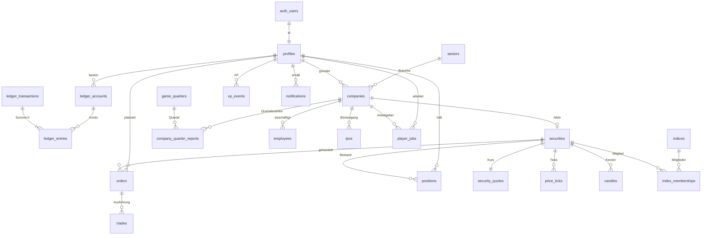

In den folgenden Diagrammen fehlen die Kanten zu `game_quarters` und `ledger_transactions`, weil fast jede Tabelle
darauf verweist und die Diagramme sonst unlesbar wären. Die Spalten dazu heißen überall `game_quarter_id` bzw.
`ledger_transaction_id` und stehen in Abschnitt 3.

<!-- BEGIN GENERATED:er -->

### 4.1 Ledger (doppelte Buchführung)

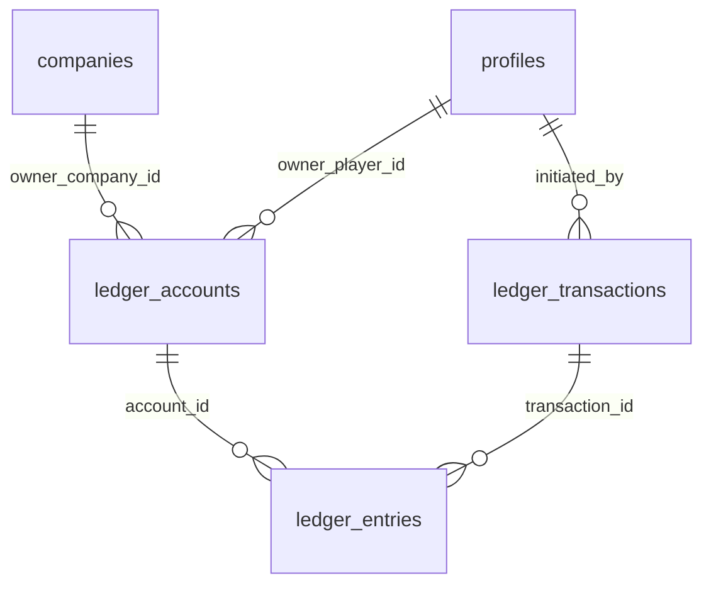

### 4.2 Spieler, Fortschritt und Belohnungen

```mermaid
erDiagram
  achievements ||--o{ cosmetic_items : "unlock_achievement_key"
  achievements ||--o{ player_achievements : "achievement_key"
  cosmetic_items ||--o{ player_cosmetics : "cosmetic_key"
  invite_codes ||--o{ invite_code_redemptions : "code"
  levels ||--o{ cosmetic_items : "unlock_level"
  levels ||--o{ unlocks : "level"
  lifestyle_items ||--o{ player_lifestyle_items : "item_key"
  mission_templates ||--o{ player_missions : "template_key"
  mission_templates ||--o{ unlocks : "intro_mission_key"
  profiles ||--o{ daily_logins : "player_id"
  profiles ||--o{ invite_code_redemptions : "player_id"
  profiles ||--o{ login_streaks : "player_id"
  profiles ||--o{ player_achievements : "player_id"
  profiles ||--o{ player_bankruptcies : "player_id"
  profiles ||--o{ player_cosmetics : "player_id"
  profiles ||--o{ player_lifestyle_items : "player_id"
  profiles ||--o{ player_missions : "player_id"
  profiles ||--o{ player_private : "player_id"
  profiles ||--o{ player_random_events : "player_id"
  profiles ||--o{ player_settings : "player_id"
  profiles ||--o{ player_unlocks : "player_id"
  profiles ||--o{ vault_claims : "player_id"
  profiles ||--o{ vaults : "player_id"
  profiles ||--o{ xp_daily_counters : "player_id"
  profiles ||--o{ xp_events : "player_id"
  random_event_definitions ||--o{ player_random_events : "definition_key"
  unlocks ||--o{ mission_templates : "required_unlock_key"
  unlocks ||--o{ player_unlocks : "unlock_key"
```

### 4.3 Wertpapiere, Marktdaten und Simulationsinterna

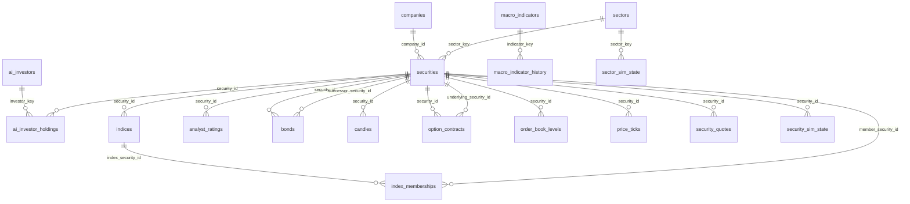

### 4.4 Handel

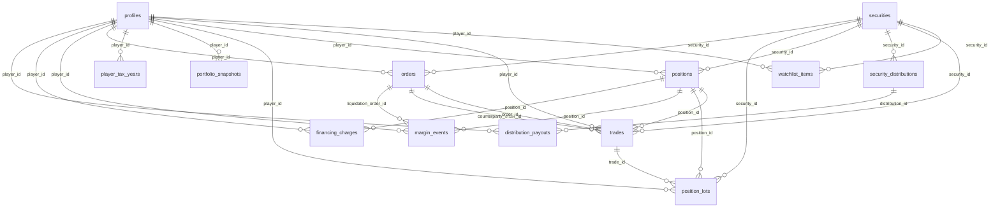

### 4.5 Unternehmen und Mitarbeiter

```mermaid
erDiagram
  ai_investors ||--o{ cap_table_entries : "ai_investor_key"
  companies ||--o{ applicants : "company_id"
  companies ||--o{ cap_table_entries : "company_id"
  companies ||--o{ capital_injections : "company_id"
  companies ||--o{ company_events : "company_id"
  companies ||--o{ company_products : "company_id"
  companies ||--o{ company_quarter_decisions : "company_id"
  companies ||--o{ company_quarter_reports : "company_id"
  companies ||--o{ company_state : "company_id"
  companies ||--o{ employees : "company_id"
  companies ||--o{ insolvency_proceedings : "company_id"
  companies ||--o{ loans : "company_id"
  companies ||--o{ poaching_offers : "from_company_id"
  companies ||--o{ share_issuances : "company_id"
  companies ||--o{ share_lockups : "company_id"
  companies ||--o{ stock_option_grants : "company_id"
  companies ||--o{ takeover_offers : "bidder_company_id"
  companies ||--o{ takeover_offers : "target_company_id"
  employee_traits ||--o{ applicants : "trait_key"
  employee_traits ||--o{ employees : "trait_key"
  employees ||--o{ applicants : "hired_employee_id"
  employees ||--o{ poaching_offers : "employee_id"
  employees ||--o{ stock_option_grants : "employee_id"
  insolvency_proceedings ||--o{ takeover_offers : "insolvency_id"
  loans ||--o{ loan_payments : "loan_id"
  profiles ||--o{ cap_table_entries : "player_id"
  profiles ||--o{ capital_injections : "player_id"
  profiles ||--o{ companies : "ceo_id"
  profiles ||--o{ companies : "founder_id"
  profiles ||--o{ company_quarter_decisions : "submitted_by"
  profiles ||--o{ employees : "player_id"
  profiles ||--o{ loans : "player_id"
  profiles ||--o{ loans : "requested_by"
  profiles ||--o{ poaching_offers : "offered_by"
  profiles ||--o{ share_lockups : "player_id"
  profiles ||--o{ stock_option_grants : "player_id"
  profiles ||--o{ takeover_offers : "bidder_player_id"
  sectors ||--o{ companies : "sector_key"
  sectors ||--o{ sector_quarter_stats : "sector_key"
  securities ||--o{ companies : "security_id"
  stock_option_grants ||--o{ stock_option_vesting_events : "grant_id"
```

### 4.6 Börsengang und Governance

```mermaid
erDiagram
  ai_investors ||--o{ angel_offers : "ai_investor_key"
  ai_investors ||--o{ ipo_subscriptions : "ai_investor_key"
  companies ||--o{ angel_offers : "company_id"
  companies ||--o{ corporate_actions : "company_id"
  companies ||--o{ guidance : "company_id"
  companies ||--o{ insider_blackout_windows : "company_id"
  companies ||--o{ insider_violations : "company_id"
  companies ||--o{ ipos : "company_id"
  companies ||--o{ reputation_events : "company_id"
  companies ||--o{ shareholder_votes : "company_id"
  insider_blackout_windows ||--o{ insider_violations : "window_id"
  ipos ||--o{ ipo_prospectus_forecasts : "ipo_id"
  ipos ||--o{ ipo_subscriptions : "ipo_id"
  ipos ||--o{ ipo_use_of_proceeds : "ipo_id"
  orders ||--o{ insider_violations : "order_id"
  profiles ||--o{ angel_offers : "created_by"
  profiles ||--o{ angel_offers : "investor_player_id"
  profiles ||--o{ corporate_actions : "requested_by"
  profiles ||--o{ guidance : "issued_by"
  profiles ||--o{ insider_violations : "player_id"
  profiles ||--o{ ipo_subscriptions : "player_id"
  profiles ||--o{ ipos : "filed_by"
  profiles ||--o{ reputation_events : "player_id"
  profiles ||--o{ shareholder_vote_ballots : "player_id"
  profiles ||--o{ shareholder_votes : "proposed_by"
  securities ||--o{ insider_blackout_windows : "security_id"
  securities ||--o{ insider_violations : "security_id"
  securities ||--o{ ipos : "security_id"
  security_distributions ||--o{ corporate_actions : "distribution_id"
  shareholder_votes ||--o{ corporate_actions : "vote_id"
  shareholder_votes ||--o{ shareholder_vote_ballots : "vote_id"
  trades ||--o{ insider_violations : "trade_id"
```

### 4.7 Karriere

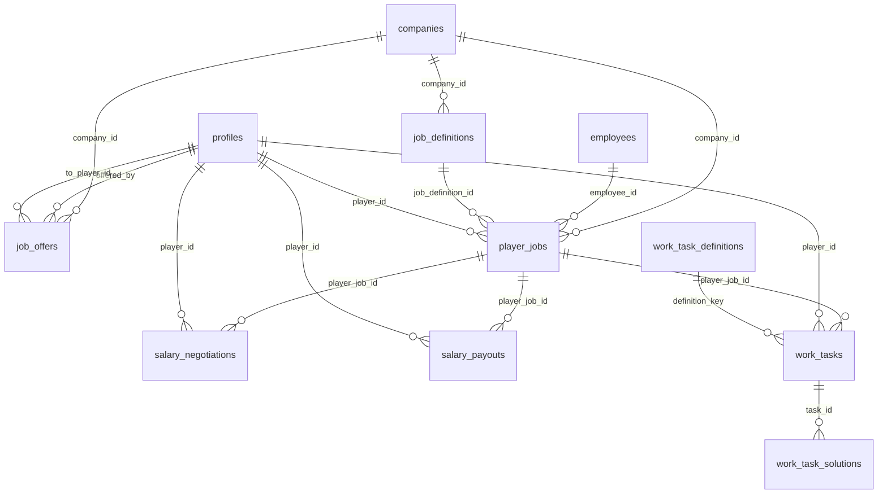

### 4.8 Soziales und Benachrichtigungen

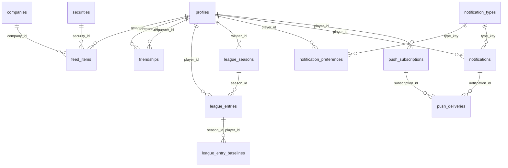

### 4.9 Events und Nachrichten

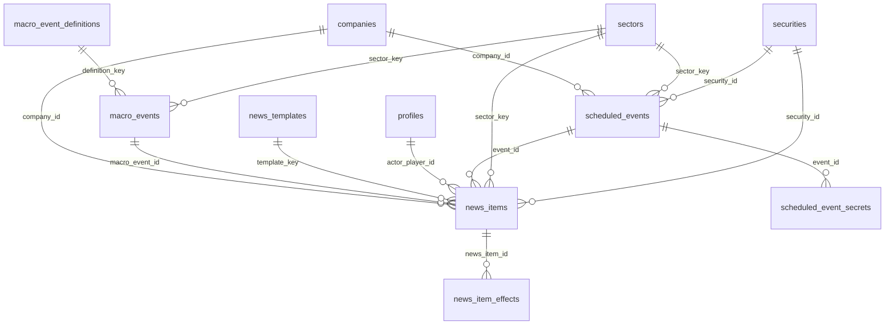

### 4.10 Admin, Missbrauchsschutz und Audit

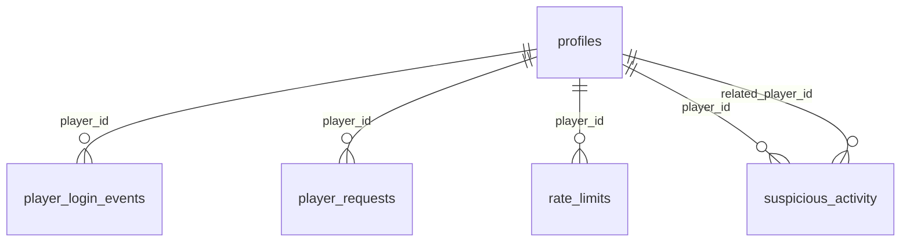

<!-- END GENERATED:er -->

---

## 5. Views

Alle Views sind `security_invoker = true` und nur für `authenticated` freigegeben. Angelegt in Migration 1500.

| View                   | Inhalt                                                                                      | Basis                                                    |
| ---------------------- | ------------------------------------------------------------------------------------------- | -------------------------------------------------------- |
| `v_securities`         | Marktliste: Stammdaten, Logo und Farbe des Emittenten, aktueller Kurs                       | `securities`, `security_quotes`, `companies`             |
| `v_stock_fundamentals` | Kennzahlen je Aktie: KGV, Nettomarge, Dividendenrendite, Marktkapitalisierung               | `companies`, `security_quotes`, `security_distributions` |
| `v_bonds`              | Staatsanleihen mit Bedingungen, Kurs und Rendite                                            | `bonds`, `securities`, `security_quotes`                 |
| `v_index_members`      | Aktuelle Indexmitglieder mit Gewicht und Kurs                                               | `indices`, `index_memberships`                           |
| `v_company_profiles`   | Firmenkopf: Profil, Gründer mit Reputation, Kurs, letzte **veröffentlichte** Quartalszahlen | `companies`, `profiles`, `company_quarter_reports`       |
| `v_cap_table`          | Aktionärsregister mit Anteil in Basispunkten                                                | `cap_table_entries`                                      |
| `v_ipo_calendar`       | Laufende und vergangene Börsengänge mit Überzeichnung (ohne Entwürfe)                       | `ipos`, `companies`                                      |
| `v_job_board`          | Offene Jobs der KI-Firmen                                                                   | `job_definitions`, `companies`                           |
| `v_player_profiles`    | Öffentliche Spielerkarte mit Anzahl Erfolge, Statussymbolen und gegründeten Firmen          | `profiles` und weitere                                   |
| `v_league_standings`   | Wochenliga nach Wachstum in Prozent; `is_friend_or_me` filtert die Freundes-Liga            | `league_entries`, `league_seasons`                       |
| `v_friends`            | Freunde und offene Anfragen aus Sicht des Aufrufers                                         | `friendships`, `profiles`                                |
| `v_feed`               | Sichtbare Feed-Einträge mit Namen                                                           | `feed_items`                                             |
| `v_event_calendar`     | Kommende Events für die Countdown-Leiste und Ergebnisse der letzten 24 Stunden              | `scheduled_events`                                       |
| `v_news`               | Newsticker mit Firmen- und Tickernamen                                                      | `news_items`                                             |
| `v_my_accounts`        | Eigene Kontostände (Cash, Reserve)                                                          | `ledger_accounts`                                        |
| `v_my_ledger`          | Eigener Kontoauszug                                                                         | `ledger_entries`, `ledger_transactions`                  |
| `v_my_positions`       | Offene Positionen mit Marktwert und unrealisiertem Ergebnis (nur Anzeige)                   | `positions`, `security_quotes`                           |
| `v_my_vault`           | Tresorzustand mit aufgelaufenen Sekunden                                                    | `vaults`                                                 |

Die `v_my_*`-Views filtern zusätzlich zur RLS ausdrücklich auf `auth.uid()`. Sonst würden Firmenkonten, die ein Insider
lesen darf, in „meinen“ Listen auftauchen.

---

## 6. Funktionen und RPCs

### 6.1 Jetzt umgesetzt (M0)

| Funktion                                                                             | Aufrufbar von            | Zweck                                                                                                                                                                    |
| ------------------------------------------------------------------------------------ | ------------------------ | ------------------------------------------------------------------------------------------------------------------------------------------------------------------------ |
| `handle_new_user()`                                                                  | Trigger auf `auth.users` | Prüft Einladungscode und Altersbestätigung, legt Profil, Einstellungen, Tresor, Login-Serie, Ledger-Konten und Benachrichtigungs-Standards an und bucht das Startkapital |
| `is_admin()`                                                                         | `authenticated`          | Aufrufer steht in `admin_users`                                                                                                                                          |
| `is_company_insider(company_id)`                                                     | `authenticated`          | RLS-Helfer: Gründer, CEO oder aktiver Spieler-Mitarbeiter                                                                                                                |
| `are_friends(a, b)`                                                                  | `authenticated`          | RLS-Helfer; ein Client darf nur Paare abfragen, in denen er selbst vorkommt                                                                                              |
| `has_unlock(key)`                                                                    | `authenticated`          | Aufrufer hat das Feature freigeschaltet                                                                                                                                  |
| `owns_ledger_account(account_id)`, `can_read_ledger_transaction(id)`                 | `authenticated`          | RLS-Helfer für das Ledger                                                                                                                                                |
| `game_now()`, `game_day(ts)`, `current_game_quarter()`                               | `authenticated`          | Spielzeit inklusive Admin-Versatz, Spieltag, laufendes Quartal                                                                                                           |
| `ensure_game_quarters(days_ahead)`                                                   | Server                   | Legt kommende Quartale an (Europe/Berlin, 08/14/20/02 Uhr), idempotent                                                                                                   |
| `ledger_post(kind, entries, …)`                                                      | Server                   | Bucht eine ausgeglichene Transaktion, sperrt Konten in fester Reihenfolge, idempotent über Schlüssel                                                                     |
| `ledger_transfer(from, to, amount, kind, …)`                                         | Server                   | Kurzform für zwei Buchungszeilen                                                                                                                                         |
| `ledger_system_account(key)`, `ledger_player_account(player, kind)`                  | Server                   | Konten nachschlagen                                                                                                                                                      |
| `ledger_audit()`, `money_supply_cents()`                                             | Server                   | Abgleich Cache gegen Journal; Geldmenge für die Zentralbank                                                                                                              |
| `rate_limit_hit(…)`, `rate_limit_enforce(…)`                                         | Server                   | Zähler im festen Zeitfenster; `enforce` wirft `NX004`                                                                                                                    |
| `request_begin(…)`, `request_complete(…)`                                            | Server                   | Idempotenz-Journal für Aktionen ohne eigene Tabelle                                                                                                                      |
| `config_jsonb/bigint/boolean(key, path, fallback)`                                   | Server                   | Typisierter Zugriff auf `game_config`                                                                                                                                    |
| `maintain_price_tick_partitions(…)`                                                  | Server, Cron             | Tagespartitionen für `price_ticks` anlegen und alte löschen                                                                                                              |
| `run_maintenance()`                                                                  | Cron                     | Kalender, Partitionen, Aufbewahrungsfristen                                                                                                                              |
| `invoke_edge_function(name, body)`                                                   | Cron                     | Ruft eine Edge Function über `pg_net`; URL und Secret aus Supabase Vault                                                                                                 |
| `set_updated_at()`, `prevent_mutation()`, `enforce_row_cap()` und die Ledger-Trigger | Trigger                  | Gemeinsame Triggerfunktionen                                                                                                                                             |

„Server“ bedeutet: nur `service_role` hat `EXECUTE`, dazu andere `SECURITY DEFINER`-Funktionen. `anon` darf keine Funktion ausführen.

**Metadaten bei der Registrierung** (`supabase.auth.signUp({ options: { data } })`):

| Feld            | Pflicht                                                                  | Bedeutung                                                                                                                         |
| --------------- | ------------------------------------------------------------------------ | --------------------------------------------------------------------------------------------------------------------------------- |
| `invite_code`   | ja, solange `game_config.auth.inviteRequired` nicht `false` ist          | Groß-/Kleinschreibung und Leerzeichen am Rand egal                                                                                |
| `age_confirmed` | ja, solange `game_config.auth.ageConfirmationRequired` nicht `false` ist | `true`                                                                                                                            |
| `nickname`      | nein                                                                     | 3 bis 20 Zeichen aus `[A-Za-z0-9_]`; ist er vergeben, hängt der Server fünf Ziffern an; fehlt er, heißt der Spieler `TraderNNNNN` |

Startkapital: `game_config`, Schlüssel `economy`, Pfad `startingCapitalCents`, sonst 1 000 000 Cent (ADR-011).

### 6.2 Geplant je Meilenstein

Signaturskizzen. Jede Spieler-RPC ist `SECURITY DEFINER`, prüft `auth.uid()`, Level und Freischaltung, Rate Limit und
Eingaben erneut und nimmt eine `p_request_id uuid`. Rückgabe ist die betroffene Zeile oder ein `jsonb`-Ergebnis.
„intern“ heißt: nur `service_role`.

**M1 Markt**

```sql
acquire_tick_lease(p_runner_id uuid, p_ttl_seconds int) returns boolean                    -- intern
get_tick_state() returns jsonb                                                               -- intern, ein Roundtrip
apply_market_tick(p_payload jsonb) returns jsonb                                             -- intern: Kurse, Ticks, Kerzen, Orderbuch,
                                                                                             --   fällige Limit-/Stop-Orders, KI-Bestände
place_order(p_request_id uuid, p_security_id uuid, p_side order_side, p_type order_type,
            p_quantity bigint, p_limit_price_e4 bigint default null,
            p_stop_price_e4 bigint default null, p_position_side position_side default 'long',
            p_leverage smallint default 1, p_time_in_force time_in_force default 'gtc') returns orders
cancel_order(p_request_id uuid, p_order_id uuid) returns orders
execute_order_fill(p_order_id uuid, p_quantity bigint, p_price_e4 bigint,
                   p_counterparty trade_counterparty) returns trades                         -- intern: Trade, Position, Lots,
                                                                                             --   Gebühr, Steuer, Ledger
```

**M2 Spieler-Kern**

```sql
claim_vault(p_request_id uuid) returns jsonb               -- { amount_cents, accrued_seconds, forfeited_seconds }
claim_daily_login(p_request_id uuid) returns jsonb         -- Streak, Bonus-XP, Streak-Schutz
award_xp(p_player_id uuid, p_source xp_source, p_amount int, p_ref_type text, p_ref_id uuid,
         p_dedupe_key text) returns jsonb                  -- intern: Tagesdeckel, Level-up, Freischaltungen
assign_daily_missions(p_player_id uuid) returns setof player_missions                        -- intern
track_mission_progress(p_player_id uuid, p_metric text, p_delta bigint) returns void         -- intern
claim_mission(p_request_id uuid, p_mission_id uuid) returns player_missions
unlock_achievement(p_player_id uuid, p_key text) returns void                                -- intern
update_profile(p_nickname text, p_avatar jsonb, p_title_key text, p_frame_key text,
               p_accent_color text) returns profiles
send_friend_request(p_request_id uuid, p_nickname text) returns friendships
respond_friend_request(p_friendship_id uuid, p_accept boolean) returns friendships
remove_friend(p_friendship_id uuid) returns void
get_player_portfolio(p_player_id uuid) returns jsonb       -- beachtet portfolio_visibility, nur Gewichte in Prozent
notify(p_player_id uuid, p_type_key text, p_title text, p_body text, p_payload jsonb,
       p_dedupe_key text) returns uuid                     -- intern, beachtet notification_preferences
snapshot_portfolios(p_granularity snapshot_granularity) returns int                          -- intern
close_league_season(p_season_id uuid) returns void                                           -- intern
```

**M3 Karriere**

```sql
take_job(p_request_id uuid, p_job_definition_id uuid) returns player_jobs
quit_job(p_request_id uuid) returns player_jobs
accrue_salaries() returns int                              -- intern: höchstens 12 bezahlte Stunden pro Tag, XP
start_work_task(p_task_id uuid) returns work_tasks
submit_work_task(p_request_id uuid, p_task_id uuid, p_answer jsonb) returns work_tasks
negotiate_salary(p_request_id uuid, p_raise_bps int) returns salary_negotiations
```

**M4 Unternehmen**

```sql
found_company(p_request_id uuid, p_name text, p_sector_key text, p_legal_form legal_form,
              p_logo_pixels jsonb, p_brand_color text, p_capital_cents bigint) returns companies
convert_company(p_request_id uuid, p_company_id uuid, p_legal_form legal_form) returns companies
inject_capital(p_request_id uuid, p_company_id uuid, p_amount_cents bigint) returns capital_injections
submit_quarter_decisions(p_request_id uuid, p_company_id uuid, p_decisions jsonb) returns company_quarter_decisions
start_product_development(p_request_id uuid, p_company_id uuid, p_name text, p_budget_cents bigint) returns company_products
hire_applicant(p_request_id uuid, p_applicant_id uuid, p_role employee_role) returns employees
dismiss_employee(p_request_id uuid, p_employee_id uuid) returns employees
set_employee_salary(p_request_id uuid, p_employee_id uuid, p_salary_cents_per_quarter bigint) returns employees
request_loan(p_request_id uuid, p_company_id uuid, p_amount_cents bigint, p_term_quarters int) returns loans
repay_loan(p_request_id uuid, p_loan_id uuid, p_amount_cents bigint) returns loans
close_quarter(p_quarter_id bigint, p_results jsonb) returns jsonb   -- intern: wendet die in TypeScript berechnete
                                                                    --   Simulation an (Berichte, Gehälter, Zinsen, Dividenden,
                                                                    --   Kupons, Vesting, Insolvenz), idempotent über job_runs
```

**M5 Sozial**

```sql
create_job_offer(p_request_id uuid, p_company_id uuid, p_to_player_id uuid, p_terms jsonb) returns job_offers
respond_job_offer(p_request_id uuid, p_offer_id uuid, p_accept boolean) returns job_offers
create_angel_offer(p_request_id uuid, p_company_id uuid, p_shares bigint, p_price_per_share_e4 bigint,
                   p_investor_player_id uuid default null) returns angel_offers
respond_angel_offer(p_request_id uuid, p_offer_id uuid, p_accept boolean) returns angel_offers
poach_employee(p_request_id uuid, p_employee_id uuid, p_company_id uuid, p_salary_cents_per_quarter bigint) returns poaching_offers
record_insider_trade(p_trade_id uuid) returns void         -- intern, aus execute_order_fill
resolve_insider_violations() returns int                   -- intern: Aufdeckung würfeln, Strafe, Reputation
```

**M6 Börsengang**

```sql
file_ipo(p_request_id uuid, p_company_id uuid, p_prospectus jsonb) returns ipos   -- Prognose, Mittelverwendung (Summe 100 %), Lock-up
subscribe_ipo(p_request_id uuid, p_ipo_id uuid, p_shares bigint, p_limit_price_e4 bigint) returns ipo_subscriptions
cancel_ipo_subscription(p_request_id uuid, p_subscription_id uuid) returns ipo_subscriptions
price_ipo(p_ipo_id uuid, p_ai_demand jsonb) returns ipos   -- intern: Zuteilung, Listing oder Abbruch mit Rückzahlung
issue_guidance(p_request_id uuid, p_company_id uuid, p_revenue_low_cents bigint, p_revenue_high_cents bigint) returns guidance
announce_corporate_action(p_request_id uuid, p_company_id uuid, p_kind corporate_action_kind, p_terms jsonb) returns corporate_actions
propose_vote(p_request_id uuid, p_company_id uuid, p_kind vote_kind, p_proposal jsonb) returns shareholder_votes
cast_vote(p_request_id uuid, p_vote_id uuid, p_choice vote_choice) returns shareholder_vote_ballots
adjust_reputation(p_player_id uuid, p_kind reputation_event_kind, p_delta int, p_ref jsonb) returns int   -- intern
```

**M7 Risiko**

```sql
-- place_order wird um Short und Hebel erweitert (gleiche Signatur)
charge_financing(p_charge_date date) returns int           -- intern: Hebelzinsen, Leihgebühren
check_margin(p_security_ids uuid[]) returns int            -- intern, im Tick: Warnung, Margin Call
liquidate_position(p_position_id uuid) returns orders      -- intern
declare_bankruptcy(p_request_id uuid) returns player_bankruptcies
resolve_scheduled_event(p_event_id uuid, p_outcome jsonb) returns scheduled_events   -- intern
start_macro_event(p_definition_key text, p_sector_key text default null) returns macro_events   -- intern
```

**M8 Feinschliff**

```sql
buy_lifestyle_item(p_request_id uuid, p_item_key text) returns player_lifestyle_items
sell_lifestyle_item(p_request_id uuid, p_item_id uuid) returns player_lifestyle_items
charge_lifestyle_upkeep(p_quarter_id bigint) returns int   -- intern
roll_random_events() returns int                           -- intern
respond_random_event(p_request_id uuid, p_event_id uuid, p_accept boolean) returns player_random_events
equip_cosmetics(p_request_id uuid, p_avatar jsonb, p_title_key text, p_frame_key text) returns profiles
queue_push(p_notification_id uuid) returns int             -- intern: Tagesdeckel, push_deliveries
```

**Admin** (prüfen `is_admin()`, schreiben `admin_actions`)

```sql
admin_set_config(p_key text, p_value jsonb) returns game_config
admin_set_time_offset(p_offset interval) returns timestamptz
admin_trigger_event(p_kind scheduled_event_kind, p_params jsonb) returns scheduled_events
admin_reset_player(p_player_id uuid) returns void
admin_create_invite_code(p_code text, p_max_uses int, p_expires_at timestamptz) returns invite_codes
admin_adjust_balance(p_player_id uuid, p_amount_cents bigint, p_reason text) returns uuid
```

---

## 7. Ledger im Detail

Umsetzung von ADR-007 in Migration 0300.

### Aufbau

- `ledger_accounts`: Kontoarten `player_cash`, `player_reserve`, `company_cash`, `company_reserve`, `system`.
  Jeder Spieler bekommt bei der Registrierung ein Cash- und ein Reservekonto. Auf das Reservekonto wandert Geld,
  das durch offene Limit-Kauforders, IPO-Zeichnungen oder Margin gebunden ist. So ist „verfügbar“ immer der
  Stand des Cash-Kontos, ohne zweite Rechnung.
- `ledger_transactions`: Kopf mit `kind`, Bezug (`ref_type`, `ref_id`), Quartal und optionalem `idempotency_key`.
- `ledger_entries`: Zeilen mit `amount_cents` und `balance_after_cents`.

Vorzeichen: `amount_cents > 0` erhöht den Kontostand, `< 0` senkt ihn. Die Zeilen einer Transaktion ergeben zusammen 0.

### Garantien

| Regel                                                    | Durchgesetzt von                                                                                                              |
| -------------------------------------------------------- | ----------------------------------------------------------------------------------------------------------------------------- |
| Summe je Transaktion = 0, mindestens zwei Zeilen         | Constraint-Trigger `ledger_check_balanced`, `DEFERRABLE INITIALLY DEFERRED`, auf `ledger_entries` und `ledger_transactions`   |
| Kein UPDATE, DELETE, TRUNCATE auf Zeilen und Köpfen      | Trigger `prevent_mutation`                                                                                                    |
| Keine Zeilen an eine abgeschlossene Transaktion anhängen | `ledger_transactions.db_txid` muss der laufenden Datenbanktransaktion entsprechen                                             |
| Kontostand nur über Buchungen                            | Trigger `ledger_accounts_guard` lässt Änderungen an `balance_cents` nur aus dem Buchungstrigger zu; neue Konten starten bei 0 |
| Spieler- und Firmenkonten nie negativ                    | Prüfung im Buchungstrigger (`NX001`) und Check-Constraint; nur Konten mit `allow_negative` dürfen ins Minus                   |
| Keine Deadlocks                                          | `ledger_post()` sperrt alle betroffenen Konten in Reihenfolge der `id`                                                        |
| Kein doppeltes Buchen                                    | `idempotency_key` eindeutig; `ledger_post()` gibt bei Wiederholung die vorhandene Transaktion zurück                          |

`ledger_audit()` vergleicht jeden Cache mit der Summe der Zeilen und muss leer sein.

### Systemkonten

Quellen und Senken dürfen negativ werden. Ihr Stand zeigt, wie viel Geld über diesen Weg ins Spiel kam (negativ)
oder das Spiel verlassen hat (positiv).

| `system_key` | Rolle                                                                               |
| ------------ | ----------------------------------------------------------------------------------- |
| `mint`       | Geldschöpfung: Startkapital, Grundeinkommen, Boni, Eröffnungsbilanzen der KI-Firmen |
| `payroll`    | Gehälter, die KI-Firmen an Spieler zahlen                                           |
| `fees`       | Ordergebühren und andere Gebühren (Senke)                                           |
| `taxes`      | Steuern auf Gewinne (Senke)                                                         |
| `market`     | Gegenpartei der KI (Marktmacher, Fonds) und Rundungsdifferenzen                     |
| `upkeep`     | Unterhalt für Statussymbole (Senke)                                                 |
| `interest`   | Finanzierungskosten, Kreditzinsen, Kupons                                           |
| `bank`       | Kreditsummen der KI-Bank                                                            |
| `fines`      | Strafen der Finanzaufsicht (Senke)                                                  |
| `economy`    | Kunden und Lieferanten der Firmen (Umsatz und Kosten)                               |

### Beispiel: Registrierung

| Konto                            | `amount_cents` |
| -------------------------------- | -------------- |
| `mint`                           | −1 000 000     |
| `player_cash` des neuen Spielers | +1 000 000     |

### Beispiel: Kauf von 10 Aktien zu 84,00 € mit 1 € Gebühr (geplant in M1)

| Konto         | `amount_cents` |
| ------------- | -------------- |
| `player_cash` | −84 100        |
| `market`      | +84 000        |
| `fees`        | +100           |

---

## 8. Spielzeit

Umsetzung von ADR-006 in Migration 0200.

- `game_quarters` enthält jedes Quartal als Zeile. Q1 beginnt um 08:00, Q2 um 14:00, Q3 um 20:00, Q4 um 02:00 (Europe/Berlin).
  Ein **Spieltag** läuft von 08:00 bis 08:00 und entspricht einem Spieljahr. `game_year` zählt ab der Epoche in
  `sim_runtime.game_epoch_date`, die beim ersten Aufruf von `ensure_game_quarters()` gesetzt wird.
- Beginn und Ende werden beide aus der lokalen Uhrzeit berechnet. An den Tagen der Zeitumstellung ist dadurch genau ein
  Quartal 5 bzw. 7 Stunden lang, ohne Sonderfall im Code. Ein Exclusion-Constraint verhindert überlappende Quartale.
- `game_now()` ist die Uhrzeit plus `sim_runtime.time_offset`. Damit spult der Admin für Tests vor.
  `current_game_quarter()` liest das Quartal, in dem `game_now()` liegt. Spielzeit wird nie aus der Uhr ausgerechnet.
- Der Status (`scheduled`, `active`, `closing`, `closed`) gehört dem Quartalsabschluss. `ensure_game_quarters()` setzt nur `active`.
- `market_status` hält die Börsenphase für den Client (08 bis 22 Uhr offen, danach nachbörslich), geschrieben vom Tick-Runner.

---

## 9. Stammdaten (Seed)

`supabase/seed.sql` ist idempotent und kann mehrfach laufen. Nicht enthalten ist `game_config`
(wird mit `pnpm db:config` aus `src/config/balance.ts` erzeugt).

| Inhalt                                                | Anzahl | Hinweis                                                       |
| ----------------------------------------------------- | ------ | ------------------------------------------------------------- |
| Branchen                                              | 5      | mit Branchen-KGV und Quartalsnachfrage (Summe der KI-Umsätze) |
| KI-Unternehmen                                        | 15     | ADR-014; je Branche Bluechip, Mittelständler, Pennystock      |
| Aktien mit Startkurs, Geld/Brief und verdecktem Anker | 15     | Startkurse 0,31 € bis 112,50 €                                |
| Firmenkonten mit Eröffnungsbilanz                     | 15     | eine Quartalsrate Kosten, gebucht aus `mint`                  |
| Staatsanleihen                                        | 4      | 1, 2, 5, 10 Spieljahre; Kupon 2,5 % bis 3,8 %                 |
| Index NEXA 30                                         | 1      | Basis 1000 Punkte, 15 Mitglieder nach Marktkapitalisierung    |
| KI-Investortypen                                      | 6      | Spec 5.3, mit Strategieparametern                             |
| Leitzins                                              | 300 bp | `central_bank_state`                                          |
| Makrogrößen                                           | 4      | Ölpreis, Konsumklima, Lohnindex, Konjunkturindex              |
| Level                                                 | 50     | `round(100 × n^1.5)`                                          |
| Freischaltungen                                       | 28     | Spec 9.3                                                      |
| Missionsvorlagen                                      | 23     | 11 täglich, 3 wöchentlich, 9 Einstieg                         |
| Erfolge                                               | 56     | inklusive der 8 aus Spec 11.2, jeder mit eigenem `icon_key`   |
| Kosmetik                                              | 15     | Titel, Rahmen, Avatar-Teile                                   |
| Statussymbole                                         | 5      | Spec 11.3 mit Unterhalt je Quartal                            |
| Zufallsereignisse                                     | 7      | Spec 11.4 plus drei kleine                                    |
| Makro-Events                                          | 5      | Spec 5.5                                                      |
| Nachrichtenvorlagen                                   | 18     |                                                               |
| Benachrichtigungsarten                                | 30     |                                                               |
| Mitarbeiter-Eigenschaften                             | 8      |                                                               |
| Arbeitsaufgaben-Arten                                 | 6      |                                                               |
| Jobs bei KI-Firmen                                    | 19     | 5 Stufen, Level 2, 5, 12, 20, 25                              |
| Einladungscodes                                       | 2      | vor einem echten Start ersetzen                               |
| Zufallsströme                                         | 5      | `sim_rng_streams`                                             |

Die KI-Unternehmen haben feste IDs (`md5('nexa:company:' || ticker)::uuid`, Aktien entsprechend mit `nexa:security:`),
damit Demo-Daten und Tests in jeder Umgebung dieselben Schlüssel verwenden.

Startwerte der 15 KI-Unternehmen (Umsatz und Kosten je Quartal):

| Ticker | Unternehmen           | Branche  | Größe    | Aktien   | Startkurs | Umsatz       | Kosten         | Ausschüttung |
| ------ | --------------------- | -------- | -------- | -------- | --------- | ------------ | -------------- | ------------ |
| KLS    | KlarSoft AG           | Tech     | Bluechip | 50 Mio.  | 84,00 €   | 420 Mio. €   | 382,5 Mio. €   | 20 %         |
| PXW    | Pixelwerk Studios     | Tech     | Mittel   | 20 Mio.  | 23,50 €   | 60 Mio. €    | 55,5 Mio. €    | keine        |
| QSL    | QuantenSprung Labs    | Tech     | Penny    | 40 Mio.  | 0,42 €    | 2,4 Mio. €   | 2,9 Mio. €     | keine        |
| BRZ    | Brotzeit Handel AG    | Handel   | Bluechip | 80 Mio.  | 41,20 €   | 1 960 Mio. € | 1 901,2 Mio. € | 50 %         |
| KFR    | Kaufrausch Märkte     | Handel   | Mittel   | 25 Mio.  | 15,80 €   | 280 Mio. €   | 273 Mio. €     | 35 %         |
| FGD    | Fundgrube Discount    | Handel   | Penny    | 60 Mio.  | 0,65 €    | 45 Mio. €    | 44,4 Mio. €    | keine        |
| VLT    | Volta Energie AG      | Energie  | Bluechip | 100 Mio. | 56,40 €   | 1 300 Mio. € | 1 182,5 Mio. € | 65 %         |
| RKW    | Rheinkraft Werke      | Energie  | Mittel   | 30 Mio.  | 18,90 €   | 150 Mio. €   | 138,2 Mio. €   | 45 %         |
| SFX    | SolarFuchs            | Energie  | Penny    | 50 Mio.  | 0,88 €    | 6 Mio. €     | 6,5 Mio. €     | keine        |
| NPH    | NeuroPharm AG         | Pharma   | Bluechip | 60 Mio.  | 112,50 €  | 480 Mio. €   | 403,3 Mio. €   | 40 %         |
| ALM    | Alpenmed              | Pharma   | Mittel   | 15 Mio.  | 34,60 €   | 52 Mio. €    | 46,1 Mio. €    | 20 %         |
| GNV    | GenoVita Biotech      | Pharma   | Penny    | 80 Mio.  | 0,31 €    | 0,4 Mio. €   | 2,1 Mio. €     | keine        |
| NDL    | Nordlicht Logistik AG | Logistik | Bluechip | 70 Mio.  | 47,80 €   | 870 Mio. €   | 817,7 Mio. €   | 45 %         |
| EBX    | Eilbote Express       | Logistik | Mittel   | 20 Mio.  | 12,40 €   | 78 Mio. €    | 74,1 Mio. €    | 30 %         |
| FPT    | Frachtpilot           | Logistik | Penny    | 45 Mio.  | 0,54 €    | 9 Mio. €     | 8,7 Mio. €     | keine        |

Die Startkurse sind so gewählt, dass Jahresgewinn je Aktie mal Branchen-KGV ungefähr den Kurs ergibt
(Tech 28, Handel 14, Energie 12, Pharma 22, Logistik 16). Drei Pennystocks schreiben Verlust und werden nach Fantasie bewertet.

---

## 10. Migrationen, Cron und Aufbewahrung

| Datei                                         | Inhalt                                                                                                  |
| --------------------------------------------- | ------------------------------------------------------------------------------------------------------- |
| `20261110000100_extensions_enums_helpers.sql` | Standardrechte schließen, alle Enums, `set_updated_at`, `prevent_mutation`, `admin_users`, `is_admin()` |
| `20261110000200_config_game_time.sql`         | `game_config`, Laufzeit-Singletons, Spielkalender und Zeitfunktionen                                    |
| `20261110000300_ledger.sql`                   | Ledger mit Triggern, `ledger_post()`, Systemkonten                                                      |
| `20261110000400_players_progression.sql`      | Profile, Einladungscodes, Level, XP, Tresor, Missionen, Erfolge, Lebensstil, Zufallsereignisse          |
| `20261110000500_securities_market_data.sql`   | Branchen, Wertpapiere, Kurse, Ticks (partitioniert), Kerzen, Index, Zentralbank, Simulationsinterna     |
| `20261110000600_trading.sql`                  | Orders, Trades, Positionen, Margin, Steuern, Ausschüttungen, Watchlist                                  |
| `20261110000700_companies_employees.sql`      | Firmen, Produkte, Quartale, Mitarbeiter, Optionen, Kredite, Cap Table, Insolvenz                        |
| `20261110000800_ipo_governance.sql`           | Business Angels, IPO, Guidance, Kapitalmaßnahmen, Abstimmungen, Reputation, Insider-Regel               |
| `20261110000900_careers.sql`                  | Jobs, Gehalt, Arbeitsaufgaben, Verhandlung, Jobangebote                                                 |
| `20261110001000_social_notifications.sql`     | Freunde, Feed, Liga, Benachrichtigungen, Push                                                           |
| `20261110001100_events_news.sql`              | Geplante Events, Makro-Events, Nachrichten                                                              |
| `20261110001200_admin_audit.sql`              | Admin-Log, Rate Limits, Idempotenz-Journal, Missbrauchsprotokoll                                        |
| `20261110001300_auth_signup.sql`              | `handle_new_user()` und Trigger auf `auth.users`                                                        |
| `20261110001400_triggers_rls_policies.sql`    | `updated_at`-Trigger, RLS-Helfer, Rechte, alle Policies, Realtime-Publikation                           |
| `20261110001500_public_views.sql`             | Views                                                                                                   |
| `20261110001600_cron.sql`                     | `invoke_edge_function()`, `run_maintenance()`, Zeitpläne mit `pg_cron`                                  |

Die Reihenfolge weicht an einer Stelle von der Domänenliste ab: Das Ledger kommt vor den Spielern, weil Spielertabellen
auf Buchungen verweisen. Die Fremdschlüssel vom Ledger auf `profiles` und `companies` werden in den späteren Migrationen ergänzt.

### Zeitpläne (`pg_cron`)

Migration 1600 legt die Jobs nur an, wenn `pg_cron` verfügbar ist. Fehlt die Erweiterung (lokale Prüfung), wird der
Block übersprungen. URL und Secret der Edge Functions stehen in Supabase Vault (`nexa_functions_base_url`,
`nexa_cron_secret`), ersatzweise in `internal_settings`. Solange nichts hinterlegt ist, tut `invoke_edge_function()` nichts.

| Job                    | Zeitplan (UTC)      | Aufruf                                                                     |
| ---------------------- | ------------------- | -------------------------------------------------------------------------- |
| `nexa-tick-runner`     | jede Minute         | `invoke_edge_function('tick-runner')` (ADR-004)                            |
| `nexa-quarter-runner`  | zur vollen Stunde   | `invoke_edge_function('quarter-runner')`; prüft, ob ein Quartal fällig ist |
| `nexa-ensure-quarters` | stündlich, Minute 5 | `ensure_game_quarters(3)`                                                  |
| `nexa-maintenance`     | täglich 03:17       | `run_maintenance()`                                                        |

### Aufbewahrung

| Tabelle                           | Frist                                           | Mechanismus                                                               |
| --------------------------------- | ----------------------------------------------- | ------------------------------------------------------------------------- |
| `price_ticks`                     | 3 Tage                                          | Tagespartitionen, alte werden gelöscht (`maintain_price_tick_partitions`) |
| `candles`                         | 1 min: 7 Tage, 5 min: 30 Tage, sonst unbegrenzt | `run_maintenance()`                                                       |
| `portfolio_snapshots`             | 5 min: 2 Tage, 1 h: 30 Tage, 1 Tag: unbegrenzt  | `run_maintenance()`                                                       |
| `rate_limits`                     | 1 Tag                                           | `run_maintenance()`                                                       |
| `player_requests`, `sim_tick_log` | 7 Tage                                          | `run_maintenance()`                                                       |
| `notifications`                   | abgelaufene sofort, gelesene nach 30 Tagen      | `run_maintenance()`                                                       |
| `player_login_events`             | 90 Tage                                         | `run_maintenance()`                                                       |

Größenordnung für `price_ticks`: 20 Wertpapiere mal 17 280 Ticks am Tag sind rund 350 000 Zeilen täglich. Mit drei Tagen
Aufbewahrung bleibt die Tabelle bei etwa einer Million Zeilen und passt in das kostenlose Supabase-Kontingent.

### Indizes für die heißen Pfade

| Abfrage                                 | Index                                                                                |
| --------------------------------------- | ------------------------------------------------------------------------------------ |
| Ticks und Kerzen je Wertpapier und Zeit | Primärschlüssel `(security_id, ts)` bzw. `(security_id, interval, bucket_start)`     |
| Orders eines Spielers nach Status       | `orders (player_id, status, created_at desc)`                                        |
| Offene Limit-Orders für das Matching    | `orders (security_id, side, limit_price_e4, created_at)` nur für offene Limit-Orders |
| Fällige Stop-Orders                     | `orders (security_id, side, stop_price_e4)` nur für offene Stops                     |
| Liquidationsprüfung im Tick             | `positions (security_id, liquidation_price_e4)` nur für offene Hebelpositionen       |
| Benachrichtigungen                      | `notifications (player_id, created_at desc)` und ein Teilindex für ungelesene        |
| Wash-Trading-Prüfung                    | `trades (player_id, security_id, executed_at desc)`                                  |
| Kontoauszug                             | `ledger_entries (account_id, id desc)`                                               |

---

## 11. Offene Punkte

1. **Schlüssel in `game_config`.** `handle_new_user()` liest `economy.startingCapitalCents`, `auth.inviteRequired` und
   `auth.ageConfirmationRequired`. Der Generator `pnpm db:config` muss diese Namen treffen oder die Funktion wird angepasst.
2. **`game_config_public_keys` ist leer.** Welche Konfigurationsbereiche der Client lesen darf (Gebühren, Steuersatz,
   Tresor, XP-Regeln), muss der Config-Seed mit eintragen. Ohne Eintrag sieht der Client nichts.
3. **Fehlermeldung bei der Registrierung.** Schlägt der Trigger fehl (falscher Code), meldet Supabase Auth nur einen
   allgemeinen Datenbankfehler. Für eine saubere Meldung sollte der Next.js-Server den Code vorab mit der Service-Rolle prüfen.
4. **Cap Table nach dem IPO.** Vorgesehen ist, nach dem Börsengang nur Gründer, Insider, Angels und den Streubesitz zu
   führen. Ob große Spielerpositionen (zum Beispiel ab 3 %) öffentlich gemeldet werden, ist eine Designfrage für M6.
5. **Freundes-Liga.** Es gibt eine Saison je Woche für alle; die Freundes-Liga ist ein Filter darauf. Getrennte Ligen
   mit eigenem Platz 1 je Freundeskreis bräuchten eine Gruppentabelle.
6. **Anleihen rollen.** Die vier Start-Anleihen laufen aus. `bonds.successor_security_id` ist vorbereitet, die
   Neuemission gehört in `close_quarter` (M1).
7. **Einladungscodes im Seed** sind Platzhalter und stehen im Repository. Vor dem Freundestest neu vergeben.

## Nachtrag: Migration 1700 (Marktsegmente und Schonfrist)

Nach der Ausarbeitung der Unternehmenssimulation (ADR-032) ergänzt
`20261110001700_company_market_segments.sql`:

| Objekt                                         | Änderung                                                                     |
| ---------------------------------------------- | ---------------------------------------------------------------------------- |
| Enum `market_segment`                          | `local`, `regional`, `national`, `international`                             |
| `company_quarter_reports.market_segment`       | Markt, in dem die Firma im Quartal verkauft hat                              |
| `company_quarter_reports.segment_demand_cents` | Gesamtausgaben der Kunden in diesem Markt (100 % des Marktanteils-Diagramms) |
| `company_quarter_reports.uncovered_quarters`   | Aufeinanderfolgende Abschlüsse mit negativer Kasse                           |
| `company_quarter_reports.grace_quarters_left`  | Verbleibende Abschlüsse bis zur Insolvenz, `null` bei positiver Kasse        |

Die laufenden Entscheidungen einer Firma (Preis, Marketing-Budget, Guidance) liegen in `company_state.state`.
Die generierten Abschnitte 3 und 4 dieses Dokuments enthalten diese Spalten noch nicht; sie werden beim nächsten
Lauf von `supabase/tools/gen_data_model.py` aktualisiert.

**Für M4 vorgemerkt:** eine Tabelle je Branche, Markt und Quartal (Nachfrage, Umsatz der etablierten Anbieter,
unbediente Nachfrage) für das Marktanteils-Diagramm, sowie Startwerte der KI-Firmen passend zur neuen
Kalkulation (Qualität, Bekanntheit, Entwickleranteil).
