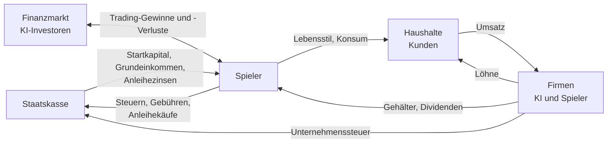

# Wirtschaft, Vermögen und Wettbewerb

Das Ziel von NEXA ist, **der reichste Mensch der Spielwelt zu werden**. Dieses Dokument beschreibt die Mechanik
dahinter: ein geschlossener Geldkreislauf ohne Inflation, eine Live-Reichenliste, endlose Level und ein Weg,
auf dem eine gute Idee aus dem Nichts groß werden kann, aber nur sehr selten wird.

Status: **Konzept, vom Auftraggeber vorgegeben** (ADR-039 bis ADR-045). Was davon schon gebaut ist, steht am Ende.

## Inhalt

1. [Leitgedanken](#1-leitgedanken)
2. [Geldkreislauf ohne Inflation](#2-geldkreislauf-ohne-inflation)
3. [Vermögen statt Kontostand](#3-vermögen-statt-kontostand)
4. [Die Reichenliste](#4-die-reichenliste)
5. [Mehr Geld, mehr Möglichkeiten, aber kein Selbstläufer](#5-mehr-geld-mehr-möglichkeiten-aber-kein-selbstläufer)
6. [Vom Garagen-Startup zum Big Player](#6-vom-garagen-startup-zum-big-player)
7. [Endlose Level](#7-endlose-level)
8. [Firmen als Clans](#8-firmen-als-clans)
9. [Namen](#9-namen)
10. [Messgrößen für den Freundestest](#10-messgrößen-für-den-freundestest)
11. [Umsetzungsstand](#11-umsetzungsstand)

---

## 1. Leitgedanken

| Grundsatz                         | Bedeutung im Spiel                                                                                       |
| --------------------------------- | -------------------------------------------------------------------------------------------------------- |
| **Vermögen ist der Punktestand**  | Gewonnen hat, wer das meiste Vermögen hat. Level, Titel und Erfolge sind Begleiter, nicht das Ziel       |
| **Geld entsteht nicht**           | Jeder Euro, den jemand verdient, hat vorher jemand anderes ausgegeben. Keine Inflation, kein Gelddrucken |
| **Wettbewerb ist echt**           | Spieler, KI-Firmen und KI-Investoren kämpfen um dieselben Kunden, dieselben Aktien und dasselbe Geld     |
| **Größe hilft, aber bremst auch** | Wer mehr hat, kann mehr bewegen. Je größer, desto schwerer wird jeder weitere Schritt                    |
| **Jeder hat eine Chance**         | Auch mit wenig Geld kann eine gute Idee groß werden. Das gelingt selten, aber es gelingt                 |
| **Kein Ende**                     | Es gibt kein Maximallevel und keinen Punkt, an dem das Spiel „durchgespielt“ ist                         |

## 2. Geldkreislauf ohne Inflation

### 2.1 Die Geldmenge ist fest

Beim Start der Spielwelt wird **einmalig** die gesamte Geldmenge erzeugt: **10 Mrd. €**
(`money.totalSupplyCents`). Danach kann nichts und niemand mehr Geld schaffen. Jede Bewegung ist eine Buchung
von einem Konto auf ein anderes (doppelte Buchführung, ADR-007). Ein Test prüft nach jedem simulierten Tag:
Die Summe aller Konten ist exakt 10 Mrd. €.

| Topf beim Start                          | Anteil | Betrag     | Wofür                                                                        |
| ---------------------------------------- | ------ | ---------- | ---------------------------------------------------------------------------- |
| Staatskasse                              | 5 %    | 500 Mio. € | Startkapital neuer Spieler, Grundeinkommen, Anleihezinsen und -rückzahlungen |
| Finanzmarkt (KI-Investoren, Marktmacher) | 60 %   | 6 Mrd. €   | Gegenpartei, wenn Spieler Aktien kaufen und verkaufen                        |
| KI-Tycoons                               | 5 %    | 500 Mio. € | Bargeld der KI-Reichen auf der Reichenliste                                  |
| Haushalte                                | 30 %   | 3 Mrd. €   | Kunden aller Firmen (ab M4: Umsätze kommen von hier, Löhne gehen hierhin)    |

### 2.2 Woher Spieler Geld bekommen und wohin es geht

- **Trading** ist ein Nullsummenspiel gegen den Finanzmarkt und gegen andere Spieler. Wer gewinnt, gewinnt das Geld
  anderer.
- **Firmengewinne** kommen von den Haushalten. Weil das Geld der Haushalte begrenzt ist, ist auch die Nachfrage
  begrenzt. Eine Branche kann nicht unbegrenzt wachsen.
- **Steuern und Gebühren** fließen in die Staatskasse. Von dort kommen Grundeinkommen und Startkapital für neue
  Spieler. Das Geld kreist, statt zu verschwinden.

### 2.3 Automatische Stabilisatoren

| Mechanik                                | Wirkung                                                                                                                                                         |
| --------------------------------------- | --------------------------------------------------------------------------------------------------------------------------------------------------------------- |
| Grundeinkommen hängt an der Staatskasse | Faktor = Staatskasse / Zielwert (250 Mio. €), zwischen 25 % und 100 %. Ist der Staat knapp, gibt es weniger. Im Spiel sichtbar: „Grundeinkommen aktuell 80 €/h“ |
| Steuern                                 | 25 % auf Gewinne, 15 % Unternehmenssteuer: Wer viel verdient, füllt die Staatskasse                                                                             |
| Lebensstil mit Unterhalt                | Statussymbole kosten laufend; das Geld geht an die Haushalte und kommt über Firmen zurück in den Kreislauf                                                      |
| Startkapital hat Vorrang                | Neue Spieler bekommen ihre 10.000 € immer, notfalls aus dem Topf der Haushalte                                                                                  |

### 2.4 Warum es so keine Inflation gibt

Preise in NEXA hängen an der Nachfrage der Haushalte und am Geld im Finanzmarkt. Beides wächst nicht von selbst.
Wird ein Spieler reich, haben andere weniger. Das ist gewollt: Reichtum ist relativ, so wie bei einer echten
Reichenliste.

**Risiko:** Konzentriert sich zu viel Geld bei wenigen Spielern, sinkt die Nachfrage für alle. Wir messen das ab dem
Freundestest (Abschnitt 10). Mögliche Gegenmittel, falls nötig: höhere Unterhaltskosten ab großen Vermögen,
eine Vermögensabgabe ab Platz X der Reichenliste, Erbschaftsregeln bei Inaktivität. Keines davon ist entschieden.

## 3. Vermögen statt Kontostand

**Vermögen** (Nettovermögen) =

- Bargeld (inklusive für Limit-Orders reserviertes Geld)
- \+ Wertpapiere zum aktuellen Verkaufskurs (Aktien, Anleihen, Bruchstücke eingeschlossen)
- \+ Firmenanteile: börsennotiert zum Kurs, privat zum Wert der letzten Finanzierungsrunde (ab M4)
- \+ Statussymbole zum Wiederverkaufswert (ab M8)
- − Schulden (Kredite, ab M4)

Vermögen kann steigen, ohne dass neues Geld entsteht: Steigt der Kurs einer Aktie, steigt der **Wert** aller
Besitzer. Erst beim Verkauf wird daraus Geld, und dieses Geld kommt vom Käufer.

## 4. Die Reichenliste

Die **NEXA-Reichenliste** ist das Herz des Wettbewerbs, angelehnt an die bekannten Listen der Wirtschaftsmagazine,
aber mit eigenem Namen und Look.

### 4.1 Wer draufsteht

- **Alle Spieler** mit ihrem Spielernamen. Die Liste ist öffentlich.
- **120 KI-Tycoons**: erfundene Personen wie „Dr. Helga Brandt, Gründerin von KlarSoft“ oder „Familie Achterberg,
  Reederei-Erben“. Ihr Vermögen steckt in Aktien der KI-Firmen und bewegt sich live mit den Kursen.

Die KI-Tycoons reichen von **15.000 €** bis **400 Mio. €**, verteilt wie in der echten Welt (viele kleine, wenige
riesige). So gibt es für jeden Spieler jederzeit ein **nächstes, erreichbares Ziel**: „Nur noch 1.240 € bis Platz 87
(Jonas Wiegand)“. Und ganz oben stehen Vermögen, für die man eine Firma aufbauen muss.

### 4.2 Was die Liste zeigt

| Element                  | Inhalt                                                                                 |
| ------------------------ | -------------------------------------------------------------------------------------- |
| Rang, Name, Beschreibung | Spieler mit Level und Titel, Tycoons mit Kurzbeschreibung                              |
| Vermögen                 | Live, alle paar Sekunden aktualisiert                                                  |
| 24 h                     | Veränderung des Vermögens in Prozent und Plätzen (▲ 3)                                 |
| Ansicht                  | „Alle“ oder „Nur Spieler“                                                              |
| Dein Platz               | Immer sichtbar, auch wenn du nicht in den Top 100 bist, mit Abstand zum nächsten Platz |

### 4.3 Nachrichten

Aus der Liste entstehen automatisch Schlagzeilen:

- „Neu in den Top 100: Lena_K springt auf Platz 94“
- „Machtwechsel: Ben überholt Anna im Spieler-Ranking“
- „Neue Nummer eins unter den Spielern“
- „Aufsteiger des Tages: +34 % in 24 Stunden“
- (ab M4) „Firmengründer Max steigt mit seinem Börsengang in die Top 10 auf“

Die Meldungen erscheinen auf der Startseite und auf der Reichenliste. Sie sind der soziale Motor: Man sieht, dass sich
etwas bewegt, und man möchte selbst in den Schlagzeilen stehen.

## 5. Mehr Geld, mehr Möglichkeiten, aber kein Selbstläufer

Mehr Vermögen öffnet Türen:

| Mit mehr Geld kannst du …                                                      | Ab              |
| ------------------------------------------------------------------------------ | --------------- |
| größere Positionen halten, mehr Firmen gleichzeitig besitzen                   | sofort          |
| Business Angel werden und Startups anderer finanzieren                         | Level 15        |
| größere Firmenformen gründen (GmbH, AG), größere Märkte bedienen               | Level 20 und 25 |
| mit 5 % Stimmrecht in Hauptversammlungen, mit 30 % ein Übernahmeangebot machen | Level 35        |

Gleichzeitig bremst Größe, so wie in der echten Wirtschaft:

- **Liquidität:** Große Orders bewegen den Kurs gegen dich. Wer 2 % einer Firma kaufen will, zahlt deutlich mehr als
  den angezeigten Kurs, und beim Verkauf genauso.
- **Märkte sind begrenzt:** Jeder Markt hat eine feste Größe (ADR-032). Wer schon die Hälfte hat, gewinnt nur schwer
  mehr dazu.
- **Steuern** greifen bei jedem realisierten Gewinn.
- **Aufmerksamkeit:** Große Spieler stehen oben auf der Liste. Andere sehen ihre Bewegungen (ab M5 im Feed) und können
  dagegen handeln.

Ergebnis: Reiche Spieler bleiben im Vorteil, aber ihr Vorsprung wächst nicht automatisch. Er muss verteidigt werden.

## 6. Vom Garagen-Startup zum Big Player

Wunsch des Auftraggebers: Schon ganz am Anfang soll man mit einer guten Idee eine Firma gründen können, die
**einer von etwa tausend** zum Big Player hochskaliert.

### 6.1 Garagen-Startup (neu, früh verfügbar)

- **Ab Level 3**, Gründung für **2.500 €** aus eigener Tasche. Nur der Gründer, keine Mitarbeiter.
- Der Spieler gibt der Firma einen Namen (Namensfilter, Abschnitt 9) und beschreibt seine **Idee** in einem Satz,
  wählt eine Branche und eine **Nische** (z. B. „Apps für Handwerker“, „vegane Fertiggerichte“).
- Jede Nische ist ein eigener kleiner Markt mit einem **verborgenen Potenzial**: Wie groß kann dieser Markt werden?

### 6.2 Das Potenzial folgt einem Potenzgesetz

Das Potenzial einer Nische wird bei der Gründung gezogen, aus einer stark schiefen Verteilung (Pareto). Die Werte
sind Startwerte für das Balancing:

| Potenzial (Jahresumsatz der Nische)          | Anteil der Nischen |
| -------------------------------------------- | ------------------ |
| unter 50.000 € (Hobby)                       | etwa 60 %          |
| 50.000 € bis 1 Mio. € (solides Kleingewerbe) | etwa 30 %          |
| 1 bis 50 Mio. € (Mittelstand)                | etwa 9 %           |
| 50 Mio. € bis 1 Mrd. € (Big Player)          | etwa 0,9 %         |
| über 1 Mrd. € (Marktführer)                  | etwa 0,1 %         |

Ein großes Potenzial allein reicht nicht: Ohne gute Führung bleibt es ungenutzt. Ein kleines Potenzial lässt sich
auch mit perfekter Führung nicht groß machen. Deshalb gelingt der Durchbruch etwa **einem von tausend**.

### 6.3 Das Potenzial erkunden

Der Spieler kennt das Potenzial nicht, er lernt es durch Handeln:

- **Markttests** (kosten Geld und Zeit) grenzen die Spanne ein: „Potenzial wahrscheinlich 0,2 bis 3 Mio. €“.
- **Kundenwachstum** verrät viel: Wächst die Nachfrage Quartal für Quartal stark, ist der Markt groß.
- **Nachfrage wächst als S-Kurve:** Am Anfang langsam, dann schnell (wenn Qualität und Bekanntheit stimmen), dann
  flacht sie am Potenzial ab. Wer zu spät investiert, verpasst die schnelle Phase; wer zu früh zu viel ausgibt, ist
  pleite, bevor sie kommt.

### 6.4 Wachstum braucht Kapital, Kapital kostet Anteile

Hochskalieren geht nur mit fremdem Geld. Dafür gibt es **Finanzierungsrunden**:

| Runde          | Wer investiert                    | Bedingung (Beispiel)                 | Typische Verwässerung |
| -------------- | --------------------------------- | ------------------------------------ | --------------------- |
| Business Angel | Mitspieler ab Level 15, KI-Angels | Idee und erste Kunden                | 10 bis 25 %           |
| Seed           | KI-Risikokapital                  | Umsatzwachstum über 30 % pro Quartal | 15 bis 25 %           |
| Serie A, B, C  | KI-Risikokapital                  | Wachstum, Marktanteil, Reputation    | je 15 bis 25 %        |
| Börsengang     | Alle                              | Level 25, Prospekt (spec 6.5)        | 20 bis 40 %           |

Die KI-Investoren bewerten nach Zahlen (Wachstum, Marge, Reputation des Gründers) und bieten Geld gegen Anteile.
Das Geld kommt aus dem Finanzmarkt-Topf, ist also kein neues Geld. Der Gründer behält am Ende vielleicht 15 % einer
riesigen Firma, und das macht ihn reich. Mit der Bewertung jeder Runde steigt sein Vermögen auf der Reichenliste,
auch ohne Börsengang.

### 6.5 Vom Startup zur Firmenstufe

Die Firmenstufen aus `BALANCING.md` (Kleinunternehmen, GmbH, AG) bleiben. Ein erfolgreiches Startup wächst in sie
hinein: Die Mitarbeitergrenze und der Markt der Stufe begrenzen das Wachstum, bis der Gründer das Level und das Geld
für die Umwandlung hat. Eine Nische kann größer sein als der lokale Markt; dann ist die Rechtsform der Engpass.

### 6.6 Ziele für das Balancing

- Etwa 60 % der Garagen-Startups scheitern oder bleiben ein Hobby. Das Risiko ist klein (2.500 €), der Spieler lernt
  die Firmenmechanik kennen.
- Etwa 1 von 10 wird ein profitables Kleingewerbe.
- Etwa 1 von 100 erreicht 100 Mio. € Bewertung.
- Etwa 1 von 1.000 wird ein Big Player mit Milliardenbewertung und Platz in den Top 10 der Reichenliste.

Diese Ziele werden wie in ADR-031 als Szenario-Tests über viele Zufallsläufe festgeschrieben, bevor die Funktion
live geht.

## 7. Endlose Level

- **Kein Maximallevel.** Die XP-Kurve (100 × n^1,5 pro Level) läuft unbegrenzt weiter.
- Bis Level 50 schalten Level **Funktionen** frei (wie bisher). Danach bringt jedes zehnte Level einen neuen
  **Prestige-Titel** („Börsenlegende“, „Börsenlegende II“ …) und kosmetische Belohnungen (Profilrahmen, Avatar-Teile).
- Level sind Erfahrung, nicht Erfolg: Ein Spieler mit Level 80 kann ärmer sein als einer mit Level 20. Die Rangliste
  zählt Vermögen.

### Tutorials bei neuen Funktionen

Wenn ein Level-up eine wichtige neue Funktion freischaltet, erklärt Finn sie in einem **kurzen, interaktiven
Mini-Tutorial** (2 bis 5 Schritte), direkt nach dem Level-up-Fenster. Geplant:

| Level | Funktion                                         | Mini-Tutorial                            |
| ----- | ------------------------------------------------ | ---------------------------------------- |
| 3     | Limit-Order (und Garagen-Startup, sobald gebaut) | Limit-Order setzen, im Orderbuch finden  |
| 5     | Staatsanleihen                                   | Anleihen-Reiter öffnen, Rendite erklären |
| 8     | Leerverkäufe                                     | ab M7                                    |
| 10    | Kleinunternehmen gründen                         | ab M4, durch den Gründungsassistenten    |
| 12    | Hebel                                            | ab M7                                    |
| 25    | Börsengang                                       | ab M6                                    |

## 8. Firmen als Clans

Wunsch des Auftraggebers: Eine Firma ist eine Art **Clan** mit eigenem **Firmenchat**.

- **Jeder Spieler ist Mitglied in höchstens einer Firma**: als Gründer oder als Mitarbeiter. Wer bei einer anderen
  Firma anfangen will, muss die alte verlassen (als Gründer: abgeben, verkaufen oder schließen). Das ersetzt die Regel
  „eigene Firma plus eine Nebenrolle“ aus dem ursprünglichen Prompt (spec 7.2).
- **Beteiligungen sind davon getrennt:** Aktien und Anteile an beliebig vielen Firmen darf jeder halten. Die „Holding“
  ab Level 40 bedeutet: mehrere Firmen **besitzen** und steuern (Mehrheitsbeteiligungen), aber nur in einer
  **mitarbeiten**.
- **Firmenchat** für alle Mitglieder: Textnachrichten, Hinweise des Systems („Quartalszahlen sind da“, „Neue
  Mitarbeiterin: Lena_K“), Abstimmungen später. Schutz: Namens- und Wortfilter (Abschnitt 9), Melden-Knopf,
  Ratenbegrenzung, Löschen durch Gründer und Admin, Verlauf 30 Tage.
- **Insider-Regel** bleibt: Mitglieder sehen Zahlen vorab und dürfen im Sperrfenster nicht mit der Aktie handeln.
- Umsetzung mit M4 (Firmen) und M5 (Spieler als Mitarbeiter, Chat).

## 9. Namen

- Der **Spielername** aus der Registrierung erscheint überall: Profil, Reichenliste, Feed, Chat.
- Er lässt sich **alle 60 Tage** ändern (`names.nicknameChangeDays`). Die Frist zählt ab der letzten Änderung.
- **Verbotene Namen:** Ein Filter auf dem Server blockiert Beleidigungen, Schimpfwörter, sexuelle und extremistische
  Begriffe, auch in verfremdeter Schreibweise (Ziffern statt Buchstaben, Sonderzeichen, Buchstabenwiederholungen), und
  reservierte Namen (Admin, Support, Finn, Namen der KI-Firmen und KI-Tycoons). Derselbe Filter gilt für
  **Firmennamen** und später für den Chat.
- Der Filter prüft schon beim Tippen (Vorabprüfung), entscheidend ist aber die Prüfung beim Speichern.

## 10. Messgrößen für den Freundestest

| Messgröße                             | Woran wir merken, dass etwas kippt                                                   |
| ------------------------------------- | ------------------------------------------------------------------------------------ |
| Summe aller Konten = 10 Mrd. €        | Jede Abweichung ist ein Fehler                                                       |
| Staatskasse und Grundeinkommensfaktor | Faktor dauerhaft unter 50 %: Steuern zu niedrig oder Auszahlungen zu hoch            |
| Anteil der Spieler am Gesamtgeld      | Steigt er schnell über 20 %, verdrängen Spieler die KI-Wirtschaft                    |
| Gini-Koeffizient der Spielervermögen  | Zu hoch nach wenigen Tagen: Vorsprung wächst zu leicht                               |
| Geld im Finanzmarkt-Topf              | Fällt er stark, gewinnen Spieler zu leicht gegen die KI                              |
| Abstand Spieler zu Tycoons            | Keiner kommt über Platz 100: Ziele zu fern. Spieler stürmen in die Top 10: zu leicht |

## 11. Umsetzungsstand

| Teil                                                            | Stand                             |
| --------------------------------------------------------------- | --------------------------------- |
| Bruchstücke von Aktien, Kauf per exaktem Betrag                 | in Arbeit                         |
| Geschlossener Geldkreislauf (Genesis, Staatskasse, Finanzmarkt) | in Arbeit                         |
| Reichenliste mit KI-Tycoons und Nachrichten                     | in Arbeit                         |
| Endlose Level, Prestige-Titel                                   | in Arbeit                         |
| Spielername, Änderung alle 60 Tage, Namensfilter                | in Arbeit                         |
| Mini-Tutorials bei Freischaltungen                              | in Arbeit (Limit-Order, Anleihen) |
| Garagen-Startup, Nischen mit Potenzial, Finanzierungsrunden     | Konzept, Umsetzung mit M4         |
| Firmen als Clans, Firmenchat                                    | Konzept, Umsetzung mit M4 und M5  |
| Haushalte als Kunden im Geldkreislauf                           | Konzept, Umsetzung mit M4         |
