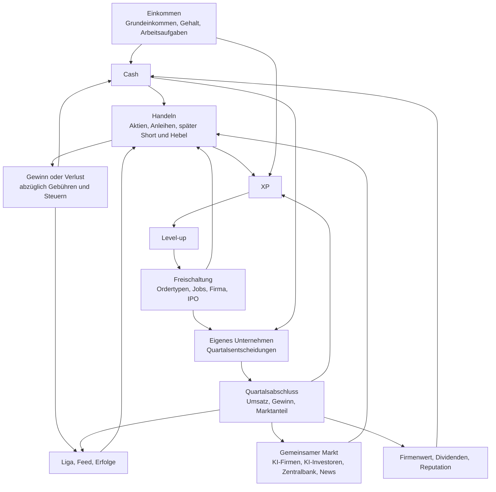

# NEXA – Game-Design-Dokument

Stand: M0 (Fundament). Quelle aller Anforderungen ist [`ORIGINAL_PROMPT.md`](./ORIGINAL_PROMPT.md).
Bereits getroffene Entscheidungen stehen in [`DECISIONS.md`](./DECISIONS.md) und werden hier per
ADR-Nummer referenziert. Sie sind für dieses Dokument bindend.

**Zu den Zahlen:** Alle Zahlen in diesem Dokument sind **Startwerte**. Sie liegen zentral in
`src/config/balance.ts` und zur Laufzeit in der Tabelle `game_config` (ADR-009). Im Code stehen keine
Balancing-Zahlen. Wo dieses Dokument einen Wert nennt, den der Prompt nicht vorgibt, ist er als
„Vorschlag“ markiert und zusätzlich in [Abschnitt 25](#25-offene-designfragen) aufgeführt.

## Inhaltsverzeichnis

1. [Vision und Säulen](#1-vision-und-säulen)
2. [Harte Rahmenbedingungen](#2-harte-rahmenbedingungen)
3. [Zielgruppe](#3-zielgruppe)
4. [Kernschleifen](#4-kernschleifen)
5. [Zeit und Spieltakt](#5-zeit-und-spieltakt)
6. [Die KI-Wirtschaft](#6-die-ki-wirtschaft)
7. [Branchen und Unternehmenssimulation](#7-branchen-und-unternehmenssimulation)
8. [Unternehmensstufen](#8-unternehmensstufen)
9. [Die vier Phasen eines Unternehmens](#9-die-vier-phasen-eines-unternehmens)
10. [Reputation](#10-reputation)
11. [Kredite und Insolvenz](#11-kredite-und-insolvenz)
12. [Mitarbeiter](#12-mitarbeiter)
13. [Einkommen und Karriere](#13-einkommen-und-karriere)
14. [Levelsystem](#14-levelsystem)
15. [Trading-Mechanik](#15-trading-mechanik)
16. [Motivation und Belohnungen](#16-motivation-und-belohnungen)
17. [Erfolge](#17-erfolge)
18. [Lebensstil](#18-lebensstil)
19. [Zufallsereignisse](#19-zufallsereignisse)
20. [Soziales](#20-soziales)
21. [Benachrichtigungen](#21-benachrichtigungen)
22. [Verantwortungsvolles Design](#22-verantwortungsvolles-design)
23. [Sicherheit und Fairness aus Spielersicht](#23-sicherheit-und-fairness-aus-spielersicht)
24. [Oberfläche: die fünf Haupt-Tabs und Customizing](#24-oberfläche-die-fünf-haupt-tabs-und-customizing)
25. [Offene Designfragen](#25-offene-designfragen)

---

## 1. Vision und Säulen

NEXA (Arbeitstitel, ADR-016) ist ein Multiplayer-Börsen- und Wirtschaftsspiel für den Browser. Alle Spieler
handeln auf **demselben Markt**. Sie verdienen Spielgeld über Grundeinkommen und Jobs, handeln Aktien und
Staatsanleihen, steigen im Level auf und gründen ab Level 10 eigene Unternehmen, die sie führen, an die
Börse bringen und gegen andere Firmen um Marktanteile antreten lassen. Eine vollständige KI-Wirtschaft sorgt
dafür, dass der Markt schon mit 4 Spielern lebendig ist.

Es ist ein **reines Menü- und Dashboard-Spiel**: keine Spielwelt, keine Karte, keine Figur. Das Spielgefühl
entsteht aus Zahlen, Charts, Entscheidungen, Events und sozialer Dynamik.

| Säule                               | Bedeutung für das Design                                                                                                                                |
| ----------------------------------- | ------------------------------------------------------------------------------------------------------------------------------------------------------- |
| **Ein gemeinsamer Markt**           | Jede Order, jede Preisentscheidung einer Firma wirkt auf alle. Es gibt keine privaten Instanzen.                                                        |
| **Die KI trägt den Markt**          | Etwa 80 % der Marktaktivität kommt von KI-Akteuren. Spieler sind die „großen Fische“, aber nicht nötig, damit sich etwas bewegt.                        |
| **Eine Simulation für alle**        | KI-Firmen und Spielerfirmen laufen durch exakt dieselbe Unternehmenssimulation. Kurse hängen an Fundamentaldaten (fairer Wert), nicht an Zufall allein. |
| **Zocken und Analyse lohnen beide** | Zocker gewinnen gelegentlich groß, fundierte Spieler liegen langfristig vorne.                                                                          |
| **Vom Trader zum Unternehmer**      | Das Levelsystem öffnet das Spiel schrittweise: Handeln, Job, Short und Hebel, Firma, IPO, Übernahmen.                                                   |
| **Soziales Drama ist gewollt**      | Abwerben, Kündigen, Wechsel zur Konkurrenz, Pump-and-Dump und Verrat sind möglich. Sie haben Folgen (Reputation), sind aber nicht verboten.             |
| **Hochwertige Oberfläche**          | Gefühl einer modernen Neo-Broker-App mit Pixel-Art als Persönlichkeit. Details in `DESIGN_SYSTEM.md`.                                                   |

---

## 2. Harte Rahmenbedingungen

Diese Punkte sind nicht verhandelbar und gelten für jedes Feature.

| Regel                       | Inhalt                                                                                                                                                                                                                     |
| --------------------------- | -------------------------------------------------------------------------------------------------------------------------------------------------------------------------------------------------------------------------- |
| Nur Spielwährung            | Kein Echtgeld, keine Auszahlung, keine In-App-Käufe im MVP. Spielgeld kann niemals für echtes Geld gekauft werden. Später sind höchstens kosmetische Käufe denkbar, die keinerlei Einfluss auf Geld, Aktien oder XP haben. |
| 18+                         | Das Spiel enthält simuliertes Zocken (Hebel, Shorts). Die Registrierung verlangt die Bestätigung der Volljährigkeit (ADR-010).                                                                                             |
| Server-Autorität            | Alle Geld-, Order-, XP- und Simulationsvorgänge laufen serverseitig. Der Client zeigt an und sendet Absichten (ADR-008).                                                                                                   |
| Geld als Ganzzahlen         | Geld als `bigint` in Cent, Kurse als `bigint` mit Skalierung 1 € = 10 000, Sätze in Basispunkten (ADR-003). Keine Floats für Geld.                                                                                         |
| Funktioniert mit 4 Spielern | Kein Feature setzt voraus, dass viele Spieler online sind. Für jede Spielerrolle gibt es einen KI-Ersatz.                                                                                                                  |
| Balancing konfigurierbar    | Alle Zahlen zentral in `src/config/balance.ts` und `game_config` (ADR-009).                                                                                                                                                |
| Sprache                     | Spielsprache Deutsch, i18n-fähig (`messages/de.json`, ADR-002). Code, Kommentare und Datenbank auf Englisch.                                                                                                               |
| Responsiv                   | Handy zuerst, auf dem PC mehrspaltig.                                                                                                                                                                                      |

---

## 3. Zielgruppe

- **Alter:** ab 18 Jahren.
- **Erste Zielgruppe:** eine Gruppe von 4 Freunden in einer geschlossenen Alpha mit Einladungscode (ADR-010).
  Später soll das Spiel auf viele Spieler skalieren.
- **Spielertypen**, die das Design gleichzeitig bedient:

| Typ         | Sucht                     | Bekommt                                                                     |
| ----------- | ------------------------- | --------------------------------------------------------------------------- |
| Zocker      | Schnelle, hohe Ausschläge | Pennystocks, Hebel, Shorts, binäre Pharma-Events, Hype bei Spieler-IPOs     |
| Analytiker  | Verstehbare Zusammenhänge | Fundamentaldaten, Event-Kalender, Analystenkursziele, Branchenzusammenhänge |
| Aufbauer    | Etwas Eigenes führen      | Firmengründung, Quartalsentscheidungen, Mitarbeiter, IPO                    |
| Wettkämpfer | Vergleich mit Freunden    | Freundes-Liga, Feed, Erfolge, Statussymbole                                 |

- **Nutzungsmuster:** mehrere kurze Sitzungen am Tag (Tresor leeren, Aufgabe erledigen, Positionen prüfen),
  dazu längere Sitzungen rund um Events und Quartalszahlen. Das Spiel läuft offline weiter.

---

## 4. Kernschleifen

### 4.1 Überblick



Der Kreislauf in einem Satz: Geld verdienen, Geld einsetzen, an den Folgen (Gewinn, Verlust, XP) wachsen,
dadurch neue Möglichkeiten freischalten, die wieder mehr Einsatz und mehr Verantwortung erlauben.

### 4.2 Schleifen nach Zeitebene

| Ebene           | Was der Spieler tut                                                                  | Was ihn belohnt                                                                                                         |
| --------------- | ------------------------------------------------------------------------------------ | ----------------------------------------------------------------------------------------------------------------------- |
| **Sekunden**    | Kurse beobachten, Order aufgeben                                                     | Live-Kursticker, Trade-Ausführung mit Animation, Sound und Haptik, XP fliegt in den Balken                              |
| **Minuten**     | Arbeitsaufgabe lösen (20 bis 60 Sekunden), Mission abschließen, auf ein Event warten | Bonus und XP, abgehakte Mission, Countdown bis zu Quartalszahlen                                                        |
| **Tag**         | Einloggen, Tresor leeren, 3 tägliche Missionen, zur Börsenglocke um 8 Uhr handeln    | Login-Streak mit wachsendem Bonus, Eröffnungsbonus in der ersten Handelsstunde, 4 Quartalsabschlüsse                    |
| **Woche**       | Portfolio gegen Freunde entwickeln, Wochen-Challenge, Gehalt verhandeln              | Freundes-Liga (Platz 1 bekommt einen Titel), Gehaltsplus                                                                |
| **Langfristig** | Level steigern, Firma aufbauen und an die Börse bringen                              | Freischaltungen, Firmenmeilensteine (erste 100.000 € Umsatz, erster Gewinn, IPO, Aufnahme in den NEXA 30), Hall of Fame |

---

## 5. Zeit und Spieltakt

| Größe           | Startwert                                        | Quelle  |
| --------------- | ------------------------------------------------ | ------- |
| Spielquartal    | 6 echte Stunden                                  | Prompt  |
| Spieljahr       | 4 Quartale = 1 echter Tag                        | Prompt  |
| Quartalsgrenzen | 08:00, 14:00, 20:00, 02:00 Uhr (Europe/Berlin)   | ADR-006 |
| Börsenzeiten    | rund um die Uhr (früher 08:00 bis 22:00 Uhr)     | ADR-106 |
| Markt-Tick      | alle 5 Sekunden (Zielkorridor 5 bis 10 Sekunden) | ADR-004 |
| Kerzen          | 1 min, 5 min, 1 h, 1 Quartal, 1 Spieljahr        | Prompt  |

- **Keine Nachbörse (ADR-106):** Die Börse ist rund um die Uhr regulär offen, ohne breiteren Spread in der Nacht und
  ohne Börsenglocken. Der Handelstag (Tagesveränderung, Tageshoch und -tief) beginnt um Mitternacht. Die Regeln für
  Börsenzeiten und Nachbörse bleiben in der Konfiguration (`time.marketOpenHour`, `time.marketCloseHour`) und kommen
  mit anderen Werten zurück.
- **Quartalsabschluss** an jeder Quartalsgrenze: Unternehmenssimulation, Quartalszahlen, Gehaltsabrechnung,
  Zinsen, Dividenden. Drei der vier Abschlüsse fallen in die Börsenzeit, der um 02:00 Uhr liegt im
  nachbörslichen Handel (ADR-006; zur Wechselwirkung siehe [Abschnitt 25](#25-offene-designfragen), Frage 2).
- **Spielzeit kommt aus der Tabelle `game_quarters`**, nicht aus der Uhrzeit. Bei Zeitumstellung ist ein
  Quartal einmalig 5 bzw. 7 Stunden lang (ADR-006).
- **Offline-Fortschritt:** Grundeinkommen, Jobgehalt und Unternehmen laufen weiter, auch wenn niemand online ist.
- **Zeit-Gates:** Produktentwicklung, Einarbeitung, Vesting, Lock-up und Zeichnungsfrist werden in Quartalen
  gemessen. Wer mehr Geld hat, kommt dadurch nicht beliebig schneller voran.

---

## 6. Die KI-Wirtschaft

Der Markt wird zu etwa 80 % von KI-Akteuren getragen. Sie sind das Fundament, auf dem 4 Spieler einen
glaubwürdigen Markt vorfinden.

### 6.1 Staat und Zentralbank

- **Leitzins:** Start 3 %. Die Zentralbank-KI passt ihn anhand der Geldmenge im Spiel an (Inflationsschutz).
  Die Geldmenge wird aus den Systemkonten des Ledgers gemessen (ADR-007).
- **Zinsentscheide** sind angekündigte Events mit Countdown.
- **Staatsanleihen** sind das sichere Netz: Laufzeiten 1, 2, 5 und 10 Spieljahre, Rendite 2 bis 4 %,
  gekoppelt an den Leitzins und immer klar unter der Durchschnittsrendite guter Aktien.
- **Makro-Wirkung:** Steigt der Leitzins, schichten KI-Fonds aus Aktien in Anleihen um, und der Gesamtmarkt
  fällt. Das soll als Ereignis spürbar sein.
- **Später (nicht im MVP):** fiktive Staaten mit Ausfallrisiko, z. B. „Republik Valdorien, 9 %, Rating CCC“.

### 6.2 KI-Unternehmen

- 15 KI-Unternehmen zum Start, verteilt auf 5 Branchen (je 3) und drei Größenklassen: Bluechip,
  Mittelständler, volatiler Pennystock.
- Sie werden mit **exakt derselben Simulation** berechnet wie Spielerfirmen (Umsatz, Kosten, Gewinn, Marktanteil).
- Jede Firma hat Namen, Kürzel, Pixel-Logo, Kurzbeschreibung, Kennzahlen und eine Nachrichtenhistorie.
- Namen und Kürzel sind in ADR-014 festgelegt. Die Charakterbeschreibungen sind Designvorgaben für Seed-Daten
  und Simulation.

| Kürzel | Unternehmen           | Branche       | Größe          | Charakter                                                                               |
| ------ | --------------------- | ------------- | -------------- | --------------------------------------------------------------------------------------- |
| `KLS`  | KlarSoft AG           | Tech/Software | Bluechip       | Bürosoftware im Abo, hohe Marge, verlässliches Wachstum, selten Überraschungen          |
| `PXW`  | Pixelwerk Studios     | Tech/Software | Mittelständler | Spielestudio, dessen Quartale von einzelnen Veröffentlichungen abhängen                 |
| `QSL`  | QuantenSprung Labs    | Tech/Software | Pennystock     | Forschungs-Start-up mit fast keinem Umsatz, lebt von Ankündigungen und Hype             |
| `BRZ`  | Brotzeit Handel AG    | Einzelhandel  | Bluechip       | Lebensmittelkette mit dünner Marge, stabilem Umsatz und verlässlicher Dividende         |
| `KFR`  | Kaufrausch Märkte     | Einzelhandel  | Mittelständler | Expandierende Kaufhauskette, wächst über Marketing und ist konjunkturabhängig           |
| `FGD`  | Fundgrube Discount    | Einzelhandel  | Pennystock     | Restposten-Discounter, der Preiskriege anzettelt und am Rand der Gewinnzone arbeitet    |
| `VLT`  | Volta Energie AG      | Energie       | Bluechip       | Großer Versorger, kapitalintensiv, hohe Dividende, reagiert träge auf den Ölpreis       |
| `RKW`  | Rheinkraft Werke      | Energie       | Mittelständler | Kraftwerksbetreiber mit hohem Rohstoffanteil, Gewinn schwankt mit dem Ölpreis           |
| `SFX`  | SolarFuchs            | Energie       | Pennystock     | Solar-Installateur mit hoher Verschuldung, stark zinsabhängig                           |
| `NPH`  | NeuroPharm AG         | Pharma        | Bluechip       | Breites Medikamentenportfolio, einzelne Studienergebnisse bewegen den Kurs nur begrenzt |
| `ALM`  | Alpenmed              | Pharma        | Mittelständler | Wenige Produkte, jede Studie ist ein spürbares Ereignis                                 |
| `GNV`  | GenoVita Biotech      | Pharma        | Pennystock     | Ein einziger Wirkstoffkandidat, Kurs entscheidet sich binär am Studienergebnis          |
| `NDL`  | Nordlicht Logistik AG | Logistik      | Bluechip       | Großer Fuhrpark, viele Mitarbeiter, Gewinn hängt an Lohnkosten und Konjunktur           |
| `EBX`  | Eilbote Express       | Logistik      | Mittelständler | Paketdienst mit schnellem Wachstum und knapper Kapazität                                |
| `FPT`  | Frachtpilot           | Logistik      | Pennystock     | Frachtvermittler mit wenig eigenem Kapital, reagiert heftig auf Ölpreis und Konjunktur  |

Pennystocks dürfen sich an einem Tag um ±30 % bewegen. Bluechips sind die ruhigen Werte und bilden zusammen
mit den Mittelständlern den Kern des Leitindex.

### 6.3 KI-Investoren

Mehrere Investortypen erzeugen zusammen Liquidität und nachvollziehbare Kursbewegungen. Technisch wirken sie
als aggregierter Netto-Nachfragedruck je Typ und Aktie, nicht als Einzelorders (ADR-005).

| Typ                    | Verhalten                                                                  | Sichtbarer Effekt                                 |
| ---------------------- | -------------------------------------------------------------------------- | ------------------------------------------------- |
| **Marktmacher**        | Stellt immer Kauf- und Verkaufsangebote mit Spread                         | Grundliquidität, man kann jederzeit handeln       |
| **Value-Fonds**        | Kauft unter dem fairen Wert, verkauft darüber, reagiert langsam            | Kurse kehren mittelfristig zum fairen Wert zurück |
| **Momentum-Trader**    | Springt auf Trends auf                                                     | Bewegungen werden verstärkt                       |
| **Rentenfonds**        | Schichtet je nach Leitzins zwischen Anleihen und Dividendenaktien um       | Zinsentscheide bewegen den Gesamtmarkt            |
| **Indexfonds**         | Hält die NEXA-30-Aktien nach Marktkapitalisierung, kauft bei Indexaufnahme | Kurssprung bei Aufnahme in den Index              |
| **Kleinanleger-Herde** | Reagiert emotional auf News und Hype                                       | Übertreibung in beide Richtungen                  |

### 6.4 Fairer Wert (Kursanker)

```
fairValue = Gewinn je Aktie
          × Branchen-KGV
          × Wachstumsfaktor
          × Reputationsfaktor   (nur Spielerfirmen, 0,6 bis 1,4)
          × Makrofaktor         (Leitzins)
```

Auf den Kurs wirken zusätzlich:

- Rauschen,
- Sentiment aus News,
- echte Spieler-Orders mit Preis-Impact abhängig von Ordergröße und Liquidität.

Der faire Wert selbst ist für Spieler **nicht sichtbar** (ADR-008). Sichtbar sind die Fundamentaldaten, aus
denen er entsteht. Wer sie liest, kann ihn schätzen. Das ist der Vorteil des Analytikers.

Formeln und Pseudocode stehen in `SIMULATION.md`.

### 6.5 Leitindex NEXA 30

- Enthält die 30 größten börsennotierten Firmen nach Marktkapitalisierung, anfangs alle KI-Firmen plus
  Spielerfirmen.
- Die **Aufnahme einer Spielerfirma** ist ein großes Event: Indexfonds müssen kaufen, der Kurs springt.
- Der NEXA 30 ist der große Live-Chart auf der Startseite und der Maßstab für „den Markt“.
- Zum Start gibt es nur 15 börsennotierte Firmen. Wie die Aufnahme trotzdem ein Ereignis bleibt, ist als
  Frage 5 in [Abschnitt 25](#25-offene-designfragen) festgehalten.

### 6.6 Nachrichten und Events

- **Nachrichten entstehen aus der Simulation** (Quartalszahlen, Rohstoffpreise, Zinsentscheide,
  Spieleraktionen) über Textvorlagen mit Variablen. Es gibt keine Nachrichten ohne Ursache im Spielzustand.
- **Geplante Events mit Countdown:**

| Event                  | Wirkung                                                                        |
| ---------------------- | ------------------------------------------------------------------------------ |
| Zinsentscheid          | Leitzins ändert sich, Rotation zwischen Aktien und Anleihen                    |
| Quartalszahlen         | Kursreaktion je nach Abweichung von der Erwartung                              |
| Pharma-Studienergebnis | Binär, ±50 bis 70 % für die betroffene Aktie                                   |
| Ölpreis-Report         | Energie und Logistik reagieren gegenläufig (Ölpreis ↑ → Energie ↑, Logistik ↓) |

- **Zufällige Makro-Events:** Branchenkrise, Rohstoffschock, Konjunkturdelle, Tech-Boom.
- Der **Event-Kalender** ist öffentlich. Planbare Events sind die Grundlage für Strategien beider Spielertypen.

---

## 7. Branchen und Unternehmenssimulation

### 7.1 Branchen

| Branche       | Charakter                                                | Typisches Risiko       |
| ------------- | -------------------------------------------------------- | ---------------------- |
| Tech/Software | Wenig Kapital, langsamer Start, dann explosives Wachstum | Ein Produkt floppt     |
| Einzelhandel  | Stabil, kleine Margen, Preiskriege                       | Konkurrent unterbietet |
| Energie       | Kapitalintensiv, hängt am Rohstoffpreis                  | Ölpreis-Event          |
| Pharma        | Lange Entwicklung, binäre Studienevents                  | Studie scheitert       |
| Logistik      | Skaliert über Mitarbeiter und Fuhrpark                   | Lohnkosten, Konjunktur |

### 7.2 Gemeinsame Nachfrage (Kernprinzip)

Alle Firmen einer Branche, Spieler **und** KI, teilen sich dieselbe Branchennachfrage. Pro Quartal:

```
attractiveness = quality^1.2 × awareness^0.8 / price^1.5
marketShare    = eigene attractiveness / Summe(attractiveness aller Firmen der Branche)
revenue        = sectorDemand × marketShare      (begrenzt durch die Produktionskapazität)
```

Die Exponenten 1,2 / 0,8 / 1,5 sind Startwerte. Senkt ein Spieler den Preis, sinkt der Umsatz seiner
Konkurrenten. So entsteht direkte Rivalität ohne Spielkarte.

### 7.3 Quartalsentscheidungen des Gründers

| Bereich       | Entscheidung                                                       | Bremse                                                                |
| ------------- | ------------------------------------------------------------------ | --------------------------------------------------------------------- |
| **Produkt**   | Entwicklung starten oder verbessern, neue Produktlinie             | Dauert mehrere Quartale (Zeit-Gate)                                   |
| **Preis**     | Marge gegen Marktanteil                                            | Wirkt über die gemeinsame Nachfrage auf alle Konkurrenten und zurück  |
| **Marketing** | Budget für Bekanntheit                                             | Sinkender Grenznutzen: doppeltes Budget bringt etwa +40 % Bekanntheit |
| **Personal**  | Einstellen, entlassen, befördern, Gehälter                         | Einarbeitungszeit, Loyalität                                          |
| **Finanzen**  | Kredit, Rücklagen, Dividende, Rückkauf, Kapitalerhöhung (nach IPO) | Zinsen, Reputation, Verwässerung                                      |

**Geld allein darf nicht reichen.** Vier Mechaniken sorgen dafür: Einarbeitungszeit neuer Mitarbeiter,
sinkender Grenznutzen, Entwicklungszeiten und Fixkosten bei Überexpansion.

### 7.4 Kosten

- **Fixkosten** je Quartal nach Unternehmensstufe ([Abschnitt 8](#8-unternehmensstufen)).
- **Variable Kosten:** Gehälter, Produktion, Marketing, Zinsen.

---

## 8. Unternehmensstufen

| Typ              | Ab Level | Gründungskosten | Fixkosten je Quartal | Max. Mitarbeiter | Kreditrahmen  |
| ---------------- | -------- | --------------- | -------------------- | ---------------- | ------------- |
| Kleinunternehmen | 10       | 15.000 €        | 2.000 €              | 5                | –             |
| GmbH             | 20       | 75.000 €        | 10.000 €             | 20               | bis 250.000 € |
| AG (vor IPO)     | 25       | 300.000 €       | 40.000 €             | 100              | bis 2 Mio. €  |

- **Umwandlung** in die nächste Stufe gegen Gebühr und mit Level-Voraussetzung.
- **Ab Level 18** ist ein Kleinunternehmen auf bis zu 20 Mitarbeiter erweiterbar.
- **Kapitalobergrenze:** Der Gründer kann pro Phase nur begrenzt privates Geld einschießen. Wachstum muss aus
  Umsatz und Investoren kommen. Die Höhe der Grenze gibt der Prompt nicht vor (Frage 14).
- Das Level 15 schaltet einen „Kleinkredit bis 50.000 €“ frei, während die Tabelle für das Kleinunternehmen
  keinen Kreditrahmen nennt. Die Auflösung steht als Frage 9 in [Abschnitt 25](#25-offene-designfragen).

---

## 9. Die vier Phasen eines Unternehmens

### Phase 1: Gründung (privat)

- Der Gründer wählt Branche, Name, Pixel-Logo, Firmenfarbe und Rechtsform.
- **Finanzierung:** Eigenkapital, Kredit, **Business Angels**. Business Angels sind KI-Investoren oder echte
  Spieler (ab Level 15), die vorbörslich Anteile kaufen.
- Ab der Gründung wird ein **Cap Table** geführt.

### Phase 2: Operatives Wachstum

- Quartalsentscheidungen ([Abschnitt 7.3](#73-quartalsentscheidungen-des-gründers)), Mitarbeiter, Marktanteile.
- Ziel der Phase: 4 Quartale Historie mit tragfähigen Zahlen, um IPO-fähig zu werden.

### Phase 3: IPO

**Voraussetzungen:**

- 4 Quartale Historie,
- Mindestumsatz (Höhe nicht vorgegeben, Frage 15),
- positive Reputation (Schwelle nicht vorgegeben, Frage 15),
- ein CFO (KI oder Spieler),
- Level 25.

**Prospekt** mit verbindlichen Angaben, die später automatisch geprüft werden:

| Angabe                                                                     | Prüfung                                                                                         |
| -------------------------------------------------------------------------- | ----------------------------------------------------------------------------------------------- |
| Umsatzprognose der nächsten 4 Quartale                                     | Vergleich mit den tatsächlichen Quartalszahlen                                                  |
| Mittelverwendung in Prozent (Expansion, Personal, Rücklage, Finanzanlagen) | Vergleich mit der tatsächlichen Verwendung des Emissionserlöses                                 |
| Gründer-Lock-up (Standard 4 Quartale)                                      | Verkäufe des Gründers im Lock-up werden technisch gesperrt, die Haltedauer danach wird bewertet |
| Anteil ausgegebener Aktien                                                 | Fix mit dem Prospekt                                                                            |

**Bookbuilding:**

1. Eine KI-Emissionsbank schlägt anhand der Zahlen eine Preisspanne vor.
2. Die Zeichnungsfrist dauert 1 Quartal. KI-Fonds und Spieler zeichnen.
3. **Überzeichnet:** Der Preis liegt am oberen Ende der Spanne, die Firma wechselt in Phase 4.
4. **Unterzeichnet:** Der IPO platzt, der Gründer verliert Reputation, die Firma geht zurück in Phase 2.

Ein erfolgreicher IPO bringt 5.000 XP und den Erfolg „Glockenschläger“.

### Phase 4: Börsennotiert

- **Automatische Quartalszahlen** zu festen Zeiten.
- **Guidance:** Der Gründer gibt eine Prognose für das nächste Quartal ab. Die Abweichung beeinflusst die Reputation.
- **Kapitalmaßnahmen:** Dividende, Aktienrückkauf, Kapitalerhöhung (verwässert die Altaktionäre).
- **Hauptversammlung:** Spieler-Aktionäre stimmen ab, über die Dividende und über die Abberufung des CEO.
  Die Abberufung braucht mehr als 50 %.
- **Später:** Übernahmen (Level 35).

---

## 10. Reputation

- Skala **0 bis 100**, geführt **pro Gründer, nicht pro Firma**. Sie wandert mit zum nächsten Unternehmen.
- Sie steuert:
  - den Bewertungsfaktor der KI-Investoren (0,6× bis 1,4×, siehe [Abschnitt 6.4](#64-fairer-wert-kursanker)),
  - die Kreditzinsen,
  - den Zugang zum IPO.

| Erhöht                                | Senkt                                        |
| ------------------------------------- | -------------------------------------------- |
| Prognosen eingehalten                 | Prognosen verfehlt (z. B. > 30 % Abweichung) |
| Lock-up eingehalten, lange gehalten   | Dumping nach dem IPO                         |
| Verlässliche Dividende                | Ständige Kapitalerhöhungen                   |
| Prospekt-Mittelverwendung eingehalten | Mittel abweichend vom Prospekt verwendet     |
| Mitarbeiter bleiben lange             | Insider-Verstoß aufgedeckt                   |

Weitere Reputationsverluste: geplatzter IPO, Insolvenz, Spielerbankrott.

**Pump-and-Dump bleibt möglich.** Es ist kein Regelverstoß, kostet aber Reputation, die beim nächsten
Unternehmen fehlt (schlechtere Bewertung, teurere Kredite, kein IPO).

---

## 11. Kredite und Insolvenz

### 11.1 Kredite

- **Zins = Leitzins + Risikoaufschlag.** Der Aufschlag hängt von Reputation, Verschuldungsgrad und Gewinn ab.
- Der **Kreditrahmen** wächst mit Level und Reputation, begrenzt durch die Unternehmensstufe
  ([Abschnitt 8](#8-unternehmensstufen)).
- Ein guter CFO senkt die Kreditzinsen ([Abschnitt 12.1](#121-ki-mitarbeiter)).
- Zinsen werden zum Quartalsabschluss gebucht.

### 11.2 Insolvenz

- **Auslöser:** 2 Quartale in Folge sind die laufenden Kosten nicht gedeckt.
- **Folgen:**
  - Die Aktie stürzt ab.
  - Gläubiger bekommen die Reste.
  - Der Gründer verliert stark an Reputation.
  - Der Gründer hat 3 Spieltage Gründungssperre (zur Bedeutung von „Spieltag“ siehe Frage 6).
- Was mit Optionen von Spieler-Mitarbeitern passiert, gibt der Prompt nicht vor (Frage 3).

### 11.3 Rettungsübernahme

Kurz vor der Pleite kann ein anderer Spieler oder eine KI-Firma die Firma günstig übernehmen. Die KI-Firma als
möglicher Käufer stellt sicher, dass die Mechanik auch mit 4 Spielern vorkommt.

---

## 12. Mitarbeiter

### 12.1 KI-Mitarbeiter

| Attribut    | Wertebereich                                                                               |
| ----------- | ------------------------------------------------------------------------------------------ |
| Name        | generiert                                                                                  |
| Fachgebiet  | Entwicklung, Vertrieb, Produktion, Finanzen, Marketing                                     |
| Skill       | 1 bis 10                                                                                   |
| Gehalt      | je Quartal                                                                                 |
| Loyalität   | in Prozent                                                                                 |
| Eigenschaft | eine je Mitarbeiter, z. B. „Ehrgeizig“: +15 % Leistung, kündigt bei Gehaltsstopp schneller |

- **Normale Mitarbeiter** erhöhen die Kapazität ihrer Abteilung, nach einer Einarbeitungszeit.
- **Führungspositionen** schalten Fähigkeiten frei:

| Position         | Wirkung                                                                        |
| ---------------- | ------------------------------------------------------------------------------ |
| CFO              | Senkt die Kreditzinsen, macht die Guidance-Spanne enger, ist IPO-Voraussetzung |
| CTO              | Verkürzt Entwicklungszeiten                                                    |
| COO              | Fähigkeit im Bereich Produktion und Kapazität (Details in `SIMULATION.md`)     |
| Vertriebsleitung | Kampagnen und Preisaktionen                                                    |

- Der **Bewerberpool** wird jedes Quartal neu generiert.
- **Abwerben** durch Konkurrenten mit höherem Gehalt ist möglich. Auch KI-Firmen werben ab.

### 12.2 Echte Spieler als Mitarbeiter

- Ein Spieler kann in der Firma eines anderen Spielers arbeiten, auch in **Führungsrollen mit echten
  Entscheidungen**: Der CFO verwaltet Liquidität und Kredite, die Vertriebsleitung wählt Kampagnen und Preisaktionen.
- **Bezahlung:** Gehalt plus Aktienoptionen mit Vesting (z. B. über 4 Quartale).
- **Produktivität:** Ein Spieler-Mitarbeiter bringt die doppelte Produktivität eines KI-Mitarbeiters mit
  gleichem Skill.
- **Begrenzung:** maximal 1 Nebenrolle zusätzlich zur eigenen Firma (zur Abgrenzung siehe Frage 1).
- Kündigen, Wechsel zur Konkurrenz und Verrat sind möglich und gewollt.

### 12.3 Insider-Regel

- Mitarbeiter einer Spielerfirma sehen die Quartalszahlen vorab.
- In einem **Sperrfenster von 2 Stunden** vor der Veröffentlichung dürfen sie nicht mit der Aktie handeln.
- Verstöße entdeckt die **KI-Finanzaufsicht** mit einer gewissen Wahrscheinlichkeit. Folge: Geldstrafe plus
  Reputationsverlust.
- Der Verstoß ist also technisch möglich, aber riskant. Das Vorabwissen außerhalb des Sperrfensters zu
  nutzen, ist erlaubt und einer der Anreize, bei Spielerfirmen zu arbeiten.

---

## 13. Einkommen und Karriere

### 13.1 Startkapital

Jeder Spieler beginnt mit **10.000 €** (ADR-011).

### 13.2 Grundeinkommen und Tresor

- **100 € pro Stunde**, auch offline.
- Das Grundeinkommen sammelt sich in einem **Konto-Tresor**, der maximal **8 Stunden** fasst (800 €). Alles
  darüber verfällt.
- „Tresor leeren“ ist eine bewusste Aktion mit Animation (Pixel-Münzen fliegen ins Konto) und Sound.
- Wer den Tresor dreimal am Tag leert, holt das Maximum von 2.400 € pro Tag heraus.

### 13.3 Jobs

| Stufe       | Ab Level | Beispiel                                 | Gehalt je Stunde   |
| ----------- | -------- | ---------------------------------------- | ------------------ |
| Praktikant  | 2        | Assistenz bei Brotzeit Handel            | 150 €              |
| Junior      | 5        | Junior-Analyst bei Volta Energie         | 300 €              |
| Senior      | 12       | Senior Sales bei NeuroPharm              | 700 €              |
| Teamleitung | 20       | Leitung Vertrieb                         | 1.300 €            |
| C-Level     | 25       | CFO (Spielerfirmen oder große KI-Firmen) | 2.500 € + Optionen |

- Das Gehalt läuft **passiv**, höchstens **12 bezahlte Stunden pro Tag**.
- **Arbeitsaufgaben** erscheinen alle paar Stunden, dauern 20 bis 60 Sekunden und bringen Bonus und XP:

| Rolle    | Beispielaufgabe                           |
| -------- | ----------------------------------------- |
| Analyst  | Quartalszahlen einer Firma schätzen       |
| Vertrieb | Aus 3 Kundenprofilen das beste wählen     |
| Finanzen | Zwischen zwei Kreditangeboten entscheiden |

### 13.4 Gehaltsentwicklung

| Hebel              | Regel                                                                   |
| ------------------ | ----------------------------------------------------------------------- |
| Berufserfahrung    | Wächst pro Arbeitsstunde                                                |
| Beförderung        | Bei Erfahrungsschwellen, +10 bis 20 % Gehalt                            |
| Gehaltsverhandlung | Einmal pro Woche, Erfolgschance nach Erfahrung, Leistung und Firmenlage |
| Jobwechsel         | Meist das größte Plus, setzt aber den Beförderungsfortschritt zurück    |

### 13.5 Anreize, bei echten Spielern zu arbeiten

| Vorteil                           | KI-Firma                  | Spielerfirma            |
| --------------------------------- | ------------------------- | ----------------------- |
| XP pro Arbeitsstunde              | 1×                        | 1,5×                    |
| Erfahrungszuwachs                 | 1×                        | 2×                      |
| Aktienoptionen                    | Nein                      | Ja                      |
| Führungsrollen mit Entscheidungen | Nur C-Level großer Firmen | Ab Teamleitung          |
| Vorabwissen Quartalszahlen        | Nein                      | Ja (mit Sperrfrist)     |
| Erfolgsbonus                      | Fix                       | Steigt mit Firmengewinn |

KI-Jobs sind immer verfügbar. Die Karriere funktioniert deshalb auch dann, wenn kein anderer Spieler eine
Firma hat.

---

## 14. Levelsystem

### 14.1 XP-Kurve

```
XP für Level n → n+1 = round(100 × n^1.5)
```

| Schritt                    | XP         |
| -------------------------- | ---------- |
| 1 → 2                      | 100        |
| 10 → 11                    | ca. 3.160  |
| 20 → 21                    | ca. 8.940  |
| 50 (Formelwert für n = 50) | ca. 35.360 |

- **Maximallevel 50.** Später ist ein Prestige-System möglich (nicht im MVP).
- Aus der Formel folgt für den gesamten Weg von Level 1 bis 50 eine Summe von rund 690.000 XP
  (abgeleiteter Wert, kein Startwert). Zur Angabe „50: ca. 35.360“ siehe Frage 4.

### 14.2 XP-Quellen und Missbrauchsschutz

| Aktion                     | XP                         | Schutz                                                                                                          |
| -------------------------- | -------------------------- | --------------------------------------------------------------------------------------------------------------- |
| Trade ausführen            | 10                         | Nur die ersten 30 Trades pro Tag. Kauf und Rückverkauf innerhalb weniger Minuten geben keine XP (Wash-Trading). |
| Trade mit Gewinn schließen | +1 je 100 € Gewinn         | Max. 500 pro Trade                                                                                              |
| Arbeitsstunde              | 40 (×1,5 bei Spielerfirma) | Max. 12 h pro Tag                                                                                               |
| Arbeitsaufgabe             | 50 bis 150 nach Qualität   | –                                                                                                               |
| Tägliche Mission           | 200 bis 400                | 3 pro Tag                                                                                                       |
| Täglicher Login            | 50 + Streak-Bonus          | –                                                                                                               |
| Firmenquartal mit Gewinn   | 500                        | –                                                                                                               |
| Erfolgreicher IPO          | 5.000                      | –                                                                                                               |
| Erfolg freigeschaltet      | 100 bis 10.000             | –                                                                                                               |

XP werden ausschließlich serverseitig vergeben (ADR-008). XP sind nicht kaufbar und nicht übertragbar.

### 14.3 Freischaltungen

| Level | Freischaltung                                              |
| ----- | ---------------------------------------------------------- |
| 1     | Aktien kaufen und verkaufen (Market-Order), Grundeinkommen |
| 2     | Erster Job (Praktikant)                                    |
| 3     | Limit-Order, Watchlist                                     |
| 5     | Stop-Loss, Staatsanleihen mit Laufzeiten, Junior-Jobs      |
| 7     | Analystenberichte (Kursziele)                              |
| 8     | Leerverkäufe (Short)                                       |
| 10    | **Kleinunternehmen gründen**                               |
| 12    | Hebel 2×, Senior-Jobs                                      |
| 15    | Kleinkredit bis 50.000 €, Business Angel werden            |
| 18    | Hebel 5×, Unternehmen auf 20 Mitarbeiter erweitern         |
| 20    | GmbH gründen, Kredite bis 250.000 €, Teamleitung           |
| 25    | IPO, C-Level-Jobs                                          |
| 30    | Hebel 10×, Optionen (Calls/Puts)                           |
| 35    | Übernahmen, feindliche Übernahmeangebote                   |
| 40    | Holding: mehrere Firmen gleichzeitig                       |
| 50    | Titel „Börsenlegende“, goldener Profilrahmen, Hall of Fame |

### 14.4 Inszenierung

Jede Freischaltung wird groß inszeniert:

1. Vollbild-Overlay mit Pixel-Animation,
2. Freischaltungen erscheinen nacheinander, jeweils mit kurzer Erklärung,
3. eine direkte Einstiegsmission, z. B. „Mach deinen ersten Short-Trade“.

Gesperrte Funktionen bleiben in der Oberfläche sichtbar, mit dem Level, ab dem sie verfügbar sind. So ist
immer klar, worauf man hinarbeitet.

---

## 15. Trading-Mechanik

### 15.1 Ordertypen

| Ordertyp              | Ab Level |
| --------------------- | -------- |
| Market                | 1        |
| Limit                 | 3        |
| Stop-Loss             | 5        |
| Short (Leerverkauf)   | 8        |
| Hebel 2×              | 12       |
| Hebel 5×              | 18       |
| Hebel 10×             | 30       |
| Optionen (Calls/Puts) | 30       |

### 15.2 Ausführung

- Spieler handeln gegen das **Orderbuch** aus KI-Marktmacher-Quotes und Limit-Orders anderer Spieler (ADR-005).
- Größere Orders verursachen **Slippage** und **Preis-Impact**.
- Gehandelt werden ganze Stücke, keine Bruchteile (ADR-003).
- Für große oder gehebelte Orders gibt es den Button „Zum Kaufen halten“ als bewusste Bestätigung.

### 15.3 Kosten

| Kostenart                      | Startwert                                                         |
| ------------------------------ | ----------------------------------------------------------------- |
| Ordergebühr                    | 1 € fix je Order                                                  |
| Spread                         | Ergibt sich aus den Marktmacher-Quotes, nachbörslich größer       |
| Finanzierungskosten über Nacht | Für Hebel- und Short-Positionen. Dauerhebel verliert langfristig. |
| Leihgebühr                     | Für Short-Positionen                                              |

### 15.4 Steuern

- **25 % auf realisierte Gewinne**, mit Verlustverrechnung.
- Die Steuer ist realistisch und gleichzeitig eine Geldsenke (Systemkonto `taxes`, ADR-007).
- Die Handelshistorie weist Gebühren und Steuern je Trade aus.

### 15.5 Margin Call und Liquidation

- Der **Liquidationspreis** einer Hebel- oder Short-Position wird immer angezeigt, schon in der Order-Maske.
- Bei Annäherung: Warnung (roter Rand pulsiert, leichtes Schütteln, Warnsound, Benachrichtigung).
- Bei Erreichen: automatische Liquidation.

### 15.6 Bankrott des Spielers

- Bankrott ist **kein Spielende**.
- Wiedereinstieg mit Grundkapital von **2.500 €** (ADR-011).
- Sichtbarer Malus: Status „Pleitegeier“ für einige Tage und Reputationsverlust.

### 15.7 Dividenden

Dividenden haben einen Ex-Tag und werden zum Quartalsende ausgezahlt (zur Lage des Ex-Tags siehe Frage 12).

### 15.8 Zocken und schlau sein: beides belohnen

| Für Zocker                 | Für Analytiker                                            |
| -------------------------- | --------------------------------------------------------- |
| Pennystocks (±30 % am Tag) | Echte Fundamentaldaten, die die KI-Investoren verwenden   |
| Hebel und Shorts           | Event-Kalender                                            |
| Binäre Pharma-Events       | Analystenkursziele (manchmal falsch)                      |
| Hype bei Spieler-IPOs      | Branchenzusammenhänge (Ölpreis ↑ → Energie ↑, Logistik ↓) |
|                            | Insiderwissen über Jobs                                   |

**Balancing-Ziel:** Zocker gewinnen gelegentlich groß, fundierte Spieler liegen langfristig vorne. Dafür
sorgen die laufenden Kosten gehebelter Positionen, die Steuer, die Rückkehr der Kurse zum fairen Wert und die
Tatsache, dass die KI-Investoren dieselben Fundamentaldaten verwenden, die der Spieler sehen kann.

---

## 16. Motivation und Belohnungen

Die fünf Zeitebenen stehen in [Abschnitt 4.2](#42-schleifen-nach-zeitebene). Hier die einzelnen Systeme.

| System                 | Regel                                                                                                              |
| ---------------------- | ------------------------------------------------------------------------------------------------------------------ |
| **Login-Streak**       | Täglicher Login gibt 50 XP plus wachsenden Streak-Bonus. 1 Streak-Schutz pro Woche fängt einen verpassten Tag auf. |
| **Tägliche Missionen** | 3 pro Tag, je 200 bis 400 XP                                                                                       |
| **Börsenglocke**       | Eröffnung um 8 Uhr mit Eröffnungsbonus für die erste Handelsstunde (Inhalt des Bonus: Frage 17)                    |
| **Tresor**             | Bis zu 800 € alle 8 Stunden abholen                                                                                |
| **Freundes-Liga**      | Wochenrangliste nach Portfolio-Wachstum in **Prozent**, damit Neue mithalten können. Platz 1 bekommt einen Titel.  |
| **Wochen-Challenge**   | Eine größere Aufgabe pro Woche                                                                                     |
| **Gehaltsverhandlung** | Einmal pro Woche                                                                                                   |
| **Firmenmeilensteine** | Erste 100.000 € Umsatz, erster Gewinn, IPO, Aufnahme in den NEXA 30                                                |
| **Hall of Fame**       | Dauerhafte Bestenliste, ab Level 50                                                                                |

Grundsatz: Belohnungen sind Spielgeld, XP, Titel und Kosmetik. Keine Belohnung ist kaufbar.

---

## 17. Erfolge

- Mindestens 40 Erfolge. Jeder Erfolg bekommt ein eigenes **Pixel-Icon** und bringt einmalig 100 bis 10.000 XP.
- Die ersten 8 Einträge der Liste sind vom Prompt vorgegeben, die übrigen sind Vorschläge.
- Einige Erfolge sind bewusst „negativ“ (Totalverlust, Pleitegeier, Erwischt). Sie gehören zum Humor des Spiels.
- Erfolge werden mit dem Meilenstein aktiv, in dem ihre Mechanik entsteht (siehe `ROADMAP.md`).

| Nr. | Name                   | Bedingung                                                                                            | Kategorie   |
| --- | ---------------------- | ---------------------------------------------------------------------------------------------------- | ----------- |
| 1   | All In                 | Einen Trade mit 10×-Hebel mit Gewinn schließen                                                       | Trading     |
| 2   | Wolf der NEXA          | 100.000 € Gewinn an einem Tag                                                                        | Trading     |
| 3   | Totalverlust           | Eine Position liquidiert bekommen                                                                    | Trading     |
| 4   | Diamond Hands          | Eine Aktie 14 Tage halten und mit +50 % verkaufen                                                    | Trading     |
| 5   | Orakel                 | 5 Quartalszahlen in Folge richtig geschätzt                                                          | Karriere    |
| 6   | Rentier                | 10.000 € Dividende in einer Woche                                                                    | Vermögen    |
| 7   | Glockenschläger        | Die eigene Firma an die Börse gebracht                                                               | Unternehmen |
| 8   | Index-Aufsteiger       | Die eigene Firma im NEXA 30                                                                          | Unternehmen |
| 9   | Erster Handel          | Den ersten Trade ausführen                                                                           | Trading     |
| 10  | Limit-Fuchs            | 10 Limit-Orders ausgeführt bekommen                                                                  | Trading     |
| 11  | Sicherheitsnetz        | Zum ersten Mal von einem Stop-Loss ausgestoppt werden                                                | Trading     |
| 12  | Bärenjäger             | Eine Short-Position mit mindestens 20 % Gewinn schließen                                             | Trading     |
| 13  | Pfennigfuchser         | Mit einer Pennystock-Position mindestens 100 % Gewinn realisieren                                    | Trading     |
| 14  | Frühaufsteher          | An 7 Tagen in Folge in der ersten Handelsstunde handeln                                              | Trading     |
| 15  | Nachteule              | 10 Trades im nachbörslichen Handel ausführen                                                         | Trading     |
| 16  | Studienglück           | Eine Pharma-Aktie über ein positives Studienergebnis halten und mit mindestens 50 % Gewinn verkaufen | Trading     |
| 17  | Gegen den Strom        | Einen Tag im Plus beenden, an dem der NEXA 30 mindestens 5 % verliert                                | Trading     |
| 18  | Dauerläufer            | Insgesamt 500 Trades ausführen                                                                       | Trading     |
| 19  | Steuerzahler           | Insgesamt 100.000 € Steuern auf Kursgewinne zahlen                                                   | Trading     |
| 20  | Sparstrumpf            | Eine Staatsanleihe bis zur Fälligkeit halten                                                         | Vermögen    |
| 21  | Leiterbauer            | Gleichzeitig Anleihen aller vier Laufzeiten halten                                                   | Vermögen    |
| 22  | Breit aufgestellt      | Gleichzeitig Aktien aus allen 5 Branchen halten                                                      | Vermögen    |
| 23  | Erste Million          | Gesamtvermögen von 1 Mio. € erreichen                                                                | Vermögen    |
| 24  | Achtstellig            | Gesamtvermögen von 10 Mio. € erreichen                                                               | Vermögen    |
| 25  | Hundert-Millionen-Klub | Gesamtvermögen von 100 Mio. € erreichen                                                              | Vermögen    |
| 26  | Pleitegeier            | Bankrott gehen                                                                                       | Vermögen    |
| 27  | Stehaufmännchen        | Nach einem Bankrott wieder 100.000 € Gesamtvermögen erreichen                                        | Vermögen    |
| 28  | Erster Arbeitstag      | Den ersten Job antreten                                                                              | Karriere    |
| 29  | Musterschüler          | 10 Arbeitsaufgaben mit Bestwertung abschließen                                                       | Karriere    |
| 30  | Aufsteiger             | Die erste Beförderung erhalten                                                                       | Karriere    |
| 31  | Verhandlungsgeschick   | 3 Gehaltsverhandlungen in Folge gewinnen                                                             | Karriere    |
| 32  | Chefetage              | Einen C-Level-Job antreten                                                                           | Karriere    |
| 33  | Seitenwechsler         | Von einer Spielerfirma zu einem Konkurrenten derselben Branche wechseln                              | Karriere    |
| 34  | Gründergeist           | Das erste Unternehmen gründen                                                                        | Unternehmen |
| 35  | Schwarze Null          | Das erste Firmenquartal mit Gewinn abschließen                                                       | Unternehmen |
| 36  | Sechsstellig           | Mit der eigenen Firma insgesamt 100.000 € Umsatz erreichen                                           | Unternehmen |
| 37  | Marktführer            | In einem Quartal den höchsten Marktanteil der Branche halten                                         | Unternehmen |
| 38  | Arbeitgeber            | 20 Mitarbeiter gleichzeitig beschäftigen                                                             | Unternehmen |
| 39  | Wort gehalten          | 4 Quartale in Folge die eigene Guidance einhalten                                                    | Unternehmen |
| 40  | Dividendenkönig        | 8 Quartale in Folge eine Dividende zahlen                                                            | Unternehmen |
| 41  | Weißer Ritter          | Eine Firma per Rettungsübernahme übernehmen                                                          | Unternehmen |
| 42  | Phönix                 | Nach einer Insolvenz mit einer neuen Firma ein Gewinnquartal abschließen                             | Unternehmen |
| 43  | Musterbürger           | Reputation 90 erreichen                                                                              | Unternehmen |
| 44  | Engel                  | Als Business Angel an einer Firma beteiligt sein, die an die Börse geht                              | Sozial      |
| 45  | Erwischt               | Von der Finanzaufsicht bei einem Insider-Verstoß entdeckt werden                                     | Sozial      |
| 46  | Wochensieger           | Eine Woche der Freundes-Liga gewinnen                                                                | Sozial      |
| 47  | Seriensieger           | Die Freundes-Liga 3 Wochen in Folge gewinnen                                                         | Sozial      |
| 48  | Stammgast              | Login-Streak von 30 Tagen                                                                            | Fortschritt |
| 49  | Dauerbrenner           | Login-Streak von 100 Tagen                                                                           | Fortschritt |
| 50  | Pflichtbewusst         | 50 tägliche Missionen abschließen                                                                    | Fortschritt |
| 51  | Tresorknacker          | Den Tresor 50-mal leeren                                                                             | Fortschritt |
| 52  | Lebemann               | Das erste Statussymbol kaufen                                                                        | Lebensstil  |
| 53  | Inselbesitzer          | Die eigene Insel kaufen                                                                              | Lebensstil  |
| 54  | Börsenlegende          | Level 50 erreichen                                                                                   | Fortschritt |

Die XP je Erfolg werden in `BALANCING.md` gestaffelt (Vorschlag: Einstiegserfolge 100, mittlere 500 bis 2.000,
seltene 5.000, „Index-Aufsteiger“ und „Börsenlegende“ 10.000).

---

## 18. Lebensstil

Statussymbole sind im Profil sichtbar, haben **laufende Unterhaltskosten** und teils kleine Boni. Sie sind
Statusanzeige und Geldsenke zugleich (Systemkonto `upkeep`, ADR-007). Alle werden als Pixel-Art dargestellt.

| Statussymbol | Kaufpreis  | Bonus           |
| ------------ | ---------- | --------------- |
| Rolex        | 25.000 €   | –               |
| Porsche      | 150.000 €  | –               |
| Penthouse    | 1,5 Mio. € | +5 % Reputation |
| Privatjet    | 20 Mio. €  | –               |
| Eigene Insel | 100 Mio. € | –               |

Die Höhe der Unterhaltskosten und die genaue Wirkung von „+5 % Reputation“ gibt der Prompt nicht vor
(Fragen 18 und 19).

---

## 19. Zufallsereignisse

Zufallsereignisse sind kostenlos und **nie kaufbar**. Sie treffen einzelne Spieler, nicht den Markt.

| Ereignis              | Wirkung                                                 |
| --------------------- | ------------------------------------------------------- |
| Erbschaft             | +5.000 €                                                |
| Steuerprüfung         | −3 % Cash                                               |
| Headhunter            | Angebot mit +30 % Gehalt                                |
| Tipp aus dem Golfclub | Hinweis auf eine Kursbewegung, stimmt in 60 % der Fälle |

Zufall kommt serverseitig aus einem seedbaren Generator (ADR-012). Ereignisse sind damit nachvollziehbar und
nicht vom Client beeinflussbar.

---

## 20. Soziales

- **Freundes-Feed** mit Ereignissen aus dem Spiel, z. B. „Ben hat mit Short auf Brotzeit +12.000 € gemacht“
  oder „Anna hat KlarSoft an die Börse gebracht“. Einträge entstehen automatisch aus Spielereignissen.
- **Freundesliste** und **Profile**. Portfolios sind teilweise sichtbar, der Umfang ist einstellbar.
- **Angebote zwischen Spielern:** Business-Angel-Angebote, Jobangebote, Übernahmeangebote.
- **Freundes-Liga** ([Abschnitt 16](#16-motivation-und-belohnungen)).
- **Später (nicht im MVP):** Chat mit Moderation.

Jede soziale Mechanik hat ein KI-Gegenstück (KI-Business-Angels, KI-Jobs, KI-Firma als Retter), damit sie
auch mit 4 Spielern vorkommt. Wo das nicht selbstverständlich ist, steht es in
[Abschnitt 25](#25-offene-designfragen).

---

## 21. Benachrichtigungen

- **Im MVP:** In-App-Benachrichtigungen (Tabelle `notifications`, ADR-013).
- **Später:** Web-Push über die PWA. Die Architektur ist darauf vorbereitet.
- **Anlässe:** Tresor voll, Margin Call, Quartalszahlen eigener Aktien, Jobangebot, Event startet.
- Jede Benachrichtigungsart ist **einzeln abschaltbar**.
- Push-Nachrichten sind optional und in der Anzahl gedeckelt ([Abschnitt 22](#22-verantwortungsvolles-design)).

---

## 22. Verantwortungsvolles Design

Das Spiel soll spannend sein, ohne Muster zu verwenden, die Stores oder Behörden problematisch finden.

| Regel                                      | Umsetzung                                                                               |
| ------------------------------------------ | --------------------------------------------------------------------------------------- |
| Kein Echtgeld im Zock-Kreislauf            | Spielgeld ist nicht kaufbar und nicht auszahlbar                                        |
| Keine bezahlten Zufallsboxen               | Zufallsereignisse sind kostenlos und nie kaufbar                                        |
| Keine manipulativen Countdown-Kaufangebote | Countdowns gibt es nur für Spielereignisse (Events, Quartalszahlen), nie für Angebote   |
| Push optional und gedeckelt                | Opt-in, einzeln abschaltbar, Obergrenze pro Tag                                         |
| Sounds und Animationen abschaltbar         | Einstellungen, zusätzlich wird `prefers-reduced-motion` respektiert                     |
| Transparenz über die eigene Spielzeit      | Optionale Statistik zur Spielzeit im Profil                                             |
| Risiko sichtbar machen                     | Liquidationspreis immer sichtbar, „Zum Kaufen halten“ bei großen oder gehebelten Orders |
| 18+                                        | Bestätigung bei der Registrierung (ADR-010)                                             |

Verpasste Sitzungen sollen wenig kosten: Der Tresor fasst 8 Stunden, der Streak hat einen Schutz pro Woche,
und die Liga misst Prozent statt absolute Beträge.

---

## 23. Sicherheit und Fairness aus Spielersicht

Die technische Umsetzung steht in `ARCHITECTURE.md` und `DATA_MODEL.md`. Für den Spieler bedeutet sie:

| Zusage an den Spieler                                | Mechanik dahinter                                                                                                              |
| ---------------------------------------------------- | ------------------------------------------------------------------------------------------------------------------------------ |
| Niemand kann sich Geld, Aktien oder XP ercheaten     | Server-Autorität, alle Aktionen als geprüfte RPCs (ADR-008)                                                                    |
| Jeder Kontostand ist nachvollziehbar                 | Unveränderliches Ledger mit doppelter Buchführung (ADR-007). Die Handelshistorie zeigt jede Bewegung mit Gebühren und Steuern. |
| Ein Doppelklick kauft nicht doppelt                  | Idempotente Orders über eine `request_id` vom Client                                                                           |
| Private Daten bleiben privat                         | Row Level Security auf allen Tabellen. Andere sehen nur, was öffentlich ist oder freigegeben wurde.                            |
| Niemand kann den Kursanker auslesen                  | Simulationsinterna (fairer Wert, Sentiment, KI-Bestände) sind für Clients nicht lesbar (ADR-008)                               |
| Niemand flutet den Markt mit Automatisierung         | Rate Limits für Orders und Aktionen                                                                                            |
| XP lassen sich nicht farmen                          | Tageslimits und Wash-Trading-Erkennung ([Abschnitt 14.2](#142-xp-quellen-und-missbrauchsschutz))                               |
| Neue Accounts können Spieler-IPOs nicht manipulieren | Begrenzung der Investitionen neuer Accounts in Spieler-IPOs                                                                    |
| Verdächtige Muster fallen auf                        | Logging für spätere Multi-Account-Erkennung                                                                                    |
| Zufall ist nicht beeinflussbar                       | Serverseitiger, seedbarer Zufallsgenerator (ADR-012)                                                                           |

**Erlaubt und gewollt:** Pump-and-Dump (kostet Reputation), Abwerben, Kündigen, Wechsel zur Konkurrenz,
feindliche Übernahmen (ab Level 35), Handeln mit Vorabwissen außerhalb des Sperrfensters.

**Nicht erlaubt und technisch verhindert oder geahndet:** Handel im Insider-Sperrfenster (Finanzaufsicht),
Verkäufe im Lock-up (gesperrt), Manipulation über Zweitaccounts (Begrenzung und Logging).

**Admin-Bereich** (nur für den Betreiber): Spielkonfiguration ändern, Events auslösen, Zeit vorspulen (für
Tests), Spieler zurücksetzen. In der Alpha ist der Betreiber selbst Mitspieler. Admin-Aktionen werden
deshalb protokolliert.

**Zugang:** Geschlossene Alpha mit Einladungscode, Anmeldung mit E-Mail und Passwort (ADR-010). Ohne
Supabase-Zugangsdaten läuft die App im Demo-Modus mit Beispieldaten und ohne Anmeldung (ADR-015). Der
Demo-Modus ist eine Vorschau der Oberfläche, kein Spielmodus.

---

## 24. Oberfläche: die fünf Haupt-Tabs und Customizing

Stil, Tokens, Komponenten und Motion-Regeln stehen in `DESIGN_SYSTEM.md`. Hier steht, **was** wo zu sehen ist.

### 24.1 Navigation

- **Handy:** feste untere Tab-Leiste mit 5 Tabs, Safe-Area-Abstände, Daumen-erreichbare Aktionen, Wischgesten.
- **PC:** Seitenleiste links statt Tab-Leiste, mehrspaltige Layouts (z. B. Chart, Orderbuch und Order-Maske
  nebeneinander), Tastaturkürzel (`B` kaufen, `S` verkaufen, `/` Suche).
- **Globale Suche** nach Aktien, Spielern und Firmen.
- **Order-Maske:** Bottom Sheet auf dem Handy, Modal oder Seitenpanel auf dem PC.

### 24.2 Start (Marktübersicht)

| Element                     | Inhalt                                  |
| --------------------------- | --------------------------------------- |
| NEXA-30-Chart               | Großer Live-Chart des Leitindex         |
| Portfoliowert               | Eigener Gesamtwert mit Tagesveränderung |
| Event-Leiste                | Anstehende Events mit Countdowns        |
| Top-Gewinner und -Verlierer | Spielerfirmen sind markiert             |
| Newsticker                  | Nachrichten aus der Simulation          |
| Freundes-Feed               | Ereignisse der Freunde                  |
| Tresor-Status               | Füllstand und „Tresor leeren“           |
| Tägliche Missionen          | Kompakte Übersicht                      |

### 24.3 Portfolio

| Element         | Inhalt                                                                                    |
| --------------- | ----------------------------------------------------------------------------------------- |
| Kennzahlen      | Gesamtwert, Cash, investiert, offene Hebelpositionen                                      |
| Wertverlauf     | 1 T / 1 W / 1 M / Gesamt                                                                  |
| Positionsliste  | Einstand, Gewinn/Verlust in € und %, bei Hebelpositionen der **Liquidationspreis in Rot** |
| Aufteilung      | Donut nach Aktien, Anleihen, Cash und Branchen                                            |
| Handelshistorie | Alle Trades inklusive Gebühren und Steuern                                                |

### 24.4 Märkte

- **Reiter:** Aktien, Staatsanleihen, Indizes (später Rohstoffe).
- **Filter:** Branche, Größe, „nur Spielerfirmen“, Top-Mover, Dividende.

**Aktien-Detailseite:**

| Element           | Inhalt                                                      |
| ----------------- | ----------------------------------------------------------- |
| Chart             | Kerzenchart von 1 min bis 1 J, umschaltbar Kerze/Linie      |
| Orderbuch         | Marktmacher-Stufen und Limit-Orders der Spieler             |
| Kennzahlen        | KGV, Umsatz, Marge, Dividendenrendite, Marktkapitalisierung |
| Analystenrating   | Kursziele (ab Level 7)                                      |
| News              | Nachrichtenhistorie der Firma                               |
| Nur Spielerfirmen | Gründer, Reputation, Cap Table, Prospekt-Erfüllung          |
| Order-Maske       | Ordertypen nach Level                                       |

### 24.5 Unternehmen

- **Vor der Gründung:** Gründungsassistent in Schritten: Branche → Name → Pixel-Logo-Editor → Farbe →
  Rechtsform → Finanzierung → Zusammenfassung. Unter Level 10 zeigt der Tab, was noch fehlt.
- **Nach der Gründung:** Dashboard.

| Element          | Inhalt                                  |
| ---------------- | --------------------------------------- |
| Kennzahlen       | Umsatz, Gewinn, Cash, Burn-Rate         |
| Marktanteil      | Im Vergleich zur Konkurrenz der Branche |
| Abteilungen      | Quartalsentscheidungen je Bereich       |
| Personal         | Mitarbeiter und Bewerber                |
| Cap Table        | Anteilseigner                           |
| IPO-Checkliste   | Voraussetzungen mit Fortschritt         |
| Quartalsberichte | Historie aller Abschlüsse               |

### 24.6 Karriere / Profil

Level und XP-Balken, nächste Freischaltung, aktueller Job und Beförderungsfortschritt, Jobbörse,
Arbeitsaufgaben, Missionen, Wochen-Challenge, Erfolge, Lebensstil-Galerie, Freundes-Liga, Einstellungen.

### 24.7 Customizing

| Element                    | Umfang                                                                                                                               |
| -------------------------- | ------------------------------------------------------------------------------------------------------------------------------------ |
| **Pixel-Logo-Editor**      | 16×16 (optional 24×24), Farbpalette, Stift, Radierer, Füllen, Spiegeln, Rückgängig. Logos erscheinen überall (Listen, Charts, Feed). |
| **Firmenfarbe**            | Färbt Firmenseite und Chart-Akzent                                                                                                   |
| **Avatar-Baukasten**       | Pixel-Teile für Kopf, Frisur, Outfit, Accessoire. Teile werden über Level und Erfolge freigeschaltet.                                |
| **Profilrahmen und Titel** | Aus Liga, Erfolgen und Level (z. B. goldener Rahmen und „Börsenlegende“ ab Level 50)                                                 |
| **App-Einstellungen**      | Akzentfarbe, Hell/Dunkel, Chart-Stil (Kerzen, Linie, Fläche), Sounds und Animationen an/aus                                          |

Customizing ist rein kosmetisch und wird ausschließlich erspielt.

---

## 25. Offene Designfragen

Lücken und Spannungen im Prompt. Jede Frage hat einen **vorgeschlagenen Standard**. Der Haupttext oben
ändert keine Regel stillschweigend. Bis zur Entscheidung gilt der Vorschlag als Arbeitsannahme für die
Planung. Entschiedene Fragen wandern als ADR nach `DECISIONS.md`.

| Nr. | Frage                                                                                                                                                                                                                          | Vorgeschlagener Standard                                                                                                                                                                                                                                                                                                    | Relevant ab |
| --- | ------------------------------------------------------------------------------------------------------------------------------------------------------------------------------------------------------------------------------ | --------------------------------------------------------------------------------------------------------------------------------------------------------------------------------------------------------------------------------------------------------------------------------------------------------------------------- | ----------- |
| 1   | **„Maximal 1 Nebenrolle“ gegen Holding (Level 40) und KI-Jobs.** Zählt ein KI-Job als Nebenrolle? Erhöht die Holding die Zahl der Nebenrollen?                                                                                 | Ein Spieler hat höchstens **eine Anstellung** gleichzeitig, egal ob bei einer KI-Firma oder einer Spielerfirma. Sie ist die „Nebenrolle“. Eigene Firmen zählen nicht dazu. Die Holding erhöht die Zahl eigener Firmen, nicht die Zahl der Anstellungen.                                                                     | M3, M5      |
| 2   | **Quartalsabschluss um 02:00 Uhr im nachbörslichen Handel.** Zahlen erscheinen bei dünner Liquidität. Was gilt für Stop-Loss, Liquidation und Sperrfenster?                                                                    | Zahlen werden an jeder Quartalsgrenze sofort veröffentlicht, auch um 02:00 Uhr. Der nachbörsliche Handel läuft weiter, Stop-Loss und Liquidation bleiben aktiv. Das Sperrfenster gilt von 00:00 bis 02:00 Uhr. Die Ordermaske warnt nachbörslich vor dem größeren Spread. Der Nachtabschluss ist damit bewusst riskanter.   | M1, M4, M7  |
| 3   | **Optionen von Spieler-Mitarbeitern bei Insolvenz, Kündigung und Entlassung.**                                                                                                                                                 | Bei Insolvenz verfallen alle Optionen wertlos. Bereits in Aktien gewandelte Anteile werden wie alle Aktien behandelt (nachrangig nach den Gläubigern). Bei Kündigung oder Entlassung verfallen nicht gevestete Optionen, gevestete bleiben.                                                                                 | M5          |
| 4   | **XP-Angabe „50: ca. 35.360“ bei Maximallevel 50.** Der Wert ist der Formelwert für 50 → 51, den es nicht gibt. Der letzte Schritt 49 → 50 kostet 34.300 XP.                                                                   | Level 50 ist das Ende. XP werden danach weitergezählt und angezeigt, haben aber bis zu einem Prestige-System keine Wirkung.                                                                                                                                                                                                 | M2          |
| 5   | **NEXA 30 mit nur 15 börsennotierten Firmen.** Jede Spielerfirma wäre nach dem IPO automatisch im Index. Das Event und der Erfolg „Index-Aufsteiger“ wären geschenkt.                                                          | Der Index hat bis zu 30 Mitglieder. Eine Aufnahme erfolgt nur beim Quartalsabschluss und nur, wenn die Marktkapitalisierung über der des kleinsten KI-Mitglieds liegt. Solange weniger als 30 Firmen gelistet sind, wird niemand verdrängt.                                                                                 | M1, M6      |
| 6   | **„3 Spieltage Gründungssperre“ und „einige Tage Pleitegeier“.** Ein echter Tag ist ein Spieljahr. „Spieltag“ ist nicht definiert.                                                                                             | „Tag“ meint überall einen echten Kalendertag (Europe/Berlin), also 4 Quartale. Gründungssperre 3 echte Tage, „Pleitegeier“ 3 echte Tage. Tageslimits (30 Trades, 12 Arbeitsstunden, 3 Missionen) wechseln um 00:00 Uhr.                                                                                                     | M2, M4, M7  |
| 7   | **Zinsen pro Spieljahr sind Zinsen pro echtem Tag.** 3 % Leitzins und 2 bis 4 % Anleiherendite bedeuten risikolose 2 bis 4 % pro echtem Tag. Ab etwa 80.000 € Anleihen übersteigt das den Tageshöchstwert des Grundeinkommens. | Die Werte bleiben vorerst wie im Prompt, weil Firmengewinne und Kreditzinsen im selben Takt laufen. `BALANCING.md` rechnet den Geldfluss durch. Stellschrauben sind eine Obergrenze je Spieler für Anleihen oder ein niedrigeres Zinsniveau. Entscheidung vor M1.                                                           | M1          |
| 8   | **Besteuerung von Dividenden und Anleihezinsen.** Der Prompt nennt nur realisierte Gewinne. Wann wird die Steuer erhoben?                                                                                                      | Dividenden und Kupons zählen als Kapitalerträge und werden mit 25 % besteuert. Die Steuer wird bei jeder Realisierung sofort gebucht. Verluste gehen in einen Verlusttopf ohne Verfall, der spätere Gewinne mindert. Es gibt keine Erstattung in Cash.                                                                      | M1          |
| 9   | **„Kleinkredit bis 50.000 €“ ab Level 15 gegen „kein Kreditrahmen“ beim Kleinunternehmen.** Privatkredit oder Firmenkredit?                                                                                                    | Firmenkredit: Ab Gründer-Level 15 bekommt das Kleinunternehmen einen Kreditrahmen bis 50.000 €. Es gibt keinen Privatkredit. Privates Fremdkapital entsteht nur über Hebel.                                                                                                                                                 | M4          |
| 10  | **Short ab Level 8, Hebel erst ab Level 12.** Ein Short braucht eine Sicherheit und kann liquidiert werden.                                                                                                                    | Short ohne Hebel: Der Verkaufserlös plus 50 % des Positionswerts werden als Sicherheit gesperrt. Liquidation, wenn die Sicherheit den Rückkaufwert nicht mehr deckt. Gehebelte Shorts erst mit den Hebelstufen.                                                                                                             | M7          |
| 11  | **„Finanzierungskosten über Nacht“ bei einem Spieljahr pro Tag.** Wann und wie oft wird abgerechnet?                                                                                                                           | Einmal pro echtem Tag zur Schlussglocke um 22:00 Uhr auf alle dann offenen Hebel- und Short-Positionen. Satz = Leitzins plus Aufschlag, bezogen auf den fremdfinanzierten Betrag. Die Leihgebühr für Shorts wird im selben Lauf gebucht.                                                                                    | M7          |
| 12  | **Ex-Tag der Dividende** bei 6 Stunden je Quartal.                                                                                                                                                                             | Stichzeitpunkt ist 1 Stunde vor Quartalsende. Wer dann hält, bekommt die Dividende zum Quartalsende. Ab dem Stichzeitpunkt handelt die Aktie „ex“.                                                                                                                                                                          | M6          |
| 13  | **Hauptversammlung mit 4 Spielern.** KI-Fonds halten meist die Mehrheit. Mehr als 50 % der Spielerstimmen sind kaum erreichbar oder trivial.                                                                                   | Gezählt werden alle Aktien. KI-Aktionäre stimmen regelbasiert: mit dem Management, solange die Reputation des Gründers mindestens 40 beträgt, sonst für die Abberufung. Nach einer Abberufung führt ein KI-CEO die Firma, der Gründer behält seine Aktien.                                                                  | M6          |
| 14  | **Höhe der Kapitalobergrenze** für private Einlagen des Gründers.                                                                                                                                                              | Je Stufe höchstens das Doppelte der Gründungskosten zusätzlich zu den Gründungskosten: 30.000 €, 150.000 €, 600.000 €.                                                                                                                                                                                                      | M4          |
| 15  | **IPO-Schwellen:** Mindestumsatz und „positive Reputation“.                                                                                                                                                                    | Mindestumsatz 500.000 € in den letzten 4 Quartalen, Reputation mindestens 50.                                                                                                                                                                                                                                               | M6          |
| 16  | **Freundes-Liga nach Portfolio-Wachstum in Prozent.** Einzahlungen (Grundeinkommen, Gehalt) verfälschen das Wachstum, besonders bei kleinen Depots.                                                                            | Zeitgewichtete Rendite: Zuflüsse aus Einkommen werden herausgerechnet. In der Alpha sind alle Spieler der Instanz automatisch in einer gemeinsamen Liga.                                                                                                                                                                    | M2          |
| 17  | **Inhalt des Eröffnungsbonus** in der ersten Handelsstunde.                                                                                                                                                                    | +50 % XP auf Trades zwischen 08:00 und 09:00 Uhr, innerhalb des Tageslimits von 30 Trades. Kein Geldbonus.                                                                                                                                                                                                                  | M2          |
| 18  | **Höhe der Unterhaltskosten** der Statussymbole.                                                                                                                                                                               | 1 % des Kaufpreises pro echtem Tag, gebucht um 00:00 Uhr. Kann der Unterhalt nicht gezahlt werden, wird das Statussymbol zu 50 % des Kaufpreises zwangsverkauft.                                                                                                                                                            | M8          |
| 19  | **Penthouse „+5 % Reputation“:** Punkte oder relativ? Dauerhaft?                                                                                                                                                               | +5 Punkte auf die wirksame Reputation, gedeckelt bei 100, nur solange das Penthouse gehalten und der Unterhalt gezahlt wird.                                                                                                                                                                                                | M8          |
| 20  | **Wash-Trading-Fenster „wenige Minuten“ und Mindestgröße.** 30 Trades mit je einer Aktie kosten 30 € Gebühr und geben 300 XP.                                                                                                  | Fenster 10 Minuten je Aktie. XP für die Ausführung nur bei einem Orderwert ab 100 €.                                                                                                                                                                                                                                        | M2          |
| 21  | **Auszahlung des Jobgehalts.** Tresor, laufend oder zum Quartal?                                                                                                                                                               | Das Gehalt wird zur Gehaltsabrechnung beim Quartalsabschluss direkt aufs Konto gebucht, mit dem Deckel von 12 bezahlten Stunden je Tag. Der Tresor gilt nur für das Grundeinkommen.                                                                                                                                         | M3          |
| 22  | **Auslöser und Umfang des Spielerbankrotts.** Was passiert mit eigener Firma, Anleihen und Statussymbolen?                                                                                                                     | Bankrott tritt ein, wenn nach einer Liquidation das Konto negativ ist und Wertpapiere und Statussymbole den Fehlbetrag nicht decken. Diese werden zwangsverkauft, die Restschuld wird erlassen, der Spieler erhält 2.500 € (ADR-011). Anteile an der eigenen Firma werden zuletzt verwertet. Level, XP und Erfolge bleiben. | M7          |
| 23  | **Spieler-Mitarbeiter und doppelte Produktivität.** Muss der Spieler dafür aktiv sein?                                                                                                                                         | Die doppelte Produktivität gilt passiv, solange das Arbeitsverhältnis besteht. Arbeitsaufgaben und Führungsentscheidungen bringen zusätzliche Wirkung. So hängt keine Firma daran, dass ein Mitspieler online ist.                                                                                                          | M5          |
| 24  | **Level 30 bis 50 liegen außerhalb der Meilensteine M0 bis M8.** Optionen, Übernahmen, Holding und Hall of Fame sind in keinem Meilenstein enthalten.                                                                          | Die Freischalttabelle zeigt diese Stufen als „kommt später“. Umsetzung nach dem Freundestest v1, siehe `ROADMAP.md`.                                                                                                                                                                                                        | nach M8     |
