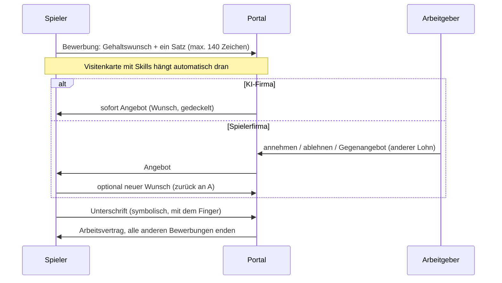

# Jobs, Skills und Visitenkarte

Konzept nach Vorgabe des Auftraggebers (ADR-050 bis ADR-054). Grundprinzip, das sich durch das ganze Spiel zieht:

> **Wer mehr kann, leistet mehr. Wer mehr leistet, verdient mehr, und seine Firma auch.**

Werte stehen in `src/config/balance.ts` (Abschnitte `skills`, `jobs`, `dailyRewards`, `avatars`), der Skill-Baum in
`src/config/skills.ts`, Texte in `messages/de.json`.

## Inhalt

1. [Skill-Baum](#1-skill-baum)
2. [Skillpunkte](#2-skillpunkte)
3. [Leistung: Spieler gegen KI](#3-leistung-spieler-gegen-ki)
4. [Das Jobportal](#4-das-jobportal)
5. [Bewerbung, Angebot, Unterschrift](#5-bewerbung-angebot-unterschrift)
6. [Arbeiten und Lohn](#6-arbeiten-und-lohn)
7. [Gehaltserhöhung, Kündigung, Entlassung](#7-gehaltserhöhung-kündigung-entlassung)
8. [Arbeitgeber-Sicht](#8-arbeitgeber-sicht)
9. [Insolvenz mit privater Haftung](#9-insolvenz-mit-privater-haftung)
10. [Digitale Visitenkarte und Profilbild](#10-digitale-visitenkarte-und-profilbild)
11. [Tägliche Belohnung](#11-tägliche-belohnung)
12. [Geldkreislauf](#12-geldkreislauf)
13. [Umsetzungsstand und nächste Schritte](#13-umsetzungsstand-und-nächste-schritte)

---

## 1. Skill-Baum

**8 Stränge** mit je 10 Skills in 5 Stufen, dazu **6 Hybrid-Skills**, die zwei Stränge verbinden. 86 Skills insgesamt.

| Strang                    | Beispiele                                                          | Passt besonders zu           |
| ------------------------- | ------------------------------------------------------------------ | ---------------------------- |
| IT & Software             | Programmierung, IT-Sicherheit, Machine Learning, Cloud, KI         | Tech                         |
| Finanzen                  | Buchhaltung, Investment, Bewertung, Corporate Finance              | jede Firma (Finanzabteilung) |
| Recht                     | Vertragsrecht, Arbeitsrecht, Gesellschaftsrecht, Kapitalmarktrecht | Pharma, Börsengang           |
| Handwerk & Technik        | Mechanik, Elektrotechnik, Bau, Automatisierung, Energietechnik     | Energie, Logistik            |
| Vertrieb & Marketing      | Verkauf, Marketing, Verhandlung, Markenführung                     | Handel                       |
| Führung & Management      | Teamführung, Projekte, Personal, Strategie                         | Führungsrollen               |
| Wissenschaft & Gesundheit | Chemie, Biologie, Medizin, Pharmakologie, Gentechnik               | Pharma, Energie              |
| Logistik & Betrieb        | Lager, Transport, Einkauf, Supply Chain, Qualität                  | Logistik, Handel             |

Aufbau jedes Strangs:

```
Stufe 1  Grundlagen
Stufe 2  drei Spezialisierungen        (je: Grundlagen)
Stufe 3  drei Vertiefungen             (je: eine Spezialisierung)
Stufe 4  zwei Expertisen               (je: eine Vertiefung)
Stufe 5  Meisterschaft                 (beide Expertisen)
```

**Hybrid-Skills** (Stufe 4, zählen für beide Stränge): FinTech (IT + Finanzen), Wirtschaftsrecht (Recht + Finanzen),
Industrie 4.0 (Handwerk + IT), Pharmavertrieb (Wissenschaft + Vertrieb), E-Commerce (Vertrieb + Logistik),
People Analytics (Führung + IT).

**Regeln**

- Ein Skill braucht alle Vorgänger. Kosten in Skillpunkten nach Stufe: 1, 2, 3, 4, 6.
- **Gelernte Skills lassen sich nicht zurücknehmen.** Die Spezialisierung ist eine echte Entscheidung.
- Mischen ist erlaubt und sinnvoll: Eine Juristin mit Finanzwissen bekommt andere Jobs als eine reine Juristin.
- **Strang-Punktzahl** = Summe der Stufen aller gelernten Skills im Strang (Hybride zählen für beide). Sie ist es,
  die Arbeitgeber sehen und verlangen.

## 2. Skillpunkte

| Quelle                   | Art                                           | Menge                                                                          |
| ------------------------ | --------------------------------------------- | ------------------------------------------------------------------------------ |
| **Arbeit** (Hauptquelle) | Strang-Punkte, nur im Strang des Jobs nutzbar | 1 Punkt je 6 bezahlte Arbeitsstunden, verteilt nach den Anforderungen des Jobs |
| Level-up                 | freie Punkte, für jeden Strang                | 1 je Level                                                                     |
| Missionen                | freie Punkte                                  | Wochen- und Story-Missionen, je nach Vorlage                                   |
| Tägliche Belohnung       | freie Punkte                                  | Tag 4 und Tag 7 der Woche                                                      |

Wer als ITler arbeitet, sammelt also IT-Punkte und wird darin besser. Freie Punkte erlauben Abstecher in andere
Stränge. Beim Lernen verbraucht das Spiel zuerst die Strang-Punkte des Strangs, dann freie Punkte.

## 3. Leistung: Spieler gegen KI

| Mitarbeiter                                | Leistung                                              |
| ------------------------------------------ | ----------------------------------------------------- |
| KI-Mitarbeiter (zum festen Preis gemietet) | 1,0                                                   |
| Spieler ohne passende Skills               | 1,5                                                   |
| Spieler mit passenden Skills               | 1,5 + 0,08 × passende Strang-Punktzahl, höchstens 4,0 |

„Passend“ heißt: die Strang-Punktzahl in den Strängen, die der Job verlangt (bis zum Doppelten der Anforderung).
Ein Spieler ist damit **immer** besser als eine KI-Kraft, und jeder neu gelernte Skill im Job hebt seine Leistung
sofort. Die Leistung fließt in die Firmensimulation (Kapazität, Qualität, Vertrieb der Abteilung): mehr Leistung,
mehr Umsatz, mehr Gewinn, und über den gewinnabhängigen Lohn (Abschnitt 6) auch mehr Gehalt.

## 4. Das Jobportal

- Jede Stelle nennt: Firma, Titel, **Karrierestufe** (Praktikant bis C-Level, mit Mindestlevel), **gesuchte Skills**
  (Pflicht, mindestens ein Strang mit Mindest-Punktzahl), **Stundenlohn**.
- **KI-Firmen** schreiben zum Start Stellen aus (2 je Firma, neu zu jedem Quartal). Sie **nehmen jeden** an, zahlen aber
  nur begrenzt: Lohn = Stufenlohn × (1 + 3 % je passendem Skill-Punkt), höchstens das 1,5-Fache. Arbeit bei KI-Firmen
  bringt weniger Erfahrung (Faktor 1) als bei Spielerfirmen (Faktor 2).
- **Spielerfirmen** (ab M4) schreiben eigene Stellen aus, mit eigenem Lohn, ohne Obergrenze.
- Filter nach Strang, „passt zu mir“, Lohn. Jede Stelle zeigt, wie gut sie zu deinen Skills passt.

## 5. Bewerbung, Angebot, Unterschrift



- Höchstens 5 offene Bewerbungen. Wer sich bei mehreren Firmen bewirbt, kann mehrere Angebote bekommen, unterschreibt
  aber nur eines (ein Job gleichzeitig, ADR-045). Mit der Unterschrift ziehen sich alle anderen Bewerbungen zurück.
- Angebote gelten 48 Stunden.
- Die **symbolische Unterschrift** ist ein kurzes Zeichenfeld: Der Spieler unterschreibt mit Finger oder Maus. Sie hat
  keinen rechtlichen Sinn, macht den Moment aber bewusst und verhindert Annahmen aus Versehen.
- Wer schon einen Job hat, muss erst kündigen (Abschnitt 7).

## 6. Arbeiten und Lohn

- Arbeit läuft **passiv**, auch offline: bis zu 12 bezahlte Stunden pro Tag.
- Lohn wird stündlich gutgeschrieben, aus der **Kasse der Firma**, nie aus der Privatkasse des Chefs.
- Jede Arbeitsstunde bringt XP und Fortschritt auf Strang-Punkte (Abschnitt 2).
- **Gewinnabhängiger Lohn bei Spielerfirmen** (Schutz für beide Seiten):
  - Vertragslohn = Basis, die der Chef **nie senken** kann.
  - Reicht das Quartalsergebnis nicht für alle Löhne, sinken die Auszahlungen automatisch anteilig, höchstens auf 50 %
    („Lohnfaktor 70 %“ sichtbar für alle). Der Chef muss nicht privat zahlen.
  - Macht die Firma mehr Gewinn als die Lohnsumme, gehen 20 % davon als Bonus an die Mitarbeiter, nach Lohnhöhe
    verteilt, bis zum Doppelten des Basislohns. Steigt der Gewinn, steigt der Lohn: Niemand wird ausgenutzt.
- Bei KI-Firmen ist der Lohnfaktor immer 100 %.

## 7. Gehaltserhöhung, Kündigung, Entlassung

| Aktion                      | Regel                                                                                                                                                                                                                                                          |
| --------------------------- | -------------------------------------------------------------------------------------------------------------------------------------------------------------------------------------------------------------------------------------------------------------- |
| **Gehaltserhöhung fordern** | Einmal pro Woche. Erlaubt sind bis zu 3 % je Strang-Punkt, den du seit Einstellung oder letzter Erhöhung in den Job-Strängen dazugewonnen hast. KI-Firmen sagen bis zu ihrer Obergrenze automatisch ja; Spieler-Chefs nehmen an, lehnen ab oder bieten weniger |
| **Kündigen**                | Sofort, ohne Frist. Kostet dich **ein Gehalt** (12 Stunden Basislohn), das an die Firma geht                                                                                                                                                                   |
| **Entlassen**               | Sofort. Die Firma zahlt dir **ein Gehalt** als Abfindung                                                                                                                                                                                                       |
| **Firma insolvent**         | Abschnitt 9                                                                                                                                                                                                                                                    |

## 8. Arbeitgeber-Sicht

Ab M4, für Spieler mit eigener Firma:

- **Stellenausschreibung erstellen:** Titel, Stufe, gesuchte Skills, Lohn, Anzahl Plätze.
- **Bewerbungs-Tab:** Liste aller Bewerbungen mit Visitenkarte, Skills, Passung in Prozent, Gehaltswunsch und Satz.
  Aktionen: annehmen, ablehnen, Gegenangebot.
- **Team-Tab:** Mitarbeiter mit Leistung, Lohn, Lohnfaktor, Erhöhungsanfragen; entlassen.
- **KI-Kräfte mieten:** zum festen Preis je Skill-Stufe, sofort verfügbar, Leistung 1,0.
- Beispielrechnung: Eine Programmiererin mit 12 IT-Punkten leistet 1,5 + 0,08 × 12 = 2,46, also fast zweieinhalb
  KI-Kräfte. Kostet sie weniger als 2,46 KI-Löhne, ist sie das bessere Geschäft.

## 9. Insolvenz mit privater Haftung

Vorgabe des Auftraggebers, ersetzt die reine Reputationsstrafe aus ADR-032 (die Schonfrist von 4 Quartalen bleibt):

1. Ist die Firma nach der Schonfrist noch im Minus, wird sie **aufgelöst**.
2. Alle Mitarbeiter bekommen **ein Gehalt** Abfindung.
3. Restliche Schulden der Firma (Minus in der Kasse, offene Kredite, Abfindungen) zahlt der **Gründer privat**.
4. Reicht sein Geld nicht, bekommt er automatisch einen **Privatkredit** der Bank. Die Rate wird von allen Einnahmen
   (Lohn, Grundeinkommen, Verkäufe) einbehalten, bis er abbezahlt ist. Wer pleite ist, ist nicht raus, aber belastet.
5. Reputation sinkt, 3 Tage Gründungssperre (wie bisher).

## 10. Digitale Visitenkarte und Profilbild

- **Profilbild** aus einer Galerie von 20 Pixel-Porträts (Analystin, Coder, Bauleiter, Juristin, Forscherin …); einige
  werden mit dem Level freigeschaltet (bis „Legende“ ab Level 50), gesperrte sind sichtbar mit Schloss.
- **Visitenkarte** (öffentlich, für alle Spieler): Profilbild, Name, Titel und Level, Platz auf der Reichenliste,
  stärkste Stränge mit Punktzahl, Anzahl gelernter Skills, aktueller Job, eigene Firma (ab M4), Login-Serie.
- Optik: dunkle Karte mit Akzentkante, Pixel-Muster, beim Überfahren mit der Maus ein leichter **3D-Kippeffekt** mit
  Lichtreflex; auf dem Handy reagiert sie auf Berühren.
- Erreichbar über die Reichenliste (Name antippen) und später über Bewerbungen und Firmenseiten.

## 11. Tägliche Belohnung

Ein **7-Tage-Kalender**, der beim ersten Besuch des Tages aufgeht:

| Tag        | 1     | 2     | 3     | 4   | 5     | 6     | 7       |
| ---------- | ----- | ----- | ----- | --- | ----- | ----- | ------- |
| XP         | 50    | 75    | 100   | 125 | 150   | 200   | 300     |
| Geld       | 100 € | 200 € | 300 € | –   | 500 € | 750 € | 1.000 € |
| Skillpunkt | –     | –     | –     | 1   | –     | –     | 1       |

XP zählen mit dem Alpha-Bonus doppelt. Wer einen Tag auslässt, fängt bei Tag 1 an; einmal pro Woche schützt ein
Serien-Schutz. Das Geld kommt aus der Staatskasse.

## 12. Geldkreislauf

Alle neuen Ströme bleiben im geschlossenen System (ADR-041): Löhne aus Firmenkassen, Kündigungsgeld an Firmenkassen,
Abfindungen aus Firmenkassen oder dem Gründer, Privatkredite von der Bank (Finanzmarkt-Topf), tägliche Belohnung aus der
Staatskasse. KI-Firmen bekommen ihr Geld zurück über ihre Umsätze (ab M4 von den Haushalten).

## 13. Umsetzungsstand und nächste Schritte

| Teil                                                                                         | Stand                                  |
| -------------------------------------------------------------------------------------------- | -------------------------------------- |
| Skill-Baum, Skillpunkte, Lernen                                                              | in Arbeit                              |
| Profilbild-Galerie, Visitenkarte mit 3D-Effekt                                               | in Arbeit                              |
| Tägliche Belohnung (7-Tage-Kalender)                                                         | in Arbeit                              |
| Jobportal mit KI-Firmen, Bewerbung, Angebot, Unterschrift, Arbeit, Lohn, Erhöhung, Kündigung | in Arbeit                              |
| Arbeitgeber-Funktionen (Ausschreibung, Bewerbungs-Tab, Gegenangebot, Entlassung)             | Datenbank in Arbeit, Oberfläche mit M4 |
| Gewinnabhängiger Lohn, Leistung in der Firmensimulation, Insolvenz mit Privathaftung         | mit M4 (braucht Spielerfirmen)         |
| Arbeitsaufgaben (kurze Mini-Spiele im Job)                                                   | mit M3/M4                              |
