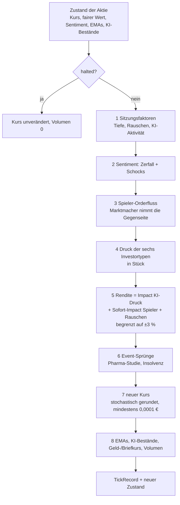
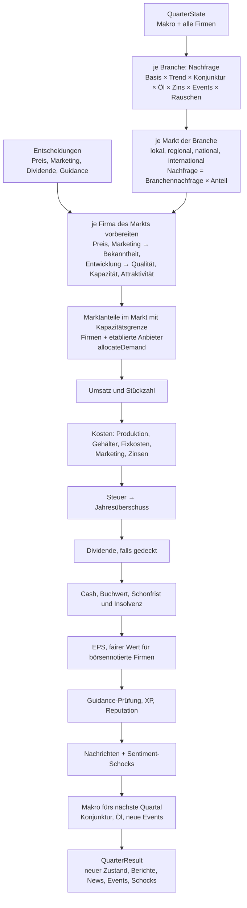

# Simulation

Dieses Dokument beschreibt, wie der Markt und die Wirtschaft von NEXA rechnen: Formeln, Reihenfolge der
Rechenschritte, Pseudocode und der Bezug zum Code in `src/lib/sim`. Alle Zahlen stehen in
[`src/config/balance.ts`](../src/config/balance.ts) (Quelle der Wahrheit, siehe [BALANCING.md](./BALANCING.md));
hier genannte Werte sind die Startwerte von dort.

Bindende Grundlagen aus [DECISIONS.md](./DECISIONS.md):

- **ADR-003:** Geld als `bigint` in Cent, Kurse als `bigint` mit 1 € = 10 000 (`*E4`), Sätze in Basispunkten.
  Modellgrößen ohne Geldcharakter (Qualität, Bekanntheit, Sentiment, Druck) sind `number`.
- **ADR-004:** Ein Tick alle 5 Sekunden, berechnet vom `tick-runner`. Die Simulation bucht nie selbst Geld.
- **ADR-005:** KI-Investoren sind aggregierter Netto-Orderfluss je Investortyp und Aktie.
- **ADR-012:** `src/lib/sim` ist reines TypeScript ohne Abhängigkeiten. Zufall kommt aus einem übergebenen
  Generator, Zeit wird übergeben. Derselbe Code läuft in Deno, Next.js und Vitest.

Ein Spieljahr sind 4 Quartale und damit 24 echte Stunden. **Alle Jahressätze (Zinsen, Renditen, Wachstum)
gelten pro Spieljahr**, also pro echtem Tag.

## Inhalt

1. [Aufbau und Datenfluss](#1-aufbau-und-datenfluss)
2. [Zufall und Reproduzierbarkeit](#2-zufall-und-reproduzierbarkeit)
3. [Kursbildung pro Tick](#3-kursbildung-pro-tick)
4. [Die sechs KI-Investortypen](#4-die-sechs-ki-investortypen)
5. [Fairer Wert](#5-fairer-wert)
6. [Liquidität, Preis-Impact und Slippage](#6-liquidität-preis-impact-und-slippage)
7. [Marktmacher, Spread und Orderbuch](#7-marktmacher-spread-und-orderbuch)
8. [Orderausführung](#8-orderausführung)
9. [Nachbörslicher Handel](#9-nachbörslicher-handel)
10. [Kerzen](#10-kerzen)
11. [Quartalsabschluss](#11-quartalsabschluss)
12. [Mitarbeiter, Kapazität, Einarbeitung](#12-mitarbeiter-kapazität-einarbeitung)
13. [Kredite und Insolvenz](#13-kredite-und-insolvenz)
14. [IPO und Bookbuilding](#14-ipo-und-bookbuilding)
15. [NEXA 30](#15-nexa-30)
16. [Zentralbank](#16-zentralbank)
17. [Staatsanleihen](#17-staatsanleihen)
18. [Nachrichten](#18-nachrichten)
19. [Geplante und zufällige Events](#19-geplante-und-zufällige-events)
20. [Reputation](#20-reputation)
21. [Steuern, Hebel, Liquidation, Tresor](#21-steuern-hebel-liquidation-tresor)
22. [Zocker gewinnen manchmal, Analytiker langfristig](#22-zocker-gewinnen-manchmal-analytiker-langfristig)
23. [Konzept → Code](#23-konzept--code)
24. [Umgesetzt und offen](#24-umgesetzt-und-offen)

---

## 1. Aufbau und Datenfluss

Die Simulation besteht aus zwei reinen Funktionen und vielen kleinen Formeln, die sie verwenden:

| Funktion                              | Takt     | Aufgabe                                                                              |
| ------------------------------------- | -------- | ------------------------------------------------------------------------------------ |
| `stepMarketTick(state, inputs, rng)`  | alle 5 s | Kurse, Quotes, Sentiment und KI-Bestände aller Aktien fortschreiben                  |
| `closeQuarter(state, decisions, rng)` | alle 6 h | Unternehmenssimulation: Nachfrage, Marktanteile, Gewinn- und Verlustrechnung, Events |

Beide lesen keinen Zustand außerhalb ihrer Argumente und schreiben nichts. Der Aufrufer (Edge Function bzw.
Postgres-Funktion) liest den Zustand, ruft die Funktion auf und bucht das Ergebnis in einer Transaktion.
Der Quartalsabschluss gibt Schocks (`TickShock`) zurück, die der nächste Tick als Eingabe bekommt. So wirken
Quartalszahlen und Makro-Events auf die Kurse.

## 2. Zufall und Reproduzierbarkeit

`rng.ts` implementiert mulberry32 mit Seed-Mischung (FNV-1a plus murmur3-Finalizer). Wichtig ist `derive(...parts)`:

```
rng.derive("tick", tickNumber, securityId)   // eigener Teilstrom je Tick und Aktie
rng.derive("sector", quarterIndex, sectorId) // Branchenrauschen im Quartal
rng.derive("macro", quarterIndex)            // Makro-Events
```

Ein abgeleiteter Strom hängt nur vom Wurzel-Seed und den Teilen ab, nicht davon, wie viele Zahlen vorher gezogen
wurden. Folgen:

- Ein Tick ist für (Zustand, Eingaben, Seed) **deterministisch** und unabhängig von der Reihenfolge der Aktien.
- Ein Tick kann später exakt nachgerechnet werden (Fehlersuche, Tests, Replay).
- Der Runner speichert einen Seed in `sim_runtime`. Spieler kennen ihn nicht, sonst wäre das Rauschen vorhersagbar.

## 3. Kursbildung pro Tick

`stepMarketTick` rechnet je Aktie in genau dieser Reihenfolge:



Pseudocode (Bezeichner wie im Code):

```
für jede Aktie s (nicht halted), r = rng.derive("tick", tick, s.id):

  # 1 Sitzung
  depth           = freeFloat × depthFreeFloatFraction × (offen ? 1 : 0.25)
  noiseFactor     = offen ? 1 : 0.5
  liquidityFactor = offen ? 1 : 0.25

  # 2 Sentiment
  sentiment = clamp(s.sentiment × (1 − 0.0019) + Σ shock.sentimentDelta, −1, 1)

  # 3 Spielerfluss (bereits ausgeführte Orders seit dem letzten Tick)
  playerNet      = Σ Käufe − Σ Verkäufe (Stück)
  makerInventory = s.archetypes.market_maker.holdingShares − playerNet

  # 4 Druck je Investortyp (Abschnitt 4)
  pressure[a] = computeInvestorPressure(a, Signale)      für alle sechs Typen
  aiNet       = Σ pressure[a]

  # 5 reguläre Rendite
  flowReturn = impactReturn(aiNet, depth)
             + immediateShare × impactReturn(playerNet, depth)
  noise      = tickNoiseBps[sizeClass]/10000 × sector.volatilityMultiplier × noiseFactor × r.normal()
  regular    = clamp(flowReturn + noise, −maxTickReturn, +maxTickReturn)

  # 6 Event-Sprünge (nicht begrenzt, aber nie unter −99 %)
  eventFactor = Π max(0.01, 1 + shock.priceReturn)
  logReturn   = regular + ln(eventFactor)

  # 7 neuer Kurs
  exact = price × exp(logReturn)
  price' = floor(exact) + (r.next() < Nachkommaanteil ? 1 : 0)   # erwartungstreu gerundet
  price' = max(minPriceE4, price')

  # 8 Folgezustand
  emaFast += 0.15   × (price' − emaFast)        # etwa 30 Sekunden
  emaSlow += 0.0165 × (price' − emaSlow)        # etwa 5 Minuten
  holding[a] += pressure[a]
  holding[market_maker] = makerInventory × (1 − 0.005 × liquidityFactor)
  quote  = quoteAround(price', halfSpreadBps(sizeClass, session, sentiment))
  volume = Spielervolumen + Σ |pressure[a]| + kosmetischer Grundumsatz
```

Erläuterungen:

- **Rendite im Log-Raum.** Der Kurs wird mit `exp(logReturn)` multipliziert und kann deshalb nie negativ werden.
  Zusätzlich gilt die harte Untergrenze `minPriceE4` (0,0001 €). Ein Test prüft das unter extremem Stress.
- **Stochastisches Runden.** Bei einem Pennystock zu 0,05 € ist ein Tick von 0,01 % kleiner als die kleinste
  Kurseinheit. Kaufmännisches Runden würde solche Bewegungen verschlucken, und der Kurs könnte am Mindestkurs
  hängen bleiben. Gerundet wird deshalb zufällig auf- oder abwärts, sodass der Erwartungswert stimmt.
- **Circuit Breaker.** Orderfluss plus Rauschen bewegen den Kurs pro Tick höchstens um `maxTickReturnBps` (3 %).
  Event-Sprünge (Schritt 6) sind davon ausgenommen, weil sie gewollt sind.
- **Rauschen pro Tick** (Standardabweichung): Bluechip 6 bp, Mittelständler 15 bp, Pennystock 45 bp, mal
  Branchenfaktor (Pharma 1,4, Tech 1,2, Einzelhandel 0,8). Zusammen mit dem Rückzug zum fairen Wert ergibt das in
  Testläufen Tagesspannen von etwa ±5 % (Bluechip), ±10 % (Mittelständler) und ±25 bis 30 % (Pennystock).

## 4. Die sechs KI-Investortypen

`computeInvestorPressure(archetype, signals)` liefert den **Netto-Nachfragedruck in Stück** für einen Tick.
Positive Werte sind Käufe. Es gibt zwei Familien:

- **Flusstypen** (Value-Fonds, Momentum-Trader, Kleinanleger): `pressure = freeFloat × capitalShare × speed × signal`
  mit `signal ∈ [−1, 1]`. Ihr „Bestand“ ist nur Buchführung der Nettoposition gegenüber dem Ausgangswert.
- **Bestandstypen** (Rentenfonds, Indexfonds, Marktmacher): `pressure = speed × (target − holding)`.
  Ihr Fluss ist endlich: Ist das Ziel erreicht, hört der Druck auf.

`speed = reactionSpeed × liquidityFactor`. Nachbörslich handeln die KI-Investoren also nur ein Viertel so viel.

| Typ               | `capitalShare` | `reactionSpeed` | Signal bzw. Ziel                                                                                                                                          |
| ----------------- | -------------- | --------------- | --------------------------------------------------------------------------------------------------------------------------------------------------------- |
| `market_maker`    | 0,05           | 0,005           | Ziel 0: baut Inventar aus Spielerorders ab. `pressure = −inventory × speed × marketMakerHedgeShare`                                                       |
| `value_fund`      | 0,30           | 0,000167        | `gap = ln(fairValue / price)`; innerhalb `deadBand` (1 %) kein Handel; `signal = clamp((gap ∓ deadBand) / gapScale, ±1)` mit `gapScale` 0,5               |
| `momentum_trader` | 0,10           | 0,0002          | `trend = emaFast / emaSlow − 1`; `signal = tanh(trend / trendScale)` mit `trendScale` 0,02                                                                |
| `pension_fund`    | 0,20           | 0,002           | `target = freeFloat × capitalShare × weight`; `weight = clamp(1 − 0,05 × (rate − neutral)/100bp + 0,03 × (dividendYield − bondYield10y)/100bp, 0,2, 1,8)` |
| `index_fund`      | 0,04           | 0,005           | `target = inIndex ? freeFloat × capitalShare : 0`                                                                                                         |
| `retail_herd`     | 0,10           | 0,0012          | `signal = clamp(sentiment + chaseGain × tanh(trend / trendScale), ±1)` mit `chaseGain` 0,1                                                                |

So entstehen die gewünschten Effekte:

- **Value-Fonds = Kursanker.** Der Value-Fonds ist die Rückkehr zum fairen Wert. Bei kleiner Abweichung zieht er
  den Kurs pro Tick um `0,0005 × gap` zurück (Herleitung unten). Das entspricht einer Halbwertszeit von etwa
  1 400 Ticks, also knapp 2 Stunden. Er „reagiert langsam“: Übertreibungen halten Stunden, nicht Sekunden.
- **Momentum verstärkt.** Steigt der Kurs, liegt der schnelle Durchschnitt über dem langsamen, die Trader kaufen
  nach. `tanh` begrenzt den Druck.
- **Kleinanleger übertreiben.** Ein Sentiment-Schock von +0,3 (gute Quartalszahlen) erzeugt über seine Zerfallszeit
  kumuliert etwa `0,0006 × 0,3 / 0,0019 ≈ 9,5 %` Kursanstieg, den der Value-Fonds danach über Stunden wieder
  abbaut, sofern der faire Wert nicht mitgestiegen ist.
- **Zinsrotation.** Steigt der Leitzins um 100 bp, senkt der Rentenfonds sein Zielgewicht um 5 %. Er verkauft
  1 % des Streubesitzes, das sind 5 „Tiefen“ und damit rund −5 % Kursdruck über ein bis zwei Stunden. Dauerhaft
  wird der Rückgang, weil der Makrofaktor gleichzeitig den fairen Wert senkt (Abschnitt 5).
- **Indexaufnahme.** `inIndex` wechselt auf `true`, das Ziel des Indexfonds springt von 0 auf 4 % des
  Streubesitzes. Das sind 20 Tiefen, also brutto etwa +20 % Kaufdruck innerhalb weniger Minuten. Danach verkaufen
  Value-Fonds in die Übertreibung. Ein Teil des Sprungs bleibt, wenn der faire Wert passt.
- **Dividendenaktien.** Der Rentenfonds gewichtet Aktien höher, deren Dividendenrendite über der Rendite der
  zehnjährigen Anleihe liegt.

### Herleitung der Größenordnungen

Die Preis-Impact-Funktion macht aus Stück eine Rendite: `return = (impactBpsPerDepth / 10 000) × shares / depth`
mit `depth = freeFloat × depthFreeFloatFraction`. Für einen Flusstyp mit vollem Signal:

```
return/Tick = 0,01 × (freeFloat × capitalShare × speed) / (freeFloat × 0,002) = 5 × capitalShare × speed
```

| Typ                     | maximale Rendite pro Tick                              |
| ----------------------- | ------------------------------------------------------ |
| Value-Fonds             | 5 × 0,30 × 0,000167 = 0,025 % (bei 50 % Fehlbewertung) |
| Momentum-Trader         | 5 × 0,10 × 0,0002 = 0,010 %                            |
| Kleinanleger, Sentiment | 5 × 0,10 × 0,0012 = 0,060 % (bei Sentiment ±1)         |
| Kleinanleger, Trendjagd | 0,060 % × 0,1 = 0,006 %                                |

**Stabilitätsbedingung.** Trendfolger koppeln die Kursbewegung auf sich selbst zurück. Bei einer gleichmäßigen
Drift `d` pro Tick liegt der schnelle Durchschnitt um etwa `d × (1/emaSlowAlpha − 1/emaFastAlpha) ≈ 54 d` über dem
langsamen. Die Schleifenverstärkung ist

```
(0,010 % + 0,006 %) × 54 / trendScale = 0,00016 × 54 / 0,02 ≈ 0,43   (< 1)
```

Trends werden also um etwa den Faktor `1 / (1 − 0,43) ≈ 1,75` verstärkt, schaukeln sich aber nicht auf. Außerdem
ist der maximale Trenddruck (0,016 %) kleiner als der maximale Druck des Value-Fonds (0,025 %). Beide Bedingungen
sichert ein Test (`investors.test.ts`). Wer die Parameter ändert, muss diese Bedingungen wieder prüfen: Mit den
ersten Probewerten (Verstärkung > 1) liefen die Kurse nachbörslich innerhalb eines Tages ins Unendliche.

### Marktmacher und Spielerorders

Kauft ein Spieler `q` Stück, sinkt das Inventar des Marktmachers um `q`. Der Preiseffekt hat zwei Teile:

1. **sofort:** `immediateShare` (50 %) des vollen Impacts im selben Tick,
2. **verzögert:** der Marktmacher deckt `marketMakerHedgeShare` (50 %) seines Inventars am Markt ein, verteilt über
   etwa 200 Ticks. Der Rest wird durch natürlichen Gegenfluss ausgeglichen.

In Summe wirkt also der volle Impact `impactReturn(q, depth)`. Danach zieht der Value-Fonds den Kurs zum fairen
Wert zurück. Kursmanipulation kostet deshalb Geld: Man kauft teuer, und der Effekt verschwindet in Stunden.

## 5. Fairer Wert

`fairValueE4()` in `fair-value.ts`:

```
fairValue = max(EPS, 0) × sector.peRatio × growthFactor × reputationFactor × macroFactor × eventValueFactor
```

| Faktor             | Berechnung                                                                                 | Spanne      |
| ------------------ | ------------------------------------------------------------------------------------------ | ----------- |
| `EPS`              | Gewinn der letzten 4 Quartale je Aktie (bei weniger Historie auf 4 Quartale hochgerechnet) | –           |
| `peRatio`          | Branchen-KGV: Tech 28, Pharma 22, Logistik 15, Einzelhandel 14, Energie 11                 | –           |
| `growthFactor`     | `1 + growthWeight × Umsatzwachstum` (letzte 4 Quartale gegen die 4 davor)                  | 0,6 bis 1,8 |
| `reputationFactor` | nur Spielerfirmen: linear von Reputation 0 → 0,6 über 50 → 1,0 bis 100 → 1,4               | 0,6 bis 1,4 |
| `macroFactor`      | `1 − 0,04 × sector.sensitivity.valuationRate × (Leitzins − neutral) / 100 bp`              | 0,6 bis 1,3 |
| `eventValueFactor` | Produkt der binären Events (Pharma-Studien), sonst 1                                       | –           |

- **Verlustfirmen** haben kein sinnvolles Gewinnvielfaches. Für sie gilt als Untergrenze
  `bookValueFloorShare` (50 %) des Buchwerts je Aktie, ebenfalls mit Reputations-, Makro- und Eventfaktor.
  Der faire Wert ist nie kleiner als der Mindestkurs.
- Der faire Wert wird **nur** beim Quartalsabschluss und bei fundamentalen Events neu gesetzt, nicht pro Tick.
  Zwischen zwei Quartalen ist er konstant. Nach ADR-008 liegt er in einer Tabelle, die nur `service_role` liest.
- **Analystenkursziele** (ab Level 7): `analystPriceTargetE4()` liefert den fairen Wert mit Rauschen
  (Standardabweichung 8 %), in 25 % der Fälle mit dreifachem Rauschen. Die Ziele sind also nützlich, aber
  „manchmal falsch“.

## 6. Liquidität, Preis-Impact und Slippage

`price-impact.ts`. Eine **Tiefe** (`depth`) ist die Stückzahl, die den Kurs um `impactBpsPerDepth` (1 %) bewegt:

```
depth          = freeFloatShares × 0,002 × (nachbörslich: 0,25)
impactReturn(q) = sign(q) × 0,01 × (|q| / depth) ^ exponent        # exponent = 1
```

**Warum linear?** Bei linearem Impact ist es egal, ob eine Order am Stück oder in Teilen kommt
(`impact(a + b) = impact(a) + impact(b)`). Bei einer Wurzelfunktion wie in echten Märkten würde Stückeln den
dauerhaften Impact erhöhen, bei einer konvexen Funktion würde es ihn senken, und Spieler würden Orders in
hundert Teile zerlegen. Linear gibt es nichts zu optimieren und nichts zu missbrauchen.

**Slippage einer Market-Order.** Das Orderbuch hat gleichmäßige Dichte. Wer `q` Stück kauft, läuft vom Briefkurs
bis `ask × (1 + impact(q))` und zahlt im Mittel die Hälfte davon:

```
averagePrice = ask × (1 + impact(q) / (exponent + 1))     # Kauf
averagePrice = bid × (1 − impact(q) / (exponent + 1))     # Verkauf
```

`estimateMarketOrder()` liefert diese Schätzung für die Ordervorschau. Orders, die den Kurs um mehr als
`maxImpactBpsPerOrder` (15 %) bewegen würden, werden nur bis zu dieser Grenze ausgeführt (`maxFillableShares`).

Beispiel: Streubesitz 10 Mio. Stück, Kurs 100 €. Eine Tiefe sind 20 000 Stück (2 Mio. €). Eine Order über
1 000 Stück (100 000 €) bewegt den Kurs um 0,05 % und kostet im Mittel 0,025 % Slippage. Bei einem Pennystock
mit 2 Mio. € Streubesitz-Wert sind dieselben 100 000 € bereits 25 Tiefen und werden bei 15 % gekappt.

### 6a. Spielergetriebene Kurse (ADR-056)

Vorgabe: Spieler bestimmen die Kurse, die KI tritt zurück, je mehr Spieler handeln. Drei Kräfte pro Tick:

| Kraft                      | Formel                                                                         | Wirkung                                                                              |
| -------------------------- | ------------------------------------------------------------------------------ | ------------------------------------------------------------------------------------ |
| Spieler-Orders             | `r = 0,01 × Nettokauf in Cent / depthCentsPer100Bps[Klasse] / Liquidität`      | 10.000 € bewegen Penny 2 %, Mittelstand 0,4 %, Bluechip 0,1 %                        |
| Firmenerfolg + Halteprämie | Wertfonds-Anker `FV × (1 + 0,6 × tanh(Spielerbestand in Cent / (20 × depth)))` | Kaufen und Halten hebt den Kurs dauerhaft, Kaufen und Verkaufen verpufft             |
| KI-Händler                 | Rauschen, Trendfolger und Herde × `w = max(0,15; R / (R + A))`                 | `A` = Spielerumsatz mit 6 h Halbwertszeit, `R` je Klasse 1 Mio. / 250.000 / 50.000 € |

Weitere Werte: Rauschfaktor 0,45 (vorher 0,2), Wertfonds-Reaktion 0,0005 (vorher 0,000167), Herde 0,002,
Branchennachfrage-Rauschen und Gewinnüberraschungen doppelt so stark, Zinsentscheid alle 2 Quartale, Anleihen-Rauschen
× 3. Code: `src/lib/sim/player-influence.ts`, eingebunden in `tick.ts`; die Datenbank (`market_tick_at`) hält
Spielerbestand und Aktivität je Wertpapier in `security_sim_state`.

## 7. Marktmacher, Spread und Orderbuch

`market-maker.ts`.

```
halfSpreadBps = (halfSpreadBps[sizeClass] + sentimentWideningBps × |sentiment|) × (nachbörslich: 3)
bid = mid − max(1 Kurseinheit, mid × halfSpreadBps / 10 000)       # mindestens der Mindestkurs
ask = mid + max(1 Kurseinheit, mid × halfSpreadBps / 10 000)       # immer > bid
```

Halber Spread während der Börsenzeit: Bluechip 5 bp, Mittelständler 15 bp, Pennystock 60 bp. In nervösen
Märkten (extremes Sentiment) kommen bis zu 20 bp dazu.

**Synthetisches Orderbuch** (`synthesizeOrderBook`): 10 Stufen je Seite im Abstand `levelStepBps` (10 bp).
Jede Stufe bietet `depth × levelStepBps / impactBpsPerDepth` Stück, also ein Zehntel einer Tiefe. Damit bildet das
Buch die lineare Impact-Funktion als Treppe nach: Wer eine Tiefe wegkauft, steht 1 % über dem Briefkurs. Ein Test
prüft, dass `walkBook()` über das synthetische Buch und `estimateMarketOrder()` auf weniger als einen halben
Stufenabstand übereinstimmen. Die Stückzahlen bekommen ±20 % kosmetisches Rauschen aus dem Tick-Teilstrom, damit
alle Clients dasselbe Buch sehen.

`mergeOrderBook()` mischt die echten Limit-Orders der Spieler hinein. Bei gleichem Preis stehen Spieler vor dem
Marktmacher, untereinander gilt Zeitpriorität.

## 8. Orderausführung

Geld und Stücke bucht ausschließlich die Datenbank (`place_order` in PL/pgSQL). Die Formeln dafür stehen in
`orders.ts`, `price-impact.ts` und `money.ts`; die SQL-Funktionen müssen dieselben Ergebnisse liefern (Tests mit
gemeinsamen Beispielwerten in M1).

```
place_order(side, type, quantity, limit?, leverage?):
  1 prüfen: Level/Freischaltung, Rate Limit, Idempotenz (request_id), Guthaben bzw. Margin
  2 Buch = mergeOrderBook(synthesizeOrderBook(quote, depth), offene Spieler-Limits der Gegenseite)
  3 Market-Order:        fills = walkBook(side, quantity, Gegenseite)        bis maxFillableShares
    marktfähiges Limit:  fills = walkBook(side, quantity, Gegenseite, limit)
    sonst:               Order ruht im Buch
  4 je Fill: value_cents = orderValueCents(quantity, price_e4)   # round-half-even, einmalig (ADR-003)
  5 buchen: Kaufpreis, Ordergebühr, bei Verkauf Steuer (Abschnitt 21), XP
  6 Nettofluss gegen den Marktmacher in `PlayerFlow` für den nächsten Tick sammeln
```

- **Spieler gegen Spieler:** Trifft eine Order auf ein Spieler-Limit, wechseln Geld und Stücke zwischen den beiden
  Spielern. Dieser Teil zählt nicht zum `PlayerFlow`, denn der Marktmacher ist nicht beteiligt und der Kurs soll
  sich dadurch nicht bewegen.
- **Ruhende Limits und Stops** prüft der Tick-RPC nach jedem Tick: `isLimitMarketable(side, limit, quote)` bzw.
  `isStopTriggered(side, stop, lastPrice)`. Ein ausgelöster Stop wird zur Market-Order.
- **Rundung:** Jeder Fill wird einzeln gerundet. Die Differenz zur exakten Summe trägt das Systemkonto „Markt“.
- **Wash-Trading:** Kauf und Rückverkauf derselben Aktie innerhalb von `washTradeWindowSeconds` (300 s) geben
  keine XP. Das prüft die Datenbank, nicht die Simulation.

## 9. Nachbörslicher Handel

Außerhalb von 08:00 bis 22:00 Uhr (`marketSession(localHour)`):

| Größe                             | Faktor | Wirkung                                                                         |
| --------------------------------- | ------ | ------------------------------------------------------------------------------- |
| Tiefe (`liquidityMultiplier`)     | 0,25   | Spielerorders bewegen den Kurs viermal so stark, höhere Slippage                |
| Spread (`spreadMultiplier`)       | 3      | Handeln wird teurer                                                             |
| Rauschen (`volatilityMultiplier`) | 0,5    | Der Markt ist ruhiger                                                           |
| KI-Aktivität                      | 0,25   | KI-Investoren handeln entsprechend weniger, ihre Wirkung pro Tick bleibt gleich |

Der letzte Punkt ist wichtig: Würden die KI-Investoren bei dünnem Buch gleich viel handeln, wäre ihre eigene
Rückkopplung viermal so stark und der Markt instabil.

## 10. Kerzen

`candles.ts`. Der Runner führt je Aktie und Intervall eine offene Kerze und ruft pro Tick
`applyTickToCandle(current, tick, intervalMs)` auf:

```
bucket = floor(timeMs / intervalMs) × intervalMs
neuer bucket → neue Kerze mit open = high = low = close = Tick-Kurs
sonst        → high/low anpassen, close = Tick-Kurs, volume addieren
```

- 1 min, 5 min und 1 h sind an der Uhr ausgerichtet.
- Quartals- und Spieljahreskerzen folgen den Zeilen von `game_quarters` (ADR-006, wegen der Zeitumstellung nicht
  aus der Uhrzeit berechenbar). Sie entstehen mit `mergeCandles()` aus den feineren Kerzen.
- `aggregateCandles()` baut Kerzen aus einer Tickliste neu auf (Reparatur, Tests). Ein Test prüft, dass
  inkrementelle und gesammelte Berechnung identisch sind.

## 11. Quartalsabschluss

`closeQuarter(state, decisions, rng)` rechnet KI- und Spielerfirmen mit **derselben** Simulation.



### 11.1 Branchennachfrage und Märkte

`sectorDemand()` liefert die Kundenausgaben der Branche im Quartal in Cent. Das ist zugleich die Nachfrage des
internationalen Markts:

```
demand = baseDemand
       × (1 + demandGrowth) ^ (quarterIndex / 4)                   # Trend
       × cycleIndex ^ sensitivity.cycle                             # Konjunktur
       × oilIndex ^ sensitivity.oilDemand                           # Ölpreis
       × max(0,5; 1 + sensitivity.ratePer100Bps × (rate − neutral)/100 bp)   # Zins
       × Π demandFactor aller laufenden Makro-Effekte der Branche
       × (1 + N(0, demandNoise))                                    # Rauschen
```

Die Branchenzusammenhänge aus Abschnitt 10.1 des Prompts stecken in den Elastizitäten: Energie profitiert vom
Ölpreis (`oilDemand` 0,8), Logistik zahlt ihn (`oilCost` 0,5), Logistik hängt am stärksten an der Konjunktur
(1,2), Pharma kaum (0,1), Tech reagiert am stärksten auf Zinsen.

**Märkte (Segmente).** Jede Firmenstufe verkauft in genau einem Markt (`segmentForTier`):

| Markt           | Stufe                          | `demandShare` | wächst mit dem Trend | etablierte Anbieter                        |
| --------------- | ------------------------------ | ------------- | -------------------- | ------------------------------------------ |
| `local`         | Kleinunternehmen               | 0,0018        | nein                 | Qualität 40, Bekanntheit 0,5               |
| `regional`      | GmbH                           | 0,006         | nein                 | Qualität 50, Bekanntheit 0,5               |
| `national`      | AG vor IPO                     | 0,022         | nein                 | Qualität 55, Bekanntheit 0,5               |
| `international` | börsennotiert (alle KI-Firmen) | 1             | ja                   | keine (die KI-Firmen sind die Etablierten) |

```
segmentDemand = sectorDemand(ohne Trend, falls growsWithSector = false) × demandShare
```

Die kleinen Märkte haben also eine feste Größe und spüren nur Konjunktur, Öl, Zins, Events und Rauschen.
Begründung und Kalibrierung stehen in [BALANCING.md](./BALANCING.md#4-unternehmen), Abschnitt 4.1.

### 11.2 Vorbereitung je Firma

```
price      = clamp(Entscheidung, 25 % … 300 % des Referenzpreises)        # nur Eingabegrenze
marketing  = Entscheidung (wird ausgegeben wie beschlossen)
awareness  = nextAwareness(awareness, effectiveMarketingBudget(marketing, Marketing-Skillpunkte), referenceBudget)
quality    = nextQuality(quality, Entwicklungs-Skillpunkte, Produktions-Skillpunkte, fertige Projekte)
capacity   = Produktions-Skillpunkte × capacityUnitsPerSkillPoint × (1 + 1,5 % × COO-Skill)
attract    = quality^1.2 × awareness^0.8 / price^e                        # e = sectors[x].priceExponent
           × (1 + min(50 %, 1 % × Vertriebs-Skillpunkte)) × (1 + 2 % × Vertriebsleitungs-Skill)
```

**Preisexponent je Branche.** Die Formel aus dem Prompt bleibt, der Preisexponent ist je Branche verschieden:
Einzelhandel 2,5, Logistik 2,0, Energie 1,5, Tech 1,2, Pharma 1,0 (Wert im Prompt: 1,5 für alle). Für eine Firma
mit kleinem Marktanteil ist der gewinnmaximale Preis

```
p* = (e + 1) / e × (Stückkosten + Produktionslohn je Stück)
```

Die Kostenstruktur jeder Branche ist so gewählt, dass `p*` dem Referenzpreis entspricht. Ein Test prüft das.
Damit regelt der Wettbewerb den Preis: Teurer als der Markt kostet mehr Kunden, als die Marge bringt, billiger
verschenkt Marge. Ein Preisband als Balancing-Regel gibt es nicht mehr.

**Marketing mit sinkendem Grenznutzen** (`market-share.ts`):

```
budget'    = budget × (1 + departmentMaxBoost × pts / (pts + 15))          # Marketing-Abteilung, bis ×2
gain       = min(maxGainPerQuarter, gainAtReferenceBudget × (budget' / referenceBudget) ^ 0,4854)
awareness' = awareness × (1 − decay) + (1 − awareness × (1 − decay)) × gain
```

Der Exponent ist `log2(1,4) = 0,4854`: Doppeltes Budget bringt genau +40 % Bekanntheitsgewinn. Eine zweite Bremse
ist die Sättigung, denn der Gewinn wirkt nur auf den Teil des Markts, der die Firma noch nicht kennt.
`referenceBudget` ist 1,5 % der Basisnachfrage **des eigenen Markts** und bringt 5 Prozentpunkte. Bekanntheit ist
der Anteil der Kunden des eigenen Markts, der die Firma kennt. Sie verfällt mit 10 % je Quartal: Wer nichts tut,
wird vergessen. Das Budget wird nicht mehr auf die Hälfte der Kasse begrenzt. Ein Budget, das die Kasse nicht
trägt, führt in die Überziehung und damit in die Schonfrist (Abschnitt 13).

**Qualität** (`qualityTarget`, `nextQuality`):

```
need     = sector.developmentIntensity × (halfSaturationSkillPoints + productionScale × Produktions-Skillpunkte)
x        = Entwicklungs-Skillpunkte / need
target   = 100 × (x / (1 + x)) ^ 0,5
quality' = clamp(quality + sector.qualityAdjustmentRate × (target − quality) + Σ fertige Projekte, 1, 100)
```

- Der **Zielwert** hängt an den Entwicklern relativ zur Firmengröße. Eine große Firma bekommt hohe Qualität
  nicht geschenkt, und KI-Firmen mit unterschiedlichem Entwickleranteil behalten dauerhaft unterschiedliche
  Qualität (vorher liefen alle Firmen einer Branche auf denselben Wert zu).
- Der **Entwicklungsbedarf** unterscheidet die Branchen: Tech 2,0, Pharma 1,5, Logistik 0,7, Energie 0,6,
  Einzelhandel 0,5.
- Die **Anpassungsrate** sagt, wie schnell Produkte altern: Tech 10 % der Lücke je Quartal, Pharma 6 %,
  Logistik 4 %, Energie und Einzelhandel 3 %. Ohne Entwickler ist der Zielwert 0.
- Produktprojekte (`ProductProject`) sind das Zeit-Gate: Sie laufen `quartersRemaining` Quartale und liefern
  dann einen Sprung, der danach wieder Richtung Zielwert abschmilzt.

### 11.3 Marktanteil und Kapazität

Innerhalb eines Markts gilt die Formel aus dem Prompt:

```
attractiveness = quality^1.2 × awareness^0.8 / price^e
marketShare    = eigene attractiveness / Σ attractiveness aller Anbieter des Markts
revenue        = segmentDemand × marketShare, begrenzt durch capacityUnits × price
```

**Etablierte Anbieter.** In den Märkten `local`, `regional` und `national` nimmt ein namenloser Wettbewerber
teil (`incumbentAttractiveness`): Qualität und Bekanntheit aus der Konfiguration, Preis = Marktpreis
(`marketPriceCents` = Referenzpreis plus Weitergabe von Kostenänderungen), unbegrenzte Kapazität. Sein Umsatz
ist kein Spielergeld und wird nur berichtet (`incumbentRevenueCents`). Er sorgt dafür, dass

- eine einzelne Spielerfirma nie den ganzen Markt bekommt,
- Preis, Qualität und Bekanntheit immer gegen einen Maßstab laufen,
- Nachfrage, die eine ausgelastete Spielerfirma nicht bedient, zu ihm abfließt.

Mehrere Spielerfirmen desselben Markts teilen sich die Nachfrage untereinander und mit ihm. Senkt eine Firma den
Preis, steigt ihr Anteil und der aller anderen sinkt. Beides prüfen Tests.

**Entscheidung zur unbedienten Nachfrage:** Kann eine Firma ihre Nachfrage nicht bedienen, geht diese **nicht
verloren**. Die Kunden kaufen bei den übrigen Anbietern, wieder im Verhältnis der Attraktivität
(`allocateDemand`, „Water-Filling“):

```
remaining = demand; open = alle Anbieter mit Attraktivität > 0
wiederhole:
  offered[i] = remaining × attract[i] / Σ attract(open)
  capped     = alle i mit offered[i] ≥ Kapazitätsumsatz[i]
  wenn capped leer: revenue[i] = offered[i]; fertig
  für capped: revenue[i] = Kapazitätsumsatz[i]; remaining −= revenue[i]; aus open entfernen
```

Unbediente Nachfrage (`unservedDemandCents`) kann nur im internationalen Markt entstehen, wenn alle Firmen
ausgelastet sind. Der tatsächliche Anteil (`marketShare`) kann kleiner sein als der Attraktivitätsanteil
(`attractivenessShare`); die Summe der tatsächlichen Anteile eines Markts ist höchstens 1.

**Stufenwechsel.** Wandelt sich eine Firma in die nächste Stufe um, wechselt sie den Markt. Die Zahl der Kunden,
die sie kennen, bleibt gleich; die Bekanntheit wird umgerechnet
(`awarenessAfterTierChange`: `awareness × demandShare_alt / demandShare_neu`).

### 11.4 Gewinn- und Verlustrechnung

```
unitsSold      = revenue / price
productionCost = unitsSold × unitCost × oilIndex ^ sensitivity.oilCost
payroll        = Σ Gehälter aller Abteilungen
fixedCost      = Fixkosten der Stufe × Branchenfaktor × (1 − 30 % × pts / (pts + 15))   # Finanz-Abteilung
interest       = debt × loanRate / 4  +  Überziehung × (Leitzins + overdraftSpread) / 4
preTax         = revenue − productionCost − payroll − fixedCost − marketing − interest
tax            = preTax > 0 ? preTax × corporateTaxBps : 0
netIncome      = preTax − tax
dividend       = gewünschte Dividende je Aktie × Aktien, nur wenn cash + netIncome sie voll deckt
cashAfter      = cash + netIncome − dividend
bookEquity    += netIncome − dividend
```

Die Funktion liefert nur Zahlen. Die Datenbank bucht daraus Gehälter an Spieler-Mitarbeiter, Zinsen, Steuern und
Dividenden (Dividende je Aktie × Bestand je Aktionär, Ex-Tag ist der Quartalsabschluss). Der Bericht je Firma
(`CompanyQuarterReport`) enthält zusätzlich Markt, Marktgröße, `uncoveredQuarters` und `graceQuartersLeft`.

### 11.5 Entscheidungen der KI-Firmen

`aiCompanyDecision()` und `aiAdjustStaffing()` sind die einfache Geschäftspolitik der 15 KI-Firmen:

- **Preis:** nähert sich pro Quartal um 25 % dem Marktpreis an (Referenzpreis plus Kostenweitergabe), mit 1 %
  Rauschen.
- **Marketing:** 1,2 % des letzten Umsatzes.
- **Dividende:** 60 % des Gewinns der letzten vier Quartale, verteilt auf vier Quartale.
- **Personal:** Auslastung über 97 % → alle Abteilungen +6 %, unter 83 % → −3 %.

In Testläufen über 40 Quartale (8 Seeds, mit und ohne Makro-Events) wird keine KI-Firma insolvent.

### 11.6 Nachrichten und Makro des nächsten Quartals

Makro-Events, die beim Abschluss von Quartal `q` gewürfelt werden, erscheinen sofort als Nachricht, wirken auf die
Nachfrage aber erst ab Quartal `q + 1`. **Öffentliche Information läuft den Fundamentaldaten voraus.** Wer
Nachrichten liest und Branchenzusammenhänge kennt, kann sich positionieren, bevor die Zahlen kommen.

### 11.7 Szenario-Werkzeug

`company-scenarios.ts` lässt `closeQuarter` über viele Quartale für geskriptete Gründertypen laufen (passiv,
gierig, Preisdrücker, solide, Überexpandierer, mittelmäßig, schlampig), allein oder zu mehreren im selben Markt.
Es modelliert einzelne Mitarbeiter mit Einarbeitung und Gehalt über die echten Funktionen aus `employees.ts` und
liefert je Firma Gewinnverlauf, Amortisationsquartal, erstes Quartal im Minus und Insolvenzquartal.
`company-scenarios.test.ts` prüft damit die Balancing-Ziele als Trefferquoten über 5 Branchen × 12 Seeds.
Die Ergebnistabellen stehen in BALANCING.md, Abschnitt 4.

## 12. Mitarbeiter, Kapazität, Einarbeitung

`employees.ts`. Die Quartalssimulation arbeitet mit **effektiven Skillpunkten je Abteilung**. Für Spielerfirmen
summiert der Aufrufer sie aus den Mitarbeiterzeilen, KI-Firmen führen nur die Summe.

```
effectiveSkillPoints = skill ^ 1,1 × onboardingFactor × trait.performanceMultiplier × (Spieler ? 2 : 1)
onboardingFactor     = 0,4 im Einstellungsquartal, 0,7 im zweiten, danach 1
marketSalary         = 185 € × skill ^ 1,3 × trait.salaryMultiplier      # pro Quartal
```

- Der Kapazitätsexponent (1,1) ist kleiner als der Gehaltsexponent (1,3). Hoher Skill ist pro Punkt teurer,
  lohnt sich aber wegen der Mitarbeiterobergrenze je Firmenstufe.
- Echte Spieler bringen doppelte Produktivität (`playerProductivityMultiplier`).
- Eigenschaften (`traits`): `ambitious` (+15 % Leistung, Loyalität sinkt doppelt so schnell), `loyal`, `frugal`,
  `genius`, `easygoing`, `mentor`.

| Abteilung     | Wirkung in der Simulation                                                |
| ------------- | ------------------------------------------------------------------------ |
| `production`  | Kapazität in Stück                                                       |
| `development` | Zielwert der Qualität (relativ zur Firmengröße, Abschnitt 11.2)          |
| `sales`       | Aufschlag auf die Attraktivität (bis +50 %)                              |
| `marketing`   | Marketingbudget zählt bis zu doppelt (halbe Wirkung bei 15 Skillpunkten) |
| `finance`     | senkt die Fixkosten um bis zu 30 % (halbe Wirkung bei 15 Skillpunkten)   |

Führungspositionen: COO +1,5 % Kapazität je Skill, Vertriebsleitung +2 % Attraktivität je Skill, CFO senkt den
Kreditzins um 10 bp je Skill, CTO verkürzt Entwicklungszeiten um 3 % je Skill (wirkt beim Anlegen eines Projekts).
Ein guter CFO verengt außerdem die Prognosespanne, die der Gründer beim Abgeben der Guidance sieht (Vorschau, M6);
die Toleranz bei der Prüfung der Guidance bleibt für alle gleich.

Loyalität, Kündigung, Abwerben und der Bewerberpool sind als Signaturen angelegt (`stubs.ts`) und werden in M4
umgesetzt.

## 13. Kredite und Insolvenz

`loans.ts`:

```
rate    = Leitzins + riskPremium                      # pro Spieljahr
premium = 150 bp
        + (100 − Reputation) × 4 bp                   # 0 bis 400 bp
        + min(600 bp, 150 bp × Schulden / Eigenkapital)   # negatives Eigenkapital = 600 bp
        + 200 bp, falls operativer Verlust
        − min(100 bp, 10 bp × (Zinsdeckung − 1)), falls Gewinn
        − 10 bp × CFO-Skill
premium = clamp(premium, 50 bp, 1 500 bp)
```

Der Kreditrahmen hängt am Level des Gründers (ab 15: 50 000 €, ab 20: 250 000 €, ab 25: 2 Mio. €) und wird mit
der Reputation skaliert (`0,5 + Reputation / 100`, also 0,5- bis 1,5-fach).

**Schonfrist und Insolvenz.** Der Prompt nennt „2 Quartale lang die laufenden Kosten nicht gedeckt“. Zwei
Quartale sind 12 echte Stunden: Wer schläft, könnte morgens insolvent sein. Umgesetzt ist deshalb eine Schonfrist
(`company.insolvency.graceQuarters` = 4):

```
Abschluss mit cashAfter < 0:  uncoveredQuarters += 1        # der erste solche Abschluss startet die Frist
Abschluss mit cashAfter ≥ 0:  uncoveredQuarters = 0         # Frist beendet
insolvent, wenn uncoveredQuarters > graceQuarters           # also beim 5. Abschluss im Minus in Folge
graceQuartersLeft = graceQuarters + 1 − uncoveredQuarters   # Countdown für die Oberfläche
```

- Zwischen dem ersten Abschluss im Minus (Warnung) und der Insolvenz liegen damit immer mindestens 4 Quartale,
  also 24 echte Stunden. Jeder Spieler ist in dieser Zeit mindestens einmal wach.
- Die Kasse darf in der Schonfrist negativ sein. Das negative Guthaben ist eine Überziehung beim Systemkonto
  „Markt“ zum Strafzins (Leitzins + 1 000 bp pro Spieljahr).
- Der Gründer kann die Frist jederzeit beenden: Kosten senken, privates Geld einschießen (im Rahmen der
  Kapitalobergrenze), Kredit aufnehmen. Ein einziger Abschluss mit positiver Kasse setzt den Zähler zurück.
- Eine gesunde Firma kommt nie in die Frist: Im Szenario-Werkzeug hatte der solide Gründer in keinem von 180
  Läufen je eine negative Kasse. Ein Gründer, der gar nichts tut, erreicht den ersten Abschluss im Minus
  frühestens im 5. Quartal und die Insolvenz frühestens im 9.

Bei Insolvenz:

- `status = "insolvent"`, die Firma nimmt nicht mehr an der Simulation teil,
- börsennotiert: Schock mit `priceReturn = −90 %`, Handel wird ausgesetzt,
- Gründer: Reputation −30, Gründungssperre 3 Spieltage,
- Gläubiger erhalten das Restvermögen (Verteilung bucht die Datenbank).

Die Rettungsübernahme während der Schonfrist ist als Signatur `aiRescueOffer()` angelegt (M4).

## 14. IPO und Bookbuilding

`ipo.ts`.

1. **Voraussetzungen** (`unmetIpoRequirements`): Level 25, 4 Quartale Historie, Umsatz der letzten 4 Quartale
   mindestens 1 Mio. €, Reputation mindestens 50, CFO vorhanden, Streubesitz zwischen 15 % und 60 %.
2. **Preisspanne** der KI-Emissionsbank (`suggestIpoPriceRange`):
   `mid = fairValue × (1 − 10 %)`, `low = mid × 0,85`, `high = mid × 1,15`.
3. **Zeichnungsfrist** 1 Quartal. Spieler zeichnen Stückzahlen. KI-Fonds zeichnen (`aiIpoDemandShares`):

   ```
   coverage_KI = 1,3 × (fairValue / mid) ^ 3 × reputationFactor × (1 + 0,5 × sentiment) × exp(N(0; 0,15))
   ```

4. **Ergebnis** (`resolveBookbuilding`):

   ```
   coverage = Σ Zeichnungen / angebotene Stücke
   coverage < 1  → IPO geplatzt: Reputation −10, zurück in Phase 2
   sonst         → Preis = low + (high − low) × min(1, (coverage − 1) / (2 − 1))
   Zuteilung     = Zeichnung × angeboten / gezeichnet, abgerundet (bei Überzeichnung)
   ```

   Überzeichnung ab dem Zweifachen führt zum oberen Ende der Spanne.

Mit Reputation 60 und neutralem Sentiment gelingt der IPO in den Tests praktisch immer. Bei schwacher Reputation
oder schlechter Stimmung kann er platzen. Am ersten Handelstag startet der Kurs beim Ausgabepreis, der faire Wert
liegt rund 10 % darüber, und die Kleinanleger bekommen einen positiven Sentiment-Schock: Das ist der „Hype bei
Spieler-IPOs“. Neue Accounts dürfen nur begrenzt zeichnen (`abuse.newAccountIpo`).

## 15. NEXA 30

`nexa-index.ts`. Kursindex, gewichtet nach Marktkapitalisierung im Streubesitz:

```
cap_i = price_i × freeFloatShares_i
level = Σ cap_i / divisor
divisor_0 = Σ cap_i / 1000                      # Start bei 1 000 Punkten
```

**Divisor-Anpassung.** Ändert sich der Korb oder die Aktienzahl (Aufnahme, Entnahme, Kapitalerhöhung, Rückkauf),
wird der Divisor bei unveränderten Kursen so angepasst, dass der Indexstand nicht springt:
`divisor' = divisor × capNachher / capVorher` (`adjustDivisor`).

**Überprüfung der Mitglieder** (`reviewIndexMembership`) alle 4 Quartale:

- Kandidat ist, wer mindestens 1 Quartal notiert ist.
- Solange es höchstens 30 Kandidaten gibt, sind alle Mitglied. Zum Start also alle 15 KI-Firmen, jede
  Spielerfirma kommt ein Quartal nach dem IPO dazu.
- Darüber gilt eine Pufferregel gegen ständiges Wechseln: Ein Mitglied bleibt bis Rang 33, ein Neuling kommt
  direkt nur bis Rang 27 hinein. Freie Plätze werden nach Rang aufgefüllt.

**Kauf der Indexfonds bei Aufnahme.** Ein nach Marktkapitalisierung gewichteter Fonds hält von jedem Mitglied
denselben Anteil des Streubesitzes (`capitalShare` 4 %). Bei Aufnahme setzt der Aufrufer `inIndex = true`. Der
Indexfonds kauft dann über mehrere Minuten 4 % des Streubesitzes (Abschnitt 4), der Kurs springt. Bei Entnahme
verkauft er entsprechend. Die Aufnahme wird ein Quartal vorher als Event angekündigt. Wer früh kauft, verdient am
Sprung, das ist gewollt.

## 16. Zentralbank

`central-bank.ts`. Die Zentralbank misst die **Geldmenge je aktivem Spieler** aus dem Ledger (Summe der Guthaben
aller Spieler- und Spielerfirmenkonten; aktiv ist, wer in den letzten 7 Tagen eingeloggt war).

```
growth      = annualizeGrowthBps(moneyGrowthBps(Stichprobe vor 4 Quartalen, heute), 4)
gap         = growth − targetMoneyGrowthBps                   # Ziel 8 % pro Spieljahr
steps       = clamp(trunc(gap / toleranceBandBps), −2, +2)    # Band 4 %
steps ≠ 0 → rate' = rate + steps × 25 bp
steps = 0 → rate' bewegt sich einen Schritt Richtung neutral (3 %), ohne ihn zu überschießen
rate'       = clamp(rate', 0,5 %, 10 %)
```

- Eine Entscheidung pro Spieljahr (jedes vierte Quartal), ein Quartal vorher mit Countdown angekündigt.
- In den ersten 14 Tagen (`warmupQuarters` 56) entscheidet die Bank nicht: Anfangs wächst die Geldmenge
  prozentual stark, weil die Basis winzig ist (siehe BALANCING.md).
- Pro-Kopf-Messung: Ein neuer Spieler mit Startkapital ist keine Inflation.

Wirkung einer Zinserhöhung: Anleiherenditen steigen (bis zur Obergrenze), der Rentenfonds schichtet aus Aktien um,
der Makrofaktor senkt alle fairen Werte (Tech am stärksten), Kredite, Hebel und Überziehungen werden teurer,
die Branchennachfrage sinkt leicht. Der Zinsentscheid erzeugt zusätzlich einen Sentiment-Schock von −0,1 je 25 bp.

## 17. Staatsanleihen

`bonds.ts`.

```
yield(maturity) = clamp(Leitzins + spread(maturity), 2 %, 4 %)
spread: 1 Jahr −75 bp, 2 Jahre −50 bp, 5 Jahre −10 bp, 10 Jahre +25 bp
```

Beim Startzins von 3 % rentieren die vier Laufzeiten mit 2,25 %, 2,50 %, 2,90 % und 3,25 %. Das liegt unter der
Gewinnrendite jeder Branche (Kehrwert des KGV: 3,6 % bei Tech bis 9,1 % bei Energie, dazu Wachstum).

- **Kupon:** jedes Quartal `Nennwert × Kupon / 4` (`bondCouponCents`). Der Kupon ist die Rendite bei Ausgabe.
- **Kurs** einer laufenden Anleihe in Prozent vom Nennwert (`bondPriceE4`): Barwert der restlichen Kupons und der
  Rückzahlung, abgezinst mit der aktuellen Rendite für die Restlaufzeit. Steigt der Zins, fällt der Kurs, lange
  Laufzeiten stärker. Wer bis zum Ende hält, bekommt den Nennwert.
- Gegenpartei ist der Staat (Systemkonto), Liquidität ist unbegrenzt, der Spread klein.

## 18. Nachrichten

Nachrichten entstehen als **Daten** aus der Simulation (`NewsItem`): `templateKey`, Geltungsbereich
(`market`, `sector`, `company`), Variablen, Sentiment-Wirkung, Wichtigkeit 1 bis 3. Der deutsche Text steht in
`messages/de.json` unter dem Schlüssel und wird mit den Variablen gefüllt. Die Simulation enthält keine Texte.

| `templateKey`                                               | Auslöser                                 | Variablen                                      |
| ----------------------------------------------------------- | ---------------------------------------- | ---------------------------------------------- |
| `earnings.beat`, `earnings.miss`, `earnings.inline`         | Quartalsabschluss börsennotierter Firmen | Umsatz, Gewinn, Marktanteil, Überraschung in % |
| `company.insolvency`                                        | Insolvenz                                | Quartal, Cash                                  |
| `macro.sector_crisis`, `macro.recession`, `macro.tech_boom` | zufällige Makro-Events                   | Branche, Nachfrageänderung, Dauer              |
| `macro.commodity_shock_up`, `macro.commodity_shock_down`    | Rohstoffschock                           | Ölpreisänderung                                |
| `macro.oil_report_up`, `macro.oil_report_down`              | Ölpreis-Report                           | Ölpreisänderung, Indexstand                    |

Weitere Schlüssel kommen mit den jeweiligen Meilensteinen dazu (Zinsentscheid, Studienergebnis, Indexaufnahme, IPO,
Spieleraktionen für den Feed).

**Gewinnüberraschung** (`earningsSentiment`): Erwartung ist der Mittelwert der bis zu vier Vorquartale.

```
surprise  = (netIncome − expected) / max(|expected|, 5 % × revenue)
sentiment = clamp(1,5 × surprise, −0,6, +0,6)
```

Aus jeder Nachricht mit Sentiment wird ein `TickShock` für die betroffenen Aktien: Firmennachrichten für die
Firma, Branchennachrichten für alle börsennotierten Firmen der Branche, Marktnachrichten für alle. Ölnachrichten
wirken gespiegelt auf die Logistik.

## 19. Geplante und zufällige Events

`events.ts`.

**Geplant (mit Countdown):**

| Event          | Takt                                                                                     | Mechanik                                                                 |
| -------------- | ---------------------------------------------------------------------------------------- | ------------------------------------------------------------------------ |
| Quartalszahlen | jedes Quartal                                                                            | `closeQuarter`, Gewinnüberraschung → Sentiment, neuer fairer Wert        |
| Zinsentscheid  | alle 4 Quartale, 1 Quartal vorher angekündigt                                            | `decidePolicyRate`                                                       |
| Ölpreis-Report | alle 2 Quartale                                                                          | `stepOilIndex`: Log-Normal-Schritt (6 %) mit 25 % Rückzug zum Normalwert |
| Pharma-Studie  | je Pharmafirma 12 % Wahrscheinlichkeit pro Quartal, Ergebnis 2 Quartale nach Ankündigung | `resolvePharmaTrial`                                                     |

**Pharma-Studie (binär).** Erfolgswahrscheinlichkeit nach Größe (Bluechip 60 %, Mittelständler 50 %,
Pennystock 40 %), Kursbewegung gleichverteilt zwischen 50 % und 70 %, bei Erfolg nach oben, sonst nach unten.
Der Sprung kommt als `priceReturn` im nächsten Tick. **Derselbe Faktor wird auf `eventValueFactor` der Firma
gelegt**, damit der faire Wert mitspringt. Sonst würden die Value-Fonds den Sprung binnen Stunden rückgängig
machen. Der Erwartungswert ist bei 50 % ungefähr null; nach Spread und Gebühren leicht negativ.

**Zufällig (pro Quartal gewürfelt, `rollMacroEvents`):**

| Event           | Wahrscheinlichkeit | Wirkung                                                                 |
| --------------- | ------------------ | ----------------------------------------------------------------------- |
| Branchenkrise   | 3 %                | Nachfrage einer zufälligen Branche −15 % für 3 Quartale, Sentiment −0,5 |
| Rohstoffschock  | 4 %                | Ölpreis ×1,25 oder ÷1,25, Sentiment Energie ±0,3, Logistik gespiegelt   |
| Konjunkturdelle | 3 %                | Nachfrage aller Branchen −8 % für 4 Quartale, Sentiment −0,4            |
| Tech-Boom       | 3 %                | Tech-Nachfrage +20 % für 4 Quartale, Sentiment +0,5                     |

Dazu läuft die Konjunktur als langsamer, zum Mittelwert zurückkehrender Zufallspfad (`stepCycleIndex`, zwischen
0,8 und 1,2). Persönliche Zufallsereignisse (Erbschaft, Steuerprüfung, Headhunter, Golfclub-Tipp) stehen in
`BALANCE.randomEvents` und werden in M8 umgesetzt.

## 20. Reputation

Reputation gehört dem Gründer (0 bis 100, Start 50) und wirkt an drei Stellen:

- **Bewertung:** `reputationValuationFactor` 0,6 bis 1,4 auf den fairen Wert aller seiner Firmen,
- **Kredite:** bis zu 400 bp Risikoaufschlag und 0,5- bis 1,5-facher Kreditrahmen,
- **IPO:** Mindestreputation 50, höhere Nachfrage der KI-Fonds.

Die Simulation liefert Reputationsereignisse als Daten (`ReputationEvent`). Die Datenbank bucht sie und begrenzt
auf 0 bis 100.

| Ereignis                                                   | Punkte  | Quelle         |
| ---------------------------------------------------------- | ------- | -------------- |
| Guidance eingehalten (Abweichung ≤ 10 %)                   | +3      | `closeQuarter` |
| Guidance verfehlt (Abweichung > 30 %, in beide Richtungen) | −5      | `closeQuarter` |
| Dividende gezahlt (börsennotiert)                          | +1      | `closeQuarter` |
| Angekündigte Dividende nicht gedeckt                       | −2      | `closeQuarter` |
| Insolvenz                                                  | −30     | `closeQuarter` |
| Lock-up eingehalten                                        | +4      | M6             |
| Lange gehalten, je Spieljahr                               | +1      | M6             |
| Dumping nach dem IPO                                       | −12     | M6             |
| Wiederholte Kapitalerhöhung                                | −4      | M6             |
| Prospekt-Mittelverwendung eingehalten / abgewichen         | +5 / −8 | M6             |
| Mitarbeiter bleiben lange                                  | +1      | M5             |
| Insider-Verstoß aufgedeckt                                 | −15     | M5             |
| IPO geplatzt                                               | −10     | M6             |
| Spielerbankrott                                            | −10     | M7             |

Die Guidance zählt in beide Richtungen, damit bewusst zu niedrige Prognosen („Sandbagging“) nichts bringen.
Pump-and-Dump bleibt möglich, kostet aber Reputation, die bei der nächsten Firma als Bewertungsabschlag fehlt.

## 21. Steuern, Hebel, Liquidation, Tresor

**Steuer auf realisierte Gewinne** (`tax.ts`), 25 % mit Verlusttopf:

```
Verlust: lossCarryForward += |Verlust|; Steuer 0; keine Erstattung
Gewinn:  offset = min(Gewinn, lossCarryForward); lossCarryForward −= offset
         Steuer = 25 % × (Gewinn − offset)
```

Über eine Folge von Trades wird so genau der Nettogewinn besteuert, sofern Verluste vor Gewinnen anfallen. Bereits
gezahlte Steuer kommt nie zurück. Kupons und Dividenden werden pauschal mit 25 % besteuert (`withholdingTaxCents`).

**Hebel und Leerverkäufe** (`margin.ts`), Wartungsmarge `m` = 5 %, Hebel `L`:

```
Long:  Sicherheit = Einstand × Stück / L; Eigenkapital = Kurs × Stück − Kredit
       P_liq = Einstand × (1 − 1/L) / (1 − m)            # aufgerundet
Short: Sicherheit = Einstand × Stück / L; Eigenkapital = Sicherheit + (Einstand − Kurs) × Stück
       P_liq = Einstand × (1 + 1/L) / (1 + m)            # abgerundet
```

| Hebel | Liquidation Long (Einstand 100 €) | Liquidation Short |
| ----- | --------------------------------- | ----------------- |
| 1×    | keine                             | 190,48 €          |
| 2×    | 52,63 €                           | 142,86 €          |
| 5×    | 84,21 €                           | 114,29 €          |
| 10×   | 94,74 €                           | 104,76 €          |

`checkMargin()` liefert Eigenkapital und Status: `margin_call` (Warnung) unter 7,5 % Marge, `liquidation` bei
höchstens 5 %. Aufgelaufene Finanzierungskosten verschieben den Liquidationspreis Richtung Markt.

**Finanzierungskosten** (`accruedFinancingCents`) laufen **sekundengenau** auf und werden beim Schließen und zum
Quartalsende abgerechnet. Es gibt keinen Stichtag, den man umgehen könnte. Satz pro Spieljahr:
Leitzins + 400 bp auf den geliehenen Betrag bei Hebel, Leihgebühr 1 % (Bluechip), 3 % (Mittelständler) bzw. 10 %
(Pennystock) auf den Wert der leerverkauften Stücke.

**Tresor** (`vault.ts`): `accrued = min(vergangene Zeit, 8 h) × 100 €/h`, millisekundengenau, abgerundet.
Gehälter laufen genauso passiv auf, höchstens 12 bezahlte Stunden pro Tag (`salaryAccruedCents`).

## 22. Zocker gewinnen manchmal, Analytiker langfristig

Der Prompt verlangt, dass Zocker gelegentlich groß gewinnen, fundierte Spieler aber langfristig vorne liegen
(Abschnitt 10.1). Das Modell erreicht das über vier Eigenschaften:

1. **Kurzfristig dominiert Rauschen, langfristig der Anker.** Pro Tick ist das Rauschen (6 bis 45 bp) viel größer
   als der Zug zum fairen Wert (höchstens 2,5 bp). Über Minuten ist der Kurs praktisch Zufall mit Erwartungswert
   null. Über Stunden summiert sich der Zug: Eine um 30 % unterbewertete Aktie hat in Testläufen nach einem
   Quartal den fairen Wert erreicht. Der erwartete Ertrag pro Tick ist `≈ 0,0005 × gap` und damit für jeden
   positiv, der die Fehlbewertung kennt.

2. **Der Anker ist aus öffentlichen Daten berechenbar.** Der faire Wert selbst ist geheim, seine Bausteine nicht:
   Gewinn je Aktie, Branchen-KGV, Umsatzwachstum, Leitzins und Gründer-Reputation stehen auf der Aktienseite.
   Wer nachrechnet, kennt den Anker. Zusätzlich gilt:
   - Makro-Events werden ein Quartal vor ihrer Wirkung auf die Zahlen gemeldet (Abschnitt 11.6).
   - Branchenzusammenhänge sind echt: Ölpreis rauf → Energie-Nachfrage rauf, Logistik-Kosten rauf.
   - Der Event-Kalender ist bekannt (Zinsentscheid, Zahlen, Studien, Indexaufnahme).
   - Analystenziele sind der faire Wert mit Rauschen, in 25 % der Fälle deutlich daneben.
   - Mitarbeiter von Spielerfirmen kennen die Zahlen vorab (mit Sperrfrist und Entdeckungsrisiko).

3. **Zocken hat hohe Varianz und leicht negativen Erwartungswert.**
   - Pennystocks schwanken um ±25 bis 30 % am Tag, kosten aber 1,2 % Spread pro Hin und Zurück.
   - Hebel vervielfacht Gewinne, kostet aber 7 % pro Spieljahr auf den Kredit. Bei 10× sind das 63 % des
     Eigenkapitals pro Tag. Dazu kommt die Liquidation bei −5,3 % Kursbewegung. Dauerhebel verliert sicher.
   - Binäre Pharma-Studien sind etwa eine faire Münze mit ±60 %: Wer richtig liegt, gewinnt groß.
   - Kleinanleger und Momentum übertreiben Nachrichten. Wer auf den Zug springt, kann in einer Stunde 10 %
     mitnehmen oder steigt am Hoch ein, bevor die Value-Fonds zurückdrücken.
   - Die Steuer ist asymmetrisch: Gewinne kosten sofort 25 %, Verluste gibt es nur als Verlusttopf zurück.

4. **Größe hilft nicht beim Zocken.** Der eigene Preis-Impact ist linear und wird binnen Stunden vom Value-Fonds
   abgebaut. Wer einen Kurs hochkauft, verkauft danach in fallende Kurse.

Ein Zocker erlebt also häufig große Ausschläge in beide Richtungen und verliert im Mittel Kosten und Steuern.
Ein Analytiker erntet den langsamen, aber verlässlichen Zug zum fairen Wert und die Informationsvorsprünge.
Ob das Verhältnis stimmt, muss der Freundestest zeigen (Kennzahlen in BALANCING.md).

## 23. Konzept → Code

| Konzept                           | Funktion                                                                                                                                                                                           | Datei                  |
| --------------------------------- | -------------------------------------------------------------------------------------------------------------------------------------------------------------------------------------------------- | ---------------------- |
| Typmodell                         | `SecurityState`, `MarketState`, `TickInputs`, `TickResult`, `CompanyState`, `QuarterState`, `QuarterResult`, `NewsItem`, `OrderBookLevel`, `Rng` …                                                 | `types.ts`             |
| Zufall, Teilströme                | `createRng`, `Rng.derive`, `deriveTickRng`, `hashSeed`                                                                                                                                             | `rng.ts`               |
| Geld und Rundung                  | `orderValueCents`, `divRoundHalfEven`, `applyBps`, `scaleByFloat`, `toBigInt`, `toSafeNumber`                                                                                                      | `money.ts`             |
| Börsenzeiten                      | `marketSession`, `secondsPerGameYear`, `ticksPerQuarter`                                                                                                                                           | `time.ts`              |
| Markt-Tick                        | `stepMarketTick`                                                                                                                                                                                   | `tick.ts`              |
| KI-Investoren                     | `computeInvestorPressure`, `computeAllPressures`, `targetHoldingShares`, `pensionTargetWeight`, `initialArchetypeStates`                                                                           | `investors.ts`         |
| Fairer Wert                       | `fairValueE4`, `reputationValuationFactor`, `macroFactor`, `growthFactor`, `trailingRevenueGrowth`, `analystPriceTargetE4`                                                                         | `fair-value.ts`        |
| Liquidität, Impact, Slippage      | `depthShares`, `impactReturn`, `estimateMarketOrder`, `maxFillableShares`                                                                                                                          | `price-impact.ts`      |
| Spread, Quotes, Orderbuch         | `halfSpreadBps`, `quoteAround`, `synthesizeOrderBook`                                                                                                                                              | `market-maker.ts`      |
| Orderausführung                   | `mergeOrderBook`, `walkBook`, `isLimitMarketable`, `isStopTriggered`                                                                                                                               | `orders.ts`            |
| Kerzen                            | `applyTickToCandle`, `aggregateCandles`, `mergeCandles`, `bucketStartMs`                                                                                                                           | `candles.ts`           |
| Marktanteil, Kapazität, Marketing | `attractiveness`, `marketShares`, `allocateDemand`, `marketingAwarenessGain`, `nextAwareness`                                                                                                      | `market-share.ts`      |
| Quartalsabschluss                 | `closeQuarter`, `sectorDemand`, `nextQuality`, `qualityTarget`, `priceBandCents`, `marketPriceCents`, `unitCostCents`, `tierFixedCostCents`, `effectiveFixedCostCents`, `effectiveMarketingBudget` | `quarter.ts`           |
| Märkte je Firmenstufe             | `segmentForTier`, `segmentDemand`, `segmentBaseDemand`, `incumbentAttractiveness`, `awarenessAfterTierChange`, `sectorAttractivenessConfig`                                                        | `quarter.ts`           |
| Szenarien für das Balancing       | `runScenario`, `summarize`                                                                                                                                                                         | `company-scenarios.ts` |
| KI-Firmenpolitik                  | `aiCompanyDecision`, `aiAdjustStaffing`                                                                                                                                                            | `quarter.ts`           |
| Mitarbeiter                       | `effectiveSkillPoints`, `onboardingFactor`, `marketSalaryCents`                                                                                                                                    | `employees.ts`         |
| Kredite                           | `loanRateBps`, `loanRiskPremiumBps`, `quarterlyInterestCents`, `creditLineCents`                                                                                                                   | `loans.ts`             |
| IPO                               | `unmetIpoRequirements`, `suggestIpoPriceRange`, `aiIpoDemandShares`, `resolveBookbuilding`, `allocateSubscription`                                                                                 | `ipo.ts`               |
| NEXA 30                           | `indexLevel`, `initialDivisor`, `adjustDivisor`, `indexWeights`, `reviewIndexMembership`                                                                                                           | `nexa-index.ts`        |
| Zentralbank                       | `moneyGrowthBps`, `annualizeGrowthBps`, `decidePolicyRate`, `isRateDecisionQuarter`                                                                                                                | `central-bank.ts`      |
| Staatsanleihen                    | `bondYieldBps`, `bondCouponCents`, `bondPriceE4`, `bondValueCents`                                                                                                                                 | `bonds.ts`             |
| Events                            | `resolvePharmaTrial`, `rollPharmaTrialAnnouncement`, `rollMacroEvents`, `stepOilIndex`, `stepCycleIndex`, `earningsSentiment`, `effectDemandFactor`, `ageEffects`                                  | `events.ts`            |
| Steuer                            | `settleCapitalGainsTax`, `withholdingTaxCents`                                                                                                                                                     | `tax.ts`               |
| Hebel, Liquidation, Finanzierung  | `liquidationPriceE4`, `checkMargin`, `initialMarginCents`, `maxLeverageForLevel`, `accruedFinancingCents`                                                                                          | `margin.ts`            |
| Tresor, Gehalt                    | `vaultStatus`, `vaultAccruedCents`, `salaryAccruedCents`                                                                                                                                           | `vault.ts`             |
| Level und Freischaltungen         | `xpForNextLevel`, `totalXpForLevel`, `levelFromTotalXp`, `levelProgress`, `unlocksAtLevel`, `isUnlocked`, `nextUnlocks`, `profitableCloseXp`, `dailyLoginXp`, `scaledXp`                           | `progression.ts`       |
| Noch nicht umgesetzt              | `generateApplicantPool`, `stepEmployeeLoyalty`, `aiRescueOffer`, `optionPremiumE4`                                                                                                                 | `stubs.ts`             |

`index.ts` exportiert die öffentliche API. `test-fixtures.ts` und `company-scenarios.ts` sind Werkzeuge für Tests
und Balancing und werden nicht exportiert.

## 24. Umgesetzt und offen

**Umgesetzt und mit Unit-Tests abgedeckt** (274 Tests in 17 Dateien, `pnpm vitest run src/lib/sim`):

- PRNG mit Teilströmen, Geldhelfer mit Round-half-even
- XP-Kurve, Level, Freischaltungen (Stichproben aus dem Prompt: 100 / 3 162 / 8 944 / 35 355)
- Attraktivität, Marktanteile, Kapazitätsgrenze mit Umverteilung, Marketing mit sinkendem Grenznutzen
- fairer Wert mit Reputations-, Makro- und Eventfaktor, Analystenziele
- Preis-Impact, Slippage, Spread, Quotes, synthetisches Orderbuch, Buch mischen und abarbeiten
- Anleiherendite, Kupon, Anleihekurs; Kreditzins und Kreditrahmen
- Steuer mit Verlusttopf, Liquidationspreise, Margin-Prüfung, Finanzierungskosten
- Tresor, Gehaltsauflauf, Zinsentscheid, Kerzen
- alle sechs Investortypen, `stepMarketTick` (deterministisch, Kurs nie ≤ 0, Rückkehr zum fairen Wert,
  Reaktion auf Orders, Nachrichten, Zins, Indexaufnahme, nachbörslich)
- Märkte je Firmenstufe mit etablierten Anbietern, Preisexponent je Branche, Schonfrist vor der Insolvenz,
  Wirkung aller fünf Abteilungen; Balancing-Ziele für Unternehmen als Szenario-Tests mit Trefferquoten
- `closeQuarter` mit Nachfrage, Anteilen, Gewinn- und Verlustrechnung, Dividende, Insolvenz, Guidance, XP,
  Reputation, Nachrichten, Makro; Geschäftspolitik der KI-Firmen
- IPO-Voraussetzungen, Preisspanne, KI-Nachfrage, Bookbuilding; NEXA 30 mit Divisor und Mitgliederprüfung
- Pharma-Studien, Makro-Events, Ölpreis, Konjunktur, Gewinnüberraschung

**Erste Fassung, in späteren Meilensteinen zu kalibrieren** (rechnet, aber Werte sind Schätzungen):

- Parameter der Investortypen und des Rauschens: nur an Testläufen von einem Spieltag geprüft (M1)
- Kostenstruktur der Branchen, Marktgrößen und Stärke der etablierten Anbieter: an den Szenarien aus
  BALANCING.md Abschnitt 4 kalibriert, aber nur mit Skill-5-Mitarbeitern und ohne Kredite und Führungskräfte (M4)
- KI-Nachfrage beim Bookbuilding (M6)

**Nur als Signatur vorhanden** (`stubs.ts`, werfen `not implemented: …`):

| Funktion                                          | Meilenstein |
| ------------------------------------------------- | ----------- |
| `generateApplicantPool` (Bewerberpool je Quartal) | M4          |
| `stepEmployeeLoyalty` (Loyalität, Kündigung)      | M4          |
| `aiRescueOffer` (Rettungsübernahme)               | M4          |
| `optionPremiumE4` (Optionen ab Level 30)          | nach M8     |

**Nicht Teil von `src/lib/sim`**, weil es Datenbanklogik ist: Buchen von Orders, Gehältern, Zinsen, Dividenden und
Steuern; Wash-Trade-Erkennung; Rate Limits; Insider-Sperrfenster; Missionen, Erfolge, Login-Streak;
Hauptversammlung, Übernahmen, Cap Table. Die Simulation liefert dafür die Formeln und die Ereignisse als Daten.
